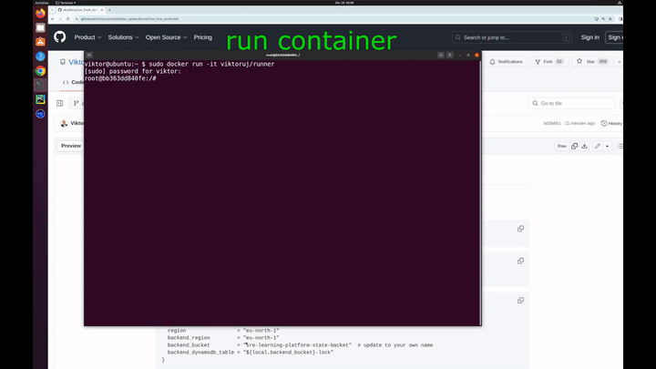

[Русский](getting_started_RU.md) · [English](getting_started.md) · [Español](getting_started_ES.md) · [Français](getting_started_FR.md) · [Deutsch](getting_started_DE.md) · ქართული · [繁體中文](getting_started_TW.md) · [日本語](getting_started_JP.md) · [მთავარი გვერდი](../README_GE.MD)

<a id="quick-start"></a>

# დაწყება და მოთხოვნები

კურსების წასაკითხად რეპოზიტორიის გახსნა საკმარისია. პრაქტიკული გარემოებისთვის AWS და პლატფორმის ხელსაწყოები დაგჭირდებათ. რესურსების საფასური თქვენს AWS ანგარიშს ერიცხება; სამუშაოს დასრულების შემდეგ გარემო სცენარის ინსტრუქციით წაშალეთ.

## 1. მოამზადეთ ხელსაწყოები

შეგიძლიათ გამოიყენოთ დამოკიდებულებებით მომზადებული Docker image:

```bash
sudo docker run -it viktoruj/runner
```

[Docker-ით გაშვების ინსტრუქცია](run_from_docker_GE.MD) · [ვიდეოინსტრუქცია](https://youtu.be/Xh6sWzafBmw)

[](https://youtu.be/Xh6sWzafBmw "პლატფორმის გაშვება Docker-ით")

<details>
<summary>ლოკალური დაყენების მოთხოვნები</summary>

- [GNU Make](https://www.gnu.org/software/make/) ≥ 4.2.1.
- [Terraform](https://developer.hashicorp.com/terraform/tutorials/aws-get-started/install-cli) ≥ 1.6.6.
- [Terragrunt](https://terragrunt.gruntwork.io/docs/getting-started/install/) ≥ 0.54.8.
- [jq](https://jqlang.github.io/jq/download/) ≥ 1.6.
- [AWS CLI](https://docs.aws.amazon.com/cli/latest/userguide/getting-started-version.html) > 2.2.30.
- [AWS პროფილი](https://docs.aws.amazon.com/cli/latest/userguide/cli-configure-files.html) ან ავტორიზაციის სხვა გამართული მეთოდი.
- [IAM მომხმარებელი](https://docs.aws.amazon.com/IAM/latest/UserGuide/id_users_create.html) [წვდომის გასაღებით](https://docs.aws.amazon.com/IAM/latest/UserGuide/id_credentials_access-keys.html), ან [IAM როლი](https://docs.aws.amazon.com/IAM/latest/UserGuide/id_roles.html), სცენარის რესურსების შექმნისა და წაშლის უფლებებით. საწყისი კონფიგურაცია VPC-ზე, EC2-ზე, IAM-სა და EKS-ზე ფართო უფლებებს ითვალისწინებს; იხილეთ [AWS-ის წვდომის პოლიტიკები](https://docs.aws.amazon.com/IAM/latest/UserGuide/access_policies.html).

ეს პლატფორმის დოკუმენტაციაში მითითებული საწყისი მინიმალური ვერსიებია. დამატებითი მოთხოვნები ხელსაწყოებისა და provider-ების მიმართ არჩეულ სცენარსა და მის Terraform-კონფიგურაციაში შეამოწმეთ.

</details>

## 2. მიიღეთ რეპოზიტორია და დააყენეთ AWS

შემდეგი ბრძანებები Docker-კონტეინერში ან ხელსაწყოებით აღჭურვილ მანქანაზე შეასრულეთ:

```bash
git clone https://github.com/ViktorUJ/cks.git
cd cks
```

დააყენეთ AWS-ზე წვდომა. [terraform/environments/terragrunt.hcl](../terraform/environments/terragrunt.hcl)-ში მიუთითეთ თქვენი `backend_bucket`; საჭიროებისას შეცვალეთ `region` და `backend_region`. შეამოწმეთ სცენარის `env.hcl`-ის რეგიონი და პარამეტრები. დეტალები მოცემულია [Docker-ის ინსტრუქციაში](run_from_docker_GE.MD).

## 3. აირჩიეთ და გაუშვით სამუშაო

CKA + CKAD-ის პირველი კომპლექსური ლაბორატორიული სამუშაოს მაგალითი:

```bash
TASK=101 make run_cka_task
```

გახსენით [ლაბორატორიული სამუშაო 101](../tasks/cka/labs/101/README_GE.MD), დაუკავშირდით Terraform-ის გამოტანილი მონაცემებით და შეასრულეთ დავალებები.

## 4. წაშალეთ გარემო

სამუშაოს შემდეგ მიჰყევით მის წაშლის ინსტრუქციას და შეასრულეთ:

```bash
TASK=101 make delete_cka_task
```

სხვა სამუშაოსთვის შეცვალეთ ნომერი და გამოიყენეთ შესაბამისი მიმართულების ბრძანება [ბრძანებების ცნობარიდან](commands_GE.md).
