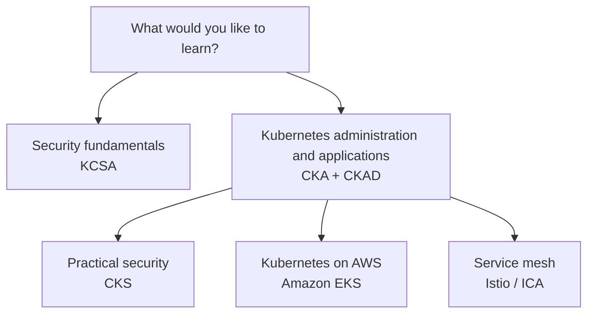

[Русский](learning_paths_RU.md) · English · [Español](learning_paths_ES.md) · [Français](learning_paths_FR.md) · [Deutsch](learning_paths_DE.md) · [ქართული](learning_paths_GE.md) · [繁體中文](learning_paths_TW.md) · [日本語](learning_paths_JP.md) · [Home](../README.MD)

# Learning paths and practice

## Where to start

- **New to Kubernetes?** Open [CKA + CKAD](../tasks/cka/course/README.md). The introductory section reviews networking, DNS, TLS, containers, Linux, YAML, and vim.
- **Want to understand security fundamentals?** Start with [KCSA](../tasks/kcsa/course/README.md): it explains threats and protective mechanisms. You will then need confident Kubernetes administration skills for the practical CKS course.
- **Already administer Kubernetes and want to go deeper into security?** Continue with [CKS](../tasks/cks/course/README.md).
- **Planning to work with Kubernetes on AWS?** After mastering administration fundamentals, choose [Amazon EKS](../tasks/eks/course/README.md).
- **Need service mesh and Istio?** Once you know Kubernetes, continue with [Istio / ICA](../tasks/ica/README.MD).

A useful sequence is **course chapter → related lab → result validation → solution review**. Once you have mastered the core topics, move on to timed mock exams. KCSA practice is based on multiple-choice questions and mock tests.

## Labs and mock exams

**Labs** let you practice an individual topic or several related skills. Composite labs include tasks, acceptance criteria, automated `check_result` validation, and reference solutions.

**Mock exams** combine tasks into an independent training session. Practical environments provide a workstation, the necessary tools, result validation, and, where supported by the scenario, `time_left` to check the remaining time.

- [CKA, CKS, ICA, and EKS lab catalog](labs.MD).
- Practical mock exams: [CKA](../tasks/cka/mock), [CKAD](../tasks/ckad/mock), [CKS](../tasks/cks/mock), [ICA](../tasks/ica/mock), [LFCS](../tasks/lfcs/mock).
- Test materials: [KCNA mock exam 01](../tasks/kcna/mock/01/README.MD), [KCSA](../tasks/kcsa/README.md), [AWS Certified AI Practitioner mock exam 01](../tasks/aws_AI_practitioner/mock/01/README.MD).
- [HR scenarios](../tasks/hr/mock) for assessing practical skills.

The description of each exercise is the primary source of instructions: it specifies the environment, how to connect, the tasks, validation, and resource deletion.

Official certification pages

- [CKA - Certified Kubernetes Administrator](https://training.linuxfoundation.org/certification/certified-kubernetes-administrator-cka/)
- [CKAD - Certified Kubernetes Application Developer](https://training.linuxfoundation.org/certification/certified-kubernetes-application-developer-ckad/)
- [CKS - Certified Kubernetes Security Specialist](https://training.linuxfoundation.org/certification/certified-kubernetes-security-specialist/)
- [ICA - Istio Certified Associate](https://training.linuxfoundation.org/certification/istio-certified-associate-ica/)
- [KCNA - Kubernetes and Cloud Native Associate](https://training.linuxfoundation.org/certification/kubernetes-cloud-native-associate/)
- [KCSA - Kubernetes and Cloud Native Security Associate](https://training.linuxfoundation.org/certification/kubernetes-and-cloud-native-security-associate-kcsa/)
- [LFCS - Linux Foundation Certified System Administrator](https://training.linuxfoundation.org/certification/linux-foundation-certified-sysadmin-lfcs/)
- [AWS Certified AI Practitioner](https://aws.amazon.com/certification/certified-ai-practitioner/)

