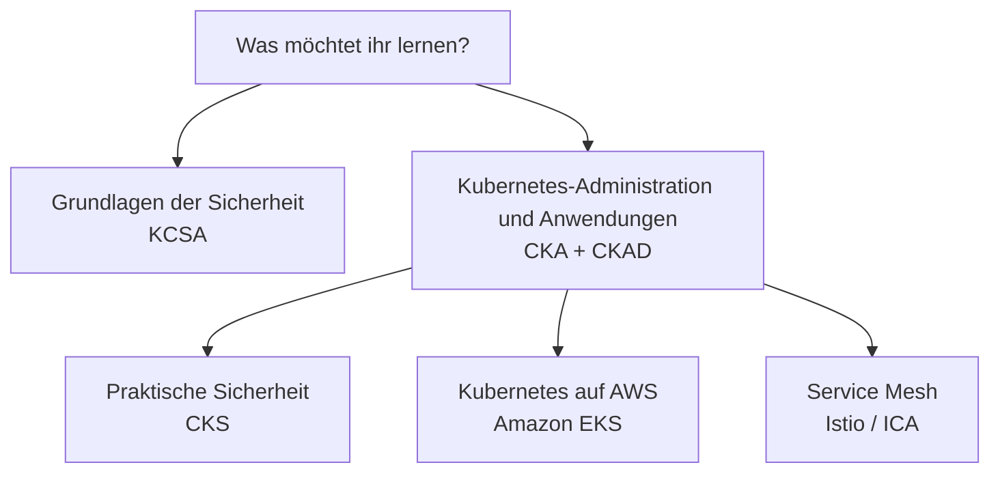

[Русский](learning_paths_RU.md) · [English](learning_paths.md) · [Español](learning_paths_ES.md) · [Français](learning_paths_FR.md) · Deutsch · [ქართული](learning_paths_GE.md) · [繁體中文](learning_paths_TW.md) · [日本語](learning_paths_JP.md) · [Startseite](../README_DE.MD)

# Lernpfade und Praxis

## Wo anfangen

- **Neu bei Kubernetes?** Öffnet [CKA + CKAD](../tasks/cka/course/README_DE.md). Der Einstieg wiederholt Netzwerke, DNS, TLS, Container, Linux, YAML und vim.
- **Ihr möchtet Sicherheitsgrundlagen verstehen?** Beginnt mit [KCSA](../tasks/kcsa/course/README_DE.md): Der Kurs erklärt Bedrohungen und Schutzmechanismen. Für den praktischen CKS-Kurs braucht ihr anschließend sichere Kubernetes-Administrationskenntnisse.
- **Ihr administriert Kubernetes bereits und möchtet Sicherheit vertiefen?** Macht mit [CKS](../tasks/cks/course/README_DE.md) weiter.
- **Ihr plant Kubernetes auf AWS einzusetzen?** Wählt nach den Administrationsgrundlagen [Amazon EKS](../tasks/eks/course/README_DE.md).
- **Ihr braucht Service Mesh und Istio?** Nach dem Kubernetes-Einstieg folgt [Istio / ICA](../tasks/ica/README_DE.MD).

Eine sinnvolle Reihenfolge ist **Kurskapitel → zugehöriges Lab → Ergebnisprüfung → Lösungsbesprechung**. Wenn die Kernthemen sitzen, folgen Probeprüfungen unter Zeitdruck. KCSA nutzt Multiple-Choice-Fragen und Probetests.

## Labs und Probeprüfungen

**Labs** üben ein Thema oder mehrere zusammenhängende Fähigkeiten. Zusammengesetzte Labs enthalten Aufgaben, Akzeptanzkriterien, automatische Prüfung mit `check_result` und Referenzlösungen.

**Probeprüfungen** bündeln Aufgaben für ein eigenständiges Training. Praktische Umgebungen bieten einen Arbeitsrechner, Werkzeuge, Ergebnisprüfung und, soweit vorgesehen, `time_left` zur Anzeige der Restzeit.

- [Lab-Katalog für CKA, CKS, ICA und EKS](labs.MD).
- Praktische Probeprüfungen: [CKA](../tasks/cka/mock), [CKAD](../tasks/ckad/mock), [CKS](../tasks/cks/mock), [ICA](../tasks/ica/mock), [LFCS](../tasks/lfcs/mock).
- Testmaterialien: [KCNA-Probeprüfung Nr. 01](../tasks/kcna/mock/01/README.MD), [KCSA](../tasks/kcsa/README_DE.md), [AWS Certified AI Practitioner-Probeprüfung Nr. 01](../tasks/aws_AI_practitioner/mock/01/README.MD).
- [HR-Szenarien](../tasks/hr/mock) zur Bewertung praktischer Fähigkeiten.

Die Übungsbeschreibung ist die maßgebliche Anleitung: Sie nennt Umgebung, Verbindung, Aufgaben, Prüfung und Ressourcenlöschung.

Offizielle Zertifizierungsseiten

- [CKA - Certified Kubernetes Administrator](https://training.linuxfoundation.org/certification/certified-kubernetes-administrator-cka/)
- [CKAD - Certified Kubernetes Application Developer](https://training.linuxfoundation.org/certification/certified-kubernetes-application-developer-ckad/)
- [CKS - Certified Kubernetes Security Specialist](https://training.linuxfoundation.org/certification/certified-kubernetes-security-specialist/)
- [ICA - Istio Certified Associate](https://training.linuxfoundation.org/certification/istio-certified-associate-ica/)
- [KCNA - Kubernetes and Cloud Native Associate](https://training.linuxfoundation.org/certification/kubernetes-cloud-native-associate/)
- [KCSA - Kubernetes and Cloud Native Security Associate](https://training.linuxfoundation.org/certification/kubernetes-and-cloud-native-security-associate-kcsa/)
- [LFCS - Linux Foundation Certified System Administrator](https://training.linuxfoundation.org/certification/linux-foundation-certified-sysadmin-lfcs/)
- [AWS Certified AI Practitioner](https://aws.amazon.com/certification/certified-ai-practitioner/)

