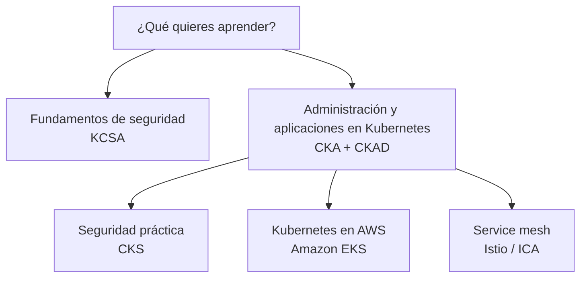

[Русский](learning_paths_RU.md) · [English](learning_paths.md) · Español · [Français](learning_paths_FR.md) · [Deutsch](learning_paths_DE.md) · [ქართული](learning_paths_GE.md) · [繁體中文](learning_paths_TW.md) · [日本語](learning_paths_JP.md) · [Página principal](../README_ES.MD)

# Rutas de aprendizaje y práctica

## Por dónde empezar

- **¿Empiezas con Kubernetes?** Abre [CKA + CKAD](../tasks/cka/course/README_ES.md). La introducción repasa redes, DNS, TLS, contenedores, Linux, YAML y vim.
- **¿Quieres entender los fundamentos de seguridad?** Empieza con [KCSA](../tasks/kcsa/course/README_ES.md): explica las amenazas y los mecanismos de protección. Después necesitarás dominar la administración de Kubernetes para el curso práctico CKS.
- **¿Ya administras Kubernetes y quieres profundizar en seguridad?** Continúa con [CKS](../tasks/cks/course/README_ES.md).
- **¿Vas a trabajar con Kubernetes en AWS?** Tras dominar los fundamentos de administración, elige [Amazon EKS](../tasks/eks/course/README_ES.md).
- **¿Necesitas service mesh e Istio?** Cuando conozcas Kubernetes, continúa con [Istio / ICA](../tasks/ica/README_ES.MD).

Un orden útil es **capítulo del curso → laboratorio relacionado → comprobación del resultado → revisión de la solución**. Cuando domines los temas principales, pasa a los simulacros cronometrados. La práctica de KCSA se basa en preguntas de opción múltiple y simulacros.

## Laboratorios y simulacros de examen

Los **laboratorios** permiten practicar un tema o varias habilidades relacionadas. Los laboratorios compuestos incluyen tareas, criterios de aceptación, validación automática con `check_result` y soluciones de referencia.

Los **simulacros de examen** reúnen tareas para entrenar de forma independiente. Los entornos prácticos proporcionan una máquina de trabajo, herramientas, validación de resultados y, cuando el escenario lo permite, `time_left` para consultar el tiempo restante.

- [Catálogo de laboratorios CKA, CKS, ICA y EKS](labs.MD).
- Simulacros prácticos: [CKA](../tasks/cka/mock), [CKAD](../tasks/ckad/mock), [CKS](../tasks/cks/mock), [ICA](../tasks/ica/mock), [LFCS](../tasks/lfcs/mock).
- Materiales de evaluación: [Simulacro KCNA n.º 01](../tasks/kcna/mock/01/README.MD), [KCSA](../tasks/kcsa/README_ES.md), [Simulacro AWS Certified AI Practitioner n.º 01](../tasks/aws_AI_practitioner/mock/01/README.MD).
- [Escenarios de selección de personal](../tasks/hr/mock) para evaluar habilidades prácticas.

La descripción de cada ejercicio es la fuente principal de instrucciones: especifica el entorno, cómo conectarse, las tareas, la validación y la eliminación de recursos.

Páginas oficiales de las certificaciones

- [CKA - Certified Kubernetes Administrator](https://training.linuxfoundation.org/certification/certified-kubernetes-administrator-cka/)
- [CKAD - Certified Kubernetes Application Developer](https://training.linuxfoundation.org/certification/certified-kubernetes-application-developer-ckad/)
- [CKS - Certified Kubernetes Security Specialist](https://training.linuxfoundation.org/certification/certified-kubernetes-security-specialist/)
- [ICA - Istio Certified Associate](https://training.linuxfoundation.org/certification/istio-certified-associate-ica/)
- [KCNA - Kubernetes and Cloud Native Associate](https://training.linuxfoundation.org/certification/kubernetes-cloud-native-associate/)
- [KCSA - Kubernetes and Cloud Native Security Associate](https://training.linuxfoundation.org/certification/kubernetes-and-cloud-native-security-associate-kcsa/)
- [LFCS - Linux Foundation Certified System Administrator](https://training.linuxfoundation.org/certification/linux-foundation-certified-sysadmin-lfcs/)
- [AWS Certified AI Practitioner](https://aws.amazon.com/certification/certified-ai-practitioner/)

