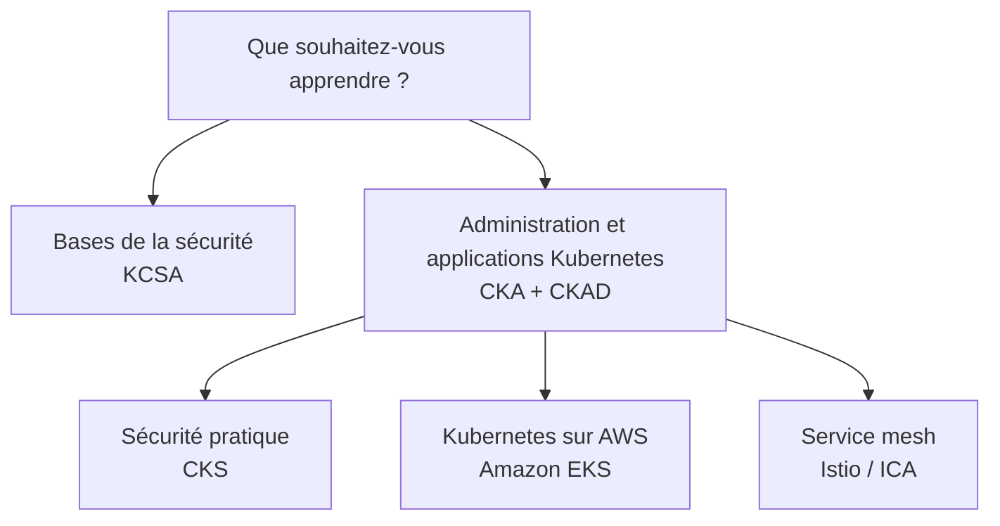

[Русский](learning_paths_RU.md) · [English](learning_paths.md) · [Español](learning_paths_ES.md) · Français · [Deutsch](learning_paths_DE.md) · [ქართული](learning_paths_GE.md) · [繁體中文](learning_paths_TW.md) · [日本語](learning_paths_JP.md) · [Accueil](../README_FR.MD)

# Parcours d'apprentissage et pratique

## Par où commencer

- **Vous débutez avec Kubernetes ?** Ouvrez [CKA + CKAD](../tasks/cka/course/README_FR.md). La partie introductive reprend les réseaux, DNS, TLS, les conteneurs, Linux, YAML et vim.
- **Vous voulez comprendre les bases de la sécurité ?** Commencez par [KCSA](../tasks/kcsa/course/README_FR.md), qui explique les menaces et les mécanismes de protection. Vous devrez ensuite maîtriser l'administration de Kubernetes pour suivre le cours pratique CKS.
- **Vous administrez déjà Kubernetes et souhaitez approfondir la sécurité ?** Poursuivez avec [CKS](../tasks/cks/course/README_FR.md).
- **Vous prévoyez de travailler avec Kubernetes sur AWS ?** Après les bases de l'administration, choisissez [Amazon EKS](../tasks/eks/course/README_FR.md).
- **Vous avez besoin de service mesh et d'Istio ?** Une fois Kubernetes acquis, poursuivez avec [Istio / ICA](../tasks/ica/README_FR.MD).

Un parcours utile est **chapitre du cours → travail pratique associé → validation du résultat → étude de la solution**. Une fois les principaux sujets maîtrisés, passez aux examens blancs chronométrés. La pratique KCSA repose sur des questions à choix multiple et des tests blancs.

## Travaux pratiques et examens blancs

Les **travaux pratiques** permettent de travailler un sujet ou plusieurs compétences liées. Les exercices composites comprennent les tâches, les critères d'acceptation, la validation automatique avec `check_result` et les solutions de référence.

Les **examens blancs** regroupent des tâches pour un entraînement autonome. Les environnements pratiques fournissent une machine de travail, les outils, la validation et, lorsque le scénario le prévoit, `time_left` pour consulter le temps restant.

- [Catalogue des travaux pratiques CKA, CKS, ICA et EKS](labs.MD).
- Examens blancs pratiques: [CKA](../tasks/cka/mock), [CKAD](../tasks/ckad/mock), [CKS](../tasks/cks/mock), [ICA](../tasks/ica/mock), [LFCS](../tasks/lfcs/mock).
- Ressources d'évaluation: [Examen blanc KCNA n° 01](../tasks/kcna/mock/01/README.MD), [KCSA](../tasks/kcsa/README_FR.md), [Examen blanc AWS Certified AI Practitioner n° 01](../tasks/aws_AI_practitioner/mock/01/README.MD).
- [Scénarios de recrutement](../tasks/hr/mock) pour évaluer les compétences pratiques.

La description de chaque exercice est la référence principale : elle précise l'environnement, la connexion, les tâches, la validation et la suppression des ressources.

Pages officielles des certifications

- [CKA - Certified Kubernetes Administrator](https://training.linuxfoundation.org/certification/certified-kubernetes-administrator-cka/)
- [CKAD - Certified Kubernetes Application Developer](https://training.linuxfoundation.org/certification/certified-kubernetes-application-developer-ckad/)
- [CKS - Certified Kubernetes Security Specialist](https://training.linuxfoundation.org/certification/certified-kubernetes-security-specialist/)
- [ICA - Istio Certified Associate](https://training.linuxfoundation.org/certification/istio-certified-associate-ica/)
- [KCNA - Kubernetes and Cloud Native Associate](https://training.linuxfoundation.org/certification/kubernetes-cloud-native-associate/)
- [KCSA - Kubernetes and Cloud Native Security Associate](https://training.linuxfoundation.org/certification/kubernetes-and-cloud-native-security-associate-kcsa/)
- [LFCS - Linux Foundation Certified System Administrator](https://training.linuxfoundation.org/certification/linux-foundation-certified-sysadmin-lfcs/)
- [AWS Certified AI Practitioner](https://aws.amazon.com/certification/certified-ai-practitioner/)

