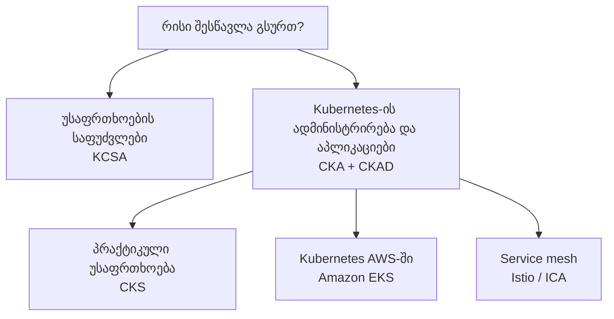

[Русский](learning_paths_RU.md) · [English](learning_paths.md) · [Español](learning_paths_ES.md) · [Français](learning_paths_FR.md) · [Deutsch](learning_paths_DE.md) · ქართული · [繁體中文](learning_paths_TW.md) · [日本語](learning_paths_JP.md) · [მთავარი გვერდი](../README_GE.MD)

# სასწავლო მარშრუტები და პრაქტიკა

## საიდან დაიწყოთ

- **Kubernetes-ის შესწავლას იწყებთ?** გახსენით [CKA + CKAD](../tasks/cka/course/README_GE.md). შესავალი ნაწილი ქსელების, DNS-ის, TLS-ის, კონტეინერების, Linux-ის, YAML-ისა და vim-ის გამეორებაში დაგეხმარებათ.
- **უსაფრთხოების საფუძვლების გაგება გსურთ?** დაიწყეთ [KCSA-ით](../tasks/kcsa/course/README_GE.md): კურსი საფრთხეებსა და დაცვის მექანიზმებს ხსნის. პრაქტიკული CKS-ისთვის შემდეგ Kubernetes-ის ადმინისტრირების მყარი ცოდნა დაგჭირდებათ.
- **უკვე მართავთ Kubernetes-ს და უსაფრთხოების გაღრმავება გსურთ?** გადადით [CKS-ზე](../tasks/cks/course/README_GE.md).
- **Kubernetes-თან AWS-ში მუშაობას გეგმავთ?** ადმინისტრირების საფუძვლების შემდეგ აირჩიეთ [Amazon EKS](../tasks/eks/course/README_GE.md).
- **Service mesh და Istio გჭირდებათ?** Kubernetes-ის გაცნობის შემდეგ გადადით [Istio / ICA-ზე](../tasks/ica/README_GE.MD).

მოსახერხებელი თანმიმდევრობაა **კურსის თავი → შესაბამისი ლაბორატორიული სამუშაო → შედეგის შემოწმება → გადაწყვეტის განხილვა**. ძირითადი თემების ათვისების შემდეგ გაიარეთ საცდელი გამოცდები დროის შეზღუდვით. KCSA-ს პრაქტიკა პასუხის არჩევით კითხვებსა და საცდელ ტესტებს ეფუძნება.

## ლაბორატორიული სამუშაოები და საცდელი გამოცდები

**ლაბორატორიული სამუშაოები** ცალკეული თემის ან რამდენიმე დაკავშირებული უნარის დამუშავებაში გეხმარებათ. კომპლექსური სამუშაოები მოიცავს დავალებებს, მიღების კრიტერიუმებს, `check_result`-ით ავტომატურ შემოწმებასა და ეტალონურ გადაწყვეტებს.

**საცდელი გამოცდები** დავალებებს დამოუკიდებელ ვარჯიშად აერთიანებს. პრაქტიკული გარემოები მოიცავს სამუშაო მანქანას, ხელსაწყოებს, შედეგის შემოწმებას და, სადაც სცენარი ითვალისწინებს, `time_left` ბრძანებას დარჩენილი დროის სანახავად.

- [CKA, CKS, ICA და EKS ლაბორატორიული სამუშაოების კატალოგი](labs.MD).
- პრაქტიკული საცდელი გამოცდები: [CKA](../tasks/cka/mock), [CKAD](../tasks/ckad/mock), [CKS](../tasks/cks/mock), [ICA](../tasks/ica/mock), [LFCS](../tasks/lfcs/mock).
- სატესტო მასალები: [KCNA-ს საცდელი გამოცდა № 01](../tasks/kcna/mock/01/README.MD), [KCSA](../tasks/kcsa/README_GE.md), [AWS Certified AI Practitioner-ის საცდელი გამოცდა № 01](../tasks/aws_AI_practitioner/mock/01/README.MD).
- [HR-სცენარები](../tasks/hr/mock) პრაქტიკული უნარების შესაფასებლად.

თითოეული სამუშაოს აღწერა ინსტრუქციის მთავარი წყაროა: მასში მოცემულია გარემო, დაკავშირების გზა, დავალებები, შემოწმება და რესურსების წაშლა.

სერტიფიკაციების ოფიციალური გვერდები

- [CKA - Certified Kubernetes Administrator](https://training.linuxfoundation.org/certification/certified-kubernetes-administrator-cka/)
- [CKAD - Certified Kubernetes Application Developer](https://training.linuxfoundation.org/certification/certified-kubernetes-application-developer-ckad/)
- [CKS - Certified Kubernetes Security Specialist](https://training.linuxfoundation.org/certification/certified-kubernetes-security-specialist/)
- [ICA - Istio Certified Associate](https://training.linuxfoundation.org/certification/istio-certified-associate-ica/)
- [KCNA - Kubernetes and Cloud Native Associate](https://training.linuxfoundation.org/certification/kubernetes-cloud-native-associate/)
- [KCSA - Kubernetes and Cloud Native Security Associate](https://training.linuxfoundation.org/certification/kubernetes-and-cloud-native-security-associate-kcsa/)
- [LFCS - Linux Foundation Certified System Administrator](https://training.linuxfoundation.org/certification/linux-foundation-certified-sysadmin-lfcs/)
- [AWS Certified AI Practitioner](https://aws.amazon.com/certification/certified-ai-practitioner/)

