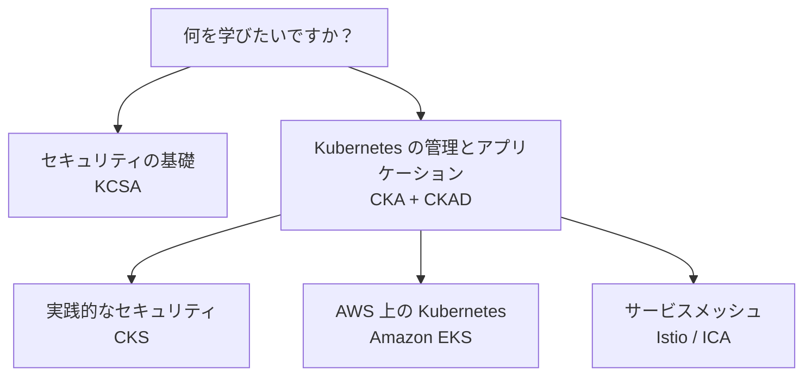

[Русский](learning_paths_RU.md) · [English](learning_paths.md) · [Español](learning_paths_ES.md) · [Français](learning_paths_FR.md) · [Deutsch](learning_paths_DE.md) · [ქართული](learning_paths_GE.md) · [繁體中文](learning_paths_TW.md) · 日本語 · [ホーム](../README_JP.MD)

# 学習ルートと実践

## どこから始めるか

- **Kubernetes を初めて学ぶ方へ。** [CKA + CKAD](../tasks/cka/course/README_JP.md) を開いてください。導入部ではネットワーク、DNS、TLS、コンテナ、Linux、YAML、vim を復習できます。
- **セキュリティの基礎を理解したい方へ。** [KCSA](../tasks/kcsa/course/README_JP.md) で脅威と防御の仕組みを学びましょう。その後、実践的な CKS コースには十分な Kubernetes 管理スキルが必要です。
- **Kubernetes を管理でき、セキュリティを深めたい方へ。** [CKS](../tasks/cks/course/README_JP.md) に進んでください。
- **AWS で Kubernetes を運用する予定の方へ。** 管理の基礎を身に付けたら [Amazon EKS](../tasks/eks/course/README_JP.md) を選びましょう。
- **サービスメッシュや Istio が必要な方へ。** Kubernetes を理解した後、[Istio / ICA](../tasks/ica/README_JP.MD) に進んでください。

おすすめの順序は **コースの章 → 対応するラボ → 結果の検証 → 解答の確認** です。主要なテーマを習得したら、時間を計って模擬試験に取り組みましょう。KCSA の演習は選択問題と模擬テストが中心です。

## ラボと模擬試験

**ラボ**では個別のテーマや関連する複数のスキルを練習します。総合ラボには課題、合格条件、`check_result` による自動検証、参考解答が含まれます。

**模擬試験**は複数の課題を組み合わせた自主トレーニングです。実践環境には作業用マシン、ツール、結果の検証が用意され、対応するシナリオでは `time_left` で残り時間を確認できます。

- [CKA、CKS、ICA、EKS のラボ一覧](labs.MD).
- 実技形式の模擬試験: [CKA](../tasks/cka/mock), [CKAD](../tasks/ckad/mock), [CKS](../tasks/cks/mock), [ICA](../tasks/ica/mock), [LFCS](../tasks/lfcs/mock).
- テスト教材: [KCNA 模擬試験 01](../tasks/kcna/mock/01/README.MD), [KCSA](../tasks/kcsa/README_JP.md), [AWS Certified AI Practitioner 模擬試験 01](../tasks/aws_AI_practitioner/mock/01/README.MD).
- [採用向けシナリオ](../tasks/hr/mock) で実践スキルを評価できます。

各演習の説明を主な手順として参照してください。環境構成、接続方法、課題、検証、リソース削除の方法が記載されています。

認定資格の公式ページ

- [CKA - Certified Kubernetes Administrator](https://training.linuxfoundation.org/certification/certified-kubernetes-administrator-cka/)
- [CKAD - Certified Kubernetes Application Developer](https://training.linuxfoundation.org/certification/certified-kubernetes-application-developer-ckad/)
- [CKS - Certified Kubernetes Security Specialist](https://training.linuxfoundation.org/certification/certified-kubernetes-security-specialist/)
- [ICA - Istio Certified Associate](https://training.linuxfoundation.org/certification/istio-certified-associate-ica/)
- [KCNA - Kubernetes and Cloud Native Associate](https://training.linuxfoundation.org/certification/kubernetes-cloud-native-associate/)
- [KCSA - Kubernetes and Cloud Native Security Associate](https://training.linuxfoundation.org/certification/kubernetes-and-cloud-native-security-associate-kcsa/)
- [LFCS - Linux Foundation Certified System Administrator](https://training.linuxfoundation.org/certification/linux-foundation-certified-sysadmin-lfcs/)
- [AWS Certified AI Practitioner](https://aws.amazon.com/certification/certified-ai-practitioner/)

