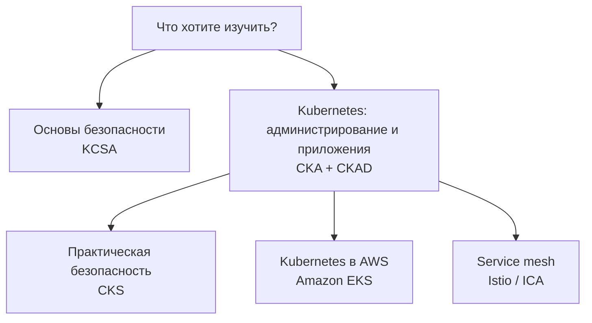

Русский · [English](learning_paths.md) · [Español](learning_paths_ES.md) · [Français](learning_paths_FR.md) · [Deutsch](learning_paths_DE.md) · [ქართული](learning_paths_GE.md) · [繁體中文](learning_paths_TW.md) · [日本語](learning_paths_JP.md) · [На главную](../README_RU.MD)

# Учебные маршруты и практика

## С чего начать

- **Начинаете изучать Kubernetes?** Откройте [CKA + CKAD](../tasks/cka/course/README_RU.md). Вводная часть поможет повторить сети, DNS, TLS, контейнеры, Linux, YAML и vim.
- **Хотите понять основы безопасности?** Начните с [KCSA](../tasks/kcsa/course/README_RU.md): курс объясняет угрозы и защитные механизмы. Для практического курса CKS затем потребуется уверенное администрирование Kubernetes.
- **Уже умеете администрировать Kubernetes и хотите углубиться в безопасность?** Переходите к [CKS](../tasks/cks/course/README_RU.md).
- **Планируете работать с Kubernetes в AWS?** После освоения основ администрирования выбирайте [Amazon EKS](../tasks/eks/course/README_RU.md).
- **Нужны service mesh и Istio?** После знакомства с Kubernetes переходите к [Istio / ICA](../tasks/ica/README_RU.MD).

Удобный порядок работы: **глава курса → связанная лабораторная → проверка результата → разбор решения**. Когда освоите основные темы, переходите к пробным экзаменам на время. В KCSA практика построена вокруг тестовых вопросов и пробных тестов.

## Лабораторные и пробные экзамены

**Лабораторные** помогают отработать отдельную тему или несколько связанных навыков. В комплексных работах есть задания, критерии приёмки, автоматическая проверка `check_result` и эталонные решения.

**Пробные экзамены** объединяют задания в самостоятельную тренировку. В практических окружениях доступны рабочая машина, необходимые инструменты, проверка результата и, где предусмотрено сценарием, команда `time_left` для контроля оставшегося времени.

- [Каталог лабораторных CKA, CKS, ICA и EKS](labs.MD).
- Практические пробные экзамены: [CKA](../tasks/cka/mock), [CKAD](../tasks/ckad/mock), [CKS](../tasks/cks/mock), [ICA](../tasks/ica/mock), [LFCS](../tasks/lfcs/mock).
- Тестовые материалы: [мок-экзамен KCNA № 01](../tasks/kcna/mock/01/README.MD), [KCSA](../tasks/kcsa/README_RU.md), [мок-экзамен AWS Certified AI Practitioner № 01](../tasks/aws_AI_practitioner/mock/01/README.MD).
- [HR-сценарии](../tasks/hr/mock) для проверки практических навыков.

Описание конкретной работы - основной источник инструкций: в нём указаны состав окружения, способ подключения, задания, проверка и порядок удаления ресурсов.

Официальные страницы сертификаций

- [CKA - Certified Kubernetes Administrator](https://training.linuxfoundation.org/certification/certified-kubernetes-administrator-cka/)
- [CKAD - Certified Kubernetes Application Developer](https://training.linuxfoundation.org/certification/certified-kubernetes-application-developer-ckad/)
- [CKS - Certified Kubernetes Security Specialist](https://training.linuxfoundation.org/certification/certified-kubernetes-security-specialist/)
- [ICA - Istio Certified Associate](https://training.linuxfoundation.org/certification/istio-certified-associate-ica/)
- [KCNA - Kubernetes and Cloud Native Associate](https://training.linuxfoundation.org/certification/kubernetes-cloud-native-associate/)
- [KCSA - Kubernetes and Cloud Native Security Associate](https://training.linuxfoundation.org/certification/kubernetes-and-cloud-native-security-associate-kcsa/)
- [LFCS - Linux Foundation Certified System Administrator](https://training.linuxfoundation.org/certification/linux-foundation-certified-sysadmin-lfcs/)
- [AWS Certified AI Practitioner](https://aws.amazon.com/certification/certified-ai-practitioner/)

