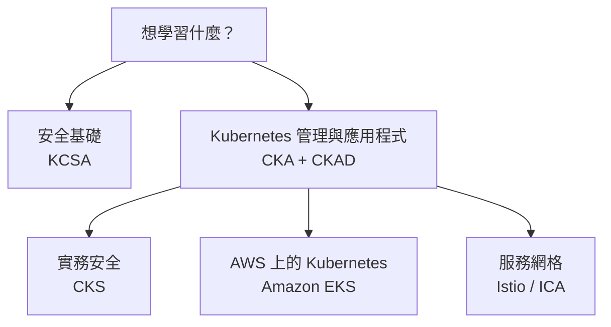

[Русский](learning_paths_RU.md) · [English](learning_paths.md) · [Español](learning_paths_ES.md) · [Français](learning_paths_FR.md) · [Deutsch](learning_paths_DE.md) · [ქართული](learning_paths_GE.md) · 繁體中文 · [日本語](learning_paths_JP.md) · [首頁](../README_TW.MD)

# 學習路徑與實作

## 從哪裡開始

- **剛開始學習 Kubernetes？** 請開啟 [CKA + CKAD](../tasks/cka/course/README_TW.md)。入門部分會複習網路、DNS、TLS、容器、Linux、YAML 和 vim。
- **想了解安全基礎？** 從 [KCSA](../tasks/kcsa/course/README_TW.md) 開始，了解威脅與防護機制。之後要學習實務型 CKS 課程，還需要熟練的 Kubernetes 管理能力。
- **已能管理 Kubernetes，想深入安全領域？** 請繼續學習 [CKS](../tasks/cks/course/README_TW.md)。
- **計畫在 AWS 上使用 Kubernetes？** 掌握管理基礎後，請選擇 [Amazon EKS](../tasks/eks/course/README_TW.md)。
- **需要服務網格與 Istio？** 熟悉 Kubernetes 後，請繼續學習 [Istio / ICA](../tasks/ica/README_TW.MD)。

建議順序是 **課程章節 → 對應實作 → 驗證結果 → 閱讀解答**。掌握主要主題後，再進行限時模擬考試。KCSA 的練習以選擇題和模擬測驗為主。

## 實作練習與模擬考試

**實作練習**協助您熟悉單一主題或多項相關技能。綜合練習包含任務、驗收條件、`check_result` 自動驗證及參考解答。

**模擬考試**將任務整合成可獨立完成的訓練。實作環境提供工作機、工具和結果驗證；部分情境也提供 `time_left` 以查看剩餘時間。

- [CKA、CKS、ICA 與 EKS 實作目錄](labs.MD).
- 實作型模擬考試: [CKA](../tasks/cka/mock), [CKAD](../tasks/ckad/mock), [CKS](../tasks/cks/mock), [ICA](../tasks/ica/mock), [LFCS](../tasks/lfcs/mock).
- 測驗教材: [KCNA 第 01 回模擬考試](../tasks/kcna/mock/01/README.MD), [KCSA](../tasks/kcsa/README_TW.md), [AWS Certified AI Practitioner 第 01 回模擬考試](../tasks/aws_AI_practitioner/mock/01/README.MD).
- [招募實作情境](../tasks/hr/mock) 用於評估實作技能。

每項練習的說明是主要操作依據，其中列出環境組成、連線方式、任務、驗證及資源刪除步驟。

認證官方頁面

- [CKA - Certified Kubernetes Administrator](https://training.linuxfoundation.org/certification/certified-kubernetes-administrator-cka/)
- [CKAD - Certified Kubernetes Application Developer](https://training.linuxfoundation.org/certification/certified-kubernetes-application-developer-ckad/)
- [CKS - Certified Kubernetes Security Specialist](https://training.linuxfoundation.org/certification/certified-kubernetes-security-specialist/)
- [ICA - Istio Certified Associate](https://training.linuxfoundation.org/certification/istio-certified-associate-ica/)
- [KCNA - Kubernetes and Cloud Native Associate](https://training.linuxfoundation.org/certification/kubernetes-cloud-native-associate/)
- [KCSA - Kubernetes and Cloud Native Security Associate](https://training.linuxfoundation.org/certification/kubernetes-and-cloud-native-security-associate-kcsa/)
- [LFCS - Linux Foundation Certified System Administrator](https://training.linuxfoundation.org/certification/linux-foundation-certified-sysadmin-lfcs/)
- [AWS Certified AI Practitioner](https://aws.amazon.com/certification/certified-ai-practitioner/)

