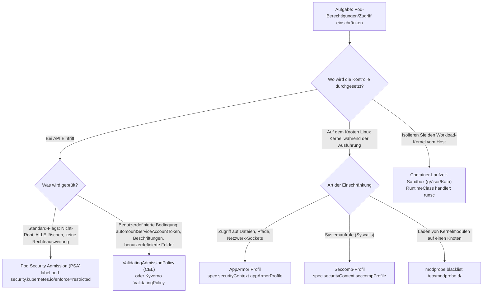
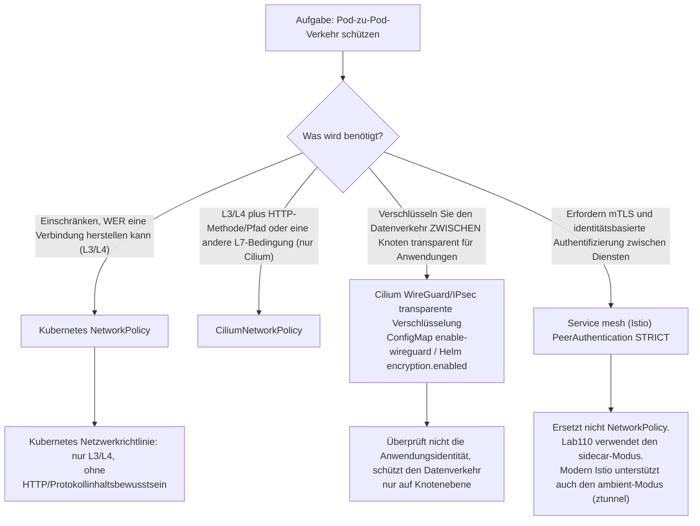
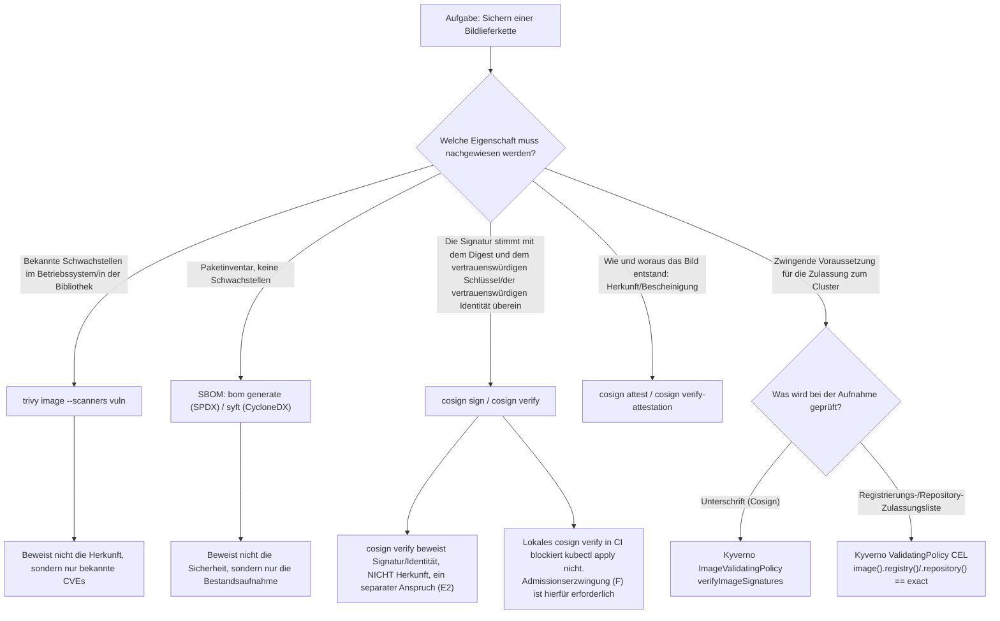
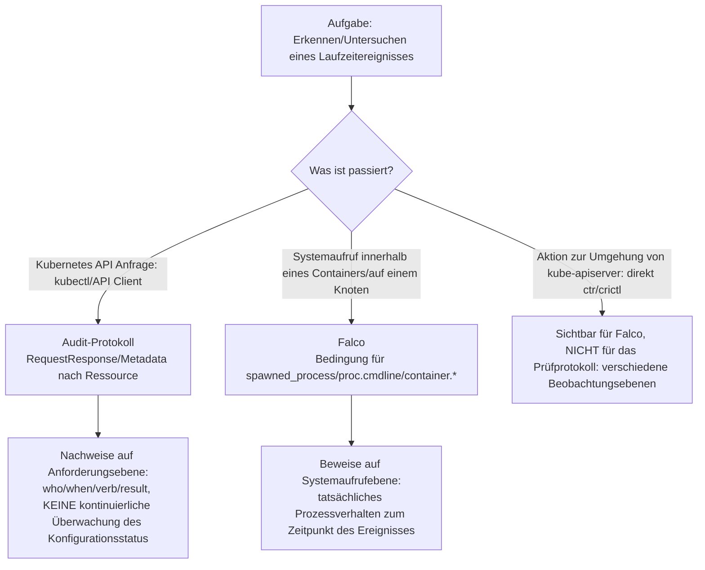

[Русская версия](CHEATSHEET_RU.md) · [Eng version](CHEATSHEET.md) · [Versión en español](CHEATSHEET_ES.md) · [Version française](CHEATSHEET_FR.md) · [ქართული ვერსია](CHEATSHEET_GE.md) · [繁體中文版](CHEATSHEET_TW.md) · [日本語版](CHEATSHEET_JP.md)

[← Kursinhalte](README_DE.md) · [Glossar](GLOSSARY_DE.md) · [Fehlerbehebungsindex (RU)](TROUBLESHOOTING_INDEX_RU.md)

# CKS-Cheatsheet: gebrauchsfertige Befehle YAML und CLI

Eine einzige Datei ohne Theorie oder lange Erklärungen: kanonische Arbeitsausschnitte aus den Lösungen zu den Kurslaboren `101-114`. Jeder Block identifiziert seine Quelle (Labor/Aufgabe), sodass Sie die vollständige Erklärung in `worker/files/solutions/1_DE.MD` des entsprechenden Labors finden können. Verwenden Sie die `Ctrl+F`/Seitensuche während eines Labors oder einer Prüfung.

> Diese Ausschnitte wurden zur schnellen Referenz aus den Laborlösungen `101-114` angepasst und gekürzt (Variablen, Einrückungen und unterstützende Schritte wurden möglicherweise vereinfacht). Wenn etwas von der neuesten Laborversion abweicht, folgen Sie der README-Datei/Lösung dieses Labors.

## So verwenden Sie diese Datei

- [Entscheidungsbäume](#decision-trees): Wenn Sie das richtige Werkzeug für eine Aufgabe auswählen müssen.
- Die Domain-Abschnitte unten: Wenn Sie wissen, was Sie brauchen und ein gebrauchsfertiges Snippet wünschen.
- [Alphabetischer Index der Begriffe und Labore](GLOSSARY_DE.md): für einen Begriff/CLI-Flag, der mit einem Kapitel verknüpft ist.
- [Symptomreferenz (RU)](TROUBLESHOOTING_INDEX_RU.md): Wenn etwas fehlgeschlagen ist und Sie die Ursache schnell finden müssen.

---

<a id="decision-trees"></a>

## Entscheidungsbäume

### Einschränken von Berechtigungen/Zugriff: PSA vs. ValidatingAdmissionPolicy vs. AppArmor vs. seccomp



### Verkehrsverschlüsselung: NetworkPolicy vs. CNI-Verschlüsselung vs. mTLS-Mesh



### Lieferkette: Scannen vs. Unterschriften vs. Herkunft/Bescheinigungen vs. SBOM vs. Zulassungsdurchsetzung



### Laufzeiterkennung: Audit-Protokolle vs. Falco vs. beide



---

## 1. Cluster Setup

### Netzwerkrichtlinie: UND, ODER und `ipBlock.except`
*Quelle: Labor 101, Aufgabe 6.*

UND: beide Selektoren im gleichen `from`-Element:

```yaml
apiVersion: networking.k8s.io/v1
kind: NetworkPolicy
metadata:
  name: allow-backend-ingress-from-legacy
  namespace: cks-101
spec:
  podSelector:
    matchLabels:
      app: backend
  policyTypes:
    - Ingress
  ingress:
    - from:
        - namespaceSelector:
            matchLabels:
              kubernetes.io/metadata.name: cks-101-legacy
          podSelector:
            matchLabels:
              app: legacy-client
      ports:
        - protocol: TCP
          port: 8080
```

ODER: separate `from`-Elemente (anders als AND oben):

```yaml
    - from:
        - namespaceSelector:
            matchLabels:
              kubernetes.io/metadata.name: cks-101-legacy
        - podSelector:
            matchLabels:
              app: legacy-client
```

`ipBlock` mit einer Ausnahme (z. B. dem Knotenmetadatenendpunkt):

```yaml
apiVersion: networking.k8s.io/v1
kind: NetworkPolicy
metadata:
  name: allow-legacy-egress
  namespace: cks-101-legacy
spec:
  podSelector:
    matchLabels:
      app: legacy-client
  policyTypes:
    - Egress
  egress:
    - to:
        - ipBlock:
            cidr: 0.0.0.0/0
            except:
              - 169.254.169.254/32
```

### CiliumNetworkPolicy: L3/L4/L7
*Quelle: Labor 102, Aufgabe 3.*

```yaml
apiVersion: cilium.io/v2
kind: CiliumNetworkPolicy
metadata:
  name: backend-policy
  namespace: cks-102
spec:
  endpointSelector:
    matchLabels:
      app: backend
  ingress:
    - fromEndpoints:
        - matchLabels:
            role: frontend
      toPorts:
        - ports:
            - port: "80"
              protocol: TCP
          rules:
            http:
              - method: GET
                path: "/"
```

### kube-bench: Ausgabe ausführen und interpretieren
*Quelle: Labor 103, Aufgabe 1.*

```bash
mkdir -p /var/work/tests/artifacts/1
scp -r /opt/kube-bench control-plane:/tmp/kube-bench
ssh control-plane 'sudo rm -rf /opt/kube-bench && sudo mv /tmp/kube-bench /opt/kube-bench'
ssh control-plane 'sudo /opt/kube-bench/kube-bench run --benchmark cis-1.12 --targets master,controlplane,node' \
  | tee /var/work/tests/artifacts/1/kube-bench.txt
grep -E '\[(PASS|WARN|FAIL)\]' /var/work/tests/artifacts/1/kube-bench.txt | head
```

> Das angeheftete `kube-bench 0.16.0` hat kein neueres Profil als `cis-1.12` (das integrierte `version_mapping` endet bei `"1.34": "cis-1.12"`). Geben Sie dieses Profil explizit an, anstatt sich auf die automatische Erkennung zu verlassen, und markieren Sie Ergebnisse für neuere Kubernetes-Versionen als `forced-approximate`.

---

## 2. Cluster Hardening

### RBAC: minimale Rolle und Rollenbindung
*Quelle: Labor 104, Aufgabe 1.*

```yaml
apiVersion: v1
kind: ServiceAccount
metadata:
  name: auditor
  namespace: security-104
---
apiVersion: rbac.authorization.k8s.io/v1
kind: Role
metadata:
  name: pod-observer
  namespace: security-104
rules:
- apiGroups: [""]
  resources: ["pods"]
  verbs: ["get", "list", "watch"]
---
apiVersion: rbac.authorization.k8s.io/v1
kind: RoleBinding
metadata:
  name: auditor-pod-observer
  namespace: security-104
subjects:
- kind: ServiceAccount
  name: auditor
  namespace: security-104
roleRef:
  apiGroup: rbac.authorization.k8s.io
  kind: Role
  name: pod-observer
```

### ServiceAccount ohne automatische Token-Montage
*Quelle: Labor 104, Aufgabe 3.*

```yaml
apiVersion: v1
kind: ServiceAccount
metadata:
  name: no-token-sa
  namespace: security-104
automountServiceAccountToken: false
---
apiVersion: v1
kind: Pod
metadata:
  name: no-token
  namespace: security-104
spec:
  serviceAccountName: no-token-sa
  automountServiceAccountToken: false
  containers:
  - name: app
    image: busybox:1.36
    command: ["sh", "-c", "sleep 3600"]
```

### Secret Volumen: `defaultMode: 0400` (= `256` dezimal)
*Quelle: Labor 104, Aufgabe 6.*

> `kubectl get pod -o json` zeigt `defaultMode: 0400` als Dezimalzahl `256` an. Das Schreiben von `defaultMode: 400` (ohne führende Null) bedeutet dezimales `400`, NICHT oktales `0400`/`256`: ein häufiger Prüfungsfehler.

```yaml
apiVersion: v1
kind: Pod
metadata:
  name: app-vulnerable
  namespace: security-104
spec:
  automountServiceAccountToken: false
  containers:
  - name: app
    image: busybox:1.36
    command: ["sh", "-c", "sleep 3600"]
    volumeMounts:
    - name: db-creds-vol
      mountPath: /etc/secrets
      readOnly: true
  volumes:
  - name: db-creds-vol
    secret:
      secretName: db-creds
      defaultMode: 0400
```

### Kubeadm-Minor-Upgrade: Zuerst die Kontrollebene, danach die Arbeiter
*Quelle: Labor 113, Aufgaben 1-2.*

> Die Reihenfolge ist wichtig: Schließen Sie das GESAMTE Upgrade der Steuerungsebene (einschließlich Uncordon) ab, bevor Sie einen Worker aktualisieren. Andernfalls verstoßen Sie gegen die Richtlinie zur Versionsabweichung. Verwenden Sie auf der Steuerungsebene `kubeadm upgrade apply`; Für Arbeiter verwenden Sie `kubeadm upgrade node` (nicht `apply`). `pkgs.k8s.io` verfügt für jede Nebenversion über ein separates Apt-Repository. Schalten Sie `sources.list.d/kubernetes.list` VOR `apt install kubeadm` auf das Ziel-Moll um.

```bash
# Wechseln Sie das Repository zum Ziel-Minor (Beispiel: 1.36)
curl -fsSL https://pkgs.k8s.io/core:/stable:/v1.36/deb/Release.key | sudo gpg --dearmor -o /etc/apt/keyrings/kubernetes-apt-keyring.gpg
echo "deb [signed-by=/etc/apt/keyrings/kubernetes-apt-keyring.gpg] https://pkgs.k8s.io/core:/stable:/v1.36/deb/ /" | sudo tee /etc/apt/sources.list.d/kubernetes.list
sudo apt-get update -qq

# Steuerungsebene: Kubeadm aktualisieren, Plan überprüfen, Upgrade ausführen
sudo apt-mark unhold kubeadm && sudo apt-get install -y --allow-change-held-packages kubeadm && sudo apt-mark hold kubeadm
sudo kubeadm upgrade plan
sudo kubeadm upgrade apply v1.36.1 -y

# Erst NACH erfolgreicher Anwendung: Drain -> Update kubelet/kubectl -> Neustart -> Uncordon
kubectl drain <control-plane-node> --ignore-daemonsets --delete-emptydir-data
sudo apt-mark unhold kubelet kubectl && sudo apt-get install -y --allow-change-held-packages kubelet kubectl && sudo apt-mark hold kubelet kubectl
sudo systemctl daemon-reload && sudo systemctl restart kubelet
kubectl uncordon <control-plane-node>

# Worker (nachdem die Steuerungsebene auf der Zielversion bereit ist): kubeadm-Upgrade-KNOTEN, nicht anwenden
sudo kubeadm upgrade node
```

---

## 3. System Hardening

### AppArmor: Laden Sie ein Profil und weisen Sie es einem Pod zu
*Quelle: Labor 106, Aufgaben 2 und 8.*

```bash
ssh control-plane 'sudo apparmor_parser -r -v /etc/apparmor.d/k8s-106-broken-profile'
ssh control-plane 'sudo aa-status | grep k8s-106-broken-profile'
```

Das aktuelle Feld ist `spec.securityContext.appArmorProfile` (NICHT die alte Beta-Anmerkung `container.apparmor.security.beta.kubernetes.io/...`):

```yaml
apiVersion: v1
kind: Pod
metadata:
  name: apparmor-writer
  namespace: security-106
spec:
  nodeSelector:
    security.cks.io/localhost-profiles-106: "true"
  automountServiceAccountToken: false
  securityContext:
    appArmorProfile:
      type: Localhost
      localhostProfile: k8s-106-deny-write
  containers:
  - name: app
    image: busybox:1.36
    command: ["sh", "-c", "sleep 3600"]
    volumeMounts:
    - name: work
      mountPath: /work
  volumes:
  - name: work
    emptyDir: {}
```

### Seccomp: Localhost JSON Profil und Pod Referenz
*Quelle: Labor 106, Aufgaben 4-5.*

```json
{
  "defaultAction": "SCMP_ACT_ALLOW",
  "architectures": ["SCMP_ARCH_X86_64"],
  "syscalls": [
    {
      "names": ["unshare"],
      "action": "SCMP_ACT_ERRNO",
      "errnoRet": 1
    }
  ]
}
```

```yaml
apiVersion: v1
kind: Pod
metadata:
  name: localhost-seccomp
  namespace: security-106
spec:
  nodeSelector:
    security.cks.io/localhost-profiles-106: "true"
  automountServiceAccountToken: false
  securityContext:
    seccompProfile:
      type: Localhost
      localhostProfile: profiles/cks-106-deny-unshare.json
  containers:
  - name: app
    image: busybox:1.36
    command: ["sh", "-c", "sleep 3600"]
```

> `localhostProfile` ist immer relativ zum Stammverzeichnis kubelet seccomp (normalerweise `/var/lib/kubelet/seccomp/`), kein absoluter Dateipfad.

---

## 4. Minimize Microservice Vulnerabilities

### Pod Sicherheitszulassung: `restricted`
*Quelle: Labor 107, Aufgabe 1.*

```bash
kubectl label namespace psa-restricted-107 \
  pod-security.kubernetes.io/enforce=restricted \
  pod-security.kubernetes.io/enforce-version=v1.36
```

### ValidatingAdmissionPolicy + Bindung: CEL für `automountServiceAccountToken`
*Quelle: Labor 107, Aufgabe 6.*

> `allowPrivilegeEscalation: false` und `capabilities.drop: ["ALL"]` werden bereits durch PSA `restricted` oben abgedeckt und in diesem VAP absichtlich NICHT dupliziert. Hier wird CEL nur für eine benutzerdefinierte Bedingung verwendet, die PSA nicht prüft.

```yaml
apiVersion: admissionregistration.k8s.io/v1
kind: ValidatingAdmissionPolicy
metadata:
  name: require-no-automount-token
spec:
  failurePolicy: Fail
  matchConstraints:
    resourceRules:
    - apiGroups: [""]
      apiVersions: ["v1"]
      operations: ["CREATE", "UPDATE"]
      resources: ["pods"]
  validations:
  - expression: >-
      has(object.spec.automountServiceAccountToken) &&
      object.spec.automountServiceAccountToken == false
    message: "spec.automountServiceAccountToken must be explicitly set to false"
---
apiVersion: admissionregistration.k8s.io/v1
kind: ValidatingAdmissionPolicyBinding
metadata:
  name: require-no-automount-token-binding
spec:
  policyName: require-no-automount-token
  validationActions: [Deny]
  matchResources:
    namespaceSelector:
      matchLabels:
        kubernetes.io/metadata.name: psa-restricted-107
```

### EncryptionConfiguration: Verschlüsseln von Secrets in etcd (`aescbc`)
*Quelle: Labor 109, Aufgabe 2.*

```bash
umask 077
key=$(head -c 32 /dev/urandom | base64 -w0)
cat > /etc/kubernetes/enc/encryption-config.yaml <<EOF
apiVersion: apiserver.config.k8s.io/v1
kind: EncryptionConfiguration
resources:
- resources:
  - secrets
  providers:
  - aescbc:
      keys:
      - name: cks-109-aescbc
        secret: ${key}
  - identity: {}
EOF
```

> Die Reihenfolge der Anbieter ist wichtig: Der erste Anbieter verarbeitet NEUE Schreibvorgänge. spätere Anbieter lesen nur noch alte Datensätze. Ein abschließender `identity: {}` ermöglicht das Lesen vorhandener unverschlüsselter Secrets bis zur vollständigen Neuverschlüsselung.

### gVisor: containerd `runsc` und RuntimeClass
*Quelle: Labor 110, Aufgabe 1.*

```bash
ssh k8s110_node_gvisor 'sudo tee -a /etc/containerd/config.toml > /dev/null <<EOF
[plugins."io.containerd.grpc.v1.cri".containerd.runtimes.runsc]
  runtime_type = "io.containerd.runsc.v1"
EOF
sudo systemctl restart containerd'
```

```yaml
apiVersion: node.k8s.io/v1
kind: RuntimeClass
metadata:
  name: gvisor
handler: runsc
scheduling:
  nodeSelector:
    sandbox.runtime/gvisor: "true"
```

### Cilium WireGuard: Transparente Verschlüsselung aktivieren
*Quelle: Labor 110, Aufgabe 4.*

Helm-managed-Installation:

```bash
helm upgrade cilium cilium/cilium -n kube-system --reuse-values \
  --set encryption.enabled=true --set encryption.type=wireguard
```

ConfigMap-based-Installation (wenn keine Helm-Version vorhanden ist):

```bash
kubectl -n kube-system patch configmap cilium-config --type merge \
  -p '{"data":{"enable-wireguard":"true"}}'
kubectl -n kube-system rollout restart daemonset/cilium
```

### Istio PeerAuthentication: `STRICT` mTLS
*Quelle: Labor 110, Aufgabe 6.*

```yaml
apiVersion: security.istio.io/v1
kind: PeerAuthentication
metadata:
  name: market-strict
  namespace: market
spec:
  mtls:
    mode: STRICT
```

---

## 5. Supply Chain Security

### Trivy: JSON Bildscan
*Quelle: Labor 111, Aufgabe 1.*

```bash
trivy image --scanners vuln --vuln-type os,library --format json \
  --output trivy-report.json "$IMAGE"
```

### Trivy: vollständige Paketliste
*Quelle: Labor 111, Aufgabe 5.*

```bash
trivy image --list-all-pkgs --format json "$IMAGE" > packages.json
jq -r '[.Results[].Packages[]? | "\(.Name)=\(.Version)"] | unique | .[:3][]' packages.json
```

### SBOM: SPDX mit `bom`, CycloneDX mit `syft`
*Quelle: Labor 111, Aufgaben 6-7.*

```bash
bom generate --format json --output bom.spdx.json --image "$IMAGE"
syft "$IMAGE" -o "cyclonedx-json=syft.cdx.json"
```

### `trivy sbom`: Scannen einer vorhandenen SBOM-Datei
*Quelle: Labor 111, Aufgabe 8.*

```bash
trivy sbom --format json --output sbom-scan.json bom.spdx.json
```

> Verwenden Sie `trivy sbom <file>`, NICHT `trivy image <file>`; Der Pfad wird als SBOM übergeben, nicht als Bildreferenz.

### Cosign: Schlüsselgenerierung, Signierung, Verifizierung (schlüsselbasiert und schlüssellos)
*Quelle: Labor 111, Aufgaben 7, 9a, 9c.*

```bash
cosign generate-key-pair
cosign sign --key cosign.key --yes "$HARDENED_IMAGE"
cosign verify --key cosign.pub "$HARDENED_IMAGE"
```

Schlüssellose Überprüfung eines öffentlichen OIDC-signierten Artefakts:

```bash
cosign verify \
  --certificate-oidc-issuer https://accounts.google.com \
  --certificate-identity keyless@distroless.iam.gserviceaccount.com \
  gcr.io/distroless/static:nonroot
```

### Kyverno ImageValidatingPolicy: Cosign Unterschriftenüberprüfung beim Einlass
*Quelle: Labor 111, Aufgabe 9a.*

```yaml
apiVersion: policies.kyverno.io/v1
kind: ImageValidatingPolicy
metadata:
  name: require-signed-catalog-images
spec:
  failurePolicy: Fail
  validationActions: [Deny]
  matchConstraints:
    resourceRules:
    - apiGroups: [""]
      apiVersions: ["v1"]
      operations: ["CREATE", "UPDATE"]
      resources: ["pods"]
  matchImageReferences:
  - glob: "${HARDENED_REPO}*"
  attestors:
  - name: catalogReleaseKey
    cosign:
      key:
        data: |-
          <eingerückt cosign.pub PEM>
  validations:
  - message: "catalog image must have a valid release signature"
    expression: >-
      (images.containers + images.?initContainers.orValue([]) +
      images.?ephemeralContainers.orValue([])).map(image,
        verifyImageSignatures(image, [attestors.catalogReleaseKey]) > 0).all(ok, ok)
```

### Kyverno ValidatingPolicy: genaue Registrierungs-/Repository-Zulassungsliste (keine Präfixübereinstimmung)
*Quelle: Labor 112, Aufgabe 9.*

> Verwenden Sie den exakten `==`, nicht den `startsWith`/Präfix-Abgleich. Andernfalls übergibt `library/busybox-evil` die Richtlinie einfach, weil ihr Name mit der zulässigen Zeichenfolge BEGINNT.

```yaml
apiVersion: policies.kyverno.io/v1
kind: ValidatingPolicy
metadata:
  name: require-trusted-registry-runtime-112
spec:
  matchConstraints:
    resourceRules:
    - apiGroups: [""]
      apiVersions: ["v1"]
      resources: ["pods"]
      operations: ["CREATE"]
  matchConditions:
  - name: only-runtime-112
    expression: "object.metadata.namespace == 'runtime-112'"
  validations:
  - expression: >
      object.spec.containers.all(c,
        image(c.image).registry() == 'docker.io' &&
        image(c.image).repository() == 'library/busybox')
    message: "CKS112_TRUSTED_REPO_POLICY: only docker.io/library/busybox is allowed in runtime-112"
  validationActions: [Deny]
```

---

## 6. Monitoring, Logging & Runtime Security

### AuditPolicy: Korrekte Regelreihenfolge
*Quelle: Labor 112, Aufgabe 4.*

> Die Reihenfolge ist wichtig: Der API-Server wendet die FIRST-Matching-Regel von oben nach unten an. Der allgemeinen Zusammenfassung am Ende müssen konkrete Regeln vorausgehen.

```yaml
apiVersion: audit.k8s.io/v1
kind: Policy
omitStages: ["RequestReceived"]
rules:
# 1. Lärmreduzierung für Veranstaltungen mit hohem Volumen und geringem Risiko
- level: None
  resources:
  - group: ""
    resources: ["events"]
- level: None
  nonResourceURLs: ["/healthz*", "/livez*", "/readyz*", "/version"]
# 2. Spezifische Regel: Vervollständigen Sie ConfigMaps (Körper ist nicht empfindlich)
- level: RequestResponse
  namespaces: ["runtime-112"]
  resources:
  - group: ""
    resources: ["configmaps"]
# 3. Secrets: Nur Metadaten, um die Protokollierung geheimer Körper zu vermeiden
- level: Metadata
  resources:
  - group: ""
    resources: ["secrets"]
# 4. Fallback-Protokollierung für die verbleibenden API (muss LAST sein)
- level: Metadata
```

### Falco: Benutzerdefinierte Regel (Bedingung/Ausgabe/Priorität)
*Quelle: Labor 112, Aufgabe 3.*

```yaml
- rule: CKS112 Custom Shell Marker
  desc: Detect the controlled CKS lab marker in a container process command line
  condition: spawned_process and container and proc.cmdline contains "CKS112_CUSTOM_EVENT"
  output: "CKS112 custom shell marker container=%container.id pid=%proc.pid ppid=%proc.ppid user=%user.name command=%proc.cmdline"
  priority: WARNING
```

### Falco: Überschreiben Sie das Makro `user_expected_terminal_shell_in_container_conditions`
*Quelle: Labor 112, Aufgabe 7.*

```yaml
- macro: user_expected_terminal_shell_in_container_conditions
  condition: (k8s.ns.name = "runtime-112" and k8s.pod.name = "ci-runner")
  override:
    condition: replace
```

> Dies unterscheidet sich von `user_shell_container_exclusions` (das zu einer anderen Regel gehört, **Run shell untrusted**). Die ähnlichen Makronamen können leicht verwechselt werden.

### Falco: JSON und Dateiausgabe
*Quelle: Labor 112, Aufgabe 7.*

```yaml
# /etc/falco/config.d/output.yaml
json_output: true
file_output:
  enabled: true
  filename: /var/log/falco/events.log
```

### `crictl`: Korrelieren einer Warnung mit einem Pod/Namespace
*Quelle: Labor 112, Aufgabe 6.*

```bash
# 1. Kurze Container-ID und Host PID wurden bereits aus der Warnung Falco extrahiert
CONTAINER_ID=$(sudo crictl ps -a -q | awk "/^${SHORT_ID}/ {print; exit}")
sudo crictl inspect "$CONTAINER_ID" > cri-container.json
SANDBOX_ID=$(jq -r '.status.sandboxId' cri-container.json)
sudo crictl inspectp "$SANDBOX_ID" > cri-sandbox.json
POD=$(jq -r '.status.metadata.name' cri-sandbox.json)
NAMESPACE=$(jq -r '.status.metadata.namespace' cri-sandbox.json)
```

### `/proc/<PID>/`: Navigieren während einer Untersuchung
*Quelle: Labor 112, Aufgabe 6.*

```bash
sudo cat /proc/$HOST_PID/status
sudo tr '\0' ' ' </proc/$HOST_PID/cmdline; echo
sudo cat /proc/$HOST_PID/cgroup
sudo ps -eo pid,ppid,user,lstart,args --forest
```

> Sammeln Sie diese Artefakte, WÄHREND der Prozess läuft. Nachdem sein Pod gelöscht wurde, verschwindet der entsprechende `/proc/<PID>` dauerhaft.

### Unveränderliches Root-Dateisystem mit beschreibbarem `/tmp`
*Quelle: Labor 112, Aufgabe 5.*

```yaml
apiVersion: v1
kind: Pod
metadata:
  name: immutable-app
  namespace: runtime-112
spec:
  automountServiceAccountToken: false
  containers:
  - name: app
    image: busybox:1.36
    command: ["sh", "-c", "sleep 3600"]
    securityContext:
      readOnlyRootFilesystem: true
    volumeMounts:
    - name: writable-tmp
      mountPath: /tmp
  volumes:
  - name: writable-tmp
    emptyDir: {}
```

---

[← Kursinhalte](README_DE.md) · [Glossar](GLOSSARY_DE.md) · [Fehlerbehebungsindex (RU)](TROUBLESHOOTING_INDEX_RU.md)
