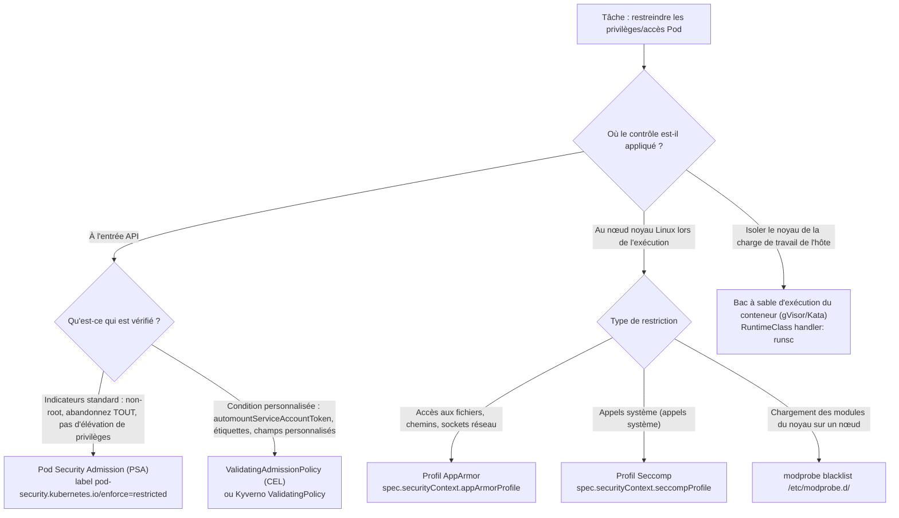
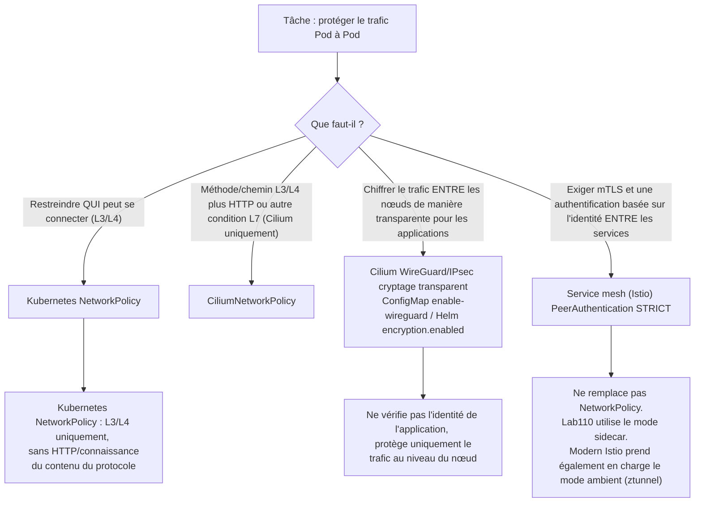
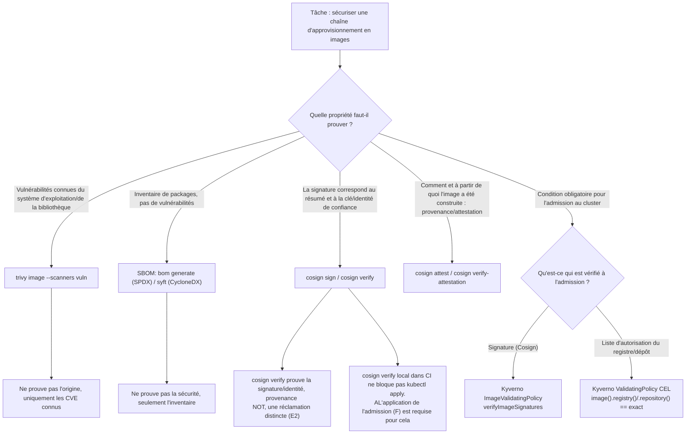
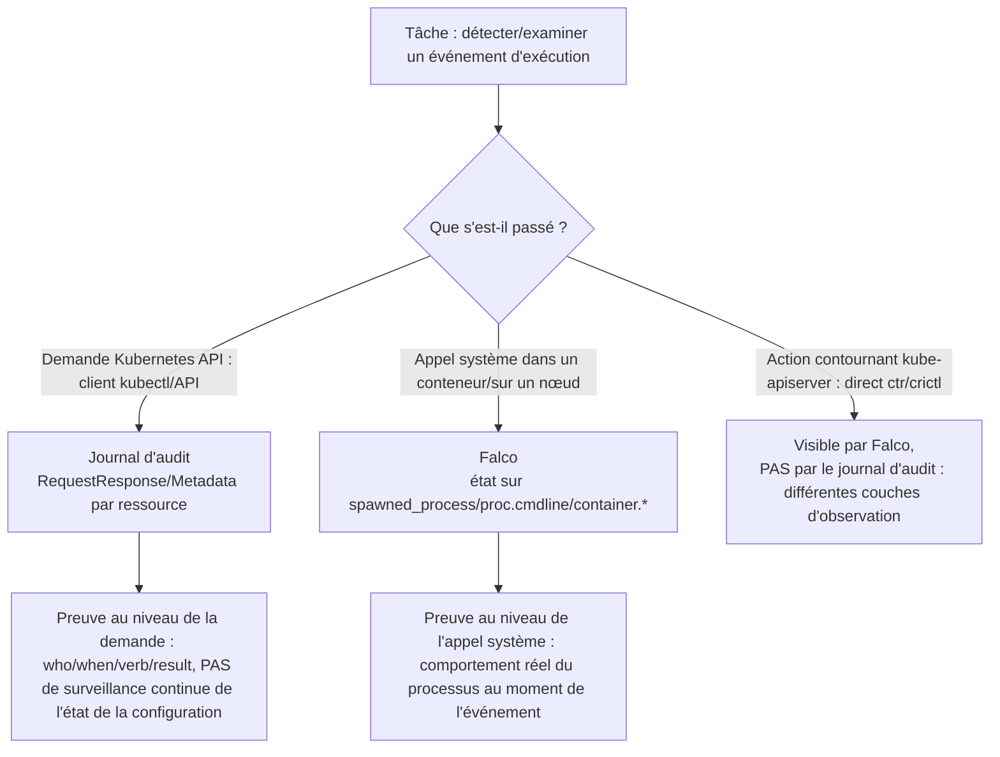

[Русская версия](CHEATSHEET_RU.md) · [Eng version](CHEATSHEET.md) · [Versión en español](CHEATSHEET_ES.md) · [Deutsche Version](CHEATSHEET_DE.md) · [ქართული ვერსია](CHEATSHEET_GE.md) · [繁體中文版](CHEATSHEET_TW.md) · [日本語版](CHEATSHEET_JP.md)

[← Contenu du cours](README_FR.md) · [Glossaire](GLOSSARY_FR.md) · [Index de dépannage (RU)](TROUBLESHOOTING_INDEX_RU.md)

# Aide-mémoire CKS : commandes YAML et CLI prêtes à l'emploi

Un seul fichier sans théorie ni longues explications : extraits de travail canoniques des solutions aux laboratoires de cours `101-114`. Chaque bloc identifie sa source (laboratoire/tâche), vous pouvez donc retrouver l'explication complète dans `worker/files/solutions/1_FR.MD` du laboratoire correspondant. Utilisez la recherche `Ctrl+F`/page pendant un laboratoire ou un examen.

> Ces extraits ont été adaptés et raccourcis à partir des solutions du laboratoire `101-114` pour une référence rapide (les variables, l'indentation et les étapes de support peuvent avoir été simplifiées). Si quelque chose diffère de la dernière version du laboratoire, suivez le fichier README/solution de ce laboratoire.

## Comment utiliser ce fichier

- [Arbres de décision](#decision-trees) : lorsque vous devez choisir le bon outil pour une tâche.
- Les sections de domaine ci-dessous : lorsque vous savez ce dont vous avez besoin et que vous souhaitez un extrait prêt à l'emploi.
- [Index alphabétique des termes et laboratoires](GLOSSARY_FR.md) : pour un terme/indicateur CLI lié à un chapitre.
- [Référence du symptôme (RU)](TROUBLESHOOTING_INDEX_RU.md) : lorsque quelque chose a échoué et que vous devez en trouver rapidement la cause.

---

<a id="decision-trees"></a>

## Arbres de décision

### Restriction des privilèges/accès : PSA vs ValidatingAdmissionPolicy vs AppArmor vs seccomp



### Chiffrement du trafic : chiffrement NetworkPolicy vs CNI vs maillage mTLS



### Chaîne d'approvisionnement : numérisation, signatures, provenance/attestations, SBOM et application de l'admission



### Détection de l'exécution : journaux d'audit, Falco et les deux



---

## 1. Cluster Setup

### Stratégie réseau : AND, OR et `ipBlock.except`
*Source : laboratoire 101, tâche 6.*

ET : les deux sélecteurs dans le même élément `from` :

```yaml
apiVersion: networking.k8s.io/v1
kind: NetworkPolicy
metadata:
  name: allow-backend-ingress-from-legacy
  namespace: cks-101
spec:
  podSelector:
    matchLabels:
      app: backend
  policyTypes:
    - Ingress
  ingress:
    - from:
        - namespaceSelector:
            matchLabels:
              kubernetes.io/metadata.name: cks-101-legacy
          podSelector:
            matchLabels:
              app: legacy-client
      ports:
        - protocol: TCP
          port: 8080
```

OU : éléments `from` distincts (différents de AND ci-dessus) :

```yaml
    - from:
        - namespaceSelector:
            matchLabels:
              kubernetes.io/metadata.name: cks-101-legacy
        - podSelector:
            matchLabels:
              app: legacy-client
```

`ipBlock` avec une exception (par exemple, le point de terminaison des métadonnées du nœud) :

```yaml
apiVersion: networking.k8s.io/v1
kind: NetworkPolicy
metadata:
  name: allow-legacy-egress
  namespace: cks-101-legacy
spec:
  podSelector:
    matchLabels:
      app: legacy-client
  policyTypes:
    - Egress
  egress:
    - to:
        - ipBlock:
            cidr: 0.0.0.0/0
            except:
              - 169.254.169.254/32
```

### Politique de réseau Cilium : L3/L4/L7
*Source : laboratoire 102, tâche 3.*

```yaml
apiVersion: cilium.io/v2
kind: CiliumNetworkPolicy
metadata:
  name: backend-policy
  namespace: cks-102
spec:
  endpointSelector:
    matchLabels:
      app: backend
  ingress:
    - fromEndpoints:
        - matchLabels:
            role: frontend
      toPorts:
        - ports:
            - port: "80"
              protocol: TCP
          rules:
            http:
              - method: GET
                path: "/"
```

### kube-bench : exécution et interprétation de la sortie
*Source : laboratoire 103, tâche 1.*

```bash
mkdir -p /var/work/tests/artifacts/1
scp -r /opt/kube-bench control-plane:/tmp/kube-bench
ssh control-plane 'sudo rm -rf /opt/kube-bench && sudo mv /tmp/kube-bench /opt/kube-bench'
ssh control-plane 'sudo /opt/kube-bench/kube-bench run --benchmark cis-1.12 --targets master,controlplane,node' \
  | tee /var/work/tests/artifacts/1/kube-bench.txt
grep -E '\[(PASS|WARN|FAIL)\]' /var/work/tests/artifacts/1/kube-bench.txt | head
```

> `kube-bench 0.16.0` épinglé n'a pas de profil plus récent que `cis-1.12` (son `version_mapping` intégré se termine par `"1.34": "cis-1.12"`). Spécifiez ce profil explicitement au lieu de vous fier à la détection automatique et marquez les résultats des versions plus récentes de Kubernetes comme `forced-approximate`.

---

## 2. Cluster Hardening

### RBAC : rôle minimal et RoleBinding
*Source : laboratoire 104, tâche 1.*

```yaml
apiVersion: v1
kind: ServiceAccount
metadata:
  name: auditor
  namespace: security-104
---
apiVersion: rbac.authorization.k8s.io/v1
kind: Role
metadata:
  name: pod-observer
  namespace: security-104
rules:
- apiGroups: [""]
  resources: ["pods"]
  verbs: ["get", "list", "watch"]
---
apiVersion: rbac.authorization.k8s.io/v1
kind: RoleBinding
metadata:
  name: auditor-pod-observer
  namespace: security-104
subjects:
- kind: ServiceAccount
  name: auditor
  namespace: security-104
roleRef:
  apiGroup: rbac.authorization.k8s.io
  kind: Role
  name: pod-observer
```

### ServiceAccount sans montage automatique du jeton
*Source : laboratoire 104, tâche 3.*

```yaml
apiVersion: v1
kind: ServiceAccount
metadata:
  name: no-token-sa
  namespace: security-104
automountServiceAccountToken: false
---
apiVersion: v1
kind: Pod
metadata:
  name: no-token
  namespace: security-104
spec:
  serviceAccountName: no-token-sa
  automountServiceAccountToken: false
  containers:
  - name: app
    image: busybox:1.36
    command: ["sh", "-c", "sleep 3600"]
```

### Volume Secret : `defaultMode: 0400` (= `256` décimal)
*Source : laboratoire 104, tâche 6.*

> `kubectl get pod -o json` affiche `defaultMode: 0400` sous forme décimale `256`. Écrire `defaultMode: 400` (sans zéro non significatif) signifie `400` décimal, PAS octal `0400`/`256` : une erreur d'examen courante.

```yaml
apiVersion: v1
kind: Pod
metadata:
  name: app-vulnerable
  namespace: security-104
spec:
  automountServiceAccountToken: false
  containers:
  - name: app
    image: busybox:1.36
    command: ["sh", "-c", "sleep 3600"]
    volumeMounts:
    - name: db-creds-vol
      mountPath: /etc/secrets
      readOnly: true
  volumes:
  - name: db-creds-vol
    secret:
      secretName: db-creds
      defaultMode: 0400
```

### Mise à niveau mineure de kubeadm : le plan de contrôle d'abord, les travailleurs ensuite
*Source : laboratoire 113, tâches 1-2.*

> L'ordre est important : terminez la mise à niveau ENTIÈRE du plan de contrôle (y compris le décordon) avant de mettre à niveau un travailleur, ou vous violez la politique d'asymétrie de version. Sur le plan de contrôle, utilisez `kubeadm upgrade apply` ; sur les travailleurs, utilisez `kubeadm upgrade node` (et non `apply`). `pkgs.k8s.io` dispose d'un référentiel apt distinct pour chaque version mineure. Basculez `sources.list.d/kubernetes.list` vers le mineur cible AVANT `apt install kubeadm`.

```bash
# Basculez le référentiel vers le mineur cible (exemple : 1.36)
curl -fsSL https://pkgs.k8s.io/core:/stable:/v1.36/deb/Release.key | sudo gpg --dearmor -o /etc/apt/keyrings/kubernetes-apt-keyring.gpg
echo "deb [signed-by=/etc/apt/keyrings/kubernetes-apt-keyring.gpg] https://pkgs.k8s.io/core:/stable:/v1.36/deb/ /" | sudo tee /etc/apt/sources.list.d/kubernetes.list
sudo apt-get update -qq

# Plan de contrôle : mettre à jour kubeadm, inspecter le plan, exécuter la mise à niveau
sudo apt-mark unhold kubeadm && sudo apt-get install -y --allow-change-held-packages kubeadm && sudo apt-mark hold kubeadm
sudo kubeadm upgrade plan
sudo kubeadm upgrade apply v1.36.1 -y

# Seulement APRÈS une application réussie : vidange -> mise à jour kubelet/kubectl -> redémarrage -> débranchement
kubectl drain <control-plane-node> --ignore-daemonsets --delete-emptydir-data
sudo apt-mark unhold kubelet kubectl && sudo apt-get install -y --allow-change-held-packages kubelet kubectl && sudo apt-mark hold kubelet kubectl
sudo systemctl daemon-reload && sudo systemctl restart kubelet
kubectl uncordon <control-plane-node>

# Worker (une fois que le plan de contrôle est prêt sur la version cible) : kubeadm update NODE, ne s'applique pas
sudo kubeadm upgrade node
```

---

## 3. System Hardening

### AppArmor : charger un profil et l'attribuer à un Pod
*Source : laboratoire 106, tâches 2 et 8.*

```bash
ssh control-plane 'sudo apparmor_parser -r -v /etc/apparmor.d/k8s-106-broken-profile'
ssh control-plane 'sudo aa-status | grep k8s-106-broken-profile'
```

Le champ actuel est `spec.securityContext.appArmorProfile` (PAS l'ancienne annotation bêta `container.apparmor.security.beta.kubernetes.io/...`) :

```yaml
apiVersion: v1
kind: Pod
metadata:
  name: apparmor-writer
  namespace: security-106
spec:
  nodeSelector:
    security.cks.io/localhost-profiles-106: "true"
  automountServiceAccountToken: false
  securityContext:
    appArmorProfile:
      type: Localhost
      localhostProfile: k8s-106-deny-write
  containers:
  - name: app
    image: busybox:1.36
    command: ["sh", "-c", "sleep 3600"]
    volumeMounts:
    - name: work
      mountPath: /work
  volumes:
  - name: work
    emptyDir: {}
```

### Seccomp : profil Localhost JSON et référence Pod
*Source : laboratoire 106, tâches 4 à 5.*

```json
{
  "defaultAction": "SCMP_ACT_ALLOW",
  "architectures": ["SCMP_ARCH_X86_64"],
  "syscalls": [
    {
      "names": ["unshare"],
      "action": "SCMP_ACT_ERRNO",
      "errnoRet": 1
    }
  ]
}
```

```yaml
apiVersion: v1
kind: Pod
metadata:
  name: localhost-seccomp
  namespace: security-106
spec:
  nodeSelector:
    security.cks.io/localhost-profiles-106: "true"
  automountServiceAccountToken: false
  securityContext:
    seccompProfile:
      type: Localhost
      localhostProfile: profiles/cks-106-deny-unshare.json
  containers:
  - name: app
    image: busybox:1.36
    command: ["sh", "-c", "sleep 3600"]
```

> `localhostProfile` est toujours relatif à la racine kubelet seccomp (généralement `/var/lib/kubelet/seccomp/`), et non à un chemin de fichier absolu.

---

## 4. Minimize Microservice Vulnerabilities

### Pod Admission de sécurité : `restricted`
*Source : laboratoire 107, tâche 1.*

```bash
kubectl label namespace psa-restricted-107 \
  pod-security.kubernetes.io/enforce=restricted \
  pod-security.kubernetes.io/enforce-version=v1.36
```

### ValidatingAdmissionPolicy + Reliure : CEL pour `automountServiceAccountToken`
*Source : laboratoire 107, tâche 6.*

> `allowPrivilegeEscalation: false` et `capabilities.drop: ["ALL"]` sont déjà couverts par PSA `restricted` ci-dessus et délibérément NON dupliqués dans ce VAP. Ici, CEL est utilisé uniquement pour une condition personnalisée que PSA ne vérifie pas.

```yaml
apiVersion: admissionregistration.k8s.io/v1
kind: ValidatingAdmissionPolicy
metadata:
  name: require-no-automount-token
spec:
  failurePolicy: Fail
  matchConstraints:
    resourceRules:
    - apiGroups: [""]
      apiVersions: ["v1"]
      operations: ["CREATE", "UPDATE"]
      resources: ["pods"]
  validations:
  - expression: >-
      has(object.spec.automountServiceAccountToken) &&
      object.spec.automountServiceAccountToken == false
    message: "spec.automountServiceAccountToken must be explicitly set to false"
---
apiVersion: admissionregistration.k8s.io/v1
kind: ValidatingAdmissionPolicyBinding
metadata:
  name: require-no-automount-token-binding
spec:
  policyName: require-no-automount-token
  validationActions: [Deny]
  matchResources:
    namespaceSelector:
      matchLabels:
        kubernetes.io/metadata.name: psa-restricted-107
```

### EncryptionConfiguration : chiffrement de Secrets dans etcd (`aescbc`)
*Source : laboratoire 109, tâche 2.*

```bash
umask 077
key=$(head -c 32 /dev/urandom | base64 -w0)
cat > /etc/kubernetes/enc/encryption-config.yaml <<EOF
apiVersion: apiserver.config.k8s.io/v1
kind: EncryptionConfiguration
resources:
- resources:
  - secrets
  providers:
  - aescbc:
      keys:
      - name: cks-109-aescbc
        secret: ${key}
  - identity: {}
EOF
```

> L'ordre du fournisseur est important : le premier fournisseur gère les NOUVELLES écritures ; les fournisseurs ultérieurs ne lisent que les anciens enregistrements. Un `identity: {}` final permet de lire le Secrets non chiffré existant jusqu'au rechiffrement complet.

### gVisor : containerd `runsc` et RuntimeClass
*Source : laboratoire 110, tâche 1.*

```bash
ssh k8s110_node_gvisor 'sudo tee -a /etc/containerd/config.toml > /dev/null <<EOF
[plugins."io.containerd.grpc.v1.cri".containerd.runtimes.runsc]
  runtime_type = "io.containerd.runsc.v1"
EOF
sudo systemctl restart containerd'
```

```yaml
apiVersion: node.k8s.io/v1
kind: RuntimeClass
metadata:
  name: gvisor
handler: runsc
scheduling:
  nodeSelector:
    sandbox.runtime/gvisor: "true"
```

### Cilium WireGuard : activation du cryptage transparent
*Source : laboratoire 110, tâche 4.*

Installation Helm-managed :

```bash
helm upgrade cilium cilium/cilium -n kube-system --reuse-values \
  --set encryption.enabled=true --set encryption.type=wireguard
```

Installation de ConfigMap-based (quand il n'y a pas de version Helm) :

```bash
kubectl -n kube-system patch configmap cilium-config --type merge \
  -p '{"data":{"enable-wireguard":"true"}}'
kubectl -n kube-system rollout restart daemonset/cilium
```

### Istio PeerAuthentication : `STRICT` mTLS
*Source : laboratoire 110, tâche 6.*

```yaml
apiVersion: security.istio.io/v1
kind: PeerAuthentication
metadata:
  name: market-strict
  namespace: market
spec:
  mtls:
    mode: STRICT
```

---

## 5. Supply Chain Security

### Trivy : numérisation d'images JSON
*Source : laboratoire 111, tâche 1.*

```bash
trivy image --scanners vuln --vuln-type os,library --format json \
  --output trivy-report.json "$IMAGE"
```

### Trivy : liste complète des packages
*Source : laboratoire 111, tâche 5.*

```bash
trivy image --list-all-pkgs --format json "$IMAGE" > packages.json
jq -r '[.Results[].Packages[]? | "\(.Name)=\(.Version)"] | unique | .[:3][]' packages.json
```

### SBOM : SPDX avec `bom`, CycloneDX avec `syft`
*Source : laboratoire 111, tâches 6 à 7.*

```bash
bom generate --format json --output bom.spdx.json --image "$IMAGE"
syft "$IMAGE" -o "cyclonedx-json=syft.cdx.json"
```

### `trivy sbom` : analyse d'un fichier SBOM existant
*Source : laboratoire 111, tâche 8.*

```bash
trivy sbom --format json --output sbom-scan.json bom.spdx.json
```

> Utilisez `trivy sbom <file>`, PAS `trivy image <file>` ; le chemin est transmis en tant que SBOM, et non en tant que référence d'image.

### Cosign : génération de clé, signature, vérification (avec clé et sans clé)
*Source : laboratoire 111, tâches 7, 9a, 9c.*

```bash
cosign generate-key-pair
cosign sign --key cosign.key --yes "$HARDENED_IMAGE"
cosign verify --key cosign.pub "$HARDENED_IMAGE"
```

Vérification sans clé d'un artefact public signé OIDC :

```bash
cosign verify \
  --certificate-oidc-issuer https://accounts.google.com \
  --certificate-identity keyless@distroless.iam.gserviceaccount.com \
  gcr.io/distroless/static:nonroot
```

### Kyverno ImageValidatingPolicy : vérification de la signature Cosign à l'admission
*Source : laboratoire 111, tâche 9a.*

```yaml
apiVersion: policies.kyverno.io/v1
kind: ImageValidatingPolicy
metadata:
  name: require-signed-catalog-images
spec:
  failurePolicy: Fail
  validationActions: [Deny]
  matchConstraints:
    resourceRules:
    - apiGroups: [""]
      apiVersions: ["v1"]
      operations: ["CREATE", "UPDATE"]
      resources: ["pods"]
  matchImageReferences:
  - glob: "${HARDENED_REPO}*"
  attestors:
  - name: catalogReleaseKey
    cosign:
      key:
        data: |-
          <en retrait cosign.pub PEM>
  validations:
  - message: "catalog image must have a valid release signature"
    expression: >-
      (images.containers + images.?initContainers.orValue([]) +
      images.?ephemeralContainers.orValue([])).map(image,
        verifyImageSignatures(image, [attestors.catalogReleaseKey]) > 0).all(ok, ok)
```

### Kyverno ValidatingPolicy : liste blanche exacte du registre/référentiel (pas de correspondance de préfixe)
*Source : laboratoire 112, tâche 9.*

> Utilisez exactement `==`, et non la correspondance `startsWith`/préfixe. Sinon, `library/busybox-evil` transmet la stratégie simplement parce que son nom COMMENCE par la chaîne autorisée.

```yaml
apiVersion: policies.kyverno.io/v1
kind: ValidatingPolicy
metadata:
  name: require-trusted-registry-runtime-112
spec:
  matchConstraints:
    resourceRules:
    - apiGroups: [""]
      apiVersions: ["v1"]
      resources: ["pods"]
      operations: ["CREATE"]
  matchConditions:
  - name: only-runtime-112
    expression: "object.metadata.namespace == 'runtime-112'"
  validations:
  - expression: >
      object.spec.containers.all(c,
        image(c.image).registry() == 'docker.io' &&
        image(c.image).repository() == 'library/busybox')
    message: "CKS112_TRUSTED_REPO_POLICY: only docker.io/library/busybox is allowed in runtime-112"
  validationActions: [Deny]
```

---

## 6. Monitoring, Logging & Runtime Security

### AuditPolicy : ordre correct des règles
*Source : laboratoire 112, tâche 4.*

> L'ordre compte : le serveur API applique la PREMIÈRE règle de correspondance de haut en bas. Des règles spécifiques doivent précéder le fourre-tout général à la fin.

```yaml
apiVersion: audit.k8s.io/v1
kind: Policy
omitStages: ["RequestReceived"]
rules:
# 1. Réduction du bruit pour les événements à volume élevé et à faible risque
- level: None
  resources:
  - group: ""
    resources: ["events"]
- level: None
  nonResourceURLs: ["/healthz*", "/livez*", "/readyz*", "/version"]
# 2. Règle spécifique : compléter ConfigMaps (le corps n'est pas sensible)
- level: RequestResponse
  namespaces: ["runtime-112"]
  resources:
  - group: ""
    resources: ["configmaps"]
# 3. Secrets : Métadonnées uniquement, pour éviter de journaliser les corps secrets
- level: Metadata
  resources:
  - group: ""
    resources: ["secrets"]
# 4. Journalisation de secours pour le API restant (doit être le DERNIER)
- level: Metadata
```

### Falco : règle personnalisée (condition/sortie/priorité)
*Source : laboratoire 112, tâche 3.*

```yaml
- rule: CKS112 Custom Shell Marker
  desc: Detect the controlled CKS lab marker in a container process command line
  condition: spawned_process and container and proc.cmdline contains "CKS112_CUSTOM_EVENT"
  output: "CKS112 custom shell marker container=%container.id pid=%proc.pid ppid=%proc.ppid user=%user.name command=%proc.cmdline"
  priority: WARNING
```

### Falco : remplacer la macro `user_expected_terminal_shell_in_container_conditions`
*Source : laboratoire 112, tâche 7.*

```yaml
- macro: user_expected_terminal_shell_in_container_conditions
  condition: (k8s.ns.name = "runtime-112" and k8s.pod.name = "ci-runner")
  override:
    condition: replace
```

> Cela diffère de `user_shell_container_exclusions` (qui appartient à une autre règle, **Run shell untrusted**). Les noms de macros similaires sont faciles à confondre.

### Falco : JSON et sortie de fichier
*Source : laboratoire 112, tâche 7.*

```yaml
# /etc/falco/config.d/output.yaml
json_output: true
file_output:
  enabled: true
  filename: /var/log/falco/events.log
```

### `crictl` : corréler une alerte avec un Pod/espace de noms
*Source : laboratoire 112, tâche 6.*

```bash
# 1. L'ID de conteneur court et l'hôte PID ont déjà été extraits de l'alerte Falco.
CONTAINER_ID=$(sudo crictl ps -a -q | awk "/^${SHORT_ID}/ {print; exit}")
sudo crictl inspect "$CONTAINER_ID" > cri-container.json
SANDBOX_ID=$(jq -r '.status.sandboxId' cri-container.json)
sudo crictl inspectp "$SANDBOX_ID" > cri-sandbox.json
POD=$(jq -r '.status.metadata.name' cri-sandbox.json)
NAMESPACE=$(jq -r '.status.metadata.namespace' cri-sandbox.json)
```

### `/proc/<PID>/` : naviguer lors d'une enquête
*Source : laboratoire 112, tâche 6.*

```bash
sudo cat /proc/$HOST_PID/status
sudo tr '\0' ' ' </proc/$HOST_PID/cmdline; echo
sudo cat /proc/$HOST_PID/cgroup
sudo ps -eo pid,ppid,user,lstart,args --forest
```

> Récupérez ces artefacts PENDANT que le processus est en cours. Après la suppression de son Pod, le `/proc/<PID>` correspondant disparaît définitivement.

### Système de fichiers racine immuable avec `/tmp` inscriptible
*Source : laboratoire 112, tâche 5.*

```yaml
apiVersion: v1
kind: Pod
metadata:
  name: immutable-app
  namespace: runtime-112
spec:
  automountServiceAccountToken: false
  containers:
  - name: app
    image: busybox:1.36
    command: ["sh", "-c", "sleep 3600"]
    securityContext:
      readOnlyRootFilesystem: true
    volumeMounts:
    - name: writable-tmp
      mountPath: /tmp
  volumes:
  - name: writable-tmp
    emptyDir: {}
```

---

[← Contenu du cours](README_FR.md) · [Glossaire](GLOSSARY_FR.md) · [Index de dépannage (RU)](TROUBLESHOOTING_INDEX_RU.md)
