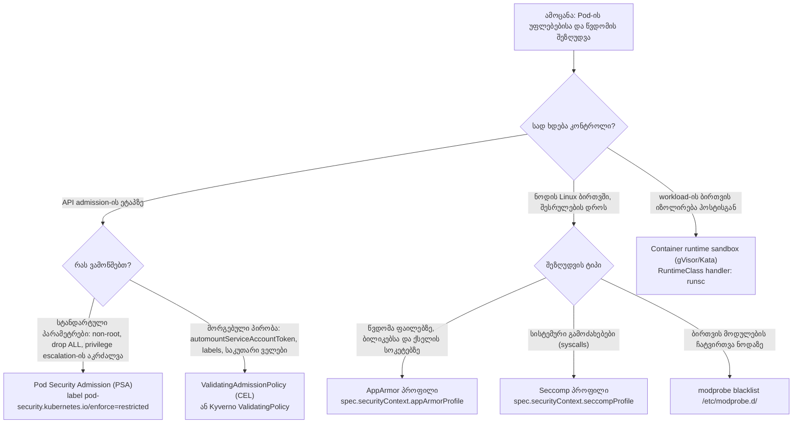
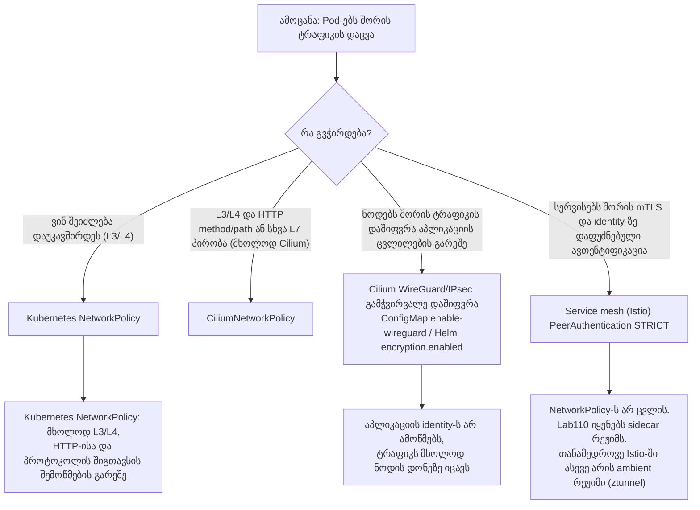
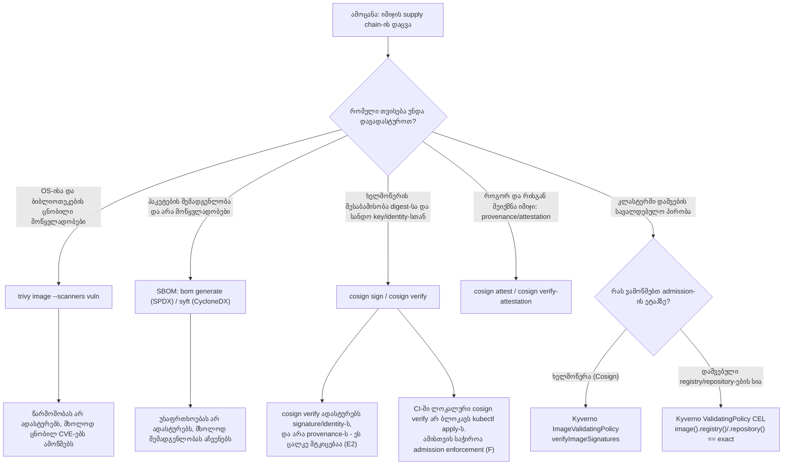
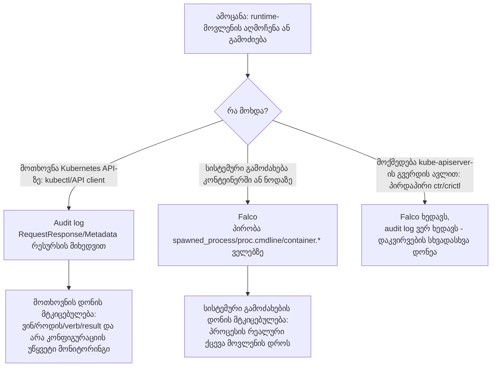

[Русская версия](CHEATSHEET_RU.md) · [Eng version](CHEATSHEET.md) · [Versión en español](CHEATSHEET_ES.md) · [Version française](CHEATSHEET_FR.md) · [Deutsche Version](CHEATSHEET_DE.md) · [繁體中文版](CHEATSHEET_TW.md) · [日本語版](CHEATSHEET_JP.md)

[← კურსის შინაარსი](README_GE.md) · [გლოსარიუმი](GLOSSARY_GE.md) · [პრობლემების მოგვარების ინდექსი (RU)](TROUBLESHOOTING_INDEX_RU.md)

# CKS cheatsheet: მზა გამოსაყენებლად YAML და CLI ბრძანებები

ერთი ფაილი თეორიის ან გრძელი ახსნა-განმარტების გარეშე: კანონიკური სამუშაო ფრაგმენტები გადაწყვეტილებებიდან კურსის ლაბორატორიამდე `101-114`. თითოეული ბლოკი განსაზღვრავს მის წყაროს (ლაბორატორია/დავალება), ასე რომ თქვენ შეგიძლიათ იპოვოთ სრული ახსნა შესაბამისი ლაბორატორიის `worker/files/solutions/1_GE.MD`-ში. გამოიყენეთ `Ctrl+F`/გვერდის ძებნა ლაბორატორიის ან გამოცდის დროს.

> ეს ფრაგმენტები ადაპტირებული და შემოკლებული იქნა ლაბორატორიული `101-114` გადაწყვეტილებებიდან სწრაფი მითითებისთვის (ცვლადები, ჩაღრმავება და დამხმარე ნაბიჯები შეიძლება გამარტივებული იყოს). თუ რამე განსხვავდება ლაბორატორიის უახლესი ვერსიისგან, მიჰყევით ამ ლაბორატორიის README/გადაწყვეტას.

## როგორ გამოვიყენოთ ეს ფაილი

- [გადაწყვეტილების ხეები](#decision-trees): როდესაც საჭიროა ამოცანისთვის სწორი ინსტრუმენტის არჩევა.
- ქვემოთ მოცემული დომენის სექციები: როდესაც იცით რა გჭირდებათ და გსურთ გამოსაყენებლად მზა ფრაგმენტი.
- [ტერმინებისა და ლაბორატორიების ანბანური ინდექსი](GLOSSARY_GE.md): ტერმინისთვის/CLI დროშისთვის, რომელიც დაკავშირებულია თავთან.
- [სიმპტომის მითითება (RU)](TROUBLESHOOTING_INDEX_RU.md): როდესაც რაღაც ვერ მოხერხდა და თქვენ უნდა სწრაფად იპოვოთ მიზეზი.

---

<a id="decision-trees"></a>

## გადაწყვეტილების ხეები

### პრივილეგიების/წვდომის შეზღუდვა: PSA vs ValidatingAdmissionPolicy vs AppArmor vs seccomp



### ტრაფიკის დაშიფვრა: NetworkPolicy vs CNI დაშიფვრა vs mTLS mesh



### მიწოდების ჯაჭვი: სკანირება ხელმოწერების წინააღმდეგ წარმოშობის/დამოწმებების წინააღმდეგ SBOM წინააღმდეგ დაშვების აღსრულების წინააღმდეგ



### გაშვების დროის გამოვლენა: აუდიტის ჟურნალები Falco ორივეს წინააღმდეგ



---

## 1. Cluster Setup

### NetworkPolicy: AND, OR და `ipBlock.except`
*წყარო: ლაბორატორია 101, ამოცანა 6.*

AND: ორივე ამომრჩევი ერთსა და იმავე `from` პუნქტში:

```yaml
apiVersion: networking.k8s.io/v1
kind: NetworkPolicy
metadata:
  name: allow-backend-ingress-from-legacy
  namespace: cks-101
spec:
  podSelector:
    matchLabels:
      app: backend
  policyTypes:
    - Ingress
  ingress:
    - from:
        - namespaceSelector:
            matchLabels:
              kubernetes.io/metadata.name: cks-101-legacy
          podSelector:
            matchLabels:
              app: legacy-client
      ports:
        - protocol: TCP
          port: 8080
```

OR: ცალკე `from` ელემენტები (განსხვავებული და ზემოთ):

```yaml
    - from:
        - namespaceSelector:
            matchLabels:
              kubernetes.io/metadata.name: cks-101-legacy
        - podSelector:
            matchLabels:
              app: legacy-client
```

`ipBlock` გამონაკლისით (მაგალითად, კვანძის მეტამონაცემების საბოლოო წერტილი):

```yaml
apiVersion: networking.k8s.io/v1
kind: NetworkPolicy
metadata:
  name: allow-legacy-egress
  namespace: cks-101-legacy
spec:
  podSelector:
    matchLabels:
      app: legacy-client
  policyTypes:
    - Egress
  egress:
    - to:
        - ipBlock:
            cidr: 0.0.0.0/0
            except:
              - 169.254.169.254/32
```

### CiliumNetworkPolicy: L3/L4/L7
*წყარო: ლაბორატორია 102, ამოცანა 3.*

```yaml
apiVersion: cilium.io/v2
kind: CiliumNetworkPolicy
metadata:
  name: backend-policy
  namespace: cks-102
spec:
  endpointSelector:
    matchLabels:
      app: backend
  ingress:
    - fromEndpoints:
        - matchLabels:
            role: frontend
      toPorts:
        - ports:
            - port: "80"
              protocol: TCP
          rules:
            http:
              - method: GET
                path: "/"
```

### kube-bench: გამომავალი გაშვება და ინტერპრეტაცია
*წყარო: ლაბორატორია 103, ამოცანა 1.*

```bash
mkdir -p /var/work/tests/artifacts/1
scp -r /opt/kube-bench control-plane:/tmp/kube-bench
ssh control-plane 'sudo rm -rf /opt/kube-bench && sudo mv /tmp/kube-bench /opt/kube-bench'
ssh control-plane 'sudo /opt/kube-bench/kube-bench run --benchmark cis-1.12 --targets master,controlplane,node' \
  | tee /var/work/tests/artifacts/1/kube-bench.txt
grep -E '\[(PASS|WARN|FAIL)\]' /var/work/tests/artifacts/1/kube-bench.txt | head
```

> ჩამაგრებულ `kube-bench 0.16.0`-ს არ აქვს `cis-1.12`-ზე ახალი პროფილი (მისი ჩაშენებული `version_mapping` მთავრდება `"1.34": "cis-1.12"`-ზე). პირდაპირ მიუთითეთ ეს პროფილი ავტომატურ ამოცნობაზე დაყრდნობის ნაცვლად და მონიშნეთ შედეგები ახალი Kubernetes ვერსიებისთვის, როგორც `forced-approximate`.

---

## 2. Cluster Hardening

### RBAC: მინიმალური როლი და როლის შეკვრა
*წყარო: ლაბორატორია 104, ამოცანა 1.*

```yaml
apiVersion: v1
kind: ServiceAccount
metadata:
  name: auditor
  namespace: security-104
---
apiVersion: rbac.authorization.k8s.io/v1
kind: Role
metadata:
  name: pod-observer
  namespace: security-104
rules:
- apiGroups: [""]
  resources: ["pods"]
  verbs: ["get", "list", "watch"]
---
apiVersion: rbac.authorization.k8s.io/v1
kind: RoleBinding
metadata:
  name: auditor-pod-observer
  namespace: security-104
subjects:
- kind: ServiceAccount
  name: auditor
  namespace: security-104
roleRef:
  apiGroup: rbac.authorization.k8s.io
  kind: Role
  name: pod-observer
```

### ServiceAccount ტოკენის ავტომატური დამონტაჟების გარეშე
*წყარო: ლაბორატორია 104, ამოცანა 3.*

```yaml
apiVersion: v1
kind: ServiceAccount
metadata:
  name: no-token-sa
  namespace: security-104
automountServiceAccountToken: false
---
apiVersion: v1
kind: Pod
metadata:
  name: no-token
  namespace: security-104
spec:
  serviceAccountName: no-token-sa
  automountServiceAccountToken: false
  containers:
  - name: app
    image: busybox:1.36
    command: ["sh", "-c", "sleep 3600"]
```

### Secret მოცულობა: `defaultMode: 0400` (= `256` ათობითი)
*წყარო: ლაბორატორია 104, ამოცანა 6.*

> `kubectl get pod -o json` აჩვენებს `defaultMode: 0400` როგორც ათობითი `256`. `defaultMode: 400` ჩაწერა (წინასწარი ნულის გარეშე) ნიშნავს ათობითი `400` და არა რვადიან `0400`/`256`: საერთო გამოცდის შეცდომას.

```yaml
apiVersion: v1
kind: Pod
metadata:
  name: app-vulnerable
  namespace: security-104
spec:
  automountServiceAccountToken: false
  containers:
  - name: app
    image: busybox:1.36
    command: ["sh", "-c", "sleep 3600"]
    volumeMounts:
    - name: db-creds-vol
      mountPath: /etc/secrets
      readOnly: true
  volumes:
  - name: db-creds-vol
    secret:
      secretName: db-creds
      defaultMode: 0400
```

### kubeadm მცირე განახლება: ჯერ საკონტროლო თვითმფრინავი, შემდეგ მუშები
*წყარო: ლაბორატორია 113, ამოცანები 1-2.*

> შეკვეთა მნიშვნელოვანია: დაასრულეთ მთელი საკონტროლო სიბრტყის განახლება (მათ შორის, გაუქმება) მუშის განახლებამდე, ან არღვევთ ვერსიის დახრილობის პოლიტიკას. საკონტროლო თვითმფრინავზე გამოიყენეთ `kubeadm upgrade apply`; მუშებზე გამოიყენეთ `kubeadm upgrade node` (არა `apply`). `pkgs.k8s.io`-ს აქვს ცალკე შესაფერისი საცავი თითოეული მცირე ვერსიისთვის. გადართეთ `sources.list.d/kubernetes.list` სამიზნე მცირეზე `apt install kubeadm`-მდე.

```bash
# გადართეთ საცავი სამიზნე მინორზე (მაგალითი: 1.36)
curl -fsSL https://pkgs.k8s.io/core:/stable:/v1.36/deb/Release.key | sudo gpg --dearmor -o /etc/apt/keyrings/kubernetes-apt-keyring.gpg
echo "deb [signed-by=/etc/apt/keyrings/kubernetes-apt-keyring.gpg] https://pkgs.k8s.io/core:/stable:/v1.36/deb/ /" | sudo tee /etc/apt/sources.list.d/kubernetes.list
sudo apt-get update -qq

# საკონტროლო თვითმფრინავი: განაახლეთ kubeadm, შეამოწმეთ გეგმა, გაუშვით განახლება
sudo apt-mark unhold kubeadm && sudo apt-get install -y --allow-change-held-packages kubeadm && sudo apt-mark hold kubeadm
sudo kubeadm upgrade plan
sudo kubeadm upgrade apply v1.36.1 -y

# მხოლოდ წარმატებული გამოყენების შემდეგ: გადინება -> განახლება kubelet/kubectl -> გადატვირთვა -> ჩართვის
kubectl drain <control-plane-node> --ignore-daemonsets --delete-emptydir-data
sudo apt-mark unhold kubelet kubectl && sudo apt-get install -y --allow-change-held-packages kubelet kubectl && sudo apt-mark hold kubelet kubectl
sudo systemctl daemon-reload && sudo systemctl restart kubelet
kubectl uncordon <control-plane-node>

# მუშა (მას შემდეგ, რაც საკონტროლო თვითმფრინავი მზად არის სამიზნე ვერსიაზე): kubeadm განაახლეთ NODE, არ გამოიყენება
sudo kubeadm upgrade node
```

---

## 3. System Hardening

### AppArmor: ჩატვირთეთ პროფილი და მიანიჭეთ იგი Pod
*წყარო: ლაბორატორია 106, დავალება 2 და 8.*

```bash
ssh control-plane 'sudo apparmor_parser -r -v /etc/apparmor.d/k8s-106-broken-profile'
ssh control-plane 'sudo aa-status | grep k8s-106-broken-profile'
```

მიმდინარე ველი არის `spec.securityContext.appArmorProfile` (არა ძველი ბეტა ანოტაცია `container.apparmor.security.beta.kubernetes.io/...`):

```yaml
apiVersion: v1
kind: Pod
metadata:
  name: apparmor-writer
  namespace: security-106
spec:
  nodeSelector:
    security.cks.io/localhost-profiles-106: "true"
  automountServiceAccountToken: false
  securityContext:
    appArmorProfile:
      type: Localhost
      localhostProfile: k8s-106-deny-write
  containers:
  - name: app
    image: busybox:1.36
    command: ["sh", "-c", "sleep 3600"]
    volumeMounts:
    - name: work
      mountPath: /work
  volumes:
  - name: work
    emptyDir: {}
```

### მეორე: Localhost JSON პროფილი და Pod მითითება
*წყარო: ლაბორატორია 106, ამოცანები 4-5.*

```json
{
  "defaultAction": "SCMP_ACT_ALLOW",
  "architectures": ["SCMP_ARCH_X86_64"],
  "syscalls": [
    {
      "names": ["unshare"],
      "action": "SCMP_ACT_ERRNO",
      "errnoRet": 1
    }
  ]
}
```

```yaml
apiVersion: v1
kind: Pod
metadata:
  name: localhost-seccomp
  namespace: security-106
spec:
  nodeSelector:
    security.cks.io/localhost-profiles-106: "true"
  automountServiceAccountToken: false
  securityContext:
    seccompProfile:
      type: Localhost
      localhostProfile: profiles/cks-106-deny-unshare.json
  containers:
  - name: app
    image: busybox:1.36
    command: ["sh", "-c", "sleep 3600"]
```

> `localhostProfile` ყოველთვის ნათესავია kubelet seccomp ფესვთან (ჩვეულებრივ `/var/lib/kubelet/seccomp/`) და არა ფაილის აბსოლუტური გზა.

---

## 4. Minimize Microservice Vulnerabilities

### Pod უსაფრთხოება დაშვება: `restricted`
*წყარო: ლაბორატორია 107, ამოცანა 1.*

```bash
kubectl label namespace psa-restricted-107 \
  pod-security.kubernetes.io/enforce=restricted \
  pod-security.kubernetes.io/enforce-version=v1.36
```

### ValidatingAdmissionPolicy + შეკვრა: CEL `automountServiceAccountToken`-სთვის
*წყარო: ლაბორატორია 107, ამოცანა 6.*

> `allowPrivilegeEscalation: false` და `capabilities.drop: ["ALL"]` უკვე დაფარულია PSA `restricted` ზემოთ და განზრახ არ არის დუბლირებული ამ VAP-ში. აქ CEL გამოიყენება მხოლოდ მორგებული მდგომარეობისთვის, რომელსაც PSA არ ამოწმებს.

```yaml
apiVersion: admissionregistration.k8s.io/v1
kind: ValidatingAdmissionPolicy
metadata:
  name: require-no-automount-token
spec:
  failurePolicy: Fail
  matchConstraints:
    resourceRules:
    - apiGroups: [""]
      apiVersions: ["v1"]
      operations: ["CREATE", "UPDATE"]
      resources: ["pods"]
  validations:
  - expression: >-
      has(object.spec.automountServiceAccountToken) &&
      object.spec.automountServiceAccountToken == false
    message: "spec.automountServiceAccountToken must be explicitly set to false"
---
apiVersion: admissionregistration.k8s.io/v1
kind: ValidatingAdmissionPolicyBinding
metadata:
  name: require-no-automount-token-binding
spec:
  policyName: require-no-automount-token
  validationActions: [Deny]
  matchResources:
    namespaceSelector:
      matchLabels:
        kubernetes.io/metadata.name: psa-restricted-107
```

### EncryptionConfiguration: Secrets დაშიფვრა etcd (`aescbc`)
*წყარო: ლაბორატორია 109, დავალება 2.*

```bash
umask 077
key=$(head -c 32 /dev/urandom | base64 -w0)
cat > /etc/kubernetes/enc/encryption-config.yaml <<EOF
apiVersion: apiserver.config.k8s.io/v1
kind: EncryptionConfiguration
resources:
- resources:
  - secrets
  providers:
  - aescbc:
      keys:
      - name: cks-109-aescbc
        secret: ${key}
  - identity: {}
EOF
```

> პროვაიდერების თანმიმდევრობა მნიშვნელოვანია: პირველი პროვაიდერი ამუშავებს NEW წერებს; მოგვიანებით პროვაიდერები მხოლოდ ძველ ჩანაწერებს კითხულობენ. საბოლოო `identity: {}` საშუალებას იძლევა წაიკითხოს არსებული დაუშიფრული Secrets სრულ ხელახალი დაშიფვრამდე.

### gVisor: containerd `runsc` და RuntimeClass
*წყარო: ლაბორატორია 110, ამოცანა 1.*

```bash
ssh k8s110_node_gvisor 'sudo tee -a /etc/containerd/config.toml > /dev/null <<EOF
[plugins."io.containerd.grpc.v1.cri".containerd.runtimes.runsc]
  runtime_type = "io.containerd.runsc.v1"
EOF
sudo systemctl restart containerd'
```

```yaml
apiVersion: node.k8s.io/v1
kind: RuntimeClass
metadata:
  name: gvisor
handler: runsc
scheduling:
  nodeSelector:
    sandbox.runtime/gvisor: "true"
```

### Cilium WireGuard: გამჭვირვალე დაშიფვრის ჩართვა
*წყარო: ლაბორატორია 110, ამოცანა 4.*

Helm-managed ინსტალაცია:

```bash
helm upgrade cilium cilium/cilium -n kube-system --reuse-values \
  --set encryption.enabled=true --set encryption.type=wireguard
```

ConfigMap-based ინსტალაცია (როდესაც არ არის Helm გამოშვება):

```bash
kubectl -n kube-system patch configmap cilium-config --type merge \
  -p '{"data":{"enable-wireguard":"true"}}'
kubectl -n kube-system rollout restart daemonset/cilium
```

### Istio PeerAuthentication: `STRICT` mTLS
*წყარო: ლაბორატორია 110, ამოცანა 6.*

```yaml
apiVersion: security.istio.io/v1
kind: PeerAuthentication
metadata:
  name: market-strict
  namespace: market
spec:
  mtls:
    mode: STRICT
```

---

## 5. Supply Chain Security

### Trivy: JSON გამოსახულების სკანირება
*წყარო: ლაბორატორია 111, ამოცანა 1.*

```bash
trivy image --scanners vuln --vuln-type os,library --format json \
  --output trivy-report.json "$IMAGE"
```

### Trivy: სრული პაკეტის სია
*წყარო: ლაბორატორია 111, ამოცანა 5.*

```bash
trivy image --list-all-pkgs --format json "$IMAGE" > packages.json
jq -r '[.Results[].Packages[]? | "\(.Name)=\(.Version)"] | unique | .[:3][]' packages.json
```

### SBOM: SPDX `bom`-ით, CycloneDX `syft`-ით
*წყარო: ლაბორატორია 111, ამოცანები 6-7.*

```bash
bom generate --format json --output bom.spdx.json --image "$IMAGE"
syft "$IMAGE" -o "cyclonedx-json=syft.cdx.json"
```

### `trivy sbom`: არსებული SBOM ფაილის სკანირება
*წყარო: ლაბორატორია 111, ამოცანა 8.*

```bash
trivy sbom --format json --output sbom-scan.json bom.spdx.json
```

> გამოიყენეთ `trivy sbom <file>` და არა `trivy image <file>`; გზა გადაეცემა როგორც SBOM და არა როგორც გამოსახულების მითითება.

### Cosign: გასაღების გენერირება, ხელმოწერა, გადამოწმება (გასაღების და გასაღების გარეშე)
*წყარო: lab 111, tasks 7, 9a, 9c.*

```bash
cosign generate-key-pair
cosign sign --key cosign.key --yes "$HARDENED_IMAGE"
cosign verify --key cosign.pub "$HARDENED_IMAGE"
```

საჯარო OIDC ხელმოწერილი არტეფაქტის უ გასაღების დადასტურება:

```bash
cosign verify \
  --certificate-oidc-issuer https://accounts.google.com \
  --certificate-identity keyless@distroless.iam.gserviceaccount.com \
  gcr.io/distroless/static:nonroot
```

### Kyverno ImageValidatingPolicy: Cosign ხელმოწერის შემოწმება დაშვებისას
*წყარო: ლაბორატორია 111, ამოცანა 9ა.*

```yaml
apiVersion: policies.kyverno.io/v1
kind: ImageValidatingPolicy
metadata:
  name: require-signed-catalog-images
spec:
  failurePolicy: Fail
  validationActions: [Deny]
  matchConstraints:
    resourceRules:
    - apiGroups: [""]
      apiVersions: ["v1"]
      operations: ["CREATE", "UPDATE"]
      resources: ["pods"]
  matchImageReferences:
  - glob: "${HARDENED_REPO}*"
  attestors:
  - name: catalogReleaseKey
    cosign:
      key:
        data: |-
          <ჩაღრმავებული cosign.pub PEM>
  validations:
  - message: "catalog image must have a valid release signature"
    expression: >-
      (images.containers + images.?initContainers.orValue([]) +
      images.?ephemeralContainers.orValue([])).map(image,
        verifyImageSignatures(image, [attestors.catalogReleaseKey]) > 0).all(ok, ok)
```

### Kyverno ValidatingPolicy: ზუსტი რეესტრის/საცავის დაშვებული სია (პრეფიქსის შესატყვისი არ არის)
*წყარო: ლაბორატორია 112, ამოცანა 9.*

> გამოიყენეთ ზუსტი `==` და არა `startsWith`/პრეფიქსის შესატყვისი. წინააღმდეგ შემთხვევაში, `library/busybox-evil` გადის პოლიტიკას მხოლოდ იმიტომ, რომ მისი სახელი იწყება ნებადართული სტრიქონით.

```yaml
apiVersion: policies.kyverno.io/v1
kind: ValidatingPolicy
metadata:
  name: require-trusted-registry-runtime-112
spec:
  matchConstraints:
    resourceRules:
    - apiGroups: [""]
      apiVersions: ["v1"]
      resources: ["pods"]
      operations: ["CREATE"]
  matchConditions:
  - name: only-runtime-112
    expression: "object.metadata.namespace == 'runtime-112'"
  validations:
  - expression: >
      object.spec.containers.all(c,
        image(c.image).registry() == 'docker.io' &&
        image(c.image).repository() == 'library/busybox')
    message: "CKS112_TRUSTED_REPO_POLICY: only docker.io/library/busybox is allowed in runtime-112"
  validationActions: [Deny]
```

---

## 6. Monitoring, Logging & Runtime Security

### აუდიტის პოლიტიკა: წესების სწორი თანმიმდევრობა
*წყარო: ლაბორატორია 112, ამოცანა 4.*

> შეკვეთა მნიშვნელოვანია: API სერვერი იყენებს FIRST შესაბამისობის წესს ზემოდან ქვემოდან. კონკრეტული წესები უნდა უსწრებდეს ზოგად დაჭერას ბოლოს.

```yaml
apiVersion: audit.k8s.io/v1
kind: Policy
omitStages: ["RequestReceived"]
rules:
# 1. ხმაურის შემცირება მაღალი მოცულობის/დაბალი რისკის მოვლენებისთვის
- level: None
  resources:
  - group: ""
    resources: ["events"]
- level: None
  nonResourceURLs: ["/healthz*", "/livez*", "/readyz*", "/version"]
# 2. სპეციფიკური წესი: სრული ConfigMaps (სხეული არ არის მგრძნობიარე)
- level: RequestResponse
  namespaces: ["runtime-112"]
  resources:
  - group: ""
    resources: ["configmaps"]
# 3. Secrets: მხოლოდ მეტამონაცემები, საიდუმლო ორგანოების აღრიცხვის თავიდან ასაცილებლად
- level: Metadata
  resources:
  - group: ""
    resources: ["secrets"]
# 4. სარეზერვო ჟურნალი დარჩენილი API (უნდა იყოს LAST)
- level: Metadata
```

### Falco: მორგებული წესი (მდგომარეობა/გამომავალი/პრიორიტეტი)
*წყარო: ლაბორატორია 112, ამოცანა 3.*

```yaml
- rule: CKS112 Custom Shell Marker
  desc: Detect the controlled CKS lab marker in a container process command line
  condition: spawned_process and container and proc.cmdline contains "CKS112_CUSTOM_EVENT"
  output: "CKS112 custom shell marker container=%container.id pid=%proc.pid ppid=%proc.ppid user=%user.name command=%proc.cmdline"
  priority: WARNING
```

### Falco: გადალახეთ `user_expected_terminal_shell_in_container_conditions` მაკრო
*წყარო: ლაბორატორია 112, ამოცანა 7.*

```yaml
- macro: user_expected_terminal_shell_in_container_conditions
  condition: (k8s.ns.name = "runtime-112" and k8s.pod.name = "ci-runner")
  override:
    condition: replace
```

> ეს განსხვავდება `user_shell_container_exclusions`-ისგან (რომელიც სხვა წესს ეკუთვნის, **Run shell untrusted**). მსგავსი მაკრო სახელები ადვილი დასაბნევია.

### Falco: JSON და ფაილის გამომავალი
*წყარო: ლაბორატორია 112, ამოცანა 7.*

```yaml
# /etc/falco/config.d/output.yaml
json_output: true
file_output:
  enabled: true
  filename: /var/log/falco/events.log
```

### `crictl`: გაფრთხილების კორელაცია Pod/სახელთა სივრცესთან
*წყარო: ლაბორატორია 112, ამოცანა 6.*

```bash
# 1. მოკლე კონტეინერის ID და ჰოსტი PID უკვე ამოღებულია Falco გაფრთხილებიდან
CONTAINER_ID=$(sudo crictl ps -a -q | awk "/^${SHORT_ID}/ {print; exit}")
sudo crictl inspect "$CONTAINER_ID" > cri-container.json
SANDBOX_ID=$(jq -r '.status.sandboxId' cri-container.json)
sudo crictl inspectp "$SANDBOX_ID" > cri-sandbox.json
POD=$(jq -r '.status.metadata.name' cri-sandbox.json)
NAMESPACE=$(jq -r '.status.metadata.namespace' cri-sandbox.json)
```

### `/proc/<PID>/`: ნავიგაცია გამოძიების დროს
*წყარო: ლაბორატორია 112, ამოცანა 6.*

```bash
sudo cat /proc/$HOST_PID/status
sudo tr '\0' ' ' </proc/$HOST_PID/cmdline; echo
sudo cat /proc/$HOST_PID/cgroup
sudo ps -eo pid,ppid,user,lstart,args --forest
```

> შეაგროვეთ ეს არტეფაქტები სანამ პროცესი ცოცხალია. მას შემდეგ, რაც მისი Pod წაიშლება, შესაბამისი `/proc/<PID>` სამუდამოდ ქრება.

### უცვლელი root ფაილური სისტემა ჩასაწერად `/tmp`
*წყარო: ლაბორატორია 112, ამოცანა 5.*

```yaml
apiVersion: v1
kind: Pod
metadata:
  name: immutable-app
  namespace: runtime-112
spec:
  automountServiceAccountToken: false
  containers:
  - name: app
    image: busybox:1.36
    command: ["sh", "-c", "sleep 3600"]
    securityContext:
      readOnlyRootFilesystem: true
    volumeMounts:
    - name: writable-tmp
      mountPath: /tmp
  volumes:
  - name: writable-tmp
    emptyDir: {}
```

---

[← კურსის შინაარსი](README_GE.md) · [გლოსარიუმი](GLOSSARY_GE.md) · [პრობლემების მოგვარების ინდექსი (RU)](TROUBLESHOOTING_INDEX_RU.md)
