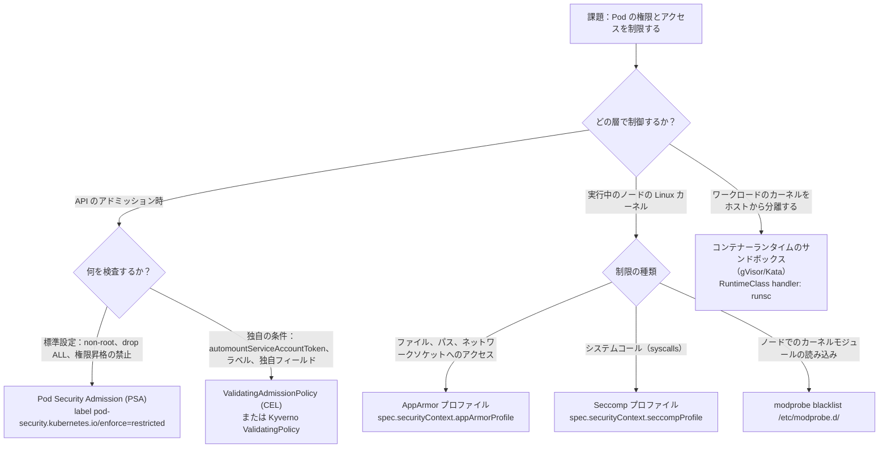
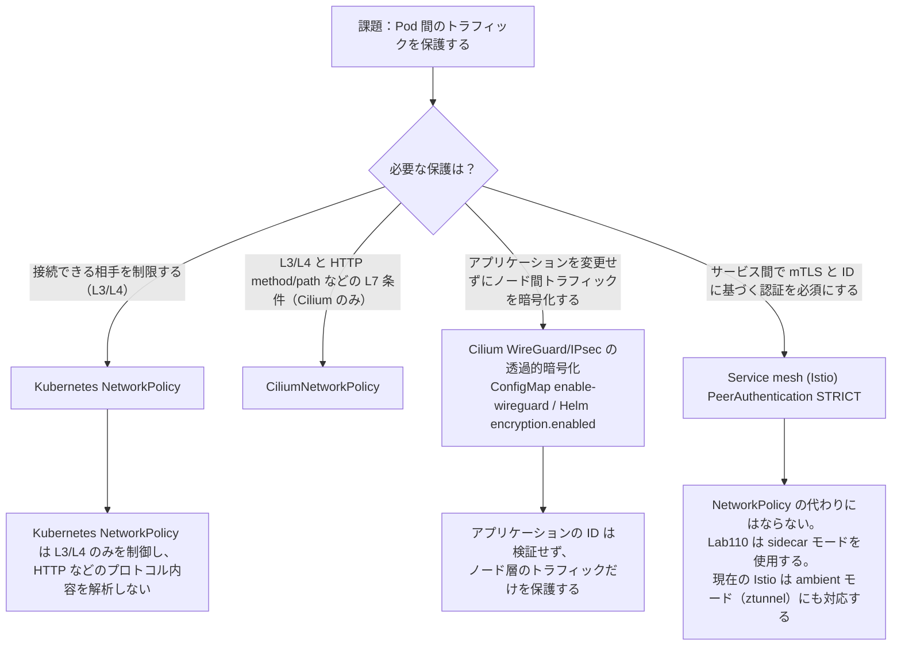
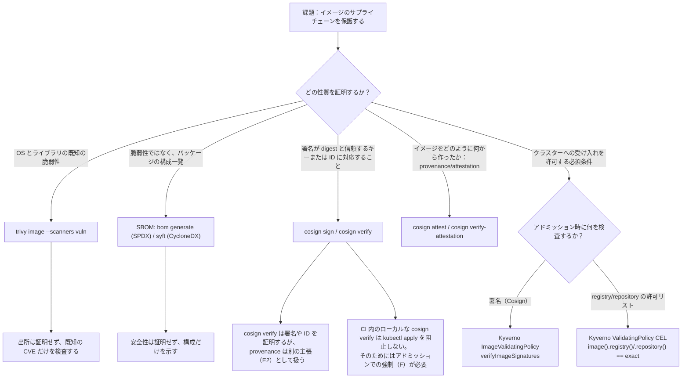
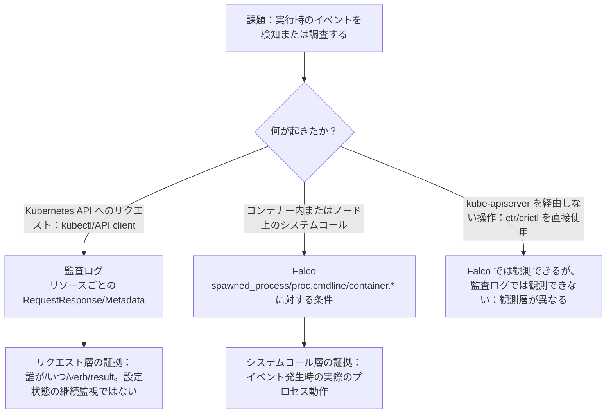

[Русская версия](CHEATSHEET_RU.md) · [Eng version](CHEATSHEET.md) · [Versión en español](CHEATSHEET_ES.md) · [Version française](CHEATSHEET_FR.md) · [Deutsche Version](CHEATSHEET_DE.md) · [ქართული ვერსია](CHEATSHEET_GE.md) · [繁體中文版](CHEATSHEET_TW.md)

[←コース内容](README_JP.md) ・[用語解説](GLOSSARY_JP.md) ・[トラブルシューティング索引(RU)](TROUBLESHOOTING_INDEX_RU.md)

# CKS チートシート: すぐに使用できる YAML および CLI コマンド

理論や長い説明のない単一のファイル: コース ラボのソリューションからの正規の作業スニペット `101-114`。すべてのブロックはそのソース (ラボ/タスク) を識別するため、完全な説明は対応するラボの `worker/files/solutions/1_JP.MD` で見つけることができます。ラボまたは試験中に `Ctrl+F`/ページ検索を使用します。

> これらのスニペットは、クイック リファレンス用にラボの `101-114` ソリューションから適応および短縮されています (変数、インデント、サポート手順は簡略化されている場合があります)。ラボの最新バージョンと何かが異なる場合は、そのラボの README/ソリューションに従ってください。

## このファイルの使い方

- [デシジョン ツリー](#decision-trees): タスクに適切なツールを選択する必要がある場合。
- 以下のドメイン セクション: 必要なものがわかっていて、すぐに使用できるスニペットが必要な場合。
- [用語とラボのアルファベット順インデックス](GLOSSARY_JP.md): 章にリンクされた用語/CLI フラグ。
- [症状参照 (RU)](TROUBLESHOOTING_INDEX_RU.md): 何かが失敗し、原因を迅速に見つける必要がある場合。

---

<a id="decision-trees"></a>

## ディシジョンツリー

### 権限/アクセスの制限: PSA vs ValidatingAdmissionPolicy vs AppArmor vs seccomp



### トラフィック暗号化: NetworkPolicy vs CNI 暗号化 vs mTLS メッシュ



### サプライ チェーン: スキャン vs 署名 vs 来歴/証明 vs SBOM vs 認証の強制



### ランタイム検出: 監査ログ vs Falco vs 両方



---

## 1. Cluster Setup

### NetworkPolicy: AND、OR、および `ipBlock.except`
*出典: ラボ 101、タスク 6。*

AND: 同じ `from` 項目内の両方のセレクター:

```yaml
apiVersion: networking.k8s.io/v1
kind: NetworkPolicy
metadata:
  name: allow-backend-ingress-from-legacy
  namespace: cks-101
spec:
  podSelector:
    matchLabels:
      app: backend
  policyTypes:
    - Ingress
  ingress:
    - from:
        - namespaceSelector:
            matchLabels:
              kubernetes.io/metadata.name: cks-101-legacy
          podSelector:
            matchLabels:
              app: legacy-client
      ports:
        - protocol: TCP
          port: 8080
```

OR: 個別の `from` 項目 (上記の AND とは異なります):

```yaml
    - from:
        - namespaceSelector:
            matchLabels:
              kubernetes.io/metadata.name: cks-101-legacy
        - podSelector:
            matchLabels:
              app: legacy-client
```

例外を伴う `ipBlock` (ノード メタデータ エンドポイントなど):

```yaml
apiVersion: networking.k8s.io/v1
kind: NetworkPolicy
metadata:
  name: allow-legacy-egress
  namespace: cks-101-legacy
spec:
  podSelector:
    matchLabels:
      app: legacy-client
  policyTypes:
    - Egress
  egress:
    - to:
        - ipBlock:
            cidr: 0.0.0.0/0
            except:
              - 169.254.169.254/32
```

### CiliumNetworkPolicy: L3/L4/L7
*出典: ラボ 102、タスク 3。*

```yaml
apiVersion: cilium.io/v2
kind: CiliumNetworkPolicy
metadata:
  name: backend-policy
  namespace: cks-102
spec:
  endpointSelector:
    matchLabels:
      app: backend
  ingress:
    - fromEndpoints:
        - matchLabels:
            role: frontend
      toPorts:
        - ports:
            - port: "80"
              protocol: TCP
          rules:
            http:
              - method: GET
                path: "/"
```

### kube-bench: 出力の実行と解釈中
*出典: ラボ 103、タスク 1。*

```bash
mkdir -p /var/work/tests/artifacts/1
scp -r /opt/kube-bench control-plane:/tmp/kube-bench
ssh control-plane 'sudo rm -rf /opt/kube-bench && sudo mv /tmp/kube-bench /opt/kube-bench'
ssh control-plane 'sudo /opt/kube-bench/kube-bench run --benchmark cis-1.12 --targets master,controlplane,node' \
  | tee /var/work/tests/artifacts/1/kube-bench.txt
grep -E '\[(PASS|WARN|FAIL)\]' /var/work/tests/artifacts/1/kube-bench.txt | head
```

> 固定された `kube-bench 0.16.0` には、`cis-1.12` より新しいプロファイルはありません (組み込みの `version_mapping` は `"1.34": "cis-1.12"` で終わります)。自動検出に依存する代わりにこのプロファイルを明示的に指定し、新しい Kubernetes バージョンの結果を `forced-approximate` としてマークします。

---

## 2. Cluster Hardening

### RBAC: 最小限のロールとロールバインディング
*出典: ラボ 104、タスク 1。*

```yaml
apiVersion: v1
kind: ServiceAccount
metadata:
  name: auditor
  namespace: security-104
---
apiVersion: rbac.authorization.k8s.io/v1
kind: Role
metadata:
  name: pod-observer
  namespace: security-104
rules:
- apiGroups: [""]
  resources: ["pods"]
  verbs: ["get", "list", "watch"]
---
apiVersion: rbac.authorization.k8s.io/v1
kind: RoleBinding
metadata:
  name: auditor-pod-observer
  namespace: security-104
subjects:
- kind: ServiceAccount
  name: auditor
  namespace: security-104
roleRef:
  apiGroup: rbac.authorization.k8s.io
  kind: Role
  name: pod-observer
```

### 自動トークンマウントなしの ServiceAccount
*出典: ラボ 104、タスク 3.*

```yaml
apiVersion: v1
kind: ServiceAccount
metadata:
  name: no-token-sa
  namespace: security-104
automountServiceAccountToken: false
---
apiVersion: v1
kind: Pod
metadata:
  name: no-token
  namespace: security-104
spec:
  serviceAccountName: no-token-sa
  automountServiceAccountToken: false
  containers:
  - name: app
    image: busybox:1.36
    command: ["sh", "-c", "sleep 3600"]
```

### Secret ボリューム: `defaultMode: 0400` (= `256` 10 進数)
*出典: ラボ 104、タスク 6.*

> `kubectl get pod -o json` は、`defaultMode: 0400` を 10 進数の `256` として表示します。 `defaultMode: 400` (先頭のゼロなし) と書くと、8 進数の `0400`/`256` ではなく、10 進数の `400` を意味します。試験でよくある間違いです。

```yaml
apiVersion: v1
kind: Pod
metadata:
  name: app-vulnerable
  namespace: security-104
spec:
  automountServiceAccountToken: false
  containers:
  - name: app
    image: busybox:1.36
    command: ["sh", "-c", "sleep 3600"]
    volumeMounts:
    - name: db-creds-vol
      mountPath: /etc/secrets
      readOnly: true
  volumes:
  - name: db-creds-vol
    secret:
      secretName: db-creds
      defaultMode: 0400
```

### kubeadm マイナー アップグレード: 最初にコントロール プレーン、その後にワーカー
*出典: ラボ 113、タスク 1 ～ 2。*

> 順序は重要です。ワーカーをアップグレードする前に、コントロール プレーン全体のアップグレード (禁止解除を含む) を完了してください。そうしないと、バージョン スキュー ポリシーに違反します。コントロール プレーンでは `kubeadm upgrade apply` を使用します。ワーカーでは `kubeadm upgrade node` (`apply` ではありません) を使用します。 `pkgs.k8s.io` には、マイナー バージョンごとに個別の apt リポジトリがあります。 `sources.list.d/kubernetes.list` を `apt install kubeadm` の前のターゲット マイナーに切り替えます。

```bash
# リポジトリをターゲット マイナー (例: 1.36) に切り替えます。
curl -fsSL https://pkgs.k8s.io/core:/stable:/v1.36/deb/Release.key | sudo gpg --dearmor -o /etc/apt/keyrings/kubernetes-apt-keyring.gpg
echo "deb [signed-by=/etc/apt/keyrings/kubernetes-apt-keyring.gpg] https://pkgs.k8s.io/core:/stable:/v1.36/deb/ /" | sudo tee /etc/apt/sources.list.d/kubernetes.list
sudo apt-get update -qq

# コントロール プレーン: kubeadm を更新し、計画を検査し、アップグレードを実行します。
sudo apt-mark unhold kubeadm && sudo apt-get install -y --allow-change-held-packages kubeadm && sudo apt-mark hold kubeadm
sudo kubeadm upgrade plan
sudo kubeadm upgrade apply v1.36.1 -y

# 適用が成功した後のみ: ドレイン -> kubelet/kubectl の更新 -> 再起動 -> 解除
kubectl drain <control-plane-node> --ignore-daemonsets --delete-emptydir-data
sudo apt-mark unhold kubelet kubectl && sudo apt-get install -y --allow-change-held-packages kubelet kubectl && sudo apt-mark hold kubelet kubectl
sudo systemctl daemon-reload && sudo systemctl restart kubelet
kubectl uncordon <control-plane-node>

# ワーカー (コントロール プレーンがターゲット バージョンで準備完了後): kubeadm アップグレード NODE、適用されません
sudo kubeadm upgrade node
```

---

## 3. System Hardening

### AppArmor: プロファイルをロードし、それを Pod に割り当てます。
*出典: ラボ 106、タスク 2 および 8。*

```bash
ssh control-plane 'sudo apparmor_parser -r -v /etc/apparmor.d/k8s-106-broken-profile'
ssh control-plane 'sudo aa-status | grep k8s-106-broken-profile'
```

現在のフィールドは `spec.securityContext.appArmorProfile` です (古いベータ アノテーション `container.apparmor.security.beta.kubernetes.io/...` ではありません)。

```yaml
apiVersion: v1
kind: Pod
metadata:
  name: apparmor-writer
  namespace: security-106
spec:
  nodeSelector:
    security.cks.io/localhost-profiles-106: "true"
  automountServiceAccountToken: false
  securityContext:
    appArmorProfile:
      type: Localhost
      localhostProfile: k8s-106-deny-write
  containers:
  - name: app
    image: busybox:1.36
    command: ["sh", "-c", "sleep 3600"]
    volumeMounts:
    - name: work
      mountPath: /work
  volumes:
  - name: work
    emptyDir: {}
```

### Seccomp: Localhost JSON プロファイルおよび Pod リファレンス
*出典: ラボ 106、タスク 4 ～ 5。*

```json
{
  "defaultAction": "SCMP_ACT_ALLOW",
  "architectures": ["SCMP_ARCH_X86_64"],
  "syscalls": [
    {
      "names": ["unshare"],
      "action": "SCMP_ACT_ERRNO",
      "errnoRet": 1
    }
  ]
}
```

```yaml
apiVersion: v1
kind: Pod
metadata:
  name: localhost-seccomp
  namespace: security-106
spec:
  nodeSelector:
    security.cks.io/localhost-profiles-106: "true"
  automountServiceAccountToken: false
  securityContext:
    seccompProfile:
      type: Localhost
      localhostProfile: profiles/cks-106-deny-unshare.json
  containers:
  - name: app
    image: busybox:1.36
    command: ["sh", "-c", "sleep 3600"]
```

> `localhostProfile` は、絶対ファイル パスではなく、常に kubelet seccomp ルート (通常は `/var/lib/kubelet/seccomp/`) に対する相対パスです。

---

## 4. Minimize Microservice Vulnerabilities

### Pod セキュリティ入場: `restricted`
*出典: ラボ 107、タスク 1。*

```bash
kubectl label namespace psa-restricted-107 \
  pod-security.kubernetes.io/enforce=restricted \
  pod-security.kubernetes.io/enforce-version=v1.36
```

### ValidatingAdmissionPolicy + バインディング: `automountServiceAccountToken` 用 CEL
*出典: ラボ 107、タスク 6。*

> `allowPrivilegeEscalation: false` および `capabilities.drop: ["ALL"]` は、上記の PSA `restricted` ですでにカバーされており、この VAP では意図的に重複していません。ここで、CEL は、PSA がチェックしないカスタム条件にのみ使用されます。

```yaml
apiVersion: admissionregistration.k8s.io/v1
kind: ValidatingAdmissionPolicy
metadata:
  name: require-no-automount-token
spec:
  failurePolicy: Fail
  matchConstraints:
    resourceRules:
    - apiGroups: [""]
      apiVersions: ["v1"]
      operations: ["CREATE", "UPDATE"]
      resources: ["pods"]
  validations:
  - expression: >-
      has(object.spec.automountServiceAccountToken) &&
      object.spec.automountServiceAccountToken == false
    message: "spec.automountServiceAccountToken must be explicitly set to false"
---
apiVersion: admissionregistration.k8s.io/v1
kind: ValidatingAdmissionPolicyBinding
metadata:
  name: require-no-automount-token-binding
spec:
  policyName: require-no-automount-token
  validationActions: [Deny]
  matchResources:
    namespaceSelector:
      matchLabels:
        kubernetes.io/metadata.name: psa-restricted-107
```

### EncryptionConfiguration: etcd (`aescbc`) での Secrets の暗号化
*出典: ラボ 109、タスク 2。*

```bash
umask 077
key=$(head -c 32 /dev/urandom | base64 -w0)
cat > /etc/kubernetes/enc/encryption-config.yaml <<EOF
apiVersion: apiserver.config.k8s.io/v1
kind: EncryptionConfiguration
resources:
- resources:
  - secrets
  providers:
  - aescbc:
      keys:
      - name: cks-109-aescbc
        secret: ${key}
  - identity: {}
EOF
```

> プロバイダーの順序は重要です。最初のプロバイダーは新しい書き込みを処理します。新しいプロバイダーは古いレコードのみを読み取ります。最後の `identity: {}` では、完全に再暗号化されるまで、既存の暗号化されていない Secrets を読み取ることができます。

### gVisor: containerd `runsc` および RuntimeClass
*出典: ラボ 110、タスク 1。*

```bash
ssh k8s110_node_gvisor 'sudo tee -a /etc/containerd/config.toml > /dev/null <<EOF
[plugins."io.containerd.grpc.v1.cri".containerd.runtimes.runsc]
  runtime_type = "io.containerd.runsc.v1"
EOF
sudo systemctl restart containerd'
```

```yaml
apiVersion: node.k8s.io/v1
kind: RuntimeClass
metadata:
  name: gvisor
handler: runsc
scheduling:
  nodeSelector:
    sandbox.runtime/gvisor: "true"
```

### Cilium WireGuard: 透過的な暗号化を有効にする
*出典: ラボ 110、タスク 4.*

Helm-managed のインストール:

```bash
helm upgrade cilium cilium/cilium -n kube-system --reuse-values \
  --set encryption.enabled=true --set encryption.type=wireguard
```

ConfigMap-based のインストール (Helm リリースがない場合):

```bash
kubectl -n kube-system patch configmap cilium-config --type merge \
  -p '{"data":{"enable-wireguard":"true"}}'
kubectl -n kube-system rollout restart daemonset/cilium
```

### Istio PeerAuthentication: `STRICT` mTLS
*出典: ラボ 110、タスク 6.*

```yaml
apiVersion: security.istio.io/v1
kind: PeerAuthentication
metadata:
  name: market-strict
  namespace: market
spec:
  mtls:
    mode: STRICT
```

---

## 5. Supply Chain Security

### Trivy: JSON 画像スキャン
*出典: ラボ 111、タスク 1。*

```bash
trivy image --scanners vuln --vuln-type os,library --format json \
  --output trivy-report.json "$IMAGE"
```

### Trivy: 完全なパッケージリスト
*出典: ラボ 111、タスク 5。*

```bash
trivy image --list-all-pkgs --format json "$IMAGE" > packages.json
jq -r '[.Results[].Packages[]? | "\(.Name)=\(.Version)"] | unique | .[:3][]' packages.json
```

### SBOM: SPDX と `bom`、CycloneDX と `syft`
*出典: ラボ 111、タスク 6 ～ 7。*

```bash
bom generate --format json --output bom.spdx.json --image "$IMAGE"
syft "$IMAGE" -o "cyclonedx-json=syft.cdx.json"
```

### `trivy sbom`: 既存の SBOM ファイルをスキャンしています
*出典: ラボ 111、タスク 8.*

```bash
trivy sbom --format json --output sbom-scan.json bom.spdx.json
```

> `trivy image <file>` ではなく、`trivy sbom <file>` を使用してください。パスはイメージ参照としてではなく、SBOM として渡されます。

### Cosign: キーの生成、署名、検証 (キーベースおよびキーレス)
*出典: ラボ 111、タスク 7、9a、9c。*

```bash
cosign generate-key-pair
cosign sign --key cosign.key --yes "$HARDENED_IMAGE"
cosign verify --key cosign.pub "$HARDENED_IMAGE"
```

公開 OIDC 署名付きアーティファクトのキーレス検証:

```bash
cosign verify \
  --certificate-oidc-issuer https://accounts.google.com \
  --certificate-identity keyless@distroless.iam.gserviceaccount.com \
  gcr.io/distroless/static:nonroot
```

### Kyverno ImageValidatingPolicy: 入場時の Cosign 署名検証
*出典: ラボ 111、タスク 9a.*

```yaml
apiVersion: policies.kyverno.io/v1
kind: ImageValidatingPolicy
metadata:
  name: require-signed-catalog-images
spec:
  failurePolicy: Fail
  validationActions: [Deny]
  matchConstraints:
    resourceRules:
    - apiGroups: [""]
      apiVersions: ["v1"]
      operations: ["CREATE", "UPDATE"]
      resources: ["pods"]
  matchImageReferences:
  - glob: "${HARDENED_REPO}*"
  attestors:
  - name: catalogReleaseKey
    cosign:
      key:
        data: |-
          <インデント cosign.pub PEM>
  validations:
  - message: "catalog image must have a valid release signature"
    expression: >-
      (images.containers + images.?initContainers.orValue([]) +
      images.?ephemeralContainers.orValue([])).map(image,
        verifyImageSignatures(image, [attestors.catalogReleaseKey]) > 0).all(ok, ok)
```

### Kyverno ValidatingPolicy: 正確なレジストリ/リポジトリ許可リスト (プレフィックス一致ではない)
*出典: ラボ 112、タスク 9.*

> `startsWith`/プレフィックス一致ではなく、正確な `==` を使用します。それ以外の場合、`library/busybox-evil` は、その名前が許可された文字列で始まるという理由だけでポリシーを渡します。

```yaml
apiVersion: policies.kyverno.io/v1
kind: ValidatingPolicy
metadata:
  name: require-trusted-registry-runtime-112
spec:
  matchConstraints:
    resourceRules:
    - apiGroups: [""]
      apiVersions: ["v1"]
      resources: ["pods"]
      operations: ["CREATE"]
  matchConditions:
  - name: only-runtime-112
    expression: "object.metadata.namespace == 'runtime-112'"
  validations:
  - expression: >
      object.spec.containers.all(c,
        image(c.image).registry() == 'docker.io' &&
        image(c.image).repository() == 'library/busybox')
    message: "CKS112_TRUSTED_REPO_POLICY: only docker.io/library/busybox is allowed in runtime-112"
  validationActions: [Deny]
```

---

## 6. Monitoring, Logging & Runtime Security

### AuditPolicy: 正しいルール順序
*出典: ラボ 112、タスク 4。*

> 順序は重要です。API サーバーは、FIRST 一致ルールを上から下に適用します。特定のルールは、最後の一般的な総括の前に置く必要があります。

```yaml
apiVersion: audit.k8s.io/v1
kind: Policy
omitStages: ["RequestReceived"]
rules:
# 1. 大規模/低リスクイベントの騒音低減
- level: None
  resources:
  - group: ""
    resources: ["events"]
- level: None
  nonResourceURLs: ["/healthz*", "/livez*", "/readyz*", "/version"]
# 2.特定のルール: 完全な ConfigMaps (ボディは敏感ではありません)
- level: RequestResponse
  namespaces: ["runtime-112"]
  resources:
  - group: ""
    resources: ["configmaps"]
# 3. Secrets: シークレットボディのログを避けるため、メタデータのみ
- level: Metadata
  resources:
  - group: ""
    resources: ["secrets"]
# 4. 残りの API のフォールバック ログ (LAST である必要があります)
- level: Metadata
```

### Falco: カスタム ルール (条件/出力/優先度)
*出典: ラボ 112、タスク 3.*

```yaml
- rule: CKS112 Custom Shell Marker
  desc: Detect the controlled CKS lab marker in a container process command line
  condition: spawned_process and container and proc.cmdline contains "CKS112_CUSTOM_EVENT"
  output: "CKS112 custom shell marker container=%container.id pid=%proc.pid ppid=%proc.ppid user=%user.name command=%proc.cmdline"
  priority: WARNING
```

### Falco: `user_expected_terminal_shell_in_container_conditions` マクロをオーバーライドします。
*出典: ラボ 112、タスク 7。*

```yaml
- macro: user_expected_terminal_shell_in_container_conditions
  condition: (k8s.ns.name = "runtime-112" and k8s.pod.name = "ci-runner")
  override:
    condition: replace
```

> これは、`user_shell_container_exclusions` (別のルール **Run shell untrusted** に属します) とは異なります。類似したマクロ名は混同しやすいです。

### Falco: JSON とファイル出力
*出典: ラボ 112、タスク 7。*

```yaml
# /etc/falco/config.d/output.yaml
json_output: true
file_output:
  enabled: true
  filename: /var/log/falco/events.log
```

### `crictl`: アラートと Pod/namespace の関連付け
*出典: ラボ 112、タスク 6。*

```bash
# 1. 短いコンテナー ID とホスト PID は、Falco アラートからすでに抽出されています。
CONTAINER_ID=$(sudo crictl ps -a -q | awk "/^${SHORT_ID}/ {print; exit}")
sudo crictl inspect "$CONTAINER_ID" > cri-container.json
SANDBOX_ID=$(jq -r '.status.sandboxId' cri-container.json)
sudo crictl inspectp "$SANDBOX_ID" > cri-sandbox.json
POD=$(jq -r '.status.metadata.name' cri-sandbox.json)
NAMESPACE=$(jq -r '.status.metadata.namespace' cri-sandbox.json)
```

### `/proc/<PID>/`: 調査中のナビゲーション
*出典: ラボ 112、タスク 6。*

```bash
sudo cat /proc/$HOST_PID/status
sudo tr '\0' ' ' </proc/$HOST_PID/cmdline; echo
sudo cat /proc/$HOST_PID/cgroup
sudo ps -eo pid,ppid,user,lstart,args --forest
```

> プロセスが生きている間にこれらのアーティファクトを収集してください。 Pod が削除されると、対応する `/proc/<PID>` は完全に消えます。

### 書き込み可能な `/tmp` を備えた不変のルート ファイルシステム
*出典: ラボ 112、タスク 5.*

```yaml
apiVersion: v1
kind: Pod
metadata:
  name: immutable-app
  namespace: runtime-112
spec:
  automountServiceAccountToken: false
  containers:
  - name: app
    image: busybox:1.36
    command: ["sh", "-c", "sleep 3600"]
    securityContext:
      readOnlyRootFilesystem: true
    volumeMounts:
    - name: writable-tmp
      mountPath: /tmp
  volumes:
  - name: writable-tmp
    emptyDir: {}
```

---

[←コース内容](README_JP.md) ・[用語解説](GLOSSARY_JP.md) ・[トラブルシューティング索引(RU)](TROUBLESHOOTING_INDEX_RU.md)
