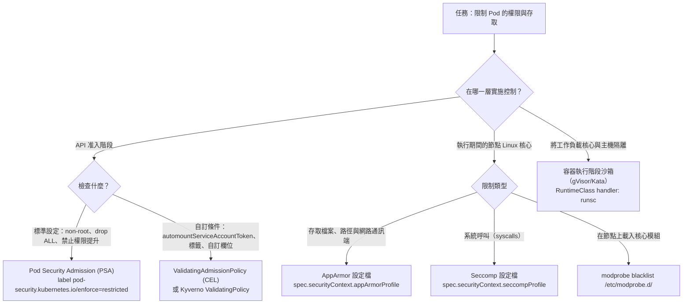
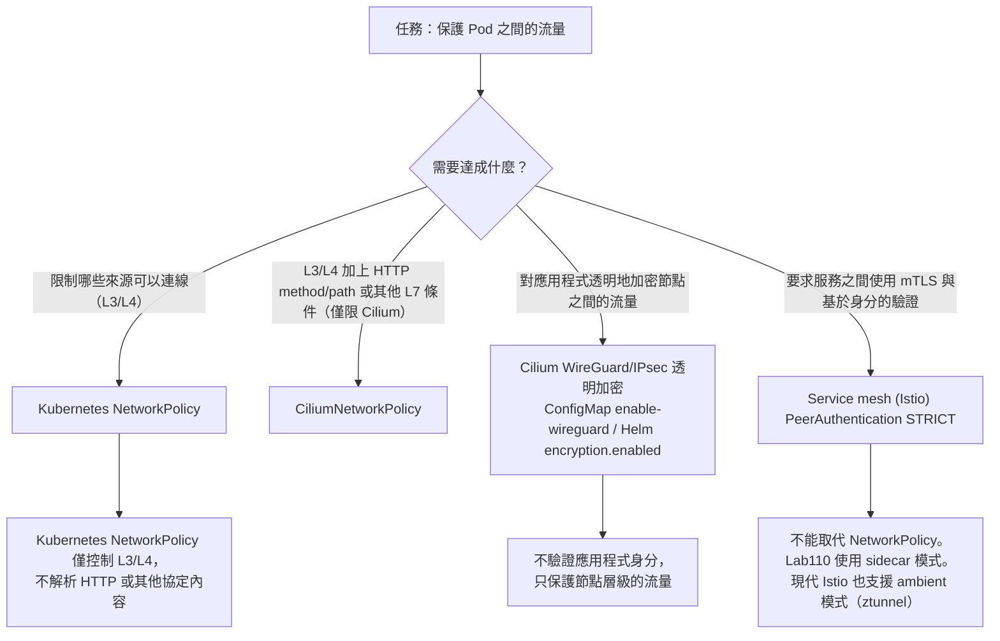
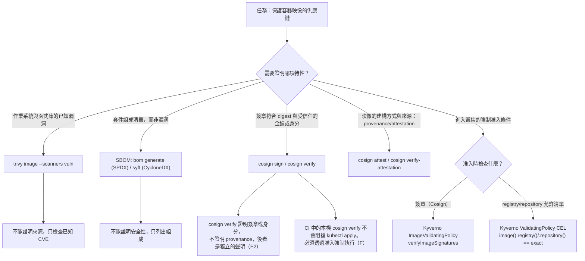
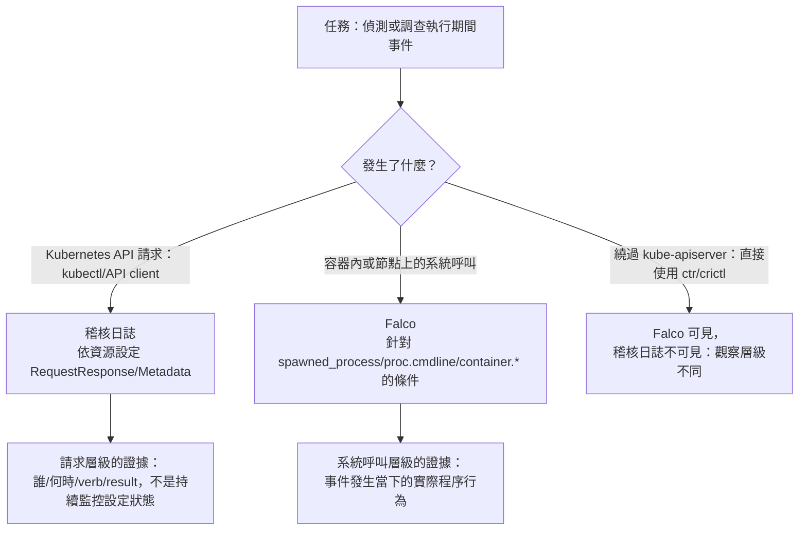

[Русская версия](CHEATSHEET_RU.md) · [Eng version](CHEATSHEET.md) · [Versión en español](CHEATSHEET_ES.md) · [Version française](CHEATSHEET_FR.md) · [Deutsche Version](CHEATSHEET_DE.md) · [ქართული ვერსია](CHEATSHEET_GE.md) · [日本語版](CHEATSHEET_JP.md)

[← 課程內容](README_TW.md) · [詞彙表](GLOSSARY_TW.md) · [故障排除索引 (RU)](TROUBLESHOOTING_INDEX_RU.md)

# CKS 備忘單：即用型 YAML 和 CLI 指令

沒有理論或冗長解釋的單一文件：課程實驗室 `101-114` 解決方案中的規格工作片段。每個區塊都會標識其來源（實驗室/任務），因此您可以在相應實驗室的 `worker/files/solutions/1_TW.MD` 中找到完整的解釋。在實驗室或考試期間使用 `Ctrl+F`/頁面搜尋。

> 這些片段是根據實驗室 `101-114` 解決方案改編和縮短的，以供快速參考（變數、縮排和支援步驟可能已簡化）。如果某些內容與最新實驗室版本有所不同，請遵循該實驗室的自述文件/解決方案。

## 如何使用該文件

- [決策樹](#decision-trees)：當您需要為任務選擇正確的工具。
- 下面的域部分：當您知道自己需要什麼並想要一個現成的程式碼片段。
- [按字母順序排列的術語和實驗室索引](GLOSSARY_TW.md)：用於連結到章節的術語/CLI 標誌。
- [症狀參考(RU)](TROUBLESHOOTING_INDEX_RU.md)：當某件事發生故障並且需要快速找出原因時。

---

<a id="decision-trees"></a>

## 決策樹

### 限制權限/存取：PSA vs ValidatingAdmissionPolicy vs AppArmor vs seccomp



### 流量加密：NetworkPolicy vs CNI 加密 vs mTLS 網格



### 供應鏈：掃描、簽章、出處/證明、SBOM、存取執行



### 運行時檢測：審核日誌與 Falco 與兩者



---

## 1. Cluster Setup

### NetworkPolicy：AND、OR 和 `ipBlock.except`
*來源：實驗室 101，任務 6。*

AND：同一 `from` 項目中的兩個選擇器：

```yaml
apiVersion: networking.k8s.io/v1
kind: NetworkPolicy
metadata:
  name: allow-backend-ingress-from-legacy
  namespace: cks-101
spec:
  podSelector:
    matchLabels:
      app: backend
  policyTypes:
    - Ingress
  ingress:
    - from:
        - namespaceSelector:
            matchLabels:
              kubernetes.io/metadata.name: cks-101-legacy
          podSelector:
            matchLabels:
              app: legacy-client
      ports:
        - protocol: TCP
          port: 8080
```

OR：單獨的 `from` 項目（與上面的 AND 不同）：

```yaml
    - from:
        - namespaceSelector:
            matchLabels:
              kubernetes.io/metadata.name: cks-101-legacy
        - podSelector:
            matchLabels:
              app: legacy-client
```

`ipBlock` 有例外（例如，節點元資料端點）：

```yaml
apiVersion: networking.k8s.io/v1
kind: NetworkPolicy
metadata:
  name: allow-legacy-egress
  namespace: cks-101-legacy
spec:
  podSelector:
    matchLabels:
      app: legacy-client
  policyTypes:
    - Egress
  egress:
    - to:
        - ipBlock:
            cidr: 0.0.0.0/0
            except:
              - 169.254.169.254/32
```

### CiliumNetworkPolicy：L3/L4/L7
*來源：實驗室 102，任務 3。*

```yaml
apiVersion: cilium.io/v2
kind: CiliumNetworkPolicy
metadata:
  name: backend-policy
  namespace: cks-102
spec:
  endpointSelector:
    matchLabels:
      app: backend
  ingress:
    - fromEndpoints:
        - matchLabels:
            role: frontend
      toPorts:
        - ports:
            - port: "80"
              protocol: TCP
          rules:
            http:
              - method: GET
                path: "/"
```

### kube-bench：運行並解釋輸出
*來源：實驗室 103，任務 1。*

```bash
mkdir -p /var/work/tests/artifacts/1
scp -r /opt/kube-bench control-plane:/tmp/kube-bench
ssh control-plane 'sudo rm -rf /opt/kube-bench && sudo mv /tmp/kube-bench /opt/kube-bench'
ssh control-plane 'sudo /opt/kube-bench/kube-bench run --benchmark cis-1.12 --targets master,controlplane,node' \
  | tee /var/work/tests/artifacts/1/kube-bench.txt
grep -E '\[(PASS|WARN|FAIL)\]' /var/work/tests/artifacts/1/kube-bench.txt | head
```

> 固定的 `kube-bench 0.16.0` 沒有比 `cis-1.12` 更新的設定檔（其內建 `version_mapping` 以 `"1.34": "cis-1.12"` 結尾）。明確指定此設定檔而不是依賴自動偵測，並將較新的 Kubernetes 版本的結果標記為 `forced-approximate`。

---

## 2. Cluster Hardening

### RBAC：最小角色和角色綁定
*來源：實驗室 104，任務 1。*

```yaml
apiVersion: v1
kind: ServiceAccount
metadata:
  name: auditor
  namespace: security-104
---
apiVersion: rbac.authorization.k8s.io/v1
kind: Role
metadata:
  name: pod-observer
  namespace: security-104
rules:
- apiGroups: [""]
  resources: ["pods"]
  verbs: ["get", "list", "watch"]
---
apiVersion: rbac.authorization.k8s.io/v1
kind: RoleBinding
metadata:
  name: auditor-pod-observer
  namespace: security-104
subjects:
- kind: ServiceAccount
  name: auditor
  namespace: security-104
roleRef:
  apiGroup: rbac.authorization.k8s.io
  kind: Role
  name: pod-observer
```

### ServiceAccount 不含自動令牌安裝
*來源：實驗室 104，任務 3。*

```yaml
apiVersion: v1
kind: ServiceAccount
metadata:
  name: no-token-sa
  namespace: security-104
automountServiceAccountToken: false
---
apiVersion: v1
kind: Pod
metadata:
  name: no-token
  namespace: security-104
spec:
  serviceAccountName: no-token-sa
  automountServiceAccountToken: false
  containers:
  - name: app
    image: busybox:1.36
    command: ["sh", "-c", "sleep 3600"]
```

### Secret 體積：`defaultMode: 0400`（= `256` 十進位）
*來源：實驗室 104，任務 6。*

> `kubectl get pod -o json` 將 `defaultMode: 0400` 顯示為十進位 `256`。書寫 `defaultMode: 400`（不含前導零）表示十進位 `400`，而不是八進位 `0400`/`256`：常見的考試錯誤。

```yaml
apiVersion: v1
kind: Pod
metadata:
  name: app-vulnerable
  namespace: security-104
spec:
  automountServiceAccountToken: false
  containers:
  - name: app
    image: busybox:1.36
    command: ["sh", "-c", "sleep 3600"]
    volumeMounts:
    - name: db-creds-vol
      mountPath: /etc/secrets
      readOnly: true
  volumes:
  - name: db-creds-vol
    secret:
      secretName: db-creds
      defaultMode: 0400
```

### kubeadm 小升級：首先是控制平面，然後是工作人員
*來源：實驗室 113，任務 1-2。*

> 順序很重要：在升級工作執行緒之前完成整個控制平面升級（包括取消封鎖），否則就違反了版本傾斜政策。在控制平面上使用`kubeadm upgrade apply`；工人使用 `kubeadm upgrade node`（不是 `apply`）。 `pkgs.k8s.io` 每個次要版本都有一個單獨的 apt 儲存庫。在 `apt install kubeadm` 之前將 `sources.list.d/kubernetes.list` 切換到目標次要版本。

```bash
# 將儲存庫切換到目標次要版本（例如：1.36）
curl -fsSL https://pkgs.k8s.io/core:/stable:/v1.36/deb/Release.key | sudo gpg --dearmor -o /etc/apt/keyrings/kubernetes-apt-keyring.gpg
echo "deb [signed-by=/etc/apt/keyrings/kubernetes-apt-keyring.gpg] https://pkgs.k8s.io/core:/stable:/v1.36/deb/ /" | sudo tee /etc/apt/sources.list.d/kubernetes.list
sudo apt-get update -qq

# 控制平面：更新 kubeadm、檢查計畫、運行升級
sudo apt-mark unhold kubeadm && sudo apt-get install -y --allow-change-held-packages kubeadm && sudo apt-mark hold kubeadm
sudo kubeadm upgrade plan
sudo kubeadm upgrade apply v1.36.1 -y

# 僅在成功應用後：排空 -> 更新 kubelet/kubectl -> 重新啟動 -> 取消封鎖
kubectl drain <control-plane-node> --ignore-daemonsets --delete-emptydir-data
sudo apt-mark unhold kubelet kubectl && sudo apt-get install -y --allow-change-held-packages kubelet kubectl && sudo apt-mark hold kubelet kubectl
sudo systemctl daemon-reload && sudo systemctl restart kubelet
kubectl uncordon <control-plane-node>

# Worker（控制平面在目標版本上就緒後）：kubeadm 升級 NODE，不套用
sudo kubeadm upgrade node
```

---

## 3. System Hardening

### AppArmor：載入設定檔並將其指派給 Pod
*來源：實驗室 106，任務 2 和 8。*

```bash
ssh control-plane 'sudo apparmor_parser -r -v /etc/apparmor.d/k8s-106-broken-profile'
ssh control-plane 'sudo aa-status | grep k8s-106-broken-profile'
```

目前欄位是 `spec.securityContext.appArmorProfile` （不是舊的 beta 註解 `container.apparmor.security.beta.kubernetes.io/...`）：

```yaml
apiVersion: v1
kind: Pod
metadata:
  name: apparmor-writer
  namespace: security-106
spec:
  nodeSelector:
    security.cks.io/localhost-profiles-106: "true"
  automountServiceAccountToken: false
  securityContext:
    appArmorProfile:
      type: Localhost
      localhostProfile: k8s-106-deny-write
  containers:
  - name: app
    image: busybox:1.36
    command: ["sh", "-c", "sleep 3600"]
    volumeMounts:
    - name: work
      mountPath: /work
  volumes:
  - name: work
    emptyDir: {}
```

### Seccomp：Localhost JSON 設定檔和 Pod 參考
*來源：實驗室 106，任務 4-5。*

```json
{
  "defaultAction": "SCMP_ACT_ALLOW",
  "architectures": ["SCMP_ARCH_X86_64"],
  "syscalls": [
    {
      "names": ["unshare"],
      "action": "SCMP_ACT_ERRNO",
      "errnoRet": 1
    }
  ]
}
```

```yaml
apiVersion: v1
kind: Pod
metadata:
  name: localhost-seccomp
  namespace: security-106
spec:
  nodeSelector:
    security.cks.io/localhost-profiles-106: "true"
  automountServiceAccountToken: false
  securityContext:
    seccompProfile:
      type: Localhost
      localhostProfile: profiles/cks-106-deny-unshare.json
  containers:
  - name: app
    image: busybox:1.36
    command: ["sh", "-c", "sleep 3600"]
```

> `localhostProfile` 總是相對於 kubelet seccomp 根（通常是 `/var/lib/kubelet/seccomp/`），而不是絕對檔案路徑。

---

## 4. Minimize Microservice Vulnerabilities

### Pod 安全准入：`restricted`
*來源：實驗室 107，任務 1。*

```bash
kubectl label namespace psa-restricted-107 \
  pod-security.kubernetes.io/enforce=restricted \
  pod-security.kubernetes.io/enforce-version=v1.36
```

### ValidatingAdmissionPolicy + 綁定：CEL 適用於 `automountServiceAccountToken`
*來源：實驗室 107，任務 6。*

> `allowPrivilegeEscalation: false` 和 `capabilities.drop: ["ALL"]` 已包含在上面的 PSA `restricted` 中，並且故意不在本 VAP 中重複。這裡CEL僅用於PSA不檢查的自訂條件。

```yaml
apiVersion: admissionregistration.k8s.io/v1
kind: ValidatingAdmissionPolicy
metadata:
  name: require-no-automount-token
spec:
  failurePolicy: Fail
  matchConstraints:
    resourceRules:
    - apiGroups: [""]
      apiVersions: ["v1"]
      operations: ["CREATE", "UPDATE"]
      resources: ["pods"]
  validations:
  - expression: >-
      has(object.spec.automountServiceAccountToken) &&
      object.spec.automountServiceAccountToken == false
    message: "spec.automountServiceAccountToken must be explicitly set to false"
---
apiVersion: admissionregistration.k8s.io/v1
kind: ValidatingAdmissionPolicyBinding
metadata:
  name: require-no-automount-token-binding
spec:
  policyName: require-no-automount-token
  validationActions: [Deny]
  matchResources:
    namespaceSelector:
      matchLabels:
        kubernetes.io/metadata.name: psa-restricted-107
```

### 加密配置：加密 etcd 中的 Secrets (`aescbc`)
*來源：實驗室 109，任務 2。*

```bash
umask 077
key=$(head -c 32 /dev/urandom | base64 -w0)
cat > /etc/kubernetes/enc/encryption-config.yaml <<EOF
apiVersion: apiserver.config.k8s.io/v1
kind: EncryptionConfiguration
resources:
- resources:
  - secrets
  providers:
  - aescbc:
      keys:
      - name: cks-109-aescbc
        secret: ${key}
  - identity: {}
EOF
```

> 提供程序順序很重要：第一個提供者處理新寫入；後來的提供者只讀取舊記錄。最終的 `identity: {}` 允許讀取現有的未加密 Secrets 直到完全重新加密。

### gVisor：containerd `runsc` 與 RuntimeClass
*來源：實驗室 110，任務 1。*

```bash
ssh k8s110_node_gvisor 'sudo tee -a /etc/containerd/config.toml > /dev/null <<EOF
[plugins."io.containerd.grpc.v1.cri".containerd.runtimes.runsc]
  runtime_type = "io.containerd.runsc.v1"
EOF
sudo systemctl restart containerd'
```

```yaml
apiVersion: node.k8s.io/v1
kind: RuntimeClass
metadata:
  name: gvisor
handler: runsc
scheduling:
  nodeSelector:
    sandbox.runtime/gvisor: "true"
```

### Cilium WireGuard：啟用透明加密
*來源：實驗室 110，任務 4。*

Helm-managed安裝：

```bash
helm upgrade cilium cilium/cilium -n kube-system --reuse-values \
  --set encryption.enabled=true --set encryption.type=wireguard
```

ConfigMap-based安裝（沒有Helm版本時）：

```bash
kubectl -n kube-system patch configmap cilium-config --type merge \
  -p '{"data":{"enable-wireguard":"true"}}'
kubectl -n kube-system rollout restart daemonset/cilium
```

### Istio PeerAuthentication: `STRICT` mTLS
*來源：實驗室 110，任務 6。*

```yaml
apiVersion: security.istio.io/v1
kind: PeerAuthentication
metadata:
  name: market-strict
  namespace: market
spec:
  mtls:
    mode: STRICT
```

---

## 5. Supply Chain Security

### Trivy：JSON 影像掃描
*來源：實驗室 111，任務 1。*

```bash
trivy image --scanners vuln --vuln-type os,library --format json \
  --output trivy-report.json "$IMAGE"
```

### Trivy：完整的封裝清單
*來源：實驗室 111，任務 5。*

```bash
trivy image --list-all-pkgs --format json "$IMAGE" > packages.json
jq -r '[.Results[].Packages[]? | "\(.Name)=\(.Version)"] | unique | .[:3][]' packages.json
```

### SBOM：SPDX 與 `bom`、CycloneDX 與 `syft`
*來源：實驗室 111，任務 6-7。*

```bash
bom generate --format json --output bom.spdx.json --image "$IMAGE"
syft "$IMAGE" -o "cyclonedx-json=syft.cdx.json"
```

### `trivy sbom`：掃描現有的 SBOM 文件
*來源：實驗室 111，任務 8。*

```bash
trivy sbom --format json --output sbom-scan.json bom.spdx.json
```

> 使用 `trivy sbom <file>`，而不是 `trivy image <file>`；路徑作為 SBOM 傳遞，而不是作為影像參考。

### Cosign：金鑰產生、簽署、驗證（基於金鑰和無金鑰）
*來源：實驗室 111，任務 7、9a、9c。*

```bash
cosign generate-key-pair
cosign sign --key cosign.key --yes "$HARDENED_IMAGE"
cosign verify --key cosign.pub "$HARDENED_IMAGE"
```

公共 OIDC 簽章工件的無金鑰驗證：

```bash
cosign verify \
  --certificate-oidc-issuer https://accounts.google.com \
  --certificate-identity keyless@distroless.iam.gserviceaccount.com \
  gcr.io/distroless/static:nonroot
```

### Kyverno ImageValidatingPolicy：准入時Cosign簽章驗證
*來源：實驗室 111，任務 9a。*

```yaml
apiVersion: policies.kyverno.io/v1
kind: ImageValidatingPolicy
metadata:
  name: require-signed-catalog-images
spec:
  failurePolicy: Fail
  validationActions: [Deny]
  matchConstraints:
    resourceRules:
    - apiGroups: [""]
      apiVersions: ["v1"]
      operations: ["CREATE", "UPDATE"]
      resources: ["pods"]
  matchImageReferences:
  - glob: "${HARDENED_REPO}*"
  attestors:
  - name: catalogReleaseKey
    cosign:
      key:
        data: |-
          <縮排 cosign.pub PEM>
  validations:
  - message: "catalog image must have a valid release signature"
    expression: >-
      (images.containers + images.?initContainers.orValue([]) +
      images.?ephemeralContainers.orValue([])).map(image,
        verifyImageSignatures(image, [attestors.catalogReleaseKey]) > 0).all(ok, ok)
```

### Kyverno ValidatingPolicy：精確的登錄/儲存庫白名單（不符前綴）
*來源：實驗室 112，任務 9。*

> 使用精確的 `==`，而不是 `startsWith`/前綴匹配。否則，`library/busybox-evil` 通過策略只是因為其名稱以允許的字串開頭。

```yaml
apiVersion: policies.kyverno.io/v1
kind: ValidatingPolicy
metadata:
  name: require-trusted-registry-runtime-112
spec:
  matchConstraints:
    resourceRules:
    - apiGroups: [""]
      apiVersions: ["v1"]
      resources: ["pods"]
      operations: ["CREATE"]
  matchConditions:
  - name: only-runtime-112
    expression: "object.metadata.namespace == 'runtime-112'"
  validations:
  - expression: >
      object.spec.containers.all(c,
        image(c.image).registry() == 'docker.io' &&
        image(c.image).repository() == 'library/busybox')
    message: "CKS112_TRUSTED_REPO_POLICY: only docker.io/library/busybox is allowed in runtime-112"
  validationActions: [Deny]
```

---

## 6. Monitoring, Logging & Runtime Security

### AuditPolicy：正確的規則順序
*來源：實驗室 112，任務 4。*

> 順序很重要：API 伺服器從上到下應用 FIRST 匹配規則。具體規則必須先於最後的一般包羅萬象的規則。

```yaml
apiVersion: audit.k8s.io/v1
kind: Policy
omitStages: ["RequestReceived"]
rules:
# 1. 高流量/低風險事件的降噪
- level: None
  resources:
  - group: ""
    resources: ["events"]
- level: None
  nonResourceURLs: ["/healthz*", "/livez*", "/readyz*", "/version"]
# 2.具體規則：填寫ConfigMaps（身體不敏感）
- level: RequestResponse
  namespaces: ["runtime-112"]
  resources:
  - group: ""
    resources: ["configmaps"]
# 3. Secrets：僅元數據，以避免記錄秘密機構
- level: Metadata
  resources:
  - group: ""
    resources: ["secrets"]
# 4. 剩餘API的回退日誌記錄（必須是LAST）
- level: Metadata
```

### Falco：自訂規則（條件/輸出/優先權）
*來源：實驗室 112，任務 3。*

```yaml
- rule: CKS112 Custom Shell Marker
  desc: Detect the controlled CKS lab marker in a container process command line
  condition: spawned_process and container and proc.cmdline contains "CKS112_CUSTOM_EVENT"
  output: "CKS112 custom shell marker container=%container.id pid=%proc.pid ppid=%proc.ppid user=%user.name command=%proc.cmdline"
  priority: WARNING
```

### Falco：覆蓋`user_expected_terminal_shell_in_container_conditions`宏
*來源：實驗室 112，任務 7。*

```yaml
- macro: user_expected_terminal_shell_in_container_conditions
  condition: (k8s.ns.name = "runtime-112" and k8s.pod.name = "ci-runner")
  override:
    condition: replace
```

> 這與 `user_shell_container_exclusions`（屬於另一個規則 **Run shell untrusted**）不同。相似的巨集名稱很容易混淆。

### Falco：JSON 和檔案輸出
*來源：實驗室 112，任務 7。*

```yaml
# /etc/falco/config.d/output.yaml
json_output: true
file_output:
  enabled: true
  filename: /var/log/falco/events.log
```

### `crictl`：將警報與 Pod/命名空間關聯
*來源：實驗室 112，任務 6。*

```bash
# 1. 短容器 ID 和主機 PID 已從 Falco 警報中提取
CONTAINER_ID=$(sudo crictl ps -a -q | awk "/^${SHORT_ID}/ {print; exit}")
sudo crictl inspect "$CONTAINER_ID" > cri-container.json
SANDBOX_ID=$(jq -r '.status.sandboxId' cri-container.json)
sudo crictl inspectp "$SANDBOX_ID" > cri-sandbox.json
POD=$(jq -r '.status.metadata.name' cri-sandbox.json)
NAMESPACE=$(jq -r '.status.metadata.namespace' cri-sandbox.json)
```

### `/proc/<PID>/`：調查期間導航
*來源：實驗室 112，任務 6。*

```bash
sudo cat /proc/$HOST_PID/status
sudo tr '\0' ' ' </proc/$HOST_PID/cmdline; echo
sudo cat /proc/$HOST_PID/cgroup
sudo ps -eo pid,ppid,user,lstart,args --forest
```

> 在進程處於活動狀態時收集這些工件。刪除其Pod後，對應的`/proc/<PID>`永久消失。

### 具有可寫入 `/tmp` 的不可變根檔案系統
*來源：實驗室 112，任務 5。*

```yaml
apiVersion: v1
kind: Pod
metadata:
  name: immutable-app
  namespace: runtime-112
spec:
  automountServiceAccountToken: false
  containers:
  - name: app
    image: busybox:1.36
    command: ["sh", "-c", "sleep 3600"]
    securityContext:
      readOnlyRootFilesystem: true
    volumeMounts:
    - name: writable-tmp
      mountPath: /tmp
  volumes:
  - name: writable-tmp
    emptyDir: {}
```

---

[← 課程內容](README_TW.md) · [詞彙表](GLOSSARY_TW.md) · [故障排除索引 (RU)](TROUBLESHOOTING_INDEX_RU.md)
