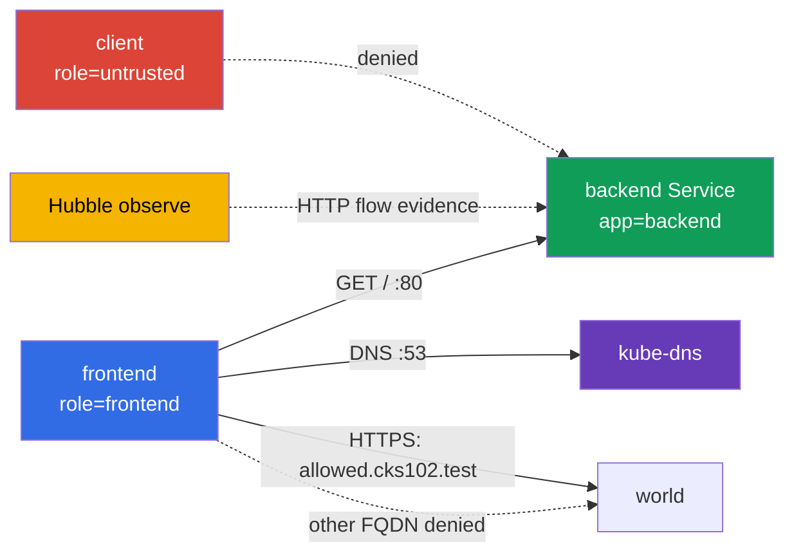

[Русская версия](README_RU.MD) · [Versión en español](README_ES.MD) · [Version française](README_FR.MD) · [Deutsche Version](README_DE.MD) · [ქართული ვერსია](README_GE.MD) · [繁體中文版](README_TW.MD) · [日本語版](README_JP.MD)

# Lab 102 - CiliumNetworkPolicy: L3/L4/L7, DNS-aware egress, and Hubble

## Description

In this lab you configure a CiliumNetworkPolicy for a small service and prove the actual behavior of the network. The task is not to write YAML that looks right, but to narrow L3/L4 access by labels, then add an L7 HTTP filter, restrict egress by FQDN, and save evidence from Hubble. The basic Kubernetes objects serve here only as a lab environment; the subject of the work is the capabilities of Cilium.

## Goal

Reinforce the material of [chapter 06. Cilium NetworkPolicy](../../course/06/README.md):

- `CiliumNetworkPolicy`, `endpointSelector`, and identity by labels;
- L3/L4 restriction of the source and the TCP port;
- L7 HTTP rules for the method and path;
- DNS-aware egress via `toFQDNs` with a separate DNS rule;
- checking allowed and denied flows via Hubble;
- a composite L7 policy with two different path scopes for different source namespaces.

## Self-check before you start

<details>
<summary>1. How does an L3/L4 policy in Cilium fundamentally differ from an L7 policy on the same rule?</summary>

L3/L4 allows or denies the whole connection based on the source/destination identity and the port - Cilium does not look inside the traffic. An L7 rule (`rules.http`) is added on the same TCP port but inspects the content of the request (method, path) - the connection may be allowed at L4, but a specific HTTP request will still get `403` if it does not match the L7 rule. If you leave a separate broad L4 rule without L7, it "switches off" L7 filtering for that port.

</details>

<details>
<summary>2. Why does a `toFQDNs` egress rule not work without a separate rule for DNS?</summary>

`toFQDNs` relies on Cilium **seeing the DNS response** and remembering which IPs correspond to the allowed name (`allowed.cks102.test`). If the DNS query to `kube-dns` is blocked, Cilium never learns the current IP for the FQDN and cannot build an allow rule for egress to it - all traffic to this FQDN will be blocked, even if the FQDN policy itself is written correctly.

</details>

<details>
<summary>3. Why is it convenient, when proving an L7 denial via Hubble, to start capturing the traffic before the test, and is it mandatory?</summary>

`hubble observe --follow`, started before the request, is a convenient mode for controlled capture: it reduces the risk that the needed flow leaves the retention buffer before it is saved. It is not the only way to get valid evidence: a regular `hubble observe` can read events that are already stored within the retention window (for example, with a correct `--since`), and the output can be exported to a file. In any case, the evidence must unambiguously tie the time window, source/destination, HTTP method/path, and verdict to specific GET/POST test cases.

</details>

## What We Build and Why

| Object | Purpose | Why it is needed |
| ----- | ----- | ----- |
| Namespace `cks-102` | isolates the lab environment | the policy and the results are not mixed with system workloads |
| Pod `backend` + Service `backend` | HTTP endpoint on TCP/80 | the target for the L3/L4 and L7 ingress policy |
| Pod `frontend` | trusted client | the only source allowed to reach the backend and the external FQDN |
| Pod `client` | untrusted client | proves that an allow by label is not the same as access for everyone |
| CiliumNetworkPolicy `backend-policy` | ingress policy | first L3/L4, then the same object is refined to L7 |
| CiliumNetworkPolicy `frontend-fqdn` | egress policy | allows DNS and only `allowed.cks102.test` |
| Hubble Relay + CLI | observability | shows allowed/denied HTTP flows in real time |
| Namespace `production` + Pod/Service `portal` | a second, independent backend with two path scopes | the target for the composite L7 policy of task 6 |
| Namespace `finance` + Pod `finance-client` | trusted source for `/private/*` | proves a namespace-aware L7 allow |
| CiliumNetworkPolicy `portal-policy` | composite ingress policy with two path scopes | `/public/*` - any cluster endpoint, `/private/*` - only `finance` |



## Infrastructure

| Component | Description |
| ----- | ----- |
| `vpc`            | a dedicated VPC `10.102.0.0/16` with two public subnets |
| `ssh-keys`       | keys for access to the virtual machines |
| `k8s-1`          | a single-node kubeadm Kubernetes `1.36.0` cluster, containerd, and Cilium with kube-proxy replacement |
| `worker`         | a work machine with `kubectl`, Cilium CLI, Hubble CLI, and `check_result` |
| Hubble Relay       | enabled by the startup `worker.sh`; the CLI needs a local `cilium hubble port-forward` |

## Deployment

```bash
TASK=102 make run_cks_task
```

Connect to the work machine over SSH. The context `cluster1-admin@cluster1` is already configured.

```bash
kubectl config current-context
cilium status --wait
```

## Tasks

---

|           **1**           | **Training namespace and endpoints** |
| :-----: | :----- |
|       What to do       | Create the namespace `cks-102`. In it create: a Pod `backend` with the label `app=backend` and the image `nginx:1.27-alpine`; a Service `backend` that selects this Pod on port `80`; a Pod `frontend` with the label `role=frontend` and the image `curlimages/curl:8.10.1`; a Pod `client` with the label `role=untrusted` and the same image. The client Pods must have a command that keeps the container running, for example `sleep 3600`. Wait for Ready. |
| Acceptance criteria | - the namespace `cks-102` exists;<br/>- the Pods `backend`, `frontend`, `client` exist with the specified labels;<br/>- the Service `backend` has port `80`. |

<details>
<summary>💡 Hint for task 1</summary>

Note that the labels differ in style: `backend` uses `app=backend`, while `frontend`/`client` use `role=frontend`/`role=untrusted` - this is intentional, so that the subsequent CiliumNetworkPolicy objects state explicitly which label they match the identity on. Mixing up `app`/`role` for one of the Pods is a frequent reason why a policy "does not work".

</details>

---

|           **2**           | **Cilium L3/L4: only frontend to backend:80** |
| :-----: | :----- |
|       What to do       | In `cks-102` create a `CiliumNetworkPolicy` named `backend-policy`. It must select `app=backend` and allow ingress only from endpoints with `role=frontend` to TCP port `80`. Do not add a broad allow for all endpoints. Before applying the policy, verify on your own with `curl` that both `frontend` and `client` really reach `http://backend/` - otherwise the deny after the policy proves nothing. After applying `backend-policy`, check both Pods again. |
| Acceptance criteria | - `backend-policy` selects `app=backend`, source `role=frontend`, TCP `80`;<br/>- after the policy: `frontend` gets `200`;<br/>- after the policy: `client` gets exactly a transport-level deny - `HTTPCODE:000` and a curl network/timeout exit code (`7`/`28`), not just "not 200". |

<details>
<summary>💡 Hint for task 2</summary>

`endpointSelector.matchLabels` in the policy itself must match `backend` (`app: backend`), while `fromEndpoints[].matchLabels` inside `ingress` must match `frontend` (`role: frontend`) - these are two DIFFERENT selectors in one object, and they are easy to swap. Verify this via `kubectl exec` into `client`: after the policy the request must get exactly `HTTPCODE:000` and exit `7`/`28` - a real HTTP response with any code (`403`, `404`...) means that the network path still exists and the L3/L4 deny is not proven.

</details>

---

|           **3**           | **Cilium L7 HTTP: only GET /** |
| :-----: | :----- |
|       What to do       | Modify **the same** `backend-policy`: for TCP/80 allow from `frontend` only the HTTP `GET` with the path `/`. Do not leave a separate broad L4 allow rule, otherwise the L7 filter will not restrict POST. Before the change, check with `curl` (while the L3/L4-only policy from task 2 is still in effect) that both `GET /` and `POST /` from `frontend` really reach the backend - an L4-only policy does not look inside HTTP. After replacing the rule with the L7 one, check both requests again. |
| Acceptance criteria | - the TCP/80 rule has `rules.http` with `method: GET` and `path: /`;<br/>- after L7: `GET http://backend/` from `frontend` returns `200`;<br/>- after L7: `POST http://backend/` from `frontend` returns `403`. |

<details>
<summary>💡 Hint for task 3</summary>

The most common mistake in this task is to leave the original L4-only rule from task 2 NEXT TO the new L7 rule instead of replacing it. If the policy contains both "allow TCP/80 without an L7 filter" and "allow TCP/80 with L7 GET /", Cilium applies the broader permission, and `POST` passes when it should get `403`. Make sure that `toPorts.rules.http` is INSIDE the same rule as `toPorts.ports` with port 80, and not in a separate duplicate rule. The baseline with the L4-only policy before this task exists precisely to prove that before L7 the POST really reached the backend, and after L7 it is rejected exactly by the L7 filter (`403`), and not by some unrelated network problem.

</details>

---

|           **4**           | **DNS-aware egress: only one FQDN is allowed** |
| :-----: | :----- |
|       What to do       | Create a `CiliumNetworkPolicy` `frontend-fqdn` that selects `role=frontend`. Allow it DNS traffic to `kube-dns` on port `53` **via an L7 DNS proxy rule** `toPorts.rules.dns` (for example, `matchPattern: "*"`): Cilium builds the FQDN-to-IP mapping for `toFQDNs` from this DNS traffic. Allow egress via `toFQDNs` only to `allowed.cks102.test` (a lab-owned fixture outside the Kubernetes address space - a separate network namespace on the control-plane node with a synthetic IP, wired through CoreDNS in the bootstrap; this is intentional, since Cilium's `toFQDNs` does not apply the allow rule to an IP inside the cluster) and only on TCP `443`. **Also keep the required internal flow from tasks 2-3**: add a separate egress rule to `backend` (`app=backend`) only on TCP `80` - without it `frontend-fqdn` enables egress default-deny for `frontend`, and the `frontend -> backend:80` flow already allowed in tasks 2-3 would be blocked. Before applying, check with `curl` that DNS resolution and `https://allowed.cks102.test/`, `http://allowed.cks102.test:80/`, `https://blocked.cks102.test/` (with `-k`, the fixture has a self-signed certificate) are really reachable. After applying `frontend-fqdn`, check the same addresses again, plus `frontend -> backend GET /` (`200`) and `POST /` (`403`) from tasks 2-3 - make sure they have not regressed. |
| Acceptance criteria | - the policy contains `toFQDNs.matchName: allowed.cks102.test` and `toPorts` with TCP `443`;<br/>- DNS to `kube-dns` is allowed by a separate rule with `rules.dns`;<br/>- internal egress to `backend` is allowed by a separate rule only on TCP `80`, without which task 3 regresses;<br/>- external egress is allowed only to `allowed.cks102.test:443`; `allowed.cks102.test:80` and `blocked.cks102.test:443` are not allowed;<br/>- after applying `frontend-fqdn`, `frontend -> backend GET /` still returns `200`, and `POST /` - `403`;<br/>- `allowed.cks102.test`/`blocked.cks102.test` are a lab-owned fixture brought up by the bootstrap; their unavailability before the policy is considered an infrastructure error, not a reason for an inconclusive result. |

<details>
<summary>💡 Hint for task 4</summary>

Three egress rules are needed in a single policy object: (1) DNS to kube-dns with `rules.dns.matchPattern: "*"`, WITHOUT which Cilium cannot track which IP corresponds to `allowed.cks102.test`; (2) internal `backend` (`app=backend`) on TCP/80 - without this rule the egress default-deny for `frontend` blocks the flow already allowed in tasks 2-3, and the Hubble evidence in task 5 becomes impossible; (3) `toFQDNs` with `matchName: allowed.cks102.test` and `toPorts` strictly on 443. If the first request to `allowed.cks102.test` fails right after you apply the policy, wait a few seconds; DNS resolution and the FQDN mapping in Cilium are not instantaneous.

</details>

---

|           **5**           | **Hubble: observing HTTP flows** |
| :-----: | :----- |
|       What to do       | On the worker start `cilium hubble port-forward`, then in a separate window/in the background - `hubble observe --from-pod cks-102/frontend --to-pod cks-102/backend --protocol http --follow`. While the observation is running, from `frontend` perform an allowed `GET /` and a denied `POST /` to the backend and make sure you see both flows: `GET /` with the verdict `FORWARDED`, `POST /` with the verdict `DROPPED`. |
| Acceptance criteria | - `check_result` generates the GET/POST requests itself and checks on its own that both verdicts are visible in Hubble - make sure that the final policy from tasks 2-3 really gives `FORWARDED` for GET and `DROPPED` for POST. |

<details>
<summary>💡 Hint for task 5</summary>

For a controlled capture it is recommended to start `hubble observe --follow` IN THE BACKGROUND (`&`) BEFORE the `GET`/`POST`: this lowers the risk of losing the flow before the observation. `--follow` is not the only valid option: if the events are still in the retention buffer, they can be read with a regular `hubble observe` with a correct time filter. In any case, verify for yourself that the evidence unambiguously shows `frontend -> backend`, `GET / -> FORWARDED`, and `POST / -> DROPPED` - no artifact files are required from the student.

</details>

---

|           **6**           | **Composite L7 policy: `/public/*` for everyone, `/private/*` only for `finance`** |
| :-----: | :----- |
|       What to do       | Tasks 2-3 practice one source (`frontend`) and one path contract. Here - an independent second backend with TWO path scopes at once. Create the namespaces `production` and `finance`. In `production` create a Pod `portal` (label `app=portal`, image `nginx:1.27-alpine`) and a ConfigMap that gives nginx a minimal server block: `location /public/` returns `200` (for example, `return 200 "public ok\n";`), `location /private/` returns `200` likewise, any other path - `404`. Mount the ConfigMap as `/etc/nginx/conf.d/default.conf`. Create a Service `portal` on port `80`. In `finance` create a Pod `finance-client` (`curlimages/curl:8.10.1`, `sleep 3600`). The existing Pod `client` from the namespace `cks-102` (task 1) is used as the source of the "any other/external" namespace - do not create a separate Pod for this. Create a `CiliumNetworkPolicy` `portal-policy` in `production` that selects `app=portal`, with TWO ingress rules on TCP/80: (1) `fromEndpoints` with `matchExpressions: [{key: k8s:io.kubernetes.pod.namespace, operator: Exists}]` (any Pod regardless of namespace) + `rules.http` `GET` on the path matching `/public/*`; (2) `fromEndpoints` with `matchLabels` on the namespace `finance` + `rules.http` `GET` on the path matching `/private/*`. Before applying the policy, check with `curl` that both `finance-client` and `cks-102/client` really get `200` on BOTH paths - otherwise the deny proves nothing. After applying, check both paths from both namespaces again. |
| Acceptance criteria | - `portal-policy` contains exactly two ingress rules on TCP/80 with the split described above;<br/>- baseline: the Pod `portal` itself returns `200` on both paths (the checker verifies this via loopback inside the Pod, without removing the policy);<br/>- after the policy: `finance-client` gets `200` on both `/public/*` and `/private/*`;<br/>- after the policy: `cks-102/client` gets `200` on `/public/*` but gets exactly an L7 refusal (`403`) on `/private/*` - the TCP connection is still allowed by the first rule (the rule with `matchExpressions: Exists`), so this is not a transport-level deny but an Envoy L7 `403`. |

<details>
<summary>💡 Hint for task 6</summary>

The path in `rules.http` is a regex (Envoy-compatible), not an exact string: `/public/.*`,
not `/public/`. Two ingress rules with DIFFERENT `fromEndpoints` for the same
`endpointSelector`+port are combined additively per identity: the rule that allows
ABSOLUTELY any identity (including `finance`) gives `finance-client` the union of both
L7 allow lists (both `/public/*` and `/private/*`), while `cks-102/client` (which does not match rule 2)
gets only `/public/*`. This is exactly why the final deny for the external client on
`/private/*` is a `403` from Envoy, not `HTTPCODE:000`: the "any" rule has already allowed the
TCP connection itself for everyone, and L4 here is not restricted to a single source.

**The trap**: `fromEndpoints: [{}]` (an empty selector) is NOT a way to match any identity
from any namespace. Cilium implicitly scopes a `fromEndpoints` selector without an explicit
namespace label to the namespace of the policy ITSELF, and this applies even to an empty `{}` - as
a result such a rule matches only `production`, not `finance`/`cks-102`, and both
external namespaces get a transport-level deny instead of the expected behavior. To actually
allow any identity regardless of namespace, use `matchExpressions` with
`operator: Exists` on the reserved label `k8s:io.kubernetes.pod.namespace` - the mere presence of
this label is true for any Pod.

Do not confuse `location /public/` (a path prefix) in the nginx config with the regex path in the CNP - they
live in different places and use different syntaxes.

</details>

---

## Checking the Result

On the worker run:

```bash
check_result
```

The check covers six independent tasks. `check_result` itself verifies the behavior of the
live cluster (your policies are not deleted or modified: the checker only reads them and
sends probe requests, and itself generates GET/POST for Hubble) - no artifact files are required from the student.
The checker's own diagnostic runtime checks are saved in `/var/work/tests/checker-artifacts/`.

## Solution

Reference solution: [worker/files/solutions/1.MD](worker/files/solutions/1.MD).

## Deletion

```bash
TASK=102 make delete_cks_task
```
