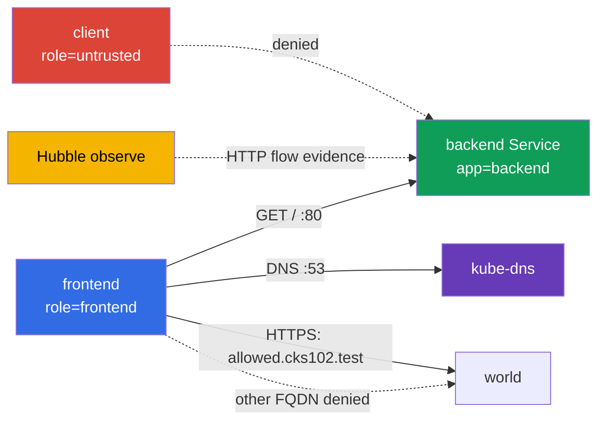

[Русская версия](README_RU.MD) · [Eng version](README.MD) · [Versión en español](README_ES.MD) · [Version française](README_FR.MD) · [ქართული ვერსია](README_GE.MD) · [繁體中文版](README_TW.MD) · [日本語版](README_JP.MD)

# Lab 102 - CiliumNetworkPolicy: L3/L4/L7, DNS-aware egress und Hubble

## Beschreibung

In diesem Lab konfigurierst du eine CiliumNetworkPolicy für einen kleinen Service und
belegst das tatsächliche Netzwerkverhalten. Es geht nicht darum, ein ähnlich aussehendes YAML zu schreiben,
sondern darum, den L3/L4-Zugriff anhand von Labels einzugrenzen, dann einen L7-HTTP-Filter hinzuzufügen, den egress
per FQDN einzuschränken und evidence aus Hubble zu sichern. Die Kubernetes-Basisobjekte dienen hier nur als
Lernumgebung; Gegenstand des Labs sind die Möglichkeiten von Cilium.

## Ziel

Den Stoff von [Kapitel 06. Cilium NetworkPolicy](../../course/06/de.md) festigen:

- `CiliumNetworkPolicy`, `endpointSelector` und identity anhand von Labels;
- L3/L4-Einschränkung von source und TCP-Port;
- L7-HTTP-Regeln für Methode und path;
- DNS-aware egress über `toFQDNs` mit separater DNS-Regel;
- Prüfung erlaubter und verbotener Flows über Hubble;
- eine zusammengesetzte L7 policy mit zwei verschiedenen path-scopes für source aus unterschiedlichen Namespaces.

## Prüfe dich vor dem Start

<details>
<summary>1. Worin unterscheidet sich eine L3/L4 policy in Cilium grundsätzlich von einer L7 policy auf derselben Regel?</summary>

L3/L4 erlaubt oder verbietet die Verbindung als Ganzes anhand von source/destination identity und Port - Cilium schaut nicht in den Traffic hinein. Eine L7-Regel (`rules.http`) wird auf demselben TCP-Port ergänzt, prüft aber den Inhalt der Anfrage (Methode, path) - die Verbindung kann auf L4 erlaubt sein, aber die konkrete HTTP-Anfrage erhält trotzdem `403`, wenn sie nicht zur L7-Regel passt. Bleibt eine separate breite L4-Regel ohne L7 bestehen, „schaltet“ sie die L7-Filterung für diesen Port aus.

</details>

<details>
<summary>2. Warum funktioniert eine `toFQDNs`-egress-Regel nicht ohne separate Regel für DNS?</summary>

`toFQDNs` beruht darauf, dass Cilium die **DNS-Antwort sieht** und sich merkt, welchen IPs der erlaubte Name (`allowed.cks102.test`) entspricht. Ist die DNS-Anfrage an `kube-dns` blockiert, erfährt Cilium nie die aktuelle IP für den FQDN und kann keine allow-Regel für den egress dorthin aufbauen - der gesamte Traffic zu diesem FQDN wird blockiert, selbst wenn die FQDN-policy selbst korrekt geschrieben ist.

</details>

<details>
<summary>3. Warum ist es für den Nachweis eines L7-denial über Hubble praktisch, den Traffic-Capture schon vor dem Test zu starten, und ist das zwingend erforderlich?</summary>

`hubble observe --follow`, gestartet vor der Anfrage, ist ein bequemer Modus für controlled capture: Er verringert das Risiko, dass der benötigte flow vor dem Speichern aus dem retention buffer fällt. Das ist nicht der einzige Weg zu gültiger evidence: Ein normales `hubble observe` kann bereits gespeicherte Events innerhalb des retention window lesen (z. B. mit korrektem `--since`), und die Ausgabe kann in eine Datei exportiert werden. In jedem Fall muss die evidence das Zeitfenster, source/destination, HTTP method/path und verdict eindeutig mit dem konkreten GET/POST test case verknüpfen.

</details>

## Was wir erstellen und warum

| Objekt                          | Zweck                         | Warum nötig                                                                                 |
| ------------------------------------- | -------------------------------------------- | ----------------------------------------------------------------------------------------------------- |
| Namespace `cks-102`                  | isoliert die Lernumgebung | Policy und Ergebnisse vermischen sich nicht mit System-Workloads |
| Pod `backend` + Service `backend`  | HTTP-Endpoint auf TCP/80                    | target für L3/L4 und L7 ingress policy                                                              |
| Pod `frontend`                       | vertrauenswürdiger Client            | einzige source, der das backend und der externe FQDN erlaubt sind     |
| Pod `client`                         | nicht vertrauenswürdiger Client        | beweist, dass allow nach Label nicht Zugriff für alle bedeutet          |
| CiliumNetworkPolicy `backend-policy` | ingress policy                               | zuerst L3/L4, dann wird dasselbe Objekt auf L7 verfeinert                |
| CiliumNetworkPolicy `frontend-fqdn`  | egress policy                                | erlaubt DNS und nur `allowed.cks102.test`                                         |
| Hubble Relay + CLI                    | Beobachtbarkeit                   | zeigt allowed/denied HTTP-flow in Echtzeit                      |
| Namespace `production` + Pod/Service `portal` | zweites, unabhängiges Backend mit zwei path-scopes | Ziel der zusammengesetzten L7 policy in Aufgabe 6 |
| Namespace `finance` + Pod `finance-client` | vertrauenswürdige Quelle für `/private/*` | beweist namespace-aware L7 allow |
| CiliumNetworkPolicy `portal-policy` | zusammengesetzte ingress policy mit zwei path-scopes | `/public/*` - jeder cluster endpoint, `/private/*` - nur `finance` |



## Infrastruktur

| Komponente | Beschreibung                                                                                                              |
| ------------------ | ----------------------------------------------------------------------------------------------------------------------------- |
| `vpc`            | eigene VPC `10.102.0.0/16` mit zwei öffentlichen Subnetzen                                 |
| `ssh-keys`       | Schlüssel für den Zugriff auf die virtuellen Maschinen                                                     |
| `k8s-1`          | Ein-Node-kubeadm-Cluster Kubernetes `1.36.0`, containerd und Cilium mit kube-proxy replacement            |
| `worker`         | Arbeitsmaschine mit `kubectl`, Cilium CLI, Hubble CLI und `check_result`                                         |
| Hubble Relay       | wird vom Start-`worker.sh` aktiviert; für die CLI wird ein lokales `cilium hubble port-forward` benötigt |

## Bereitstellung

```bash
TASK=102 make run_cks_task
```

Verbinde dich per SSH mit der Arbeitsmaschine. Der Kontext `cluster1-admin@cluster1` ist bereits eingerichtet.

```bash
kubectl config current-context
cilium status --wait
```

## Aufgaben

---

|           **1**           | **Lern-Namespace und Endpoints**                                                                                                                                                                                                                                                                                                                                                                                                                                                                                                                   |
| :-----------------------------: | :------------------------------------------------------------------------------------------------------------------------------------------------------------------------------------------------------------------------------------------------------------------------------------------------------------------------------------------------------------------------------------------------------------------------------------------------------------------------------------------------------------------------------------------------------------------------------------------------------------------------------------------------------------------------------------------------------- |
|       Was wir tun       | Erstelle den Namespace `cks-102`. Erstelle darin: Pod `backend` mit Label `app=backend` und Image `nginx:1.27-alpine`; Service `backend`, der diesen Pod auf Port `80` auswählt; Pod `frontend` mit Label `role=frontend` und Image `curlimages/curl:8.10.1`; Pod `client` mit Label `role=untrusted` und demselben Image. Der Befehl der Client-Pods muss den Container am Laufen halten, z. B. `sleep 3600`. Warte auf Ready. |
| Abnahmekriterien | - der Namespace `cks-102` existiert;<br/>- die Pods `backend`, `frontend`, `client` mit den angegebenen Labels existieren;<br/>- der Service `backend` hat Port `80`.                                                                                                                                                                                                                                                                                                                                                                                    |

<details>
<summary>💡 Hinweis zu Aufgabe 1</summary>

Beachte, dass die Labels stilistisch unterschiedlich sind: `backend` verwendet `app=backend`, während `frontend`/`client` `role=frontend`/`role=untrusted` verwenden - das ist Absicht, damit die späteren CiliumNetworkPolicy explizit angeben müssen, über welches Label sie die identity matchen. Bei einem der Pods `app`/`role` zu verwechseln, ist ein häufiger Grund, warum eine policy „nicht funktioniert“.

</details>

---

|           **2**           | **Cilium L3/L4: nur frontend zu backend:80**                                                                                                                                                                                                                                                                                                                                                                                                                                                                                                                                                                                                                                                                        |
| :-----------------------------: | :--------------------------------------------------------------------------------------------------------------------------------------------------------------------------------------------------------------------------------------------------------------------------------------------------------------------------------------------------------------------------------------------------------------------------------------------------------------------------------------------------------------------------------------------------------------------------------------------------------------------------------------------------------------------------------------------------------------------------------- |
|       Was wir tun       | Erstelle in `cks-102` eine `CiliumNetworkPolicy` mit dem Namen `backend-policy`. Sie muss `app=backend` auswählen und ingress nur von Endpoints mit `role=frontend` auf TCP-Port `80` erlauben. Füge keine breite Erlaubnis für alle Endpoints hinzu.<br/><br/>Bevor du die policy anwendest, vergewissere dich selbst per `curl`, dass sowohl `frontend` als auch `client` `http://backend/` tatsächlich erreichen - sonst beweist das deny nach der policy nichts. Prüfe nach dem Anwenden von `backend-policy` beide Pods erneut. |
| Abnahmekriterien | - `backend-policy` wählt `app=backend` aus, source `role=frontend`, TCP `80`;<br/>- nach der policy: `frontend` erhält `200`;<br/>- nach der policy: `client` erhält tatsächlich ein transport-level deny - `HTTPCODE:000` und curl network/timeout exit code (`7`/`28`), nicht einfach „nicht 200“.                                                                                                                                                                                                                                                                                                                                                                                   |

<details>
<summary>💡 Hinweis zu Aufgabe 2</summary>

`endpointSelector.matchLabels` in der policy selbst muss `backend` matchen (`app: backend`), und `fromEndpoints[].matchLabels` innerhalb von `ingress` muss `frontend` matchen (`role: frontend`) - das sind zwei VERSCHIEDENE Selektoren in einem Objekt, die man leicht vertauscht. Prüfe dich selbst per `kubectl exec` in `client`: Nach der policy muss die Anfrage genau `HTTPCODE:000` und exit `7`/`28` erhalten - eine echte HTTP-Antwort mit beliebigem Code (`403`, `404`...) bedeutet, dass der Netzwerkpfad weiterhin existiert und L3/L4 deny nicht belegt ist.

</details>

---

|           **3**           | **Cilium L7 HTTP: nur GET /**                                                                                                                                                                                                                                                                                                                                                                                                                                                                                                                                                                                                                                                                                     |
| :-----------------------------: | :------------------------------------------------------------------------------------------------------------------------------------------------------------------------------------------------------------------------------------------------------------------------------------------------------------------------------------------------------------------------------------------------------------------------------------------------------------------------------------------------------------------------------------------------------------------------------------------------------------------------------------------------------------------------------------------------------------------- |
|       Was wir tun       | Ändere **dieselbe** `backend-policy`: Erlaube für TCP/80 von `frontend` nur HTTP `GET` mit path `/`. Lasse keine separate breite L4-allow-Regel stehen, sonst schränkt der L7-Filter POST nicht ein.<br/><br/>Prüfe vor der Änderung per `curl` (bei noch geltender reiner L3/L4-policy aus Aufgabe 2), dass sowohl `GET /` als auch `POST /` von `frontend` tatsächlich das backend erreichen - die reine L4-policy schaut nicht in HTTP hinein. Prüfe nach dem Ersetzen der Regel durch L7 beide Anfragen erneut. |
| Abnahmekriterien | - die TCP/80-Regel hat `rules.http` mit `method: GET` und `path: /`;<br/>- nach L7: `GET http://backend/` von `frontend` liefert `200`;<br/>- nach L7: `POST http://backend/` von `frontend` liefert `403`.                                                                                                                                                                                                                                                                                                                                                                                                                                                            |

<details>
<summary>💡 Hinweis zu Aufgabe 3</summary>

Der häufigste Fehler dieser Aufgabe ist, die ursprüngliche reine L4-Regel aus Aufgabe 2 NEBEN der neuen L7-Regel stehen zu lassen, statt sie zu ersetzen. Wenn in der policy gleichzeitig „TCP/80 ohne L7-Filter erlauben“ und „TCP/80 mit L7 GET / erlauben“ vorkommen, wendet Cilium die breitere Erlaubnis an, und `POST` geht durch, obwohl es `403` erhalten sollte. Stelle sicher, dass `toPorts.rules.http` INNERHALB derselben Regel steht wie `toPorts.ports` mit Port 80, und nicht in einer separaten, doppelten Regel. Die Baseline mit reiner L4-policy vor dieser Aufgabe existiert genau deshalb, um zu belegen: Vor L7 ging POST tatsächlich zum backend durch, und nach L7 lehnt ihn gerade der L7-Filter ab (`403`) und nicht irgendein fremdes Netzwerkproblem.

</details>

---

|           **4**           | **DNS-aware egress: nur ein FQDN erlaubt**                                                                                                                                                                                                                                                                                                                                                                                                                                                                                                                                                                                                                                                                                                                                                                                                                                                                                                                                                                                                                                                                                                                                                                                                                                                                                                                                                                                                                                                                                                                                                                                                                                                                                                                                                                                                                                              |
| :-----------------------------: | :------------------------------------------------------------------------------------------------------------------------------------------------------------------------------------------------------------------------------------------------------------------------------------------------------------------------------------------------------------------------------------------------------------------------------------------------------------------------------------------------------------------------------------------------------------------------------------------------------------------------------------------------------------------------------------------------------------------------------------------------------------------------------------------------------------------------------------------------------------------------------------------------------------------------------------------------------------------------------------------------------------------------------------------------------------------------------------------------------------------------------------------------------------------------------------------------------------------------------------------------------------------------------------------------------------------------------------------------------------------------------------------------------------------------------------------------------------------------------------------------------------------------------------------------------------------------------------------------------------------------------------------------------------------------------------------------------------------------------------------------------------------------------------------------------------------------------------------------------------------------------------- |
|       Was wir tun       | Erstelle die `CiliumNetworkPolicy` `frontend-fqdn`, die `role=frontend` auswählt. Erlaube ihr DNS zu `kube-dns` auf Port `53` **über eine L7 DNS proxy rule** `toPorts.rules.dns` (z. B. `matchPattern: "*"`): Aus diesem DNS-Traffic bildet Cilium das FQDN-to-IP mapping für `toFQDNs`. Erlaube egress über `toFQDNs` nur zu `allowed.cks102.test` (lab-owned fixture außerhalb des Kubernetes address space - ein separater network namespace auf dem control-plane Node mit synthetischer IP, im bootstrap über CoreDNS angebunden; das ist Absicht, `toFQDNs` in Cilium wendet die allow-Regel nicht auf IPs innerhalb des Clusters an) und nur auf TCP `443`. **Bewahre auch den notwendigen internen Flow aus den Aufgaben 2-3**: Füge eine separate egress-Regel zu `backend` (`app=backend`) nur auf TCP `80` hinzu - ohne sie aktiviert `frontend-fqdn` egress default-deny für `frontend`, und das bereits erlaubte `frontend -> backend:80` aus den Aufgaben 2-3 wird blockiert.<br/><br/>Prüfe vor dem Anwenden per `curl`, dass DNS resolution und `https://allowed.cks102.test/`, `http://allowed.cks102.test:80/`, `https://blocked.cks102.test/` (mit `-k`, selbstsigniertes Zertifikat der fixture) tatsächlich erreichbar sind. Prüfe nach dem Anwenden von `frontend-fqdn` dieselben Adressen erneut, zusätzlich `frontend -> backend GET /` (`200`) und `POST /` (`403`) aus den Aufgaben 2-3 - stelle sicher, dass sie nicht regressiert sind. |
| Abnahmekriterien | - die policy enthält `toFQDNs.matchName: allowed.cks102.test` und `toPorts` mit TCP `443`;<br/>- DNS zu `kube-dns` ist durch eine separate Regel mit `rules.dns` erlaubt;<br/>- der interne egress zu `backend` ist durch eine separate Regel nur auf TCP `80` erlaubt, ohne sie regressiert Aufgabe 3;<br/>- externer egress ist nur zu `allowed.cks102.test:443` erlaubt; `allowed.cks102.test:80` und `blocked.cks102.test:443` sind nicht erlaubt;<br/>- nach dem Anwenden von `frontend-fqdn` liefert `frontend -> backend GET /` weiterhin `200` und `POST /` - `403`;<br/>- `allowed.cks102.test`/`blocked.cks102.test` sind lab-owned fixtures, vom bootstrap bereitgestellt; ihre Nichterreichbarkeit vor der policy gilt als Infrastrukturfehler und nicht als Grund für ein inconclusive Ergebnis.                                                                                                                                                                                                                                                                                                                                                                                                                                                                                                                                                                                                                                                                                                                                                                                                                                                                                                                                                                                                                                                                                                                                                                                                                                                                                                                                                                                                                                                                                                                                                                                                                                                                                                                                                                                                                                                                                                                                                                                                                                                                                                                                                                                                                                                                                                                                                                                                                                                         |

<details>
<summary>💡 Hinweis zu Aufgabe 4</summary>

Drei egress-Regeln werden in einem policy-Objekt benötigt: (1) DNS zu kube-dns mit `rules.dns.matchPattern: "*"`, OHNE dies kann Cilium nicht nachverfolgen, welche IP zu `allowed.cks102.test` gehört; (2) das interne `backend` (`app=backend`) auf TCP/80 - ohne diese Regel blockiert das egress default-deny für `frontend` den bereits erlaubten Flow aus den Aufgaben 2-3, und die Hubble evidence in Aufgabe 5 wird unmöglich; (3) `toFQDNs` mit `matchName: allowed.cks102.test` und `toPorts` strikt auf 443. Wenn nach dem apply die erste Anfrage an `allowed.cks102.test` nicht durchgeht, warte einige Sekunden, denn DNS resolution und FQDN mapping in Cilium erfolgen nicht augenblicklich.

</details>

---

|           **5**           | **Hubble: Beobachtung der HTTP-Flows**                                                                                                                                                                                                                                                                                                                                                                                                                                                        |
| :-----------------------------: | :---------------------------------------------------------------------------------------------------------------------------------------------------------------------------------------------------------------------------------------------------------------------------------------------------------------------------------------------------------------------------------------------------------------------------------------------------------------------------------------------------------------- |
|       Was wir tun       | Starte auf dem Worker `cilium hubble port-forward`, dann in einem separaten Fenster/im Hintergrund `hubble observe --from-pod cks-102/frontend --to-pod cks-102/backend --protocol http --follow`. Führe, während die Beobachtung läuft, aus `frontend` das erlaubte `GET /` und das verbotene `POST /` zum backend aus und stelle sicher, dass du beide flows siehst: `GET /` mit verdict `FORWARDED`, `POST /` mit verdict `DROPPED`. |
| Abnahmekriterien | - `check_result` generiert GET/POST selbst und prüft selbst, dass beide verdicts in Hubble sichtbar sind - stelle sicher, dass die finale policy aus den Aufgaben 2-3 tatsächlich `FORWARDED` für GET und `DROPPED` für POST liefert.                                                                                                                                                                                                                                                                                                                                                                                                                         |

<details>
<summary>💡 Hinweis zu Aufgabe 5</summary>

Für controlled capture wird empfohlen, `hubble observe --follow` IM HINTERGRUND (`&`) VOR `GET`/`POST` zu starten: So ist das Risiko geringer, einen flow vor der Beobachtung zu verlieren. `--follow` ist nicht die einzige gültige Variante: Sind die Events noch im retention buffer, können sie mit einem normalen `hubble observe` mit korrektem Zeitfilter gelesen werden. Vergewissere dich in jedem Fall selbst, dass die evidence eindeutig `frontend -> backend`, `GET / -> FORWARDED` und `POST / -> DROPPED` zeigt - es sind keine artifact-Dateien vom Teilnehmer erforderlich.

</details>

---

|           **6**           | **Zusammengesetzte L7 policy: `/public/*` für alle, `/private/*` nur für `finance`**                                                                                                                                                                                                                                                                                                                                                                                                                                                                                                                                                                                                                                     |
| :-----------------------------: | :------------------------------------------------------------------------------------------------------------------------------------------------------------------------------------------------------------------------------------------------------------------------------------------------------------------------------------------------------------------------------------------------------------------------------------------------------------------------------------------------------------------------------------------------------------------------------------------------------------------------------------------------------------------------------------------------------------------------------------------------------------------------------------------------------------------------------------------------------------------------------------------------------------------------------------------------------------------------------------------------------------------------------------------------------------------------------------------------------------------------------------------------------------------------------------------------------------------------------------------------------------------------------------------------------------------------------------------------------------------------------------------------------------------------------------------------------------------------------------------------------------------------------------------------------------------------------------------------------------------------------------------------------------------------------------------------------------------------------------------------------------------------------------------------------------------------------------------------------------- |
|       Was wir tun       | Die Aufgaben 2-3 üben eine source (`frontend`) und einen path-Vertrag. Hier geht es um ein unabhängiges zweites backend mit ZWEI path-scopes gleichzeitig. Erstelle die Namespaces `production` und `finance`. Erstelle in `production` einen Pod `portal` (Label `app=portal`, Image `nginx:1.27-alpine`) und eine ConfigMap, die nginx einen minimalen server block liefert: `location /public/` gibt `200` zurück (z. B. `return 200 "public ok\n";`), `location /private/` gibt analog `200` zurück, jeder andere path - `404`. Mounte die ConfigMap als `/etc/nginx/conf.d/default.conf`. Erstelle einen Service `portal` auf Port `80`. Erstelle in `finance` einen Pod `finance-client` (`curlimages/curl:8.10.1`, `sleep 3600`). Der vorhandene Pod `client` aus dem Namespace `cks-102` (Aufgabe 1) dient als source aus einem „beliebigen anderen/externen“ Namespace - erstelle dafür keinen separaten Pod.<br/><br/>Erstelle die `CiliumNetworkPolicy` `portal-policy` in `production`, die `app=portal` auswählt, mit ZWEI ingress-Regeln auf TCP/80: (1) `fromEndpoints` mit `matchExpressions: [{key: k8s:io.kubernetes.pod.namespace, operator: Exists}]` (jeder Pod unabhängig vom Namespace) + `rules.http` `GET` auf den path, der `/public/*` entspricht; (2) `fromEndpoints` mit `matchLabels` für den Namespace `finance` + `rules.http` `GET` auf den path, der `/private/*` entspricht. Prüfe vor dem Anwenden der policy per `curl`, dass sowohl `finance-client` als auch `cks-102/client` auf BEIDEN paths `200` erhalten - sonst beweist das deny nichts. Prüfe nach dem Anwenden beide paths aus beiden Namespaces erneut. |
| Abnahmekriterien | - `portal-policy` enthält genau zwei ingress-Regeln auf TCP/80 mit der oben beschriebenen Aufteilung;<br/>- Baseline: Der Pod `portal` selbst liefert `200` auf beide paths (der Checker prüft das über loopback innerhalb des Pods, ohne die policy zu entfernen);<br/>- nach der policy: `finance-client` erhält `200` sowohl auf `/public/*` als auch auf `/private/*`;<br/>- nach der policy: `cks-102/client` erhält `200` auf `/public/*`, aber auf `/private/*` genau die L7-Ablehnung (`403`) - die TCP-Verbindung ist durch die erste Regel (die Regel mit `matchExpressions: Exists`) weiterhin erlaubt, daher ist das kein transport-level deny, sondern ein Envoy L7 `403`. |

<details>
<summary>💡 Hinweis zu Aufgabe 6</summary>

Der path in `rules.http` ist ein regex (Envoy-kompatibel) und kein exakter String: `/public/.*`,
nicht `/public/`. Zwei ingress-Regeln mit VERSCHIEDENEN `fromEndpoints` für denselben
`endpointSelector`+Port werden additiv per-identity kombiniert: Die Regel, die
ABSOLUT jede identity erlaubt (einschließlich `finance`), gibt `finance-client` die Vereinigung beider
L7-allow-Listen (sowohl `/public/*` als auch `/private/*`), während `cks-102/client` (matcht Regel 2 nicht)
nur `/public/*` erhält. Genau deshalb ist das finale deny für den externen client auf
`/private/*` ein `403` von Envoy und nicht `HTTPCODE:000`: Die „beliebige“ Regel hat den
TCP-Connect für alle bereits erlaubt, L4 ist hier nicht auf eine source beschränkt.

**Falle**: `fromEndpoints: [{}]` (leerer selector) ist KEIN Weg, jede identity
aus jedem Namespace zu matchen. Cilium schränkt einen `fromEndpoints`-selector ohne explizites
Namespace-Label implizit auf den Namespace der policy SELBST ein, und das gilt auch für das leere `{}` - im
Ergebnis matcht eine solche Regel nur `production` und nicht `finance`/`cks-102`, und beide
externen Namespaces erhalten ein transport-level deny statt des erwarteten Verhaltens. Um tatsächlich
jede identity unabhängig vom Namespace zu erlauben, verwende `matchExpressions` mit
`operator: Exists` auf das reserved-label `k8s:io.kubernetes.pod.namespace` - das Vorhandensein
dieses Labels trifft auf jeden Pod zu.

Verwechsle nicht `location /public/` (Pfad-Präfix) in der nginx-Konfiguration mit dem regex-path in der CNP - sie
leben an unterschiedlichen Orten und in unterschiedlichen Syntaxen.

</details>

---

## Ergebnisprüfung

Starte auf dem Worker:

```bash
check_result
```

Die Prüfung umfasst sechs unabhängige Aufgaben. `check_result` prüft das Verhalten des
live-Clusters selbst (deine policies werden nicht gelöscht oder verändert: Der Checker liest sie nur und
sendet Probe-Anfragen, generiert GET/POST für Hubble selbst) - es sind keine artifact-Dateien vom Teilnehmer erforderlich.
Eigene diagnostische Runtime-Prüfungen des Checkers werden in `/var/work/tests/checker-artifacts/` abgelegt.

## Lösung

Referenzlösung: [worker/files/solutions/1_DE.MD](worker/files/solutions/1_DE.MD).

## Löschen

```bash
TASK=102 make delete_cks_task
```
