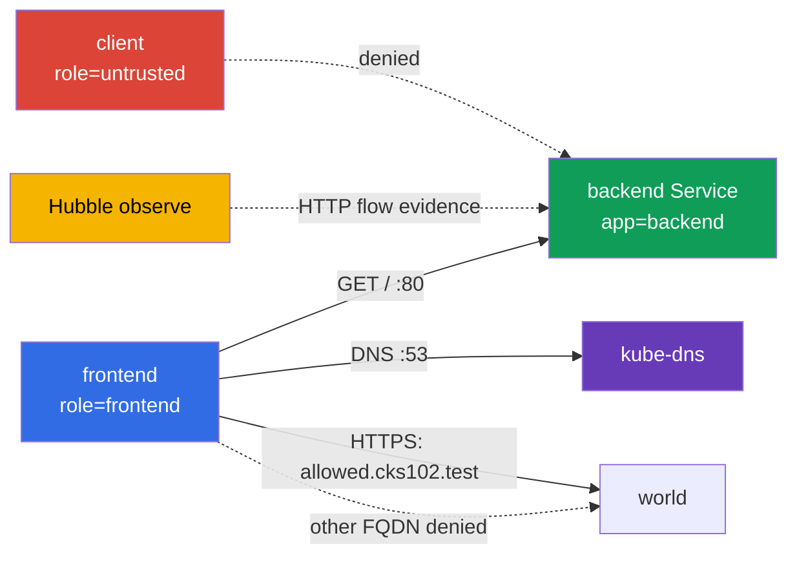

[Русская версия](README_RU.MD) · [Eng version](README.MD) · [Version française](README_FR.MD) · [Deutsche Version](README_DE.MD) · [ქართული ვერსია](README_GE.MD) · [繁體中文版](README_TW.MD) · [日本語版](README_JP.MD)

# Lab 102 - CiliumNetworkPolicy: L3/L4/L7, DNS-aware egress y Hubble

## Descripción

En este laboratorio configuras una CiliumNetworkPolicy para un pequeño servicio y
demuestras el comportamiento real de la red. El objetivo no es escribir un YAML que se
parezca, sino acotar el acceso L3/L4 por labels, añadir después un filtro HTTP L7, limitar el
egress por FQDN y conservar la evidence de Hubble. Los objetos básicos de Kubernetes sirven
aquí solo como banco de pruebas; el objeto de estudio son las capacidades de Cilium.

## Objetivo

Consolidar el contenido del [capítulo 06. Cilium NetworkPolicy](../../course/06/es.md):

- `CiliumNetworkPolicy`, `endpointSelector` e identity por labels;
- restricción L3/L4 del source y del puerto TCP;
- reglas HTTP L7 para el método y el path;
- DNS-aware egress mediante `toFQDNs` con una regla DNS aparte;
- verificación de los flujos permitidos y denegados mediante Hubble;
- una L7 policy compuesta con dos path-scope distintos para source de distintos namespace.

## Compruébate antes de empezar

<details>
<summary>1. ¿En qué se diferencia, en esencia, una L3/L4 policy de Cilium de una L7 policy sobre la misma regla?</summary>

L3/L4 permite o deniega la conexión completa según la identity de source/destination y el puerto: Cilium no mira dentro del tráfico. Una regla L7 (`rules.http`) se añade sobre el mismo puerto TCP, pero comprueba el contenido de la petición (método, path): la conexión puede estar permitida en L4 y, aun así, una petición HTTP concreta recibirá `403` si no coincide con la regla L7. Si mantienes por separado una regla L4 amplia sin L7, esta "desactivará" el filtrado L7 para ese puerto.

</details>

<details>
<summary>2. ¿Por qué una regla egress `toFQDNs` no funciona sin una regla aparte para DNS?</summary>

`toFQDNs` se basa en que Cilium **ve la respuesta DNS** y recuerda a qué IP corresponde el nombre permitido (`allowed.cks102.test`). Si la consulta DNS a `kube-dns` está bloqueada, Cilium nunca conocerá la IP actual del FQDN y no podrá construir la regla allow de egress hacia ella: todo el tráfico hacia ese FQDN quedará bloqueado, aunque la propia FQDN policy esté escrita correctamente.

</details>

<details>
<summary>3. ¿Por qué, para demostrar un L7-denial con Hubble, resulta cómodo lanzar la captura del tráfico antes de la prueba y es obligatorio hacerlo?</summary>

`hubble observe --follow`, lanzado antes de la petición, es un modo cómodo para un controlled capture: reduce el riesgo de que el flow necesario salga del retention buffer antes de guardarlo. No es la única forma de obtener evidence válida: un `hubble observe` normal puede leer eventos ya guardados dentro de la retention window (por ejemplo, con un `--since` correcto), y la salida se puede exportar a un archivo. En cualquier caso, la evidence debe vincular sin ambigüedad la ventana temporal, source/destination, HTTP method/path y el verdict con los test case concretos GET/POST.

</details>

## Qué creamos y para qué

| Objeto                          | Finalidad                         | Para qué hace falta                                                                                 |
| ------------------------------------- | -------------------------------------------- | ----------------------------------------------------------------------------------------------------- |
| Namespace `cks-102`                  | aísla el banco de pruebas | la policy y los resultados no se mezclan con los workload del sistema |
| Pod `backend` + Service `backend`  | HTTP endpoint en TCP/80                    | target para las ingress policy L3/L4 y L7                                                              |
| Pod `frontend`                       | cliente de confianza            | único source al que se permite el acceso a backend y al FQDN externo     |
| Pod `client`                         | cliente no confiable        | demuestra que un allow por label no equivale a acceso para todos          |
| CiliumNetworkPolicy `backend-policy` | ingress policy                               | primero L3/L4; después el mismo objeto se refina hasta L7                |
| CiliumNetworkPolicy `frontend-fqdn`  | egress policy                                | permite DNS y solo `allowed.cks102.test`                                         |
| Hubble Relay + CLI                    | observabilidad                   | muestra los HTTP-flow allowed/denied en tiempo real                      |
| Namespace `production` + Pod/Service `portal` | un segundo backend independiente con dos path-scope | target de la L7 policy compuesta de la tarea 6 |
| Namespace `finance` + Pod `finance-client` | source de confianza para `/private/*` | demuestra un L7 allow namespace-aware |
| CiliumNetworkPolicy `portal-policy` | ingress policy compuesta con dos path-scope | `/public/*` - cualquier cluster endpoint, `/private/*` - solo `finance` |



## Infraestructura

| Componente | Descripción                                                                                                              |
| ------------------ | ----------------------------------------------------------------------------------------------------------------------------- |
| `vpc`            | VPC independiente `10.102.0.0/16` con dos subredes públicas                                 |
| `ssh-keys`       | claves para acceder a las máquinas virtuales                                                     |
| `k8s-1`          | clúster kubeadm de un solo nodo con Kubernetes `1.36.0`, containerd y Cilium con kube-proxy replacement            |
| `worker`         | máquina de trabajo con `kubectl`, Cilium CLI, Hubble CLI y `check_result`                                         |
| Hubble Relay       | lo habilita el `worker.sh` de arranque; para la CLI hace falta un `cilium hubble port-forward` local |

## Despliegue

```bash
TASK=102 make run_cks_task
```

Conéctate por SSH a la máquina de trabajo. El contexto `cluster1-admin@cluster1` ya está configurado.

```bash
kubectl config current-context
cilium status --wait
```

## Tareas

---

|           **1**           | **Namespace de laboratorio y endpoints** |
| :-----------------------------: | :-------------------------------------------------------------------------------------------------------------------------------------------------------------------------------------------------------------------------------------------------------------------------------------------------------------------------------------------------------------------------------------------------------------------------------------------------------------------------------------------------------------------------------------------------------------------------------------------------------------------------------------------------------------------------------------------------------------------------------------------------------------------------------------------------------------------------------------------------------------------------------------------------------------------------------------------------------------------------------------------------------------------------------------------------------------------------------------------------------------------------------------------------------------------------------------------------------------------------------------------------------------------------------------------------------------------------------------------------------------------------------------------------------------------------------------------------------------------------------------------------------------------------------------------------------------------------------------------------------------------------------------------------------------------------------------------------------------------------------------------------------------------------------------------------------------------------------------------------------------------------------------------------------------------------------------------------------------------------------------------------------------------------------------------------------------------------------------------------------------- |
|       Qué hacemos       | Crea el namespace `cks-102`. Dentro de él crea: un Pod `backend` con el label `app=backend` y la imagen `nginx:1.27-alpine`; un Service `backend` que seleccione ese Pod en el puerto `80`; un Pod `frontend` con el label `role=frontend` y la imagen `curlimages/curl:8.10.1`; un Pod `client` con el label `role=untrusted` y la misma imagen. En los pods client, el comando debe mantener el contenedor en ejecución, por ejemplo `sleep 3600`. Espera a que estén Ready. |
| Criterios de aceptación | - existe el namespace `cks-102`;<br/>- existen los Pods `backend`, `frontend`, `client` con los labels indicados;<br/>- el Service `backend` tiene el puerto `80`. |

<details>
<summary>💡 Pista para la tarea 1</summary>

Fíjate en que los labels son distintos en estilo: `backend` usa `app=backend`, mientras que `frontend`/`client` usan `role=frontend`/`role=untrusted`. Esto es intencionado, para que las CiliumNetworkPolicy posteriores indiquen explícitamente por qué label concreto hacen match de la identity. Confundir `app`/`role` en uno de los Pod es una causa frecuente de que la policy "no funcione".

</details>

---

|           **2**           | **Cilium L3/L4: solo frontend hacia backend:80** |
| :-----------------------------: | :--------------------------------------------------------------------------------------------------------------------------------------------------------------------------------------------------------------------------------------------------------------------------------------------------------------------------------------------------------------------------------------------------------------------------------------------------------------------------------------------------------------------------------------------------------------------------------------------------------------------------------------------------------------------------------------------------------------------------------------------------------------------------------------------------------------------------------------------------------------------------------------------------------------------------------------------------------------------------------------------------------------------------------------------------------------------------------------------------------------------------------------------------------------------------------------------------------------------------------------------------------------------------------------------------------------------------------------------------------------------------------------------------------------------------------------------------------------------------------------------------------------------------------------------------------------------------------------------------------------------------------------------------------------------------------------------------------------------------------------------------------------------------------------------------------------------------------------------------------------------------------------------------------------------------------------------------------------------------------------------------------------------------------------------------------------------------------------------------------------- |
|       Qué hacemos       | En `cks-102` crea una `CiliumNetworkPolicy` con el nombre `backend-policy`. Debe seleccionar `app=backend` y permitir ingress solo desde un endpoint con `role=frontend` al puerto TCP `80`. No añadas un permiso amplio para todos los endpoint. Antes de aplicar la policy, comprueba por tu cuenta con `curl` que tanto `frontend` como `client` alcanzan realmente `http://backend/`: de lo contrario, el deny posterior a la policy no demostrará nada. Tras aplicar `backend-policy`, comprueba de nuevo ambos Pods. |
| Criterios de aceptación | - `backend-policy` selecciona `app=backend`, source `role=frontend`, TCP `80`;<br/>- tras la policy: `frontend` recibe `200`;<br/>- tras la policy: `client` recibe precisamente un deny a nivel de transporte: `HTTPCODE:000` y un exit code de red/timeout de curl (`7`/`28`), y no simplemente "algo distinto de 200". |

<details>
<summary>💡 Pista para la tarea 2</summary>

`endpointSelector.matchLabels` en la propia policy debe hacer match con `backend` (`app: backend`), mientras que `fromEndpoints[].matchLabels` dentro de `ingress` debe hacer match con `frontend` (`role: frontend`): son dos selectores DISTINTOS en un mismo objeto y es fácil intercambiarlos. Compruébalo con `kubectl exec` en `client`: tras la policy, la petición debe recibir precisamente `HTTPCODE:000` y exit `7`/`28`; una respuesta HTTP real con cualquier código (`403`, `404`...) significa que el camino de red sigue existiendo y que el L3/L4 deny no está demostrado.

</details>

---

|           **3**           | **Cilium L7 HTTP: solo GET /** |
| :-----------------------------: | :------------------------------------------------------------------------------------------------------------------------------------------------------------------------------------------------------------------------------------------------------------------------------------------------------------------------------------------------------------------------------------------------------------------------------------------------------------------------------------------------------------------------------------------------------------------------------------------------------------------------------------------------------------------------------------------------------------------------------------------------------------------------------------------------------------------------------------------------------------------------------------------------------------------------------------------------------------------------------------------------------------------------------------------------------------------------------------------------------------------------------------------------------------------------------------------------------------------------------------------------------------------------------------------------------------------------------------------------------------------------------------------------------------------------------------------------------------------------------------------------------------------------------------------------------------------------------------------------------------------------------------------------------------------------------------------------------------------------------------------------------------------------------------------------------------------------------------------------------------------------------------------------------------------------------------------------------------------------------------------------------------------------------------------------------------------------------------------------------------- |
|       Qué hacemos       | Modifica **la misma** `backend-policy`: para TCP/80 permite desde `frontend` solo HTTP `GET` con el path `/`. No mantengas por separado una regla L4 allow amplia; de lo contrario, el filtro L7 no limitará POST. Antes de modificarla, comprueba con `curl` (con la L3/L4-only policy de la tarea 2 todavía en vigor) que tanto `GET /` como `POST /` desde `frontend` llegan realmente a backend: una L4-only policy no mira dentro de HTTP. Tras reemplazar la regla por L7, comprueba de nuevo ambas peticiones. |
| Criterios de aceptación | - la regla TCP/80 tiene `rules.http` con `method: GET` y `path: /`;<br/>- tras L7: `GET http://backend/` desde `frontend` devuelve `200`;<br/>- tras L7: `POST http://backend/` desde `frontend` devuelve `403`. |

<details>
<summary>💡 Pista para la tarea 3</summary>

El error más frecuente de esta tarea es dejar la regla L4-only original de la tarea 2 JUNTO a la nueva regla L7, en lugar de reemplazarla. Si en la policy hay a la vez "permitir TCP/80 sin filtro L7" y "permitir TCP/80 con L7 GET /", Cilium aplicará el permiso más amplio, y `POST` pasará, cuando debería recibir `403`. Asegúrate de que `toPorts.rules.http` está DENTRO de la misma regla que `toPorts.ports` con el puerto 80, y no en una regla duplicada aparte. El baseline con la L4-only policy antes de esta tarea existe precisamente para demostrar que, antes de L7, POST llegaba realmente a backend y que, después de L7, lo rechaza el filtro L7 (`403`) y no algún problema de red ajeno.

</details>

---

|           **4**           | **DNS-aware egress: solo se permite un FQDN** |
| :-----------------------------: | :------------------------------------------------------------------------------------------------------------------------------------------------------------------------------------------------------------------------------------------------------------------------------------------------------------------------------------------------------------------------------------------------------------------------------------------------------------------------------------------------------------------------------------------------------------------------------------------------------------------------------------------------------------------------------------------------------------------------------------------------------------------------------------------------------------------------------------------------------------------------------------------------------------------------------------------------------------------------------------------------------------------------------------------------------------------------------------------------------------------------------------------------------------------------------------------------------------------------------------------------------------------------------------------------------------------------------------------------------------------------------------------------------------------------------------------------------------------------------------------------------------------------------------------------------------------------------------------------------------------------------------------------------------------------------------------------------------------------------------------------------------------------------------------------------------------------------------------------------------------------------------------------------------------------------------------------------------------------------------------------------------------------------------------------------------------------------------------------------------ |
|       Qué hacemos       | Crea la `CiliumNetworkPolicy` `frontend-fqdn`, que seleccione `role=frontend`. Permítele DNS a `kube-dns` en el puerto `53` **mediante una L7 DNS proxy rule** `toPorts.rules.dns` (por ejemplo, `matchPattern: "*"`): con ese tráfico DNS Cilium forma el FQDN-to-IP mapping para `toFQDNs`. Permite el egress mediante `toFQDNs` solo hacia `allowed.cks102.test` (un lab-owned fixture fuera del address space de Kubernetes: un network namespace aparte en el nodo control-plane con una IP sintética, conectado a través de CoreDNS en el bootstrap; esto es intencionado, `toFQDNs` en Cilium no aplica la regla allow a una IP dentro del clúster) y solo al TCP `443`. **Conserva también el flujo interno obligatorio de las tareas 2-3**: añade una regla egress aparte hacia `backend` (`app=backend`) solo al TCP `80`; sin ella, `frontend-fqdn` activa el egress default-deny para `frontend`, y el `frontend -> backend:80` ya permitido en las tareas 2-3 quedará bloqueado. Antes de aplicarla, comprueba con `curl` que la DNS resolution y `https://allowed.cks102.test/`, `http://allowed.cks102.test:80/`, `https://blocked.cks102.test/` (con `-k`, certificado autofirmado del fixture) son realmente accesibles. Tras aplicar `frontend-fqdn`, comprueba de nuevo las mismas direcciones, además de `frontend -> backend GET /` (`200`) y `POST /` (`403`) de las tareas 2-3: asegúrate de que no han sufrido una regresión. |
| Criterios de aceptación | - la policy contiene `toFQDNs.matchName: allowed.cks102.test` y `toPorts` con TCP `443`;<br/>- el DNS a `kube-dns` está permitido por una regla aparte con `rules.dns`;<br/>- el egress interno hacia `backend` está permitido por una regla aparte solo en TCP `80`, sin la cual la tarea 3 sufre una regresión;<br/>- el egress externo está permitido solo hacia `allowed.cks102.test:443`; `allowed.cks102.test:80` y `blocked.cks102.test:443` no están permitidos;<br/>- tras aplicar `frontend-fqdn`, `frontend -> backend GET /` sigue devolviendo `200`, y `POST /`, `403`;<br/>- `allowed.cks102.test`/`blocked.cks102.test` son un lab-owned fixture levantado por el bootstrap; su indisponibilidad antes de la policy se considera un error de infraestructura y no un motivo para un resultado inconclusive. |

<details>
<summary>💡 Pista para la tarea 4</summary>

En un mismo objeto de policy hacen falta tres reglas egress: (1) DNS a kube-dns con `rules.dns.matchPattern: "*"`, SIN esto Cilium no podrá averiguar qué IP corresponde a `allowed.cks102.test`; (2) el `backend` interno (`app=backend`) en TCP/80: sin esta regla el egress default-deny para `frontend` bloqueará el flujo ya permitido de las tareas 2-3, y la Hubble evidence de la tarea 5 será imposible; (3) `toFQDNs` con `matchName: allowed.cks102.test` y `toPorts` estrictamente al 443. Si tras el apply la primera petición a `allowed.cks102.test` no pasa, espera unos segundos: la DNS resolution y el FQDN mapping en Cilium no son instantáneos.

</details>

---

|           **5**           | **Hubble: observación de los flujos HTTP** |
| :-----------------------------: | :--------------------------------------------------------------------------------------------------------------------------------------------------------------------------------------------------------------------------------------------------------------------------------------------------------------------------------------------------------------------------------------------------------------------------------------------------------------------------------------------------------------------------------------------------- |
|       Qué hacemos       | En el worker lanza `cilium hubble port-forward` y, después, en una ventana aparte/en segundo plano, `hubble observe --from-pod cks-102/frontend --to-pod cks-102/backend --protocol http --follow`. Mientras la observación está en marcha, ejecuta desde `frontend` un `GET /` permitido y un `POST /` denegado hacia backend y asegúrate de ver ambos flow: `GET /` con verdict `FORWARDED`, `POST /` con verdict `DROPPED`. |
| Criterios de aceptación | - `check_result` genera por sí mismo GET/POST y comprueba por sí mismo que ambos verdict se ven en Hubble: asegúrate de que la policy final de las tareas 2-3 realmente da `FORWARDED` para GET y `DROPPED` para POST. |

<details>
<summary>💡 Pista para la tarea 5</summary>

Para un controlled capture se recomienda lanzar `hubble observe --follow` EN SEGUNDO PLANO (`&`) ANTES de `GET`/`POST`: así hay menos riesgo de perder el flow antes de observarlo. `--follow` no es la única opción válida: si los eventos aún están en el retention buffer, se pueden leer con un `hubble observe` normal con un filtro temporal correcto. En cualquier caso, asegúrate por tu cuenta de que la evidence muestra sin ambigüedad `frontend -> backend`, `GET / -> FORWARDED` y `POST / -> DROPPED`; no se requiere que el estudiante entregue ningún archivo de artefactos.

</details>

---

|           **6**           | **L7 policy compuesta: `/public/*` para todos, `/private/*` solo para `finance`** |
| :-----------------------------: | :------------------------------------------------------------------------------------------------------------------------------------------------------------------------------------------------------------------------------------------------------------------------------------------------------------------------------------------------------------------------------------------------------------------------------------------------------------------------------------------------------------------------------------------------------------------------------------------------------------------------------------------------------------------------------------------------------------------------------------------------------------------------------------------------------------------------------------------------------------------------------------------------------------------------------------------------------------------------------------------------------------------------------------------------------------------------------------------------------------------------------------------------------------------------------------------------------------------------------------------------------------------------------------------------------------------------------------------------------------------------------------------------------------------------------------------------------------------------------------------------------------------------------------------------------------------------------------------------------------------------------------------------------------------------------------------------------------------------------------------------------------------------------------------------------------------------------------------------------------------------------------------------------------------------------------------------------------------------------------------------------------------------------------------------------------------------------------------------------------- |
|       Qué hacemos       | Las tareas 2-3 practican un solo source (`frontend`) y un solo contrato de path. Aquí, un segundo backend independiente con DOS path-scope a la vez. Crea los namespace `production` y `finance`. En `production` crea un Pod `portal` (label `app=portal`, imagen `nginx:1.27-alpine`) y un ConfigMap que dé a nginx un server block mínimo: `location /public/` devuelve `200` (por ejemplo, `return 200 "public ok\n";`), `location /private/` devuelve `200` de forma análoga, cualquier otro path, `404`. Monta el ConfigMap como `/etc/nginx/conf.d/default.conf`. Crea un Service `portal` en el puerto `80`. En `finance` crea un Pod `finance-client` (`curlimages/curl:8.10.1`, `sleep 3600`). El Pod `client` existente del namespace `cks-102` (tarea 1) se usa como source de "cualquier otro/externo" namespace: no crees para ello un Pod aparte. Crea la `CiliumNetworkPolicy` `portal-policy` en `production`, que seleccione `app=portal`, con DOS reglas ingress en TCP/80: (1) `fromEndpoints` con `matchExpressions: [{key: k8s:io.kubernetes.pod.namespace, operator: Exists}]` (cualquier Pod, con independencia del namespace) + `rules.http` `GET` en el path que corresponda a `/public/*`; (2) `fromEndpoints` con `matchLabels` por el namespace `finance` + `rules.http` `GET` en el path que corresponda a `/private/*`. Antes de aplicar la policy, comprueba con `curl` que tanto `finance-client` como `cks-102/client` reciben realmente `200` en AMBOS path: de lo contrario, el deny no demostrará nada. Tras aplicar la policy, comprueba de nuevo ambos path desde ambos namespace. |
| Criterios de aceptación | - `portal-policy` contiene exactamente dos reglas ingress en TCP/80 con la separación descrita arriba;<br/>- baseline: el Pod `portal` devuelve por sí mismo `200` en ambos path (el checker lo comprueba mediante loopback dentro del Pod, sin retirar la policy);<br/>- tras la policy: `finance-client` recibe `200` tanto en `/public/*` como en `/private/*`;<br/>- tras la policy: `cks-102/client` recibe `200` en `/public/*`, pero recibe precisamente un rechazo L7 (`403`) en `/private/*`: la conexión TCP sigue permitida por la primera regla (la regla con `matchExpressions: Exists`), por lo que no es un deny a nivel de transporte, sino un `403` L7 de Envoy. |

<details>
<summary>💡 Pista para la tarea 6</summary>

El path en `rules.http` es una regex (compatible con Envoy), y no una cadena exacta: `/public/.*`,
y no `/public/`. Dos reglas ingress con `fromEndpoints` DISTINTOS para el mismo
`endpointSelector`+puerto se combinan de forma aditiva per-identity: la regla que permite
ABSOLUTAMENTE cualquier identity (incluida `finance`) da a `finance-client` la unión de ambas
listas L7-allow (tanto `/public/*` como `/private/*`), mientras que `cks-102/client` (que no hace match con la regla 2)
recibe solo `/public/*`. Precisamente por eso el deny final para el client externo en
`/private/*` es un `403` de Envoy, y no `HTTPCODE:000`: la regla "cualquiera" ya permitió la propia
conexión TCP para todos, L4 aquí no está limitado a un único source.

**Trampa**: `fromEndpoints: [{}]` (selector vacío) NO es una forma de hacer match con cualquier identity
de cualquier namespace. Cilium aplica implícitamente un scoping del selector de `fromEndpoints` sin un
namespace-label explícito al namespace de LA PROPIA policy, y esto se aplica incluso a un `{}` vacío; en
consecuencia, esa regla hace match solo con `production`, y no con `finance`/`cks-102`, y los dos
namespace externos recibirán un deny a nivel de transporte en lugar del comportamiento esperado. Para permitir
realmente cualquier identity con independencia del namespace, usa `matchExpressions` con
`operator: Exists` sobre el reserved-label `k8s:io.kubernetes.pod.namespace`: la mera presencia de
este label es cierta para cualquier Pod.

No confundas `location /public/` (prefijo de ruta) en la configuración de nginx con el regex-path en la CNP: viven
en lugares distintos y con sintaxis distintas.

</details>

---

## Comprobación del resultado

En el worker lanza:

```bash
check_result
```

La comprobación abarca seis tareas independientes. `check_result` verifica por sí mismo el comportamiento
del clúster en vivo (tus policy no se eliminan ni se modifican: el checker solo las lee y
envía peticiones de prueba, y genera por sí mismo GET/POST para Hubble); no se requiere que el estudiante entregue ningún archivo de artefactos.
El checker guarda sus propias comprobaciones runtime de diagnóstico en `/var/work/tests/checker-artifacts/`.

## Solución

Solución de referencia: [worker/files/solutions/1_ES.MD](worker/files/solutions/1_ES.MD).

## Eliminación

```bash
TASK=102 make delete_cks_task
```
