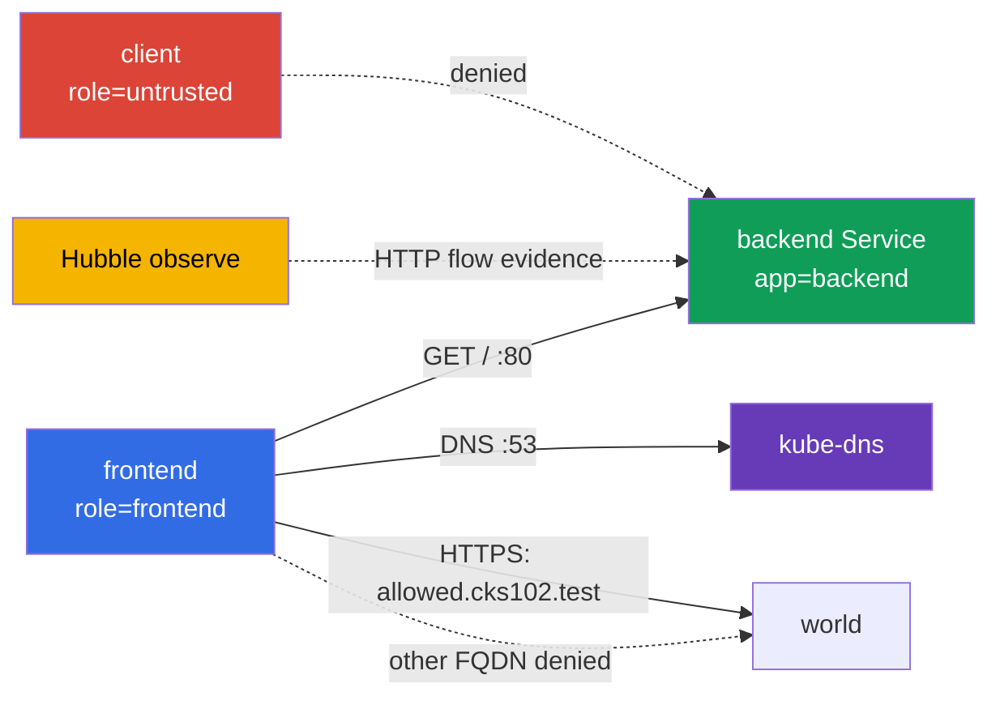

[Русская версия](README_RU.MD) · [Eng version](README.MD) · [Versión en español](README_ES.MD) · [Deutsche Version](README_DE.MD) · [ქართული ვერსია](README_GE.MD) · [繁體中文版](README_TW.MD) · [日本語版](README_JP.MD)

# Lab 102 - CiliumNetworkPolicy : L3/L4/L7, DNS-aware egress et Hubble

## Description

Dans ce lab, vous configurez une CiliumNetworkPolicy pour un petit service et vous
démontrez le comportement réel du réseau. L'objectif n'est pas d'écrire un YAML qui
ressemble à la solution, mais de restreindre l'accès L3/L4 par labels, d'ajouter ensuite un filtre HTTP L7, de limiter l'egress
par FQDN et de conserver l'evidence de Hubble. Les objets Kubernetes de base ne servent ici
que de banc d'essai ; le sujet d'étude, ce sont les capacités de Cilium.

## Objectif

Consolider le contenu du [chapitre 06. Cilium NetworkPolicy](../../course/06/fr.md) :

- `CiliumNetworkPolicy`, `endpointSelector` et identity par labels ;
- restriction L3/L4 du source et du port TCP ;
- règles HTTP L7 pour la méthode et le path ;
- DNS-aware egress via `toFQDNs` avec une règle DNS distincte ;
- vérification des flux autorisés et refusés via Hubble ;
- une L7 policy composite avec deux path-scope différents pour des source de namespace différents.

## Vérifiez-vous avant de commencer

<details>
<summary>1. En quoi une L3/L4 policy de Cilium diffère-t-elle fondamentalement d'une L7 policy sur la même règle ?</summary>

L3/L4 autorise ou refuse la connexion entière selon l'identity de source/destination et le port - Cilium ne regarde pas à l'intérieur du trafic. Une règle L7 (`rules.http`) s'ajoute sur le même port TCP, mais vérifie le contenu de la requête (méthode, path) - la connexion peut être autorisée en L4, mais une requête HTTP précise recevra tout de même `403` si elle ne correspond pas à la règle L7. Si vous laissez à côté une règle L4 large sans L7, elle « désactivera » le filtrage L7 pour ce port.

</details>

<details>
<summary>2. Pourquoi une règle egress `toFQDNs` ne fonctionne-t-elle pas sans règle distincte pour le DNS ?</summary>

`toFQDNs` repose sur le fait que Cilium **voit la réponse DNS** et mémorise à quelles IP correspond le nom autorisé (`allowed.cks102.test`). Si la requête DNS vers `kube-dns` est bloquée, Cilium ne connaîtra jamais l'IP actuelle du FQDN et ne pourra pas construire la règle allow d'egress vers elle - tout le trafic vers ce FQDN sera bloqué, même si la FQDN policy elle-même est écrite correctement.

</details>

<details>
<summary>3. Pourquoi, pour démontrer un L7-denial via Hubble, est-il important de faire le capture du trafic précisément pendant le test, et non après ?</summary>

`hubble observe --follow`, lancé avant la requête, est un mode pratique pour un controlled capture : il réduit le risque que le flow voulu sorte du retention buffer avant d'être enregistré. Ce n'est pas la seule façon d'obtenir une evidence valide : un `hubble observe` ordinaire peut lire des événements déjà enregistrés dans la retention window (par exemple avec un `--since` correct), et la sortie peut être exportée dans un fichier. Dans tous les cas, l'evidence doit relier sans ambiguïté la fenêtre temporelle, source/destination, HTTP method/path et le verdict aux test case concrets GET/POST.

</details>

## Ce que nous créons et pourquoi

| Objet                          | Rôle                         | Pourquoi il est nécessaire                                                                                 |
| ------------------------------------- | -------------------------------------------- | ----------------------------------------------------------------------------------------------------- |
| Namespace `cks-102`                  | isole le banc d'essai | la policy et les résultats ne se mélangent pas avec les workload système |
| Pod `backend` + Service `backend`  | HTTP endpoint sur TCP/80                    | target des ingress policy L3/L4 et L7                                                              |
| Pod `frontend`                       | client de confiance            | unique source auquel sont autorisés backend et le FQDN externe     |
| Pod `client`                         | client non fiable        | démontre qu'un allow par label n'équivaut pas à un accès pour tous          |
| CiliumNetworkPolicy `backend-policy` | ingress policy                               | d'abord L3/L4 ; puis le même objet est affiné jusqu'à L7                |
| CiliumNetworkPolicy `frontend-fqdn`  | egress policy                                | autorise le DNS et uniquement `allowed.cks102.test`                                         |
| Hubble Relay + CLI                    | observabilité                   | montre les HTTP-flow allowed/denied en temps réel                      |
| Namespace `production` + Pod/Service `portal` | un second backend indépendant avec deux path-scope | target de la L7 policy composite de la tâche 6 |
| Namespace `finance` + Pod `finance-client` | source de confiance pour `/private/*` | démontre un L7 allow namespace-aware |
| CiliumNetworkPolicy `portal-policy` | ingress policy composite avec deux path-scope | `/public/*` - n'importe quel cluster endpoint, `/private/*` - uniquement `finance` |



## Infrastructure

| Composant | Description                                                                                                              |
| ------------------ | ----------------------------------------------------------------------------------------------------------------------------- |
| `vpc`            | VPC distincte `10.102.0.0/16` avec deux sous-réseaux publics                                 |
| `ssh-keys`       | clés pour accéder aux machines virtuelles                                                     |
| `k8s-1`          | cluster kubeadm mono-nœud avec Kubernetes `1.36.0`, containerd et Cilium avec kube-proxy replacement            |
| `worker`         | machine de travail avec `kubectl`, Cilium CLI, Hubble CLI et `check_result`                                         |
| Hubble Relay       | activé par le `worker.sh` de démarrage ; pour le CLI, il faut un `cilium hubble port-forward` local |

## Déploiement

```bash
TASK=102 make run_cks_task
```

Connectez-vous en SSH à la machine de travail. Le contexte `cluster1-admin@cluster1` est déjà configuré.

```bash
kubectl config current-context
cilium status --wait
```

## Tâches

---

|           **1**           | **Namespace de lab et endpoints** |
| :-----------------------------: | :-------------------------------------------------------------------------------------------------------------------------------------------------------------------------------------------------------------------------------------------------------------------------------------------------------------------------------------------------------------------------------------------------------------------------------------------------------------------------------------------------------------------------------------------------------------------------------------------------------------------------------------------------------------------------------------------------------------------------------------------------------------------------------------------------------------------------------------------------------------------------------------------------------------------------------------------------------------------------------------------------------------------------------------------------------------------------------------------------------------------------------------------------------------------------------------------------------------------------------------------------------------------------------------------------------------------------------------------------------------------------------------------------------------------------------------------------------------------------------------------------------------------------------------------------------------------------------------------------------------------------------------------------------------------------------------------------------------------------------------------------------------------------------------------------------------------------------------------------------------------------------------------------------------------------------------------------------------------------------------------------------------------------------------------------------------------------------------------------------------- |
|       Ce qu'on fait       | Créez le namespace `cks-102`. Dedans, créez : un Pod `backend` avec le label `app=backend` et l'image `nginx:1.27-alpine` ; un Service `backend` qui sélectionne ce Pod sur le port `80` ; un Pod `frontend` avec le label `role=frontend` et l'image `curlimages/curl:8.10.1` ; un Pod `client` avec le label `role=untrusted` et la même image. Pour les pods client, la commande doit maintenir le conteneur en marche, par exemple `sleep 3600`. Attendez Ready. |
| Critères d'acceptation | - le namespace `cks-102` existe ;- les Pods `backend`, `frontend`, `client` existent avec les labels indiqués ;- le Service `backend` a le port `80`. |

<details>
<summary>💡 Indice pour la tâche 1</summary>

Notez que les labels sont différents par leur style : `backend` utilise `app=backend`, tandis que `frontend`/`client` utilisent `role=frontend`/`role=untrusted` - c'est volontaire, pour que les CiliumNetworkPolicy suivantes indiquent explicitement par quel label précis elles font correspondre l'identity. Confondre `app`/`role` pour l'un des Pod est une cause fréquente du fait que la policy « ne fonctionne pas ».

</details>

---

|           **2**           | **Cilium L3/L4 : seulement frontend vers backend:80** |
| :-----------------------------: | :--------------------------------------------------------------------------------------------------------------------------------------------------------------------------------------------------------------------------------------------------------------------------------------------------------------------------------------------------------------------------------------------------------------------------------------------------------------------------------------------------------------------------------------------------------------------------------------------------------------------------------------------------------------------------------------------------------------------------------------------------------------------------------------------------------------------------------------------------------------------------------------------------------------------------------------------------------------------------------------------------------------------------------------------------------------------------------------------------------------------------------------------------------------------------------------------------------------------------------------------------------------------------------------------------------------------------------------------------------------------------------------------------------------------------------------------------------------------------------------------------------------------------------------------------------------------------------------------------------------------------------------------------------------------------------------------------------------------------------------------------------------------------------------------------------------------------------------------------------------------------------------------------------------------------------------------------------------------------------------------------------------------------------------------------------------------------------------------------------------- |
|       Ce qu'on fait       | Dans `cks-102`, créez une `CiliumNetworkPolicy` nommée `backend-policy`. Elle doit sélectionner `app=backend` et autoriser l'ingress uniquement depuis un endpoint avec `role=frontend` vers le port TCP `80`. N'ajoutez pas d'autorisation large pour tous les endpoint. Avant d'appliquer la policy, assurez-vous vous-même avec `curl` que `frontend` comme `client` atteignent réellement `http://backend/` - sinon le deny après la policy ne prouvera rien. Après avoir appliqué `backend-policy`, vérifiez de nouveau les deux Pods. |
| Critères d'acceptation | - `backend-policy` sélectionne `app=backend`, source `role=frontend`, TCP `80` ;- après la policy : `frontend` reçoit `200` ;- après la policy : `client` reçoit précisément un deny au niveau transport - `HTTPCODE:000` et un exit code réseau/timeout de curl (`7`/`28`), et pas simplement « autre chose que 200 ». |

<details>
<summary>💡 Indice pour la tâche 2</summary>

`endpointSelector.matchLabels` dans la policy elle-même doit correspondre à `backend` (`app: backend`), tandis que `fromEndpoints[].matchLabels` à l'intérieur de `ingress` doit correspondre à `frontend` (`role: frontend`) - ce sont deux sélecteurs DIFFÉRENTS dans un même objet, il est facile de les intervertir. Vérifiez via `kubectl exec` dans `client` : après la policy, la requête doit recevoir précisément `HTTPCODE:000` et exit `7`/`28` - une vraie HTTP response avec n'importe quel code (`403`, `404`...) signifie que le chemin réseau existe toujours et que le L3/L4 deny n'est pas démontré.

</details>

---

|           **3**           | **Cilium L7 HTTP : seulement GET /** |
| :-----------------------------: | :------------------------------------------------------------------------------------------------------------------------------------------------------------------------------------------------------------------------------------------------------------------------------------------------------------------------------------------------------------------------------------------------------------------------------------------------------------------------------------------------------------------------------------------------------------------------------------------------------------------------------------------------------------------------------------------------------------------------------------------------------------------------------------------------------------------------------------------------------------------------------------------------------------------------------------------------------------------------------------------------------------------------------------------------------------------------------------------------------------------------------------------------------------------------------------------------------------------------------------------------------------------------------------------------------------------------------------------------------------------------------------------------------------------------------------------------------------------------------------------------------------------------------------------------------------------------------------------------------------------------------------------------------------------------------------------------------------------------------------------------------------------------------------------------------------------------------------------------------------------------------------------------------------------------------------------------------------------------------------------------------------------------------------------------------------------------------------------------------------- |
|       Ce qu'on fait       | Modifiez **la même** `backend-policy` : pour TCP/80, autorisez depuis `frontend` uniquement HTTP `GET` avec le path `/`. Ne laissez pas à côté une règle L4 allow large, sinon le filtre L7 ne limitera pas POST. Avant la modification, vérifiez avec `curl` (avec la L3/L4-only policy de la tâche 2 encore en vigueur) que `GET /` comme `POST /` depuis `frontend` atteignent réellement backend - une L4-only policy ne regarde pas à l'intérieur de HTTP. Après avoir remplacé la règle par L7, vérifiez de nouveau les deux requêtes. |
| Critères d'acceptation | - la règle TCP/80 a `rules.http` avec `method: GET` et `path: /` ;- après L7 : `GET http://backend/` depuis `frontend` renvoie `200` ;- après L7 : `POST http://backend/` depuis `frontend` renvoie `403`. |

<details>
<summary>💡 Indice pour la tâche 3</summary>

L'erreur la plus fréquente de cette tâche est de laisser la règle L4-only d'origine de la tâche 2 À CÔTÉ de la nouvelle règle L7, au lieu de la remplacer. Si la policy contient à la fois « autoriser TCP/80 sans filtre L7 » et « autoriser TCP/80 avec L7 GET / », Cilium appliquera l'autorisation la plus large, et `POST` passera alors qu'il devrait recevoir `403`. Assurez-vous que `toPorts.rules.http` se trouve À L'INTÉRIEUR de la même règle que `toPorts.ports` avec le port 80, et non dans une règle dupliquée distincte. Le baseline avec la L4-only policy avant cette tâche existe précisément pour démontrer qu'avant L7, POST atteignait réellement backend et qu'après L7, c'est le filtre L7 qui le rejette (`403`), et non un quelconque problème réseau étranger.

</details>

---

|           **4**           | **DNS-aware egress : un seul FQDN est autorisé** |
| :-----------------------------: | :------------------------------------------------------------------------------------------------------------------------------------------------------------------------------------------------------------------------------------------------------------------------------------------------------------------------------------------------------------------------------------------------------------------------------------------------------------------------------------------------------------------------------------------------------------------------------------------------------------------------------------------------------------------------------------------------------------------------------------------------------------------------------------------------------------------------------------------------------------------------------------------------------------------------------------------------------------------------------------------------------------------------------------------------------------------------------------------------------------------------------------------------------------------------------------------------------------------------------------------------------------------------------------------------------------------------------------------------------------------------------------------------------------------------------------------------------------------------------------------------------------------------------------------------------------------------------------------------------------------------------------------------------------------------------------------------------------------------------------------------------------------------------------------------------------------------------------------------------------------------------------------------------------------------------------------------------------------------------------------------------------------------------------------------------------------------------------------------------------ |
|       Ce qu'on fait       | Créez la `CiliumNetworkPolicy` `frontend-fqdn`, qui sélectionne `role=frontend`. Autorisez-lui le DNS vers `kube-dns` sur le port `53` **via une L7 DNS proxy rule** `toPorts.rules.dns` (par exemple `matchPattern: "*"`) : à partir de ce trafic DNS, Cilium construit le FQDN-to-IP mapping pour `toFQDNs`. Autorisez l'egress via `toFQDNs` uniquement vers `allowed.cks102.test` (un lab-owned fixture hors de l'address space de Kubernetes - un network namespace distinct sur le nœud control-plane avec une IP synthétique, branché via CoreDNS au bootstrap ; c'est volontaire, `toFQDNs` dans Cilium n'applique pas la règle allow à une IP à l'intérieur du cluster) et uniquement sur TCP `443`. **Conservez aussi le flux interne obligatoire des tâches 2-3** : ajoutez une règle egress distincte vers `backend` (`app=backend`) uniquement sur TCP `80` - sans elle, `frontend-fqdn` active l'egress default-deny pour `frontend`, et le `frontend -> backend:80` déjà autorisé dans les tâches 2-3 sera bloqué. Avant l'application, vérifiez avec `curl` que la DNS resolution et `https://allowed.cks102.test/`, `http://allowed.cks102.test:80/`, `https://blocked.cks102.test/` (avec `-k`, certificat auto-signé du fixture) sont réellement accessibles. Après avoir appliqué `frontend-fqdn`, vérifiez de nouveau les mêmes adresses, plus `frontend -> backend GET /` (`200`) et `POST /` (`403`) des tâches 2-3 - assurez-vous qu'ils n'ont pas régressé. |
| Critères d'acceptation | - la policy contient `toFQDNs.matchName: allowed.cks102.test` et `toPorts` avec TCP `443` ;- le DNS vers `kube-dns` est autorisé par une règle distincte avec `rules.dns` ;- l'egress interne vers `backend` est autorisé par une règle distincte uniquement sur TCP `80`, sans quoi la tâche 3 régresse ;- l'egress externe est autorisé uniquement vers `allowed.cks102.test:443` ; `allowed.cks102.test:80` et `blocked.cks102.test:443` ne sont pas autorisés ;- après l'application de `frontend-fqdn`, `frontend -> backend GET /` renvoie toujours `200`, et `POST /` - `403`.- `allowed.cks102.test`/`blocked.cks102.test` sont un lab-owned fixture levé par le bootstrap ; leur indisponibilité avant la policy est considérée comme une erreur d'infrastructure, et non comme un motif de résultat inconclusive. |

<details>
<summary>💡 Indice pour la tâche 4</summary>

Trois règles egress sont nécessaires dans un même objet de policy : (1) DNS vers kube-dns avec `rules.dns.matchPattern: "*"`, SANS cela Cilium ne pourra pas suivre quelle IP correspond à `allowed.cks102.test` ; (2) le `backend` interne (`app=backend`) sur TCP/80 - sans cette règle, l'egress default-deny pour `frontend` bloquera le flux déjà autorisé des tâches 2-3, et la Hubble evidence de la tâche 5 deviendra impossible ; (3) `toFQDNs` avec `matchName: allowed.cks102.test` et `toPorts` strictement sur 443. Si, après l'apply, la première requête vers `allowed.cks102.test` ne passe pas - patientez quelques secondes, la DNS resolution et le FQDN mapping dans Cilium ne sont pas instantanés.

</details>

---

|           **5**           | **Hubble : observation des flux HTTP** |
| :-----------------------------: | :--------------------------------------------------------------------------------------------------------------------------------------------------------------------------------------------------------------------------------------------------------------------------------------------------------------------------------------------------------------------------------------------------------------------------------------------------------------------------------------------------------------------------------------------------- |
|       Ce qu'on fait       | Sur le worker, lancez `cilium hubble port-forward`, puis dans une fenêtre distincte/en arrière-plan - `hubble observe --from-pod cks-102/frontend --to-pod cks-102/backend --protocol http --follow`. Pendant que l'observation est en cours, exécutez depuis `frontend` un `GET /` autorisé et un `POST /` refusé vers backend et assurez-vous de voir les deux flow : `GET /` avec le verdict `FORWARDED`, `POST /` avec le verdict `DROPPED`. |
| Critères d'acceptation | - `check_result` génère lui-même GET/POST et vérifie lui-même que les deux verdict sont visibles dans Hubble - assurez-vous que la policy finale des tâches 2-3 donne réellement `FORWARDED` pour GET et `DROPPED` pour POST. |

<details>
<summary>💡 Indice pour la tâche 5</summary>

Pour un controlled capture, il est recommandé de lancer `hubble observe --follow` EN ARRIÈRE-PLAN (`&`) AVANT `GET`/`POST` : ainsi, le risque de perdre le flow avant l'observation est moindre. `--follow` n'est pas la seule option valide : si les événements sont encore dans le retention buffer, on peut les lire avec un `hubble observe` ordinaire avec un filtre temporel correct. Dans tous les cas, assurez-vous vous-même que l'evidence montre sans ambiguïté `frontend -> backend`, `GET / -> FORWARDED` et `POST / -> DROPPED` - aucun fichier-artefact de l'étudiant n'est requis.

</details>

---

|           **6**           | **L7 policy composite : `/public/*` pour tous, `/private/*` uniquement pour `finance`** |
| :-----------------------------: | :------------------------------------------------------------------------------------------------------------------------------------------------------------------------------------------------------------------------------------------------------------------------------------------------------------------------------------------------------------------------------------------------------------------------------------------------------------------------------------------------------------------------------------------------------------------------------------------------------------------------------------------------------------------------------------------------------------------------------------------------------------------------------------------------------------------------------------------------------------------------------------------------------------------------------------------------------------------------------------------------------------------------------------------------------------------------------------------------------------------------------------------------------------------------------------------------------------------------------------------------------------------------------------------------------------------------------------------------------------------------------------------------------------------------------------------------------------------------------------------------------------------------------------------------------------------------------------------------------------------------------------------------------------------------------------------------------------------------------------------------------------------------------------------------------------------------------------------------------------------------------------------------------------------------------------------------------------------------------------------------------------------------------------------------------------------------------------------------------------- |
|       Ce qu'on fait       | Les tâches 2-3 entraînent un seul source (`frontend`) et un seul contrat de path. Ici, un second backend indépendant avec DEUX path-scope à la fois. Créez les namespace `production` et `finance`. Dans `production`, créez un Pod `portal` (label `app=portal`, image `nginx:1.27-alpine`) et un ConfigMap qui donne à nginx un server block minimal : `location /public/` renvoie `200` (par exemple `return 200 "public ok\n";`), `location /private/` renvoie `200` de la même façon, tout autre path - `404`. Montez le ConfigMap comme `/etc/nginx/conf.d/default.conf`. Créez un Service `portal` sur le port `80`. Dans `finance`, créez un Pod `finance-client` (`curlimages/curl:8.10.1`, `sleep 3600`). Le Pod `client` existant du namespace `cks-102` (tâche 1) est utilisé comme source de « n'importe quel autre/externe » namespace - ne créez pas pour cela un Pod distinct. Créez la `CiliumNetworkPolicy` `portal-policy` dans `production`, qui sélectionne `app=portal`, avec DEUX règles ingress sur TCP/80 : (1) `fromEndpoints` avec `matchExpressions: [{key: k8s:io.kubernetes.pod.namespace, operator: Exists}]` (n'importe quel Pod quel que soit le namespace) + `rules.http` `GET` sur le path correspondant à `/public/*` ; (2) `fromEndpoints` avec `matchLabels` par le namespace `finance` + `rules.http` `GET` sur le path correspondant à `/private/*`. Avant d'appliquer la policy, vérifiez avec `curl` que `finance-client` comme `cks-102/client` reçoivent réellement `200` sur les DEUX path - sinon le deny ne prouvera rien. Après avoir appliqué la policy, vérifiez de nouveau les deux path depuis les deux namespace. |
| Critères d'acceptation | - `portal-policy` contient exactement deux règles ingress sur TCP/80 avec la séparation décrite ci-dessus ;- baseline : le Pod `portal` renvoie lui-même `200` sur les deux path (le checker le vérifie via loopback à l'intérieur du Pod, sans retirer la policy) ;- après la policy : `finance-client` reçoit `200` aussi bien sur `/public/*` que sur `/private/*` ;- après la policy : `cks-102/client` reçoit `200` sur `/public/*`, mais reçoit précisément un refus L7 (`403`) sur `/private/*` - la connexion TCP est toujours autorisée par la première règle (la règle avec `matchExpressions: Exists`), donc il ne s'agit pas d'un deny au niveau transport, mais d'un `403` L7 d'Envoy. |

<details>
<summary>💡 Indice pour la tâche 6</summary>

Le path dans `rules.http` est une regex (compatible Envoy), et non une chaîne exacte : `/public/.*`,
et non `/public/`. Deux règles ingress avec des `fromEndpoints` DIFFÉRENTS pour le même
`endpointSelector`+port se combinent de façon additive per-identity : la règle qui autorise
ABSOLUMENT n'importe quelle identity (y compris `finance`) donne à `finance-client` l'union des deux
listes L7-allow (`/public/*` comme `/private/*`), tandis que `cks-102/client` (qui ne correspond pas à la règle 2)
reçoit uniquement `/public/*`. C'est précisément pourquoi le deny final pour le client externe sur
`/private/*` est un `403` d'Envoy, et non `HTTPCODE:000` : la règle « n'importe laquelle » a déjà autorisé la connexion
TCP elle-même pour tous, L4 n'est pas ici limité à un seul source.

**Piège** : `fromEndpoints: [{}]` (sélecteur vide) n'est PAS une façon de faire correspondre n'importe quelle identity
de n'importe quel namespace. Cilium applique implicitement un scoping du sélecteur de `fromEndpoints` sans
namespace-label explicite au namespace DE LA POLICY ELLE-MÊME, et cela s'applique même à un `{}` vide ; en
conséquence, une telle règle ne correspond qu'à `production`, et non à `finance`/`cks-102`, et les deux
namespace externes recevront un transport-level deny au lieu du comportement attendu. Pour autoriser
réellement n'importe quelle identity indépendamment du namespace, utilisez `matchExpressions` avec
`operator: Exists` sur le reserved-label `k8s:io.kubernetes.pod.namespace` - la simple présence de
ce label est vraie pour n'importe quel Pod.

Ne confondez pas `location /public/` (chemin exact) dans la configuration nginx avec le regex-path dans la CNP - ils
vivent à des endroits différents et avec des syntaxes différentes.

</details>

---

## Vérification du résultat

Sur le worker, lancez :

```bash
check_result
```

La vérification exécute six tâches indépendantes. `check_result` vérifie lui-même le comportement
du cluster en direct (vos policy ne sont ni supprimées ni modifiées : le checker ne fait que les lire et
envoyer des requêtes de test, et génère lui-même GET/POST pour Hubble) - aucun fichier-artefact de l'étudiant n'est requis.
Le checker enregistre ses propres vérifications runtime de diagnostic dans `/var/work/tests/checker-artifacts/`.

## Solution

Solution de référence : [worker/files/solutions/1_FR.MD](worker/files/solutions/1_FR.MD).

## Suppression

```bash
TASK=102 make delete_cks_task
```
