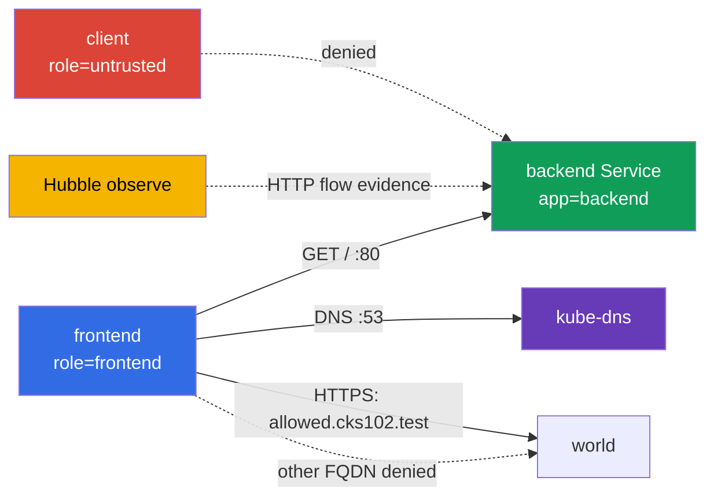

[Русская версия](README_RU.MD) · [Eng version](README.MD) · [Versión en español](README_ES.MD) · [Version française](README_FR.MD) · [Deutsche Version](README_DE.MD) · [繁體中文版](README_TW.MD) · [日本語版](README_JP.MD)

# Lab 102 - CiliumNetworkPolicy: L3/L4/L7, DNS-aware egress და Hubble

## აღწერა

ამ ლაბორატორიულ სამუშაოში თქვენ აგებთ CiliumNetworkPolicy-ს პატარა სერვისისთვის და
ამტკიცებთ ქსელის ფაქტობრივ ქცევას. ამოცანა იმაში არ მდგომარეობს, რომ დაწეროთ მსგავსი YAML,
არამედ იმაში, რომ labels-ის მიხედვით დავავიწროვოთ L3/L4-წვდომა, შემდეგ დავამატოთ HTTP L7-ფილტრი,
შევზღუდოთ egress FQDN-ით და შევინახოთ evidence Hubble-იდან. Kubernetes-ის ბაზისური ობიექტები აქ
მხოლოდ სასწავლო სტენდის როლს ასრულებს; სამუშაოს საგანია Cilium-ის შესაძლებლობები.

## მიზანი

განამტკიცეთ [თავი 06. Cilium NetworkPolicy](../../course/06/ge.md)-ის მასალა:

- `CiliumNetworkPolicy`, `endpointSelector` და identity labels-ის მიხედვით;
- source-ისა და TCP-პორტის L3/L4-შეზღუდვა;
- L7 HTTP-წესები მეთოდისა და path-ისთვის;
- DNS-aware egress `toFQDNs`-ით ცალკე DNS-წესთან ერთად;
- დაშვებული და აკრძალული ნაკადების შემოწმება Hubble-ით;
- შედგენილი L7 policy ორი განსხვავებული path-scope-ით სხვადასხვა namespace source-ისთვის.

## შეამოწმეთ თავი სტარტამდე

<details>
<summary>1. რით განსხვავდება პრინციპულად L3/L4 policy Cilium-ში L7 policy-სგან ერთსა და იმავე წესზე?</summary>

L3/L4 უშვებს ან კრძალავს კავშირს მთლიანად source/destination identity-ისა და პორტის მიხედვით - Cilium ტრაფიკის შიგნით არ იყურება. L7-წესი (`rules.http`) ემატება იმავე TCP-პორტს, მაგრამ ამოწმებს მოთხოვნის შინაარსს (მეთოდი, path) - კავშირი შეიძლება დაშვებული იყოს L4-ზე, მაგრამ კონკრეტული HTTP-მოთხოვნა მაინც მიიღებს `403`-ს, თუ L7-წესს არ დაემთხვევა. თუ დატოვებთ ცალკე ფართო L4-წესს L7-ის გარეშე, ის "გამორთავს" ამ პორტზე L7-ფილტრაციას.

</details>

<details>
<summary>2. რატომ არ მუშაობს `toFQDNs` egress-წესი ცალკე DNS-წესის გარეშე?</summary>

`toFQDNs` ეფუძნება იმას, რომ Cilium **ხედავს DNS-პასუხს** და იმახსოვრებს, რომელ IP-ებს შეესაბამება დაშვებული სახელი (`allowed.cks102.test`). თუ `kube-dns`-ისკენ DNS-მოთხოვნა დაბლოკილია, Cilium ვერასოდეს გაიგებს FQDN-ის აქტუალურ IP-ს და ვერ ააგებს მისკენ egress-ის allow-წესს - მთელი ტრაფიკი ამ FQDN-ისკენ დაიბლოკება, თუნდაც თავად FQDN-policy სწორად იყოს დაწერილი.

</details>

<details>
<summary>3. რატომ არის L7-denial-ის დასამტკიცებლად Hubble-ით მნიშვნელოვანი ტრაფიკის captur'ვა სწორედ ტესტის დროს და არა მის შემდეგ?</summary>

`hubble observe --follow`, გაშვებული მოთხოვნამდე, - კომფორტული რეჟიმია controlled capture-ისთვის: ის ამცირებს რისკს, რომ საჭირო flow შენახვამდე retention buffer-იდან გავა. ეს არ არის ვალიდური evidence-ის მიღების ერთადერთი გზა: ჩვეულებრივ `hubble observe`-ს შეუძლია უკვე შენახული მოვლენების წაკითხვა retention window-ის ფარგლებში (მაგალითად, სწორი `--since`-ით), ხოლო გამოტანა შეიძლება ფაილში ექსპორტირდეს. ნებისმიერ ვარიანტში evidence-მა ცალსახად უნდა დააკავშიროს დროის ფანჯარა, source/destination, HTTP method/path და verdict კონკრეტულ GET/POST test case-თან.

</details>

## რას ვქმნით და რისთვის

| ობიექტი                          | დანიშნულება                         | რისთვის არის საჭირო                                                                                 |
| ------------------------------------- | -------------------------------------------- | ----------------------------------------------------------------------------------------------------- |
| Namespace`cks-102`                  | გამოყოფს სასწავლო სტენდს | policy და შედეგები არ ერევა სისტემურ workload-ებში |
| Pod`backend` + Service `backend`  | HTTP endpoint TCP/80-ზე                    | target L3/L4 და L7 ingress policy-სთვის                                                              |
| Pod`frontend`                       | სანდო კლიენტი            | ერთადერთი source, რომელსაც backend-ზე და გარე FQDN-ზე წვდომა აქვს დაშვებული     |
| Pod`client`                         | არასანდო კლიენტი        | ამტკიცებს, რომ allow label-ით არ ნიშნავს წვდომას ყველასთვის          |
| CiliumNetworkPolicy`backend-policy` | ingress policy                               | ჯერ L3/L4, შემდეგ იგივე ობიექტი დაზუსტდება L7-მდე                |
| CiliumNetworkPolicy`frontend-fqdn`  | egress policy                                | უშვებს DNS-ს და მხოლოდ`allowed.cks102.test`-ს                                         |
| Hubble Relay + CLI                    | observability                   | აჩვენებს დაშვებულ/უარყოფილ HTTP-flow-ს რეალურ დროში                      |
| Namespace`production` + Pod/Service `portal` | მეორე, დამოუკიდებელი backend ორი path-scope-ით | target დავალება 6-ის შედგენილი L7 policy-სთვის |
| Namespace`finance` + Pod `finance-client` | სანდო წყარო`/private/*`-ისთვის | ამტკიცებს namespace-aware L7 allow-ს |
| CiliumNetworkPolicy`portal-policy` | შედგენილი ingress policy ორი path-scope-ით | `/public/*` - ნებისმიერი cluster endpoint, `/private/*` - მხოლოდ`finance` |



## ინფრასტრუქტურა

| კომპონენტი | აღწერა                                                                                                              |
| ------------------ | ----------------------------------------------------------------------------------------------------------------------------- |
| `vpc`            | ცალკე VPC`10.102.0.0/16` ორი საჯარო ქვექსელით                                 |
| `ssh-keys`       | გასაღებები ვირტუალურ მანქანებზე წვდომისთვის                                                     |
| `k8s-1`          | ერთკვანძიანი kubeadm-კლასტერი Kubernetes`1.36.0`, containerd და Cilium kube-proxy replacement-ით            |
| `worker`         | სამუშაო მანქანა`kubectl`-ით, Cilium CLI-ით, Hubble CLI-ით და `check_result`-ით                                         |
| Hubble Relay       | ირთვება საწყისი`worker.sh`-ით; CLI-სთვის საჭიროა ლოკალური `cilium hubble port-forward` |

## განთავსება

```bash
TASK=102 make run_cks_task
```

დაუკავშირდით სამუშაო მანქანას SSH-ით. კონტექსტი `cluster1-admin@cluster1` უკვე გამართულია.

```bash
kubectl config current-context
cilium status --wait
```

## დავალებები

---

|           **1**           | **სასწავლო namespace და endpoints** |
| :-----------------------------: | :-------------------------------------------------------------------------------------------------------------------------------------------------------------------------------------------------------------------------------------------------------------------------------------------------------------------------------------------------------------------------------------------------------------------------------------------------------------------------------------------------------------------------------------------------------------------------------------------------------------------------------------------------------------------------------------------------------------------------------------------------------------------------------------------------------------------------------------------------------------------------------------------------------------------------------------------------------------------------------------------------------------------------------------------------------------- |
|       რას ვაკეთებთ       | შექმენით namespace`cks-102`. მასში შექმენით: Pod `backend` label-ით `app=backend` და image-ით `nginx:1.27-alpine`; Service `backend`, რომელიც ამ Pod-ს ირჩევს პორტზე `80`; Pod `frontend` label-ით `role=frontend` და image-ით `curlimages/curl:8.10.1`; Pod `client` label-ით `role=untrusted` და იმავე image-ით. client-pod-ებში ბრძანებამ კონტეინერი უნდა გაშვებული გაამყოფოს, მაგალითად `sleep 3600`. დაელოდეთ Ready-ს. |
| მიღების კრიტერიუმები | - არსებობს namespace`cks-102`;- არსებობს Pods `backend`, `frontend`, `client` მითითებული labels-ით;- Service `backend`-ს აქვს პორტი `80`. |

<details>
<summary>💡 მინიშნება დავალება 1-ისთვის</summary>

ყურადღება მიაქციეთ, რომ labels სტილით განსხვავებულია: `backend` იყენებს `app=backend`-ს, ხოლო `frontend`/`client` იყენებენ `role=frontend`/`role=untrusted`-ს - ეს განზრახ არის გაკეთებული, რათა შემდგომმა CiliumNetworkPolicy-მ აშკარად მიუთითოს, კონკრეტულად რომელი label-ით ემთხვევა identity-ს. ერთ-ერთი Pod-ისთვის `app`/`role`-ის არევა - ხშირი მიზეზია, რის გამოც policy "არ მუშაობს".

</details>

---

|           **2**           | **Cilium L3/L4: მხოლოდ frontend backend:80-მდე** |
| :-----------------------------: | :------------------------------------------------------------------------------------------------------------------------------------------------------------------------------------------------------------------------------------------------------------------------------------------------------------------------------------------------------------------------------------------------------------------------------------------------------------------------------------------------------------------------------------------------------------------------------------------------------------------------------------------------------------------------------------------------------------------------------------------------------------------------------------------------------------------------------------- |
|       რას ვაკეთებთ       | `cks-102`-ში შექმენით `CiliumNetworkPolicy` სახელით `backend-policy`. ის უნდა ირჩევდეს `app=backend`-ს და უშვებდეს ingress-ს მხოლოდ endpoint-იდან `role=frontend`-ით TCP-პორტზე `80`. ნუ დაამატებთ ფართო დაშვებას ყველა endpoint-ისთვის.policy-ის გამოყენებამდე თავად დარწმუნდით `curl`-ით, რომ როგორც `frontend`, ისე `client` რეალურად აღწევენ `http://backend/`-ს - წინააღმდეგ შემთხვევაში policy-ის შემდეგ deny არაფერს დაამტკიცებს. `backend-policy`-ის გამოყენების შემდეგ ორივე Pod ხელახლა შეამოწმეთ. |
| მიღების კრიტერიუმები | -`backend-policy` ირჩევს `app=backend`-ს, source `role=frontend`, TCP `80`;- policy-ის შემდეგ: `frontend` იღებს `200`-ს;- policy-ის შემდეგ: `client` იღებს სწორედ transport-level deny-ს - `HTTPCODE:000` და curl network/timeout exit code (`7`/`28`), და არა უბრალოდ "არა 200". |

<details>
<summary>💡 მინიშნება დავალება 2-ისთვის</summary>

`endpointSelector.matchLabels` თავად policy-ში უნდა ემთხვეოდეს `backend`-ს (`app: backend`), ხოლო `fromEndpoints[].matchLabels` `ingress`-ის შიგნით უნდა ემთხვეოდეს `frontend`-ს (`role: frontend`) - ეს ორი განსხვავებული selector-ია ერთ ობიექტში, მათი ადგილების არევა ადვილია. შეამოწმეთ თავი `kubectl exec`-ით `client`-ში: policy-ის შემდეგ მოთხოვნამ უნდა მიიღოს სწორედ `HTTPCODE:000` და exit `7`/`28` - რეალური HTTP-პასუხი ნებისმიერი კოდით (`403`, `404`...) ნიშნავს, რომ ქსელური გზა ჯერ კიდევ არსებობს და L3/L4 deny დამტკიცებული არ არის.

</details>

---

|           **3**           | **Cilium L7 HTTP: მხოლოდ GET /** |
| :-----------------------------: | :------------------------------------------------------------------------------------------------------------------------------------------------------------------------------------------------------------------------------------------------------------------------------------------------------------------------------------------------------------------------------------------------------------------------------------------------------------------------------------------------------------------------------------------------------------------------------------------------------------------------------------------------------------------------------------------------------------------------------------------------------------------------------------------------------------------------------- |
|       რას ვაკეთებთ       | შეცვალეთ**იგივე** `backend-policy`: TCP/80-ისთვის დაუშვით `frontend`-იდან მხოლოდ HTTP `GET` path-ით `/`. ნუ დატოვებთ ცალკე ფართო L4 allow-წესს, წინააღმდეგ შემთხვევაში L7-ფილტრი POST-ს ვერ შეზღუდავს.ცვლილებამდე შეამოწმეთ `curl`-ით (ჯერ კიდევ მოქმედი L3/L4-only policy-ით დავალება 2-დან), რომ როგორც `GET /`, ისე `POST /` `frontend`-იდან რეალურად აღწევს backend-ს - L4-only policy HTTP-ის შიგნით არ იყურება. წესის L7-ით ჩანაცვლების შემდეგ ორივე მოთხოვნა ხელახლა შეამოწმეთ. |
| მიღების კრიტერიუმები | - TCP/80-ის წესს აქვს`rules.http` `method: GET`-ით და `path: /`-ით;- L7-ის შემდეგ: `GET http://backend/` `frontend`-იდან აბრუნებს `200`-ს;- L7-ის შემდეგ: `POST http://backend/` `frontend`-იდან აბრუნებს `403`-ს. |

<details>
<summary>💡 მინიშნება დავალება 3-ისთვის</summary>

ამ დავალების ყველაზე ხშირი შეცდომაა დავალება 2-ის საწყისი L4-only წესის დატოვება ახალი L7-წესის გვერდით, მისი ჩანაცვლების ნაცვლად. თუ policy-ში ერთდროულად არის "დაუშვი TCP/80 L7-ფილტრის გარეშე" და "დაუშვი TCP/80 L7 GET /-ით", Cilium გამოიყენებს უფრო ფართო დაშვებას, და `POST` გაივლის, მაშინ როცა უნდა მიიღოს `403`. დარწმუნდით, რომ `toPorts.rules.http` არის იმავე წესის **შიგნით**, რომელშიც არის `toPorts.ports` პორტით 80, და არა ცალკე დუბლირებულ წესში. L4-only policy-ის baseline ამ დავალებამდე სწორედ იმისთვის არსებობს, რომ დაამტკიცოს: L7-მდე POST რეალურად გადიოდა backend-ზე, ხოლო L7-ის შემდეგ მას უარყოფს სწორედ L7-ფილტრი (`403`), და არა რაიმე გარეშე ქსელური პრობლემა.

</details>

---

|           **4**           | **DNS-aware egress: დაშვებულია მხოლოდ ერთი FQDN** |
| :-----------------------------: | :------------------------------------------------------------------------------------------------------------------------------------------------------------------------------------------------------------------------------------------------------------------------------------------------------------------------------------------------------------------------------------------------------------------------------------------------------------------------------------------------------------------------------------------------------------------------------------------------------------------------------------------------------------------------------------------------------------------------------------------------------------------------------------------------------------------------------------------------------------------------------------------------------------------------------------------------------------------------------------------------------------------------------------------------------------------------------------------------------------------------------------------------------------------------------------------------------------------------------------------------------------------------------------------------------------------------------------------------------------------------------------------------------------------------------------------------------------------------------------------------------------------------------------------------------------------------------------------------------------------------------------------------------------------------------------------------------------------------------------------------------------------------------------------------------------------------------------------------------------------------------------------------------------------- |
|       რას ვაკეთებთ       | შექმენით`CiliumNetworkPolicy` `frontend-fqdn`, რომელიც ირჩევს `role=frontend`-ს. დაუშვით მასში DNS `kube-dns`-ისკენ პორტზე `53` **L7 DNS proxy rule-ით** `toPorts.rules.dns` (მაგალითად, `matchPattern: "*"`): Cilium ამ DNS-ტრაფიკით აყალიბებს FQDN-to-IP mapping-ს `toFQDNs`-ისთვის. დაუშვით egress `toFQDNs`-ით მხოლოდ `allowed.cks102.test`-ისკენ (lab-owned fixture Kubernetes address space-ის გარეთ - ცალკე network namespace control-plane node-ზე სინთეტიკური IP-ით, bootstrap-ში CoreDNS-ის გავლით მიერთებული; ეს განზრახ არის, Cilium-ში `toFQDNs` არ ავრცელებს allow-წესს კლასტერის შიგნით არსებულ IP-ზე) და მხოლოდ TCP `443`-ზე. **ასევე შეინარჩუნეთ სავალდებულო შიდა ნაკადი დავალებები 2-3-დან**: დაამატეთ ცალკე egress-წესი `backend`-ისკენ (`app=backend`) მხოლოდ TCP `80`-ზე - მის გარეშე `frontend-fqdn` რთავს egress default-deny-ს `frontend`-ისთვის, და უკვე დაშვებული `frontend -> backend:80` დავალება 2-3-დან დაიბლოკება.გამოყენებამდე შეამოწმეთ `curl`-ით, რომ DNS resolution და `https://allowed.cks102.test/`, `http://allowed.cks102.test:80/`, `https://blocked.cks102.test/` (`-k`-ით, fixture-ის თვითხელმოწერილი სერტიფიკატი) რეალურად ხელმისაწვდომია. `frontend-fqdn`-ის გამოყენების შემდეგ იგივე მისამართები ხელახლა შეამოწმეთ, პლუს `frontend -> backend GET /` (`200`) და `POST /` (`403`) დავალებები 2-3-დან - დარწმუნდით, რომ ისინი არ რეგრესირებულა. |
| მიღების კრიტერიუმები | - policy შეიცავს`toFQDNs.matchName: allowed.cks102.test`-ს და `toPorts`-ს TCP `443`-ით;- DNS `kube-dns`-ისკენ დაშვებულია ცალკე წესით `rules.dns`-ით;- შიდა egress `backend`-ისკენ დაშვებულია ცალკე წესით მხოლოდ TCP `80`-ზე, რომლის გარეშეც დავალება 3 რეგრესირდება;- გარე egress დაშვებულია მხოლოდ `allowed.cks102.test:443`-ისკენ; `allowed.cks102.test:80` და `blocked.cks102.test:443` არ ნებადართულია;- `frontend-fqdn`-ის გამოყენების შემდეგ `frontend -> backend GET /` კვლავ აბრუნებს `200`-ს, ხოლო `POST /` - `403`-ს.- `allowed.cks102.test`/`blocked.cks102.test` - lab-owned fixture, bootstrap-ის მიერ აყვანილი; policy-მდე მათი მიუწვდომლობა ითვლება ინფრასტრუქტურულ შეცდომად, და არა inconclusive შედეგის საბაბად. |

<details>
<summary>💡 მინიშნება დავალება 4-ისთვის</summary>

policy-ის ერთ ობიექტში სამი egress-წესია საჭირო: (1) DNS kube-dns-ისკენ `rules.dns.matchPattern: "*"`-ით, ამის გარეშე Cilium ვერ გაიგებს, რომელი IP შეესაბამება `allowed.cks102.test`-ს; (2) შიდა `backend` (`app=backend`) TCP/80-ზე - ამ წესის გარეშე `frontend`-ის egress default-deny დაბლოკავს უკვე დაშვებულ ნაკადს დავალებები 2-3-დან, და Hubble evidence დავალება 5-ში შეუძლებელი გახდება; (3) `toFQDNs` `matchName: allowed.cks102.test`-ით და `toPorts` მკაცრად 443-ზე. თუ apply-ის შემდეგ პირველი მოთხოვნა `allowed.cks102.test`-ზე არ გადის - დაელოდეთ რამდენიმე წამს, DNS resolution და FQDN mapping Cilium-ში მყისიერი არ არის.

</details>

---

|           **5**           | **Hubble: HTTP-ნაკადების დაკვირვება** |
| :-----------------------------: | :--------------------------------------------------------------------------------------------------------------------------------------------------------------------------------------------------------------------------------------------------------------------------------------------------------------------------------------------------------------------------------------------------------------------------------------------------------------------------------------------------------------- |
|       რას ვაკეთებთ       | worker-ზე გაუშვით`cilium hubble port-forward`, შემდეგ ცალკე ფანჯარაში/ფონში - `hubble observe --from-pod cks-102/frontend --to-pod cks-102/backend --protocol http --follow`. სანამ დაკვირვება მიმდინარეობს, `frontend`-იდან შეასრულეთ დაშვებული `GET /` და აკრძალული `POST /` backend-ისკენ და დარწმუნდით, რომ ორივე flow ჩანს: `GET /` verdict-ით `FORWARDED`, `POST /` verdict-ით `DROPPED`. |
| მიღების კრიტერიუმები | -`check_result` თავად აგენერირებს GET/POST-ს და თავად ამოწმებს, რომ ორივე verdict ჩანს Hubble-ში - დარწმუნდით, რომ დავალებები 2-3-ის საბოლოო policy რეალურად იძლევა `FORWARDED`-ს GET-ისთვის და `DROPPED`-ს POST-ისთვის. |

<details>
<summary>💡 მინიშნება დავალება 5-ისთვის</summary>

controlled capture-ისთვის რეკომენდებულია `hubble observe --follow`-ის გაშვება ფონში (`&`) `GET`/`POST`-მდე: ასე flow-ს დაკვირვებამდე დაკარგვის რისკი ნაკლებია. `--follow` არ არის ერთადერთი ვალიდური ვარიანტი: თუ მოვლენები ჯერ კიდევ retention buffer-შია, მათი წაკითხვა შესაძლებელია ჩვეულებრივი `hubble observe`-ით სწორი დროითი ფილტრით. ნებისმიერ შემთხვევაში თავად დარწმუნდით, რომ evidence ცალსახად აჩვენებს `frontend -> backend`-ს, `GET / -> FORWARDED`-ს და `POST / -> DROPPED`-ს - სტუდენტისგან არანაირი artifact-ფაილი არ მოითხოვება.

</details>

---

|           **6**           | **შედგენილი L7 policy: `/public/*` ყველასთვის, `/private/*` მხოლოდ `finance`-ისთვის** |
| :-----------------------------: | :------------------------------------------------------------------------------------------------------------------------------------------------------------------------------------------------------------------------------------------------------------------------------------------------------------------------------------------------------------------------------------------------------------------------------------------------------------------------------------------------------------------------------------------------------------------------------------------------------------------------------------------------------------------------------------------------------------------------------------------------------------------------------------------------------------------------------------------------------------------------------------------------------------------------------------------------------------------------------------------------------------------------------------------------------------------------------------------------------------------------------------------------------------------------------------------------------------------------------------------------------------------------------------------------------------------------------------------------------------------------------------------------------------------------------------------------------------------------------------------------------------------------------------------------------------------------------------------------------------------------------------------------------------------------------------------------------------------------------------------------------------------------------------------------------------------------------------------------------------------------------------------------------------------------- |
|       რას ვაკეთებთ       | დავალებები 2-3 ავარჯიშებენ ერთ source-ს (`frontend`) და ერთ path-კონტრაქტს. აქ - დამოუკიდებელი მეორე backend ერთდროულად ორი path-scope-ით. შექმენით namespace`production` და `finance`. `production`-ში შექმენით Pod `portal` (label `app=portal`, image `nginx:1.27-alpine`) და ConfigMap, რომელიც nginx-ს აძლევს მინიმალურ server block-ს: `location /public/` აბრუნებს `200`-ს (მაგალითად, `return 200 "public ok\n";`), `location /private/` აბრუნებს `200`-ს ანალოგიურად, ნებისმიერი სხვა path - `404`. ConfigMap მიამაგრეთ როგორც `/etc/nginx/conf.d/default.conf`. შექმენით Service `portal` პორტზე `80`. `finance`-ში შექმენით Pod `finance-client` (`curlimages/curl:8.10.1`, `sleep 3600`). არსებული Pod `client` namespace `cks-102`-იდან (დავალება 1) გამოიყენება როგორც "ნებისმიერი სხვა/გარე" namespace-ის წყარო - ამისთვის ცალკე Pod ნუ შექმნით.შექმენით `CiliumNetworkPolicy` `portal-policy` `production`-ში, რომელიც ირჩევს `app=portal`-ს, ორი ingress-წესით TCP/80-ზე: (1) `fromEndpoints` `matchExpressions: [{key: k8s:io.kubernetes.pod.namespace, operator: Exists}]`-ით (ნებისმიერი Pod namespace-ის მიუხედავად) + `rules.http` `GET` path-ზე, რომელიც შეესაბამება `/public/*`-ს; (2) `fromEndpoints` `matchLabels`-ით namespace `finance`-ის მიხედვით + `rules.http` `GET` path-ზე, რომელიც შეესაბამება `/private/*`-ს. policy-ის გამოყენებამდე შეამოწმეთ `curl`-ით, რომ როგორც `finance-client`, ისე `cks-102/client` რეალურად იღებენ `200`-ს ორივე path-ზე - წინააღმდეგ შემთხვევაში deny არაფერს დაამტკიცებს. გამოყენების შემდეგ ორივე path ორივე namespace-იდან ხელახლა შეამოწმეთ. |
| მიღების კრიტერიუმები | -`portal-policy` შეიცავს ზუსტად ორ ingress-წესს TCP/80-ზე ზემოთ აღწერილი დაყოფით;- baseline: Pod `portal` თავად აბრუნებს `200`-ს ორივე path-ზე (checker ამას ამოწმებს loopback-ით Pod-ის შიგნით, policy-ის მოხსნის გარეშე);- policy-ის შემდეგ: `finance-client` იღებს `200`-ს როგორც `/public/*`-ზე, ისე `/private/*`-ზე;- policy-ის შემდეგ: `cks-102/client` იღებს `200`-ს `/public/*`-ზე, მაგრამ იღებს სწორედ L7-უარს (`403`) `/private/*`-ზე - TCP-კავშირი მაინც დაშვებულია პირველი წესით (წესი `matchExpressions: Exists`-ით), ამიტომ ეს არ არის transport-level deny, არამედ Envoy L7 `403`. |

<details>
<summary>💡 მინიშნება დავალება 6-ისთვის</summary>

`rules.http`-ში path - ეს regex-ია (Envoy-თან თავსებადი), და არა ზუსტი სტრიქონი: `/public/.*`,
და არა `/public/`. ორი ingress-წესი განსხვავებული `fromEndpoints`-ით ერთი და იმავე
`endpointSelector`+პორტისთვის კომბინირდება ადიტიურად per-identity: წესი, რომელიც უშვებს
აბსოლუტურად ნებისმიერ identity-ს (`finance`-ის ჩათვლით), აძლევს `finance-client`-ს ორივე
L7-allow-სიის გაერთიანებას (და `/public/*`-ს, და `/private/*`-ს), ხოლო `cks-102/client` (არ ემთხვევა წესს 2)
იღებს მხოლოდ `/public/*`-ს. სწორედ ამიტომ გარე client-ის საბოლოო deny
`/private/*`-ზე - ეს არის `403` Envoy-სგან, და არა `HTTPCODE:000`: "ნებისმიერის" წესმა უკვე დაუშვა თავად
TCP-კონექტი ყველასთვის, L4 აქ ერთი source-ით შეზღუდული არ არის.

**ხაფანგი**: `fromEndpoints: [{}]` (ცარიელი selector) - ეს **არ** არის გზა, რომ დაემთხვეს ნებისმიერ identity-ს
ნებისმიერი namespace-იდან. Cilium არაპირდაპირ scoping'ს უკეთებს `fromEndpoints`-selector-ს აშკარა
namespace-label-ის გარეშე თავად policy-ის namespace-ზე, და ეს ვრცელდება ცარიელ `{}`-ზეც - შედეგად
ასეთი წესი ემთხვევა მხოლოდ `production`-ს, და არა `finance`/`cks-102`-ს, და ორივე
გარე namespace მიიღებს transport-level deny-ს მოსალოდნელი ქცევის ნაცვლად. იმისთვის, რომ რეალურად
დაიშვას ნებისმიერი identity namespace-ის მიუხედავად, გამოიყენეთ `matchExpressions` 
`operator: Exists`-ით reserved-label `k8s:io.kubernetes.pod.namespace`-ზე - ამ
label-ის არსებობის ფაქტი ჭეშმარიტია ნებისმიერი Pod-ისთვის.

ნუ აგრევთ `location /public/`-ს (ზუსტი გზა) nginx-კონფიგში CNP-ის regex-path-თან - ისინი
სხვადასხვა ადგილას არიან და სხვადასხვა სინტაქსისა.

</details>

---

## შედეგის შემოწმება

worker-ზე გაუშვით:

```bash
check_result
```

შემოწმება ასრულებს ექვს დამოუკიდებელ დავალებას. `check_result` თავად ამოწმებს
live-კლასტერის ქცევას (თქვენი policy არ იშლება და არ იცვლება: checker მხოლოდ კითხულობს მათ და
აგზავნის საცდელ მოთხოვნებს, თავად აგენერირებს GET/POST-ს Hubble-სთვის) - სტუდენტისგან არანაირი artifact-ფაილი არ მოითხოვება.
საკუთარ დიაგნოსტიკურ runtime-შემოწმებებს checker ინახავს `/var/work/tests/checker-artifacts/`-ში.

## ამოხსნა

ეტალონური ამოხსნა: [worker/files/solutions/1_GE.MD](worker/files/solutions/1_GE.MD).

## წაშლა

```bash
TASK=102 make delete_cks_task
```
