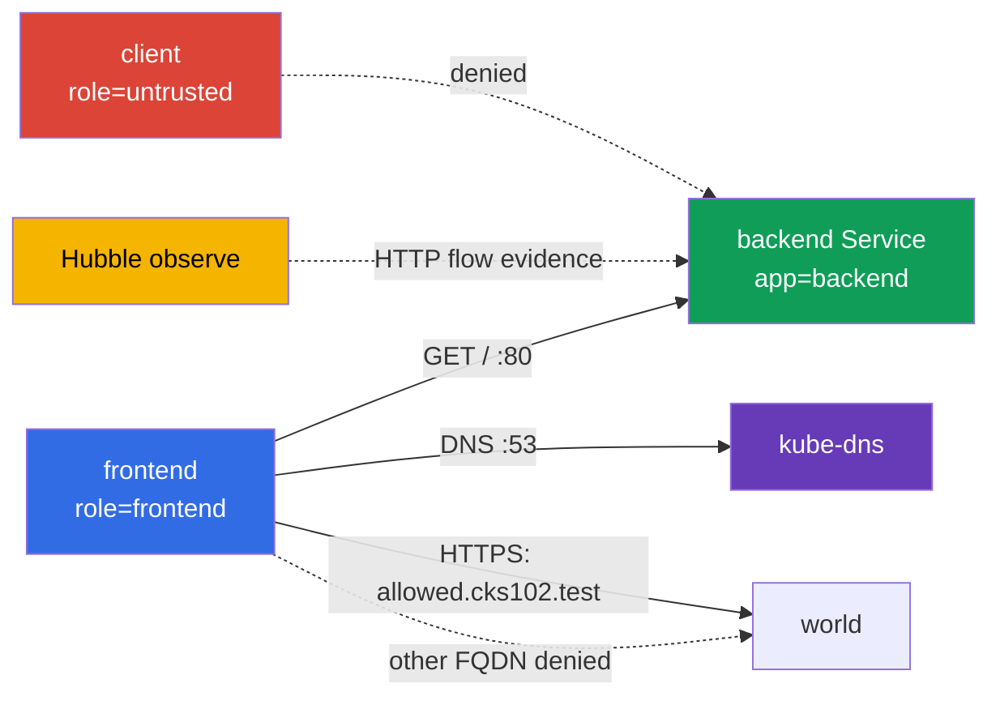

[Русская версия](README_RU.MD) · [Eng version](README.MD) · [Versión en español](README_ES.MD) · [Version française](README_FR.MD) · [Deutsche Version](README_DE.MD) · [ქართული ვერსია](README_GE.MD) · [繁體中文版](README_TW.MD)

# Lab 102 - CiliumNetworkPolicy: L3/L4/L7、DNS-aware egress、Hubble

## 概要

この実習では、小さなサービスに対して CiliumNetworkPolicy を設定し、ネットワークの実際の挙動を実証します。目的は見た目が似た YAML を書くことではなく、labels によって L3/L4 のアクセスを絞り込み、次に L7 の HTTP フィルターを追加し、FQDN で egress を制限し、Hubble から evidence を保存することです。ここでの基本的な Kubernetes オブジェクトは学習用の環境にすぎず、実習の対象は Cilium の機能です。

## 目的

[第 06 章「Cilium NetworkPolicy」](../../course/06/jp.md) の内容を定着させます：

- `CiliumNetworkPolicy`、`endpointSelector`、labels による identity；
- source と TCP ポートによる L3/L4 の制限；
- メソッドと path に対する L7 HTTP ルール；
- DNS 用の別ルールを伴う、`toFQDNs` による DNS-aware egress；
- Hubble による許可された通信と拒否された通信の確認；
- source の namespace ごとに異なる 2 つの path-scope を持つ複合 L7 policy。

## 開始前のセルフチェック

<details>
<summary>1. Cilium の L3/L4 policy は、同じルール上の L7 policy と原理的に何が違うか?</summary>

L3/L4 は、source/destination の identity とポートに基づいて接続全体を許可または拒否します - Cilium は通信の中身を見ません。L7 ルール (`rules.http`) は同じ TCP ポートに追加され、リクエストの内容 (メソッド、path) を検査します - L4 では接続が許可されていても、L7 ルールに一致しない個々の HTTP リクエストは `403` を受け取ります。L7 のない広い L4 ルールを別に残すと、そのポートの L7 フィルタリングが「無効化」されてしまいます。

</details>

<details>
<summary>2. `toFQDNs` の egress ルールが、DNS 用の別ルールなしでは動作しないのはなぜか?</summary>

`toFQDNs` は、Cilium が **DNS レスポンスを見て**、許可された名前 (`allowed.cks102.test`) がどの IP に対応するかを記憶することで成り立っています。`kube-dns` への DNS クエリがブロックされていると、Cilium は FQDN の現在の IP を知ることができず、その宛先への egress の allow ルールを構築できません - FQDN policy 自体が正しく書かれていても、その FQDN への通信はすべてブロックされます。

</details>

<details>
<summary>3. Hubble で L7-denial を実証するとき、テストの前に通信の capture を開始しておくと便利なのはなぜか、またそれは必須か?</summary>

リクエストの前に起動した `hubble observe --follow` は、controlled capture に便利なモードです。必要な flow が保存される前に retention buffer から消えてしまうリスクを減らせます。ただし、これは有効な evidence を得る唯一の方法ではありません。通常の `hubble observe` でも、retention window の範囲内ですでに保存されているイベントを (たとえば正しい `--since` で) 読み取れますし、出力をファイルにエクスポートすることもできます。どの方法でも、evidence は時間窓、source/destination、HTTP method/path、verdict を、具体的な GET/POST のテストケースに一意に結びつけている必要があります。

</details>

## 何を作り、なぜ作るのか

| オブジェクト | 用途 | 必要な理由 |
| ----- | ----- | ----- |
| Namespace `cks-102` | 学習用の環境を分離する | policy と結果がシステムの workload と混ざらない |
| Pod `backend` + Service `backend` | TCP/80 の HTTP endpoint | L3/L4 と L7 の ingress policy の対象 |
| Pod `frontend` | 信頼されたクライアント | backend と外部 FQDN が許可される唯一の source |
| Pod `client` | 信頼されないクライアント | label による allow が全員へのアクセスと同じではないことを実証する |
| CiliumNetworkPolicy `backend-policy` | ingress policy | まず L3/L4、次に同じオブジェクトを L7 に絞り込む |
| CiliumNetworkPolicy `frontend-fqdn` | egress policy | DNS と `allowed.cks102.test` のみを許可する |
| Hubble Relay + CLI | 可観測性 | 許可された HTTP-flow と拒否された HTTP-flow をリアルタイムで表示する |
| Namespace `production` + Pod/Service `portal` | 2 つの path-scope を持つ、2 つ目の独立した backend | 課題 6 の複合 L7 policy の対象 |
| Namespace `finance` + Pod `finance-client` | `/private/*` に対する信頼された source | namespace-aware な L7 allow を実証する |
| CiliumNetworkPolicy `portal-policy` | 2 つの path-scope を持つ複合 ingress policy | `/public/*` - 任意の cluster endpoint、`/private/*` - `finance` のみ |



## インフラ

| コンポーネント | 説明 |
| ----- | ----- |
| `vpc`            | 2 つのパブリックサブネットを持つ専用の VPC `10.102.0.0/16` |
| `ssh-keys`       | 仮想マシンへアクセスするためのキー |
| `k8s-1`          | シングルノードの kubeadm クラスター Kubernetes `1.36.0`、containerd、kube-proxy replacement を有効にした Cilium |
| `worker`         | `kubectl`、Cilium CLI、Hubble CLI、`check_result` を備えた作業マシン |
| Hubble Relay       | 初期化用の `worker.sh` によって有効化される；CLI にはローカルの `cilium hubble port-forward` が必要 |

## デプロイ

```bash
TASK=102 make run_cks_task
```

作業マシンに SSH で接続します。コンテキスト `cluster1-admin@cluster1` はすでに設定されています。

```bash
kubectl config current-context
cilium status --wait
```

## 課題

---

|           **1**           | **学習用の namespace と endpoints** |
| :-----: | :----- |
|       やること       | namespace `cks-102` を作成します。その中に次を作成します：label `app=backend` とイメージ `nginx:1.27-alpine` を持つ Pod `backend`；この Pod をポート `80` で選択する Service `backend`；label `role=frontend` とイメージ `curlimages/curl:8.10.1` を持つ Pod `frontend`；label `role=untrusted` と同じイメージを持つ Pod `client`。client 系の Pod は、コンテナを起動したままにするコマンド (たとえば `sleep 3600`) を持つ必要があります。Ready になるまで待ちます。 |
| 受け入れ基準 | - namespace `cks-102` が存在する；<br/>- 指定した labels を持つ Pods `backend`、`frontend`、`client` が存在する；<br/>- Service `backend` のポートが `80` である。 |

<details>
<summary>💡 課題 1 のヒント</summary>

labels のスタイルが異なることに注意してください：`backend` は `app=backend` を使い、`frontend`/`client` は `role=frontend`/`role=untrusted` を使います - これは意図的なもので、後続の CiliumNetworkPolicy がどの label で identity にマッチさせるのかを明示するためです。いずれかの Pod で `app`/`role` を取り違えることは、policy が「動作しない」原因としてよくあります。

</details>

---

|           **2**           | **Cilium L3/L4: frontend から backend:80 のみ** |
| :-----: | :----- |
|       やること       | `cks-102` に、名前が `backend-policy` の `CiliumNetworkPolicy` を作成します。これは `app=backend` を選択し、`role=frontend` を持つ endpoint からの TCP ポート `80` への ingress のみを許可する必要があります。すべての endpoint に対する広い許可を追加しないでください。<br/><br/>policy を適用する前に、`frontend` と `client` の両方が実際に `http://backend/` に到達できることを自分で `curl` で確認してください - そうしないと、policy 適用後の deny は何も実証しません。`backend-policy` を適用した後、両方の Pod を再度確認します。 |
| 受け入れ基準 | - `backend-policy` が `app=backend` を選択し、source が `role=frontend`、TCP `80` である；<br/>- policy 適用後：`frontend` が `200` を受け取る；<br/>- policy 適用後：`client` が、単なる「200 ではない」ではなく、transport-level の deny - `HTTPCODE:000` と curl の network/timeout exit code (`7`/`28`) を正確に受け取る。 |

<details>
<summary>💡 課題 2 のヒント</summary>

policy 自体の `endpointSelector.matchLabels` は `backend` (`app: backend`) にマッチさせ、`ingress` 内の `fromEndpoints[].matchLabels` は `frontend` (`role: frontend`) にマッチさせる必要があります - 同じオブジェクト内の 2 つの異なる selector で、取り違えやすいので注意してください。`client` での `kubectl exec` を通じて自己確認します：policy 適用後、リクエストは正確に `HTTPCODE:000` と exit `7`/`28` を受け取る必要があります - どんなコード (`403`、`404`...) であれ実際の HTTP レスポンスが返る場合、ネットワーク経路がまだ存在しており、L3/L4 の deny は実証されていません。

</details>

---

|           **3**           | **Cilium L7 HTTP: GET / のみ** |
| :-----: | :----- |
|       やること       | **同じ** `backend-policy` を変更します：TCP/80 では、`frontend` から path `/` への HTTP `GET` のみを許可します。別の広い L4 allow ルールを残さないでください。そうしないと L7 フィルターは POST を制限しません。<br/><br/>変更する前に、(課題 2 の L3/L4-only policy がまだ有効な状態で) `frontend` からの `GET /` と `POST /` の両方が実際に backend に届くことを `curl` で確認してください - L4-only policy は HTTP の中身を見ません。ルールを L7 に置き換えた後、両方のリクエストを再度確認します。 |
| 受け入れ基準 | - TCP/80 のルールに `method: GET` と `path: /` を持つ `rules.http` がある；<br/>- L7 適用後：`frontend` からの `GET http://backend/` が `200` を返す；<br/>- L7 適用後：`frontend` からの `POST http://backend/` が `403` を返す。 |

<details>
<summary>💡 課題 3 のヒント</summary>

この課題で最もよくある間違いは、課題 2 の元の L4-only ルールを、置き換えるのではなく、新しい L7 ルールの隣に残してしまうことです。policy に「L7 フィルターなしで TCP/80 を許可」と「L7 GET / ありで TCP/80 を許可」が同時にあると、Cilium はより広い許可を適用し、`POST` は通過してしまいます (本来は `403` になるべきです)。`toPorts.rules.http` が、ポート 80 の `toPorts.ports` と同じルールの内部にあり、別の重複したルールにはなっていないことを確認してください。この課題の前に L4-only policy で baseline を取るのは、次のことを実証するためです：L7 の前は POST が実際に backend に通っていたこと、そして L7 の後にそれを拒否しているのは、無関係なネットワークの問題ではなく、まさに L7 フィルター (`403`) であること。

</details>

---

|           **4**           | **DNS-aware egress: 1 つの FQDN のみ許可** |
| :-----: | :----- |
|       やること       | `role=frontend` を選択する `CiliumNetworkPolicy` `frontend-fqdn` を作成します。`kube-dns` へのポート `53` の DNS を、**L7 DNS proxy rule** `toPorts.rules.dns` (たとえば `matchPattern: "*"`) で許可します：Cilium はこの DNS 通信から、`toFQDNs` 用の FQDN-to-IP mapping を構築します。egress は `toFQDNs` を通じて `allowed.cks102.test` のみ (Kubernetes のアドレス空間の外にある lab-owned fixture - control-plane ノード上の合成 IP を持つ別の network namespace で、bootstrap で CoreDNS 経由で接続されています。これは意図的なもので、Cilium の `toFQDNs` はクラスター内部の IP に対しては allow ルールを適用しません) に、TCP `443` のみで許可します。**課題 2-3 の必須の内部通信も維持してください**：`backend` (`app=backend`) への別の egress ルールを TCP `80` のみで追加します - これがないと、`frontend-fqdn` は `frontend` に対して egress の default-deny を有効にし、課題 2-3 ですでに許可されている `frontend -> backend:80` がブロックされます。<br/><br/>適用する前に、DNS resolution と `https://allowed.cks102.test/`、`http://allowed.cks102.test:80/`、`https://blocked.cks102.test/` (`-k` 付き、fixture は自己署名証明書) に実際に到達できることを `curl` で確認してください。`frontend-fqdn` を適用した後、同じアドレスを再度確認し、さらに課題 2-3 の `frontend -> backend GET /` (`200`) と `POST /` (`403`) も確認します - これらがリグレッションしていないことを確かめてください。 |
| 受け入れ基準 | - policy に `toFQDNs.matchName: allowed.cks102.test` と、TCP `443` の `toPorts` が含まれている；<br/>- `kube-dns` への DNS が `rules.dns` を持つ別ルールで許可されている；<br/>- `backend` への内部 egress が TCP `80` のみの別ルールで許可されている (これがないと課題 3 がリグレッションする)；<br/>- 外部 egress は `allowed.cks102.test:443` のみ許可されている；`allowed.cks102.test:80` と `blocked.cks102.test:443` は許可されない；<br/>- `frontend-fqdn` を適用した後も、`frontend -> backend GET /` は `200` を返し、`POST /` は `403` を返す；<br/>- `allowed.cks102.test`/`blocked.cks102.test` は bootstrap が立ち上げた lab-owned fixture である；policy の前にそれらに到達できない場合は、inconclusive な結果の理由ではなくインフラのエラーとみなされる。 |

<details>
<summary>💡 課題 4 のヒント</summary>

1 つの policy オブジェクト内に 3 つの egress ルールが必要です：(1) `rules.dns.matchPattern: "*"` を持つ kube-dns への DNS。これがないと Cilium は `allowed.cks102.test` がどの IP に対応するかを追跡できません；(2) TCP/80 での内部 `backend` (`app=backend`)。このルールがないと、`frontend` の egress default-deny が課題 2-3 ですでに許可されている通信をブロックし、課題 5 の Hubble evidence が不可能になります；(3) `matchName: allowed.cks102.test` を持つ `toFQDNs` と、厳密に 443 のみの `toPorts`。apply の後で `allowed.cks102.test` への最初のリクエストが通らない場合は、数秒待ってください。Cilium の DNS resolution と FQDN mapping は瞬時には行われません。

</details>

---

|           **5**           | **Hubble: HTTP 通信の観察** |
| :-----: | :----- |
|       やること       | worker で `cilium hubble port-forward` を起動し、続いて別のウィンドウ/バックグラウンドで `hubble observe --from-pod cks-102/frontend --to-pod cks-102/backend --protocol http --follow` を実行します。観察中に、`frontend` から backend へ、許可された `GET /` と禁止された `POST /` を実行し、両方の flow が見えることを確認します：`GET /` は verdict `FORWARDED`、`POST /` は verdict `DROPPED`。 |
| 受け入れ基準 | - `check_result` は自分で GET/POST を生成し、両方の verdict が Hubble で見えることを自分で確認する - 課題 2-3 の最終的な policy が、実際に GET に対して `FORWARDED`、POST に対して `DROPPED` を与えることを確認すること。 |

<details>
<summary>💡 課題 5 のヒント</summary>

controlled capture のためには、`GET`/`POST` の前に `hubble observe --follow` をバックグラウンド (`&`) で起動することをおすすめします：そうすれば観察前に flow を失うリスクが減ります。`--follow` が唯一の有効な方法というわけではありません：イベントがまだ retention buffer にある場合は、正しい時間フィルターを付けた通常の `hubble observe` で読み取れます。いずれの場合も、evidence が `frontend -> backend`、`GET / -> FORWARDED`、`POST / -> DROPPED` を一意に示していることを自分で確認してください - 受講者による成果物ファイルは不要です。

</details>

---

|           **6**           | **複合 L7 policy: `/public/*` は全員、`/private/*` は `finance` のみ** |
| :-----: | :----- |
|       やること       | 課題 2-3 では、1 つの source (`frontend`) と 1 つの path 契約を練習します。ここでは、2 つの path-scope を同時に持つ、独立した 2 つ目の backend を扱います。namespace `production` と `finance` を作成します。`production` に Pod `portal` (label `app=portal`、イメージ `nginx:1.27-alpine`) と、nginx に最小限の server block を与える ConfigMap を作成します：`location /public/` は `200` を返し (たとえば `return 200 "public ok\n";`)、`location /private/` も同様に `200` を返し、それ以外の path は `404` を返します。ConfigMap を `/etc/nginx/conf.d/default.conf` としてマウントします。ポート `80` で Service `portal` を作成します。`finance` に Pod `finance-client` (`curlimages/curl:8.10.1`、`sleep 3600`) を作成します。namespace `cks-102` の既存の Pod `client` (課題 1) は、「それ以外/外部」の namespace の source として使用します - そのために別の Pod を作成しないでください。<br/><br/>`production` に、`app=portal` を選択する `CiliumNetworkPolicy` `portal-policy` を、TCP/80 に対する 2 つの ingress ルールで作成します：(1) `matchExpressions: [{key: k8s:io.kubernetes.pod.namespace, operator: Exists}]` を持つ `fromEndpoints` (namespace に関係なく任意の Pod) + `/public/*` に対応する path への `rules.http` `GET`；(2) namespace `finance` に対する `matchLabels` を持つ `fromEndpoints` + `/private/*` に対応する path への `rules.http` `GET`。policy を適用する前に、`finance-client` と `cks-102/client` の両方が、両方の path で実際に `200` を受け取ることを `curl` で確認してください - そうしないと deny は何も実証しません。適用後、両方の namespace から両方の path を再度確認します。 |
| 受け入れ基準 | - `portal-policy` に、上記の分割を持つ TCP/80 の ingress ルールがちょうど 2 つある；<br/>- baseline：Pod `portal` 自身が両方の path で `200` を返す (checker は policy を外さずに、Pod 内の loopback 経由でこれを確認する)；<br/>- policy 適用後：`finance-client` は `/public/*` と `/private/*` の両方で `200` を受け取る；<br/>- policy 適用後：`cks-102/client` は `/public/*` では `200` を受け取るが、`/private/*` では正確に L7 の拒否 (`403`) を受け取る - TCP 接続は最初のルール (`matchExpressions: Exists` を持つルール) によって引き続き許可されているため、これは transport-level の deny ではなく Envoy の L7 `403` である。 |

<details>
<summary>💡 課題 6 のヒント</summary>

`rules.http` の path は正確な文字列ではなく regex (Envoy 互換) です：
`/public/` ではなく `/public/.*` です。同じ `endpointSelector` + ポートに対する、
異なる `fromEndpoints` を持つ 2 つの ingress ルールは、identity ごとに加算的に結合されます：
絶対に任意の identity (`finance` を含む) を許可するルールは、`finance-client` に
両方の L7-allow リスト (`/public/*` と `/private/*` の両方) の和集合を与え、
`cks-102/client` (ルール 2 にマッチしない) は `/public/*` だけを受け取ります。外部 client の
`/private/*` に対する最終的な deny が `HTTPCODE:000` ではなく Envoy の `403` になるのは、
まさにこのためです：「任意」のルールがすでに全員に対して TCP コネクト自体を許可しており、
ここでは L4 が 1 つの source に制限されていないからです。

**落とし穴**：`fromEndpoints: [{}]` (空の selector) は、任意の namespace の任意の identity にマッチさせる方法ではありません。
Cilium は、明示的な namespace-label のない `fromEndpoints` selector を
暗黙的に policy 自身の namespace にスコープし、これは空の `{}` にも適用されます -
その結果、そのようなルールは `production` のみにマッチし、`finance`/`cks-102` にはマッチせず、
両方の外部 namespace は期待される挙動の代わりに transport-level の deny を受け取ります。
namespace に関係なく本当に任意の identity を許可するには、reserved-label
`k8s:io.kubernetes.pod.namespace` に対して `operator: Exists` を持つ `matchExpressions` を使用します -
この label が存在するという事実は、あらゆる Pod に対して真です。

nginx 設定の `location /public/` (パスのプレフィックス) と CNP の regex-path を混同しないでください -
これらは別の場所にあり、構文も異なります。

</details>

---

## 結果のチェック

worker で次を実行します：

```bash
check_result
```

チェックは 6 つの独立した課題を対象とします。`check_result` は live クラスターの挙動を自分で検証します
(あなたの policy は削除も変更もされません：checker は読み取りのみを行い、
テスト用リクエストを送信し、Hubble 用の GET/POST を自分で生成します) - 受講者による成果物ファイルは不要です。
checker 自身の診断用 runtime 確認は `/var/work/tests/checker-artifacts/` に保存されます。

## 解答

参考解答：[worker/files/solutions/1_JP.MD](worker/files/solutions/1_JP.MD)。

## 削除

```bash
TASK=102 make delete_cks_task
```
