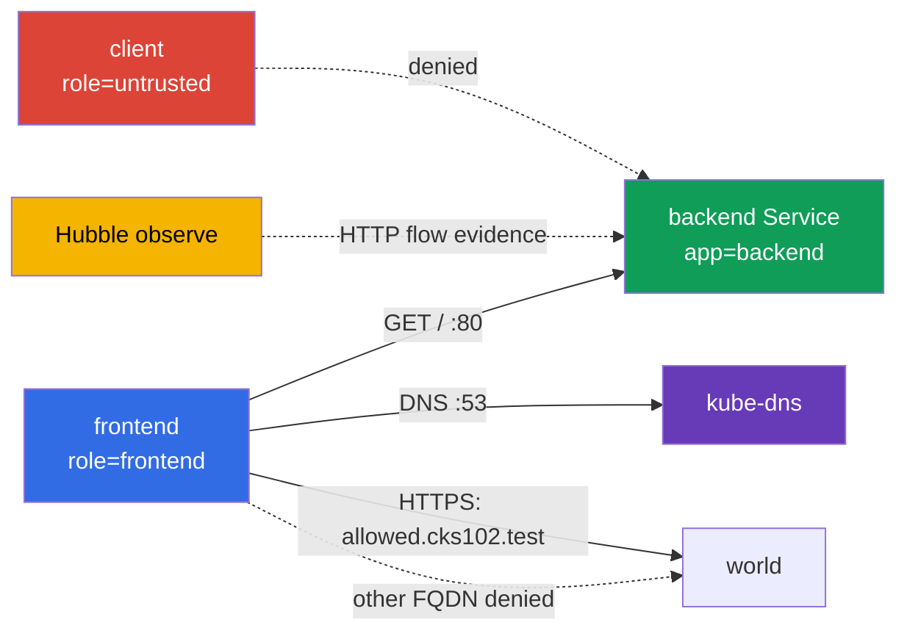

[Русская версия](README_RU.MD) · [Eng version](README.MD) · [Versión en español](README_ES.MD) · [Version française](README_FR.MD) · [Deutsche Version](README_DE.MD) · [ქართული ვერსია](README_GE.MD) · [日本語版](README_JP.MD)

# Lab 102 - CiliumNetworkPolicy:L3/L4/L7、DNS-aware egress 與 Hubble

## 說明

在這個實驗中，你要為一個小型服務設定 CiliumNetworkPolicy，並證明網路的實際行為。任務的重點不是寫出一份看起來相似的 YAML，而是依據 labels 縮小 L3/L4 的存取範圍，接著加入 L7 的 HTTP 過濾，透過 FQDN 限制 egress，並從 Hubble 保存 evidence。這裡的 Kubernetes 基本物件只是學習用的實驗台；實驗的主題是 Cilium 的功能。

## 目標

鞏固 [第 06 章 Cilium NetworkPolicy](../../course/06/tw.md) 的內容：

- `CiliumNetworkPolicy`、`endpointSelector` 以及依據 labels 的 identity;
- L3/L4 對 source 與 TCP 埠的限制；
- 針對方法與 path 的 L7 HTTP 規則；
- 透過 `toFQDNs` 並搭配獨立 DNS 規則的 DNS-aware egress;
- 透過 Hubble 檢查被允許與被禁止的流量；
- 針對不同 namespace 的 source，具有兩個不同 path-scope 的複合 L7 policy。

## 開始前先自我檢查

<details>
<summary>1. 在同一條規則上，Cilium 的 L3/L4 policy 與 L7 policy 有什麼本質上的差異？</summary>

L3/L4 依據 source/destination identity 與埠，對整個連線做允許或禁止 - Cilium 不會查看流量內部。L7 規則(`rules.http`)加在同一個 TCP 埠上，但會檢查請求的內容(方法、path)- 連線在 L4 可能被允許，但如果具體的 HTTP 請求與 L7 規則不符，仍然會得到 `403`。如果另外留下一條沒有 L7 的寬鬆 L4 規則，它會「關閉」該埠的 L7 過濾。

</details>

<details>
<summary>2. 為什麼沒有獨立的 DNS 規則，`toFQDNs` egress 規則就無法運作？</summary>

`toFQDNs` 的原理是 Cilium **看得到 DNS 回應**，並記住被允許的名稱(`allowed.cks102.test`)對應哪些 IP。如果對 `kube-dns` 的 DNS 查詢被封鎖，Cilium 就永遠無法得知該 FQDN 目前的 IP，也就無法為其建立 egress 的 allow 規則 - 即使 FQDN policy 本身寫得正確，通往該 FQDN 的所有流量也都會被封鎖。

</details>

<details>
<summary>3. 為什麼透過 Hubble 證明 L7-denial 時，最好在測試前就開始擷取流量，而這是否為必要條件？</summary>

在請求之前啟動的 `hubble observe --follow` 是 controlled capture 的方便模式：它降低了所需的 flow 在儲存之前就從 retention buffer 中消失的風險。這不是取得有效 evidence 的唯一方式：一般的 `hubble observe` 也可以讀取 retention window 內已儲存的事件(例如搭配正確的 `--since`)，而輸出可以匯出到檔案。無論哪種方式，evidence 都必須明確地把時間視窗、source/destination、HTTP method/path 與 verdict，同具體的 GET/POST test case 對應起來。

</details>

## 我們要建立什麼，以及為什麼

| 物件 | 用途 | 為什麼需要 |
| --- | --- | --- |
| Namespace `cks-102` | 隔離學習用的實驗台 | policy 與結果不會和系統的 workload 混在一起 |
| Pod `backend` + Service `backend` | TCP/80 上的 HTTP endpoint | L3/L4 與 L7 ingress policy 的 target |
| Pod `frontend` | 受信任的用戶端 | 唯一被允許存取 backend 與外部 FQDN 的 source |
| Pod `client` | 不受信任的用戶端 | 證明依 label 的 allow 並不等於對所有人開放 |
| CiliumNetworkPolicy `backend-policy` | ingress policy | 先是 L3/L4，然後同一個物件再細化到 L7 |
| CiliumNetworkPolicy `frontend-fqdn` | egress policy | 允許 DNS 以及僅限 `allowed.cks102.test` |
| Hubble Relay + CLI | 可觀測性 | 即時顯示被允許/被拒絕的 HTTP-flow |
| Namespace `production` + Pod/Service `portal` | 第二個、獨立的 backend，具有兩個 path-scope | 任務 6 中複合 L7 policy 的目標 |
| Namespace `finance` + Pod `finance-client` | `/private/*` 的受信任來源 | 證明 namespace-aware 的 L7 allow |
| CiliumNetworkPolicy `portal-policy` | 具有兩個 path-scope 的複合 ingress policy | `/public/*` - 任何 cluster endpoint,`/private/*` - 僅限 `finance` |



## 基礎架構

| 元件 | 說明 |
| --- | --- |
| `vpc` | 獨立的 VPC `10.102.0.0/16`，含兩個公有子網路 |
| `ssh-keys` | 用於存取虛擬機器的金鑰 |
| `k8s-1` | 單節點 kubeadm 叢集 Kubernetes `1.36.0`,containerd 與帶有 kube-proxy replacement 的 Cilium |
| `worker` | 工作機，具備 `kubectl`、Cilium CLI、Hubble CLI 與 `check_result` |
| Hubble Relay | 由啟動時的 `worker.sh` 啟用；CLI 需要本機的 `cilium hubble port-forward` |

## 部署

```bash
TASK=102 make run_cks_task
```

透過 SSH 連線到工作機。`cluster1-admin@cluster1` context 已經設定好。

```bash
kubectl config current-context
cilium status --wait
```

## 任務

---

|           **1**           | **學習用的 namespace 與 endpoints** |
| :-----------------------------: | :--- |
|       要做什麼       | 建立 namespace `cks-102`。在其中建立：Pod `backend`,label 為 `app=backend`，映像為 `nginx:1.27-alpine`;Service `backend`，在埠 `80` 上選取該 Pod;Pod `frontend`,label 為 `role=frontend`，映像為 `curlimages/curl:8.10.1`;Pod `client`,label 為 `role=untrusted`，映像相同。client 類 Pod 的指令必須讓容器持續執行，例如 `sleep 3600`。等待 Ready。 |
| 驗收標準 | - 存在 namespace `cks-102`;<br/>- 存在帶有指定 labels 的 Pods `backend`、`frontend`、`client`;<br/>- Service `backend` 的埠為 `80`。 |

<details>
<summary>💡 任務 1 的提示</summary>

請注意這些 label 的風格並不一致：`backend` 使用 `app=backend`，而 `frontend`/`client` 使用 `role=frontend`/`role=untrusted` - 這是刻意設計的，讓後續的 CiliumNetworkPolicy 必須明確指出它們是依據哪一個 label 來比對 identity。把其中一個 Pod 的 `app`/`role` 搞混，是 policy「不起作用」的常見原因。

</details>

---

|           **2**           | **Cilium L3/L4：只有 frontend 可存取 backend:80** |
| :-----------------------------: | :--- |
|       要做什麼       | 在 `cks-102` 中建立名為 `backend-policy` 的 `CiliumNetworkPolicy`。它必須選取 `app=backend`，並且只允許來自帶有 `role=frontend` 的 endpoint 對 TCP 埠 `80` 的 ingress。不要對所有 endpoint 加入寬鬆的允許。<br/><br/>在套用 policy 之前，請自行用 `curl` 確認 `frontend` 與 `client` 確實都能連到 `http://backend/` - 否則 policy 之後的 deny 什麼也證明不了。套用 `backend-policy` 之後，再次檢查這兩個 Pod。 |
| 驗收標準 | - `backend-policy` 選取 `app=backend`,source 為 `role=frontend`,TCP `80`;<br/>- policy 之後：`frontend` 得到 `200`;<br/>- policy 之後：`client` 得到的正是 transport-level 的 deny - `HTTPCODE:000` 與 curl 的 network/timeout exit code(`7`/`28`)，而不只是「不是 200」。 |

<details>
<summary>💡 任務 2 的提示</summary>

policy 本身的 `endpointSelector.matchLabels` 必須比對 `backend`(`app: backend`)，而 `ingress` 內的 `fromEndpoints[].matchLabels` 必須比對 `frontend`(`role: frontend`)- 這是同一個物件裡兩個不同的 selector，很容易弄反。請透過 `kubectl exec` 進入 `client` 自行檢查：policy 之後，請求必須得到的正是 `HTTPCODE:000` 與 exit `7`/`28` - 任何狀態碼(`403`、`404`...)的真實 HTTP 回應，都表示網路路徑仍然存在，L3/L4 deny 並未得到證明。

</details>

---

|           **3**           | **Cilium L7 HTTP：只允許 GET /** |
| :-----------------------------: | :--- |
|       要做什麼       | 修改**同一個** `backend-policy`：對於 TCP/80，只允許來自 `frontend`、path 為 `/` 的 HTTP `GET`。不要保留另外一條寬鬆的 L4 allow 規則，否則 L7 過濾無法限制 POST。<br/><br/>修改之前，請用 `curl` 檢查(此時任務 2 中僅 L3/L4 的 policy 仍然有效)，來自 `frontend` 的 `GET /` 與 `POST /` 都確實能到達 backend - 僅 L4 的 policy 不會查看 HTTP 內部。把規則換成 L7 之後，再次檢查這兩個請求。 |
| 驗收標準 | - TCP/80 的規則包含 `rules.http`，內有 `method: GET` 與 `path: /`;<br/>- L7 之後：從 `frontend` 執行 `GET http://backend/` 回傳 `200`;<br/>- L7 之後：從 `frontend` 執行 `POST http://backend/` 回傳 `403`。 |

<details>
<summary>💡 任務 3 的提示</summary>

這個任務最常見的錯誤，是把任務 2 中原本僅 L4 的規則保留在新的 L7 規則「旁邊」，而不是把它取代。如果 policy 中同時有「允許不帶 L7 過濾的 TCP/80」和「允許帶 L7 GET / 的 TCP/80」，Cilium 會套用範圍更寬的允許，於是 `POST` 會通過，但它本應得到 `403`。請確認 `toPorts.rules.http` 位於與埠 80 的 `toPorts.ports` 「同一條」規則「之內」，而不是另一條重複的規則中。在這個任務之前先用僅 L4 的 policy 建立 baseline，正是為了證明：在 L7 之前，POST 確實能到達 backend，而在 L7 之後，是 L7 過濾(`403`)拒絕了它，而不是某個無關的網路問題。

</details>

---

|           **4**           | **DNS-aware egress：只允許一個 FQDN** |
| :-----------------------------: | :--- |
|       要做什麼       | 建立 `CiliumNetworkPolicy` `frontend-fqdn`，選取 `role=frontend`。讓它**透過 L7 DNS proxy rule** `toPorts.rules.dns`(例如 `matchPattern: "*"`)允許對 `kube-dns` 在埠 `53` 上的 DNS:Cilium 會根據這些 DNS 流量為 `toFQDNs` 建立 FQDN-to-IP mapping。透過 `toFQDNs` 只允許對 `allowed.cks102.test` 的 egress(這是位於 Kubernetes address space 之外、由實驗自行提供的 fixture - 它是 control-plane 節點上獨立的 network namespace，帶有合成的 IP，在 bootstrap 中透過 CoreDNS 接上；這是刻意的，因為 Cilium 的 `toFQDNs` 不會對叢集內部的 IP 套用 allow 規則)，而且只限 TCP `443`。**同時保留任務 2-3 中必要的內部流量**：另外加一條 egress 規則到 `backend`(`app=backend`)，只限 TCP `80` - 沒有它，`frontend-fqdn` 會為 `frontend` 啟用 egress default-deny，任務 2-3 中已被允許的 `frontend -> backend:80` 就會被封鎖。<br/><br/>套用之前，請用 `curl` 確認 DNS resolution 以及 `https://allowed.cks102.test/`、`http://allowed.cks102.test:80/`、`https://blocked.cks102.test/`(加上 `-k`,fixture 使用自簽憑證)確實可達。套用 `frontend-fqdn` 之後，再次檢查同樣的位址，另外加上任務 2-3 中的 `frontend -> backend GET /`(`200`)與 `POST /`(`403`)- 確認它們沒有退化。 |
| 驗收標準 | - policy 包含 `toFQDNs.matchName: allowed.cks102.test`，以及帶有 TCP `443` 的 `toPorts`;<br/>- 對 `kube-dns` 的 DNS 由帶有 `rules.dns` 的獨立規則允許；<br/>- 內部對 `backend` 的 egress 由獨立規則允許，只限 TCP `80`，沒有它任務 3 會退化；<br/>- 外部 egress 只允許到 `allowed.cks102.test:443`;`allowed.cks102.test:80` 與 `blocked.cks102.test:443` 不會被放行；<br/>- 套用 `frontend-fqdn` 之後，`frontend -> backend GET /` 仍回傳 `200`，而 `POST /` 回傳 `403`；<br/>- `allowed.cks102.test`/`blocked.cks102.test` 是由 bootstrap 啟動、實驗自行提供的 fixture；它們在 policy 之前無法存取，視為基礎設施錯誤，而不是 inconclusive 結果的理由。 |

<details>
<summary>💡 任務 4 的提示</summary>

同一個 policy 物件中需要三條 egress 規則：(1) 對 kube-dns 的 DNS，帶有 `rules.dns.matchPattern: "*"`，沒有它 Cilium 無法追蹤哪個 IP 對應 `allowed.cks102.test`;(2) 內部的 `backend`(`app=backend`),TCP/80 - 沒有這條規則，`frontend` 的 egress default-deny 會封鎖任務 2-3 中已被允許的流量，任務 5 的 Hubble evidence 也將無法取得；(3) `toFQDNs` 帶有 `matchName: allowed.cks102.test`，且 `toPorts` 嚴格限定為 443。如果 apply 之後，對 `allowed.cks102.test` 的第一個請求沒有通過 - 請等待幾秒鐘，Cilium 中的 DNS resolution 與 FQDN mapping 不是瞬間完成的。

</details>

---

|           **5**           | **Hubble：觀察 HTTP 流量** |
| :-----------------------------: | :--- |
|       要做什麼       | 在 worker 上執行 `cilium hubble port-forward`，然後在另一個視窗/背景中執行 `hubble observe --from-pod cks-102/frontend --to-pod cks-102/backend --protocol http --follow`。在觀察進行期間，從 `frontend` 對 backend 執行被允許的 `GET /` 與被禁止的 `POST /`，並確認你看到了這兩個 flow:`GET /` 的 verdict 為 `FORWARDED`,`POST /` 的 verdict 為 `DROPPED`。 |
| 驗收標準 | - `check_result` 會自己產生 GET/POST，並自己檢查這兩個 verdict 在 Hubble 中都看得到 - 請確認任務 2-3 的最終 policy 確實讓 GET 得到 `FORWARDED`、POST 得到 `DROPPED`。 |

<details>
<summary>💡 任務 5 的提示</summary>

為了 controlled capture，建議在 `GET`/`POST` 「之前」於背景(`&`)啟動 `hubble observe --follow`：這樣在觀察之前遺失 flow 的風險較小。`--follow` 並不是唯一有效的做法：如果事件還在 retention buffer 中，可以用一般的 `hubble observe` 搭配正確的時間篩選來讀取。無論如何，請自行確認 evidence 明確地顯示 `frontend -> backend`、`GET / -> FORWARDED` 與 `POST / -> DROPPED` - 不需要學員提供任何 artifact 檔案。

</details>

---

|           **6**           | **複合 L7 policy:`/public/*` 對所有人開放，`/private/*` 僅限 `finance`** |
| :-----------------------------: | :--- |
|       要做什麼       | 任務 2-3 訓練的是單一 source(`frontend`)與單一 path 約定。這裡則是獨立的第二個 backend，同時具有「兩個」path-scope。建立 namespace `production` 與 `finance`。在 `production` 中建立 Pod `portal`(label `app=portal`，映像 `nginx:1.27-alpine`)以及一個為 nginx 提供最小 server block 的 ConfigMap:`location /public/` 回傳 `200`(例如 `return 200 "public ok\n";`),`location /private/` 同樣回傳 `200`，其他任何 path 回傳 `404`。將 ConfigMap 掛載為 `/etc/nginx/conf.d/default.conf`。在埠 `80` 上建立 Service `portal`。在 `finance` 中建立 Pod `finance-client`(`curlimages/curl:8.10.1`,`sleep 3600`)。namespace `cks-102` 中既有的 Pod `client`(任務 1)用作「任何其他/外部」namespace 的來源 - 不要為此另外建立 Pod。<br/><br/>在 `production` 中建立 `CiliumNetworkPolicy` `portal-policy`，選取 `app=portal`，在 TCP/80 上有「兩條」ingress 規則：(1) `fromEndpoints` 帶有 `matchExpressions: [{key: k8s:io.kubernetes.pod.namespace, operator: Exists}]`(任何 namespace 的任何 Pod)+ `rules.http`，對符合 `/public/*` 的 path 允許 `GET`;(2) `fromEndpoints` 帶有針對 namespace `finance` 的 `matchLabels` + `rules.http`，對符合 `/private/*` 的 path 允許 `GET`。套用 policy 之前，請用 `curl` 確認 `finance-client` 與 `cks-102/client` 確實在「兩個」path 上都得到 `200` - 否則 deny 什麼也證明不了。套用之後，再次檢查來自兩個 namespace 的兩個 path。 |
| 驗收標準 | - `portal-policy` 恰好包含兩條上述分工的 TCP/80 ingress 規則；<br/>- baseline:Pod `portal` 自己在兩個 path 上都回傳 `200`(checker 透過 Pod 內部的 loopback 來檢查，不會移除 policy);<br/>- policy 之後：`finance-client` 在 `/public/*` 與 `/private/*` 上都得到 `200`;<br/>- policy 之後：`cks-102/client` 在 `/public/*` 上得到 `200`，但在 `/private/*` 上得到的正是 L7 拒絕(`403`)- TCP 連線仍然被第一條規則(帶有 `matchExpressions: Exists` 的規則)允許，所以這不是 transport-level 的 deny，而是 Envoy 的 L7 `403`。 |

<details>
<summary>💡 任務 6 的提示</summary>

`rules.http` 中的 path 是 regex(與 Envoy 相容)，而不是精確字串：要寫 `/public/.*`,
而不是 `/public/`。針對同一個 `endpointSelector`+埠，具有「不同」`fromEndpoints` 的兩條
ingress 規則，會依 identity 以累加方式組合：允許「絕對任何」identity(包括 `finance`)的規則，
讓 `finance-client` 得到兩份 L7-allow 清單的聯集(`/public/*` 與 `/private/*`)，而 `cks-102/client`
(不符合規則 2)只得到 `/public/*`。這正是為什麼外部 client 在
`/private/*` 上最終的 deny 是來自 Envoy 的 `403`，而不是 `HTTPCODE:000`：「任何」規則已經對所有人
允許了 TCP 連線本身，這裡的 L4 並未被限制在單一 source。

**陷阱**:`fromEndpoints: [{}]`(空的 selector)並「不是」比對任何 namespace 中任何 identity 的方法。
Cilium 會把沒有明確 namespace-label 的 `fromEndpoints` selector 隱含地限定在 policy「自己」的 namespace,
這甚至也適用於空的 `{}` - 結果是這樣的規則只會比對 `production`，而不會比對 `finance`/`cks-102`,
兩個外部 namespace 都會得到 transport-level 的 deny，而不是預期的行為。要真正
允許任何 namespace 的任何 identity，請對 reserved-label `k8s:io.kubernetes.pod.namespace`
使用帶有 `operator: Exists` 的 `matchExpressions` - 這個 label 的存在對任何 Pod 都成立。

不要把 nginx 設定中的 `location /public/`(路徑前綴)與 CNP 中的 regex-path 混淆 - 它們
位於不同的地方，語法也不同。

</details>

---

## 檢查結果

在 worker 上執行：

```bash
check_result
```

檢查涵蓋六個獨立的任務。`check_result` 會自己檢查
live 叢集的行為(你的 policy 不會被刪除或修改：checker 只讀取它們並
送出測試請求，並自己為 Hubble 產生 GET/POST)- 不需要學員提供任何 artifact 檔案。
checker 自己的診斷 runtime 檢查結果，會保存在 `/var/work/tests/checker-artifacts/`。

## 解答

參考解答：[worker/files/solutions/1_TW.MD](worker/files/solutions/1_TW.MD)。

## 刪除

```bash
TASK=102 make delete_cks_task
```
