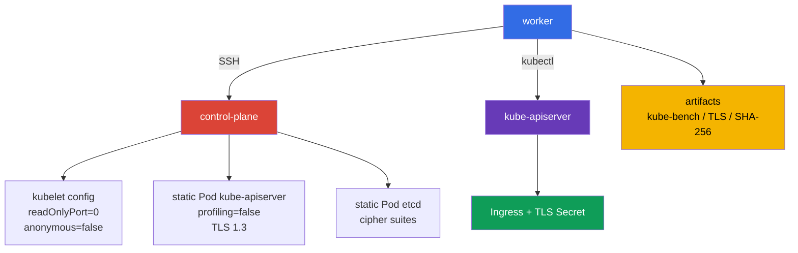

[Русская версия](README_RU.MD) · [Versión en español](README_ES.MD) · [Version française](README_FR.MD) · [Deutsche Version](README_DE.MD) · [ქართული ვერსია](README_GE.MD) · [繁體中文版](README_TW.MD) · [日本語版](README_JP.MD)

# Lab 103 - CIS/kube-bench, Secure Ingress TLS, and binary verification

## Description

In this lab you configure a two-node Kubernetes cluster (control-plane +
worker) as a security engineer: you run `kube-bench` (you install it yourself on the worker node) and, based on its findings
(not from memory), fix insecure parameters of the control-plane components and of the kubelet
on both nodes, publish an Ingress over TLS only, restrict TLS on the control plane, and
confirm the integrity of the installed Kubernetes binaries.

This is not a repetition of the basic Kubernetes setup from CKA. What matters here are the places where
settings are applied: `KubeletConfiguration`, the control-plane static Pod manifests, the TLS parameters of etcd,
and verifiable work artifacts. Work with the control-plane node over the SSH name
`control-plane` prepared on the worker.

## Goal

Reinforce the material of the course chapters:

- [Chapter 07. CIS Benchmark and kube-bench](../../course/07/README.md)
- [Chapter 08. Secure Ingress with TLS](../../course/08/README.md)
- [Chapter 09. Insecure component arguments and binary verification](../../course/09/README.md)

## Self-check before you start

<details>
<summary>1. Why can't a kube-bench run with the `cis-1.12` profile on Kubernetes 1.36 be called authoritative CIS compliance?</summary>

The `kube-bench 0.16.0` version pinned in this lab contains no profile for 1.36 at all - its built-in version mapping goes only up to `"1.34": "cis-1.12"` (the newest available profile). By explicitly specifying `--benchmark cis-1.12` on a 1.36 cluster, we forcibly use the closest existing profile as an approximation: some checks may be irrelevant for the newer version, and new security-relevant parameters specifically for 1.36 are not yet covered by this profile. This is a valuable practical signal, but not a formal compliance statement for version 1.36.
</details>

<details>
<summary>2. Why does `--tls-cipher-suites` on kube-apiserver not configure ciphers for TLS 1.3 specifically?</summary>

In Go (in which kube-apiserver is written) the flag `--tls-cipher-suites` controls only the cipher suites for TLS versions ≤ 1.2. For TLS 1.3, Go itself chooses the set of ciphers from a fixed, hardcoded list - they cannot be configured with this flag. Therefore the real protection here comes from `--tls-min-version=VersionTLS13` (it forbids the older protocols entirely), while `--tls-cipher-suites` is relevant where TLS 1.2 is still allowed (for example, etcd in this lab).
</details>

<details>
<summary>3. Why can't a hash computed from the very file being verified be used as the reference for SHA-256 verification?</summary>

If you compute the SHA-256 of a file and compare it with itself, the check always passes - even if the file was replaced with something malicious. The reference checksum must be obtained from an independent, trusted source - the official Kubernetes release page - and not from the local file you are verifying.
</details>

## What We Build and Why

| Object or artifact | What it is | Why it is in this lab |
|---|---|---|
| `kube-bench` report | a snapshot of the control-plane CIS checks | records the initial recommendations and serves as the basis for hardening |
| Kubelet configuration | kubelet settings on the node | disables the read-only endpoint and anonymous access |
| Static Pod manifest apiserver | the kube-apiserver declaration | disables profiling and sets strict TLS |
| TLS Secret and Ingress | TLS termination for the application | the Ingress terminates TLS for HTTPS on `secure.cks.local`, and ingress-nginx redirects plain HTTP requests to HTTPS via `ssl-redirect` |
| Static Pod manifest etcd | the declaration of the local etcd | restricts the allowed TLS cipher suites |
| SHA-256 artifact | the result of checking `kubelet` and `kubectl` | confirms the integrity of the binaries against the release hashes |



## Infrastructure

The environment is deployed in AWS (`eu-central-1`) via Terragrunt.

| Component | Description |
|---|---|
| `vpc` | VPC `10.103.0.0/16` with public subnets |
| `ssh-keys` | SSH keys for access to the nodes |
| `k8s-1` | Kubernetes `1.36.0` (kubeadm), containerd, and Calico: control-plane + one worker node |
| `worker` | A work machine (bastion) with `kubectl`, SSH access, and `check_result` (`kube-bench` itself is not needed here - it is already on `control-plane` and is installed on the worker node during the lab) |

> **Version and exam.** As of 2026-09-06 the official CKS exam is based on Kubernetes `v1.35`. This lab uses `1.36.0`, so everything related to that version is a forward-looking training scenario and not a statement about the current exam version.

The control-plane has its taint removed, so a training Pod can be run on it if needed.
For tasks 3, 5, and 9 the static Pods are automatically recreated by the kubelet after the
changed manifest is saved; in tasks 2 and 10, after editing the `KubeletConfiguration`, the kubelet must be
restarted manually (`systemctl restart kubelet`). Do not delete the control-plane Pods manually.

## Deployment

```bash
TASK=103 make run_cks_task
```

Connect to the worker over SSH. The context is already configured:

```bash
kubectl config use-context cluster1-admin@cluster1
time_left      # how much time is left for the lab
check_result   # runs the automatic tests and shows the result
```

The control-plane address can be obtained and checked as follows:

```bash
kubectl get nodes -o wide
ssh control-plane hostname
```

## Tasks

---

| **1** | **CIS Benchmark report** |
| :---: | :--- |
| What to do | On the `control-plane` node run `kube-bench` for Kubernetes `1.36.0`. Save the full evidence in `/var/work/tests/artifacts/1/kube-bench.txt`: `kubernetes_version`, `kube_bench_version`, the chosen `benchmark`, `mapping_status`, and then the report itself. `kube-bench` is already installed on `control-plane` (as on the real exam, where the CIS Benchmark tooling is already on the nodes) - you do not need to install or copy it, and it is exactly that node that must be checked. The version mapping built into the pinned `kube-bench 0.16.0` ends with the entry `"1.34": "cis-1.12"` - there are no newer profiles (including any profile for 1.35/1.36) in this version at all. Therefore run `--benchmark cis-1.12` explicitly and label the result on `1.36` as `forced-approximate`, not authoritative compliance. **Run the full set of targets for `cis-1.12`:** `--targets master,node,controlplane,etcd,policies` - this is the map of targets that kube-bench associates with the `cis-1.12` profile; skipping any of them produces an incomplete report. Without an explicit `--targets`, kube-bench detects the type of the current node on its own and runs a narrower set for it instead of this whole list - `etcd` and `policies` are not included in such an auto-detected run, so a report without an explicit `--targets` will be incomplete. |
| Acceptance criteria | - the evidence contains all four version/mapping fields;<br/>- `mapping_status=forced-approximate` explicitly explains the absence of official coverage for `1.36`;<br/>- the report contains the results of all sections `master`, `node`, `controlplane`, `etcd`, `policies` (not just an arbitrary `[PASS]`/`[WARN]`/`[FAIL]` line);<br/>- the text does not present the result as authoritative CIS compliance for Kubernetes `1.36`. |

<details>
<summary>💡 Hint for task 1</summary>

The check expects four specific marker lines at the beginning of the file: `kubernetes_version=v1.36.x`, `kube_bench_version=v0.16.0`, `benchmark=cis-1.12`, `mapping_status=forced-approximate` - this is not decorative text but the format the test looks for literally. Run `kube-bench` on the control-plane node itself, not remotely from the worker - kube-bench has no mode to "check another node over SSH". Do not forget `--targets master,node,controlplane,etcd,policies` - without explicitly specifying the targets, the `etcd` and `policies` sections may be skipped. `kube-bench` is already installed together with the configuration in its standard directory `/etc/kube-bench/cfg`, so you do not need to specify `--config-dir` in this lab - use this flag only if you yourself placed `cfg` in another directory and are passing the actual path to that copy.
</details>

---

| **2** | **Kubelet hardening: read-only port and anonymous auth** |
| :---: | :--- |
| What to do | On the control-plane find and eliminate two insecure kubelet settings: it still serves a read-only port without authentication and accepts anonymous requests (see the chapter on kubelet hardening). Use the `kube-bench` report from task 1 as the source of truth: it has already flagged both problems in the `node` section for this same node - find the `[FAIL]` entries next to these two topics there and use them as your guide. Fix the `kubelet configuration`, restart the kubelet, and wait for the node to be ready. Do not substitute the check with a text artifact: the settings must be applied on the node. |
| Acceptance criteria | - in the effective kubelet configuration the read-only port is disabled;<br/>- kubelet anonymous authentication is disabled;<br/>- the node is `Ready` after the restart. |

<details>
<summary>💡 Hint for task 2</summary>

Look in the task 1 report for the checks `4.2.1` (`--anonymous-auth`) and `4.2.4` (`--read-only-port`) in the `node` section. In `KubeletConfiguration` (`/var/lib/kubelet/config.yaml`) they correspond to `authentication.anonymous.enabled` and `readOnlyPort` - CIS requires `authentication.anonymous.enabled: false` and `readOnlyPort: 0`. `authentication.anonymous.enabled` is NESTED under the key `authentication.anonymous`, and is not a separate top-level field `anonymous: false` - check the YAML indentation carefully. After editing config.yaml you must restart the kubelet service itself (`systemctl restart kubelet`); editing the file does not by itself apply the changes to the running process.
</details>

---

| **3** | **kube-apiserver hardening: disable profiling** |
| :---: | :--- |
| What to do | kube-apiserver still serves the pprof HTTP profiling endpoint of the process. Use the `kube-bench` report from task 1 as the source of truth: it has already flagged this problem in the `master` section for the same node - find the `[FAIL]` entry next to this topic there and use it as your guide. Fix the kube-apiserver static Pod manifest, wait for the recreation, and make sure that the API is ready. |
| Acceptance criteria | - the actually running kube-apiserver Pod contains `--profiling=false` in its `command` (checked via the API, not by the text of the file on disk);<br/>- `kubectl get --raw='/readyz'` returns a successful result;<br/>- the kube-apiserver static Pod is running. |

<details>
<summary>💡 Hint for task 3</summary>

Look in the task 1 report for the check `1.2.15` (`--profiling`) in the `master` section. It corresponds to the flag `--profiling=false` in the `command` of the static Pod manifest `/etc/kubernetes/manifests/kube-apiserver.yaml`. Do not edit the Pod via `kubectl edit` - this is a static Pod, the kubelet manages it directly from the manifest file on disk and will revert any change made through the API. Add the flag directly into the YAML file on the node and wait: the kubelet does not notice the file change instantly.
</details>

---

| **4** | **Secure Ingress with TLS** |
| :---: | :--- |
| What to do | • Generate a self-signed certificate for `secure.cks.local` with this name specifically in the Subject Alternative Name, not only in the CN (the command is in the hint).<br/>• Create the namespace `cks-103` and from this certificate a TLS Secret `secure-ingress-tls` of type `kubernetes.io/tls`.<br/>• Deploy the Deployment `secure-app` (`viktoruj/ping_pong:alpine`, `SERVER_NAME=secure-app` and `SRV_PORT=80` via `kubectl set env`) and the Service `secure-app`.<br/>• Create the Ingress `secure-ingress` with `ingressClassName: nginx`, a TLS section for this host referencing `secure-ingress-tls`, and the annotation `nginx.ingress.kubernetes.io/ssl-redirect: "true"`.<br/>• The `ingress-nginx` controller is already installed and Ready in this lab as a lab-owned fixture (see [chapter 08](../../course/08/README.md) about its retirement) - make sure that it actually handles your Ingress (see the acceptance criteria). |
| Acceptance criteria | - the Secret `secure-ingress-tls` in `cks-103` has the type `kubernetes.io/tls` and the fields `tls.crt`, `tls.key`; the match of the pair is checked by the public key (algorithm-independent, not tied to RSA/modulus);<br/>- the certificate contains `secure.cks.local` in the SAN;<br/>- the Ingress `secure-ingress` contains `ingressClassName: nginx`, the annotation `ssl-redirect: "true"`, `spec.tls` with the host `secure.cks.local` and a reference to `secure-ingress-tls`, backend `secure-app:80`;<br/>- the Service `secure-app` has a real endpoint;<br/>- the `ingress-nginx` controller is Ready;<br/>- an HTTPS request via the controller really returns `200` with a body containing `Server Name: secure-app` (not just any `2xx`/`3xx` that the controller itself could return without reaching the backend);<br/>- an HTTP request via the controller gets a redirect with a `Location` header pointing to the HTTPS host `https://secure.cks.local` (not any `3xx`; the path after the host is optional). |

<details>
<summary>💡 Hint for task 4</summary>

On the real exam the certificate is usually issued in advance - here you need to generate it yourself:

```bash
openssl req -x509 -nodes -newkey ec -pkeyopt ec_paramgen_curve:P-256 \
  -keyout tls.key -out tls.crt -days 30 \
  -subj "/CN=secure.cks.local" -addext "subjectAltName=DNS:secure.cks.local"
```

`-addext 'subjectAltName=DNS:secure.cks.local'` is mandatory - modern clients and the Ingress controller check the SAN, not only the CN. Create the TLS Secret via `kubectl create secret tls secure-ingress-tls --cert=tls.crt --key=tls.key` - this automatically sets the correct `type: kubernetes.io/tls` and correctly encodes the data in base64. If you create the Secret manually with the type `Opaque` and the keys `tls.crt`/`tls.key`, the `type` test will fail even if the data is technically valid.

The certificate/private key pair is checked by the public key, not by the RSA-specific modulus - this works the same for RSA and EC/ECDSA keys:

```bash
cert_pub=$(kubectl -n cks-103 get secret secure-ingress-tls -o jsonpath='{.data.tls\.crt}' \
  | base64 -d | openssl x509 -pubkey -noout | openssl pkey -pubin -outform DER | sha256sum | awk '{print $1}')
key_pub=$(kubectl -n cks-103 get secret secure-ingress-tls -o jsonpath='{.data.tls\.key}' \
  | base64 -d | openssl pkey -pubout -outform DER | sha256sum | awk '{print $1}')
[[ -n "$cert_pub" && "$cert_pub" == "$key_pub" ]]
```

For an end-to-end check do not use the Pod IP from the controller's `Endpoints` - it is not guaranteed to be routable from a separate worker VM. `secure.cks.local` already resolves to a real node IP (the entry was added to `/etc/hosts` of this machine during bootstrap), and `ingress-nginx-controller` is a Service of type `NodePort` exposed on every node, so the request can be made straight from the worker, without SSH to the cluster:

```bash
HTTPS_NODEPORT=$(kubectl -n ingress-nginx get svc ingress-nginx-controller -o jsonpath='{.spec.ports[?(@.port==443)].nodePort}')
curl -sS -k --max-time 5 "https://secure.cks.local:${HTTPS_NODEPORT}/"
```

The HTTP→HTTPS redirect check is not an artificial requirement of this lab but a real exam question (see the mock exam `tasks/cks/mock/04`, task 4: `Create an Ingress with a redirect from HTTP to HTTPS`).
</details>

---

| **5** | **Control-plane TLS hardening** |
| :---: | :--- |
| What to do | In `/etc/kubernetes/manifests/kube-apiserver.yaml` set `--tls-min-version=VersionTLS13` and `--tls-cipher-suites=TLS_ECDHE_RSA_WITH_AES_128_GCM_SHA256,TLS_ECDHE_RSA_WITH_AES_256_GCM_SHA384`. In `/etc/kubernetes/manifests/etcd.yaml` set `--cipher-suites` with the same set. After the components are recreated, confirm that `TLSv1.3` is negotiated (`openssl s_client -tls1_3`) and that `TLSv1.2` is rejected (`openssl s_client -tls1_2` ends with a handshake error), and save the output in `/var/work/tests/artifacts/5/tls13.txt`. It is important to understand the semantics: in Go the flag `--tls-cipher-suites` applies only to TLS ≤ 1.2, and with `--tls-min-version=VersionTLS13` the specific TLS 1.3 cipher suites are not configured by this flag (Go chooses them itself). Therefore, for kube-apiserver, the actual protection here comes specifically from min-version 1.3; cipher-suites are meaningful where TLS 1.2 is allowed (for example, for etcd). |
| Acceptance criteria | - both required TLS flags are present in the kube-apiserver manifest;<br/>- the cipher suites are present in the etcd manifest;<br/>- kube-apiserver and etcd are healthy;<br/>- the TLS artifact contains the confirmation of `TLSv1.3` and a recorded rejection of TLS 1.2 (non-zero exit/handshake failure). |

<details>
<summary>💡 Hint for task 5</summary>

The flag on etcd is called `--cipher-suites` (without `tls-` at the beginning) - this is a DIFFERENT flag name compared to `--tls-cipher-suites` on kube-apiserver. Mixing up the flag names is a common mistake. Check yourself with two separate commands `openssl s_client -connect <host>:6443 -tls1_3` (must connect successfully) and `-tls1_2` (must end with a handshake error) - both against the kube-apiserver port, not etcd.
</details>

---

| **6** | **Integrity check of kubelet and kubectl** |
| :---: | :--- |
| What to do | Compare the SHA-256 of the installed `kubelet` on the control-plane and `kubectl` on the worker with the published Kubernetes `v1.36.0` checksums. Save the commands and the `sha256sum -c` result in `/var/work/tests/artifacts/6/binaries.sha256.txt`. Do not use hashes computed from the file being verified as the reference. |
| Acceptance criteria | - the artifact exists;<br/>- it contains separate successful results for `kubelet` and `kubectl` (`OK`);<br/>- the reference sums were obtained from the official release `v1.36.0`. |

<details>
<summary>💡 Hint for task 6</summary>

Download the official file `kubelet.sha256`/`kubectl.sha256` from `https://dl.k8s.io/release/v1.36.0/bin/linux/amd64/` (or the corresponding platform) and use `sha256sum -c` with this file against the actual installed binary - it is exactly the output of this command (`kubelet: OK`, `kubectl: OK`) that is needed in the artifact, not just the hash itself.
</details>

---

| **7** | **Remediation cycle: from a specific kube-bench FAIL to PASS** |
| :---: | :--- |
| What to do | The task 1 report is a snapshot of the current state; here you need to connect one specific failed test with its fix. On the control-plane run `kube-bench` with exactly `--check 1.1.1` (permissions of the kube-apiserver static Pod manifest; the lab infrastructure deliberately sets mode `0644`, `cis-1.12` requires `600` or stricter) and save the output **before** the fix in `/var/work/tests/artifacts/7/before.txt` - it must contain `[FAIL]` for this test. Fix the permissions of the file `/etc/kubernetes/manifests/kube-apiserver.yaml` (`chmod 600`), then run the same `--check 1.1.1` again and save the output in `/var/work/tests/artifacts/7/after.txt` - it must contain `[PASS]` without a single `[FAIL]` for this check. |
| Acceptance criteria | `before.txt` contains a `[FAIL]` line for the check `1.1.1`; the actual file permissions on the node after the fix are exactly `600`; `after.txt` contains `[PASS]` for the check `1.1.1` and does not contain `[FAIL]` for it; kube-apiserver stays healthy after the change (an fs-only fix, the component is not recreated). |

<details>
<summary>💡 Hint for task 7</summary>

This task is about the order of actions, not only about the final state: first record the `[FAIL]` (before.txt), only then do `chmod 600`, then run the check again (after.txt). If you do the `chmod` before saving before.txt, you will not get the needed `[FAIL]` in the first artifact. Changing file permissions is an fs-only operation; the kubelet does not recreate the static Pod because of a change of the permissions of the manifest file itself (unlike a change of its content).
</details>

---

| **8** | **Remediation cycle: kube-controller-manager, the same technique for another component** |
| :---: | :--- |
| What to do | The same as in task 7, but for `kube-controller-manager` and a different check ID: `--check 1.1.3` (permissions of the kube-controller-manager static Pod manifest; the lab infrastructure deliberately sets mode `0644`). Save the output **before** the fix in `/var/work/tests/artifacts/8/before.txt` (it must contain `[FAIL]` for `1.1.3`), fix with `chmod 600 /etc/kubernetes/manifests/kube-controller-manager.yaml`, then save the repeated run in `/var/work/tests/artifacts/8/after.txt` (it must contain `[PASS]` without `[FAIL]` for `1.1.3`). |
| Acceptance criteria | `before.txt` contains a `[FAIL]` line for the check `1.1.3`; the file permissions after the fix are exactly `600`; `after.txt` contains `[PASS]` for `1.1.3` and does not contain `[FAIL]` for it; `kube-controller-manager` stays `Running` (an fs-only fix, the component is not recreated). |

<details>
<summary>💡 Hint for task 8</summary>

The same order of actions as in task 7: first `before.txt` with `[FAIL]`, then `chmod`, then `after.txt` with `[PASS]`. Do not carry old CIS check IDs over "from memory" - `1.1.3` in the pinned `kube-bench 0.16.0`/profile `cis-1.12` is specifically the kube-controller-manager pod specification file permissions; check this via `--check 1.1.3` before you fix anything.
</details>

---

| **9** | **Remediation cycle: profiling on kube-controller-manager and kube-scheduler** |
| :---: | :--- |
| What to do | The same technique as in tasks 7-8, for the checks `1.3.2` (kube-controller-manager profiling) and `1.4.1` (kube-scheduler profiling) - both under the same `cis-1.12` profile, an explicit `--targets` is not needed. Run `kube-bench --check 1.3.2` and `--check 1.4.1` on `control-plane` and save the output **before** the fix in `/var/work/tests/artifacts/9/controller-manager-before.txt` and `.../scheduler-before.txt` - both must contain `[FAIL]`. Task 3 already disabled profiling on kube-apiserver; by default kubeadm does not add `--profiling=false` to the `kube-controller-manager`/`kube-scheduler` manifests at all. Add `--profiling=false` to the `command` of both static Pod manifests, wait for the recreation, and run the same checks again, saving the output in `.../controller-manager-after.txt` and `.../scheduler-after.txt` - both must contain `[PASS]` without a single `[FAIL]`. |
| Acceptance criteria | the `before` files contain `[FAIL]` for `1.3.2`/`1.4.1` respectively; the actually running `kube-controller-manager`/`kube-scheduler` Pods contain `--profiling=false` in their `command` (checked via the API); the `after` files contain `[PASS]` without `[FAIL]` for the same checks; both Pods are in the `Running` phase. |

<details>
<summary>💡 Hint for task 9</summary>

The same order of actions as in tasks 7-8: first `before.txt` with `[FAIL]`, then the manifest fix, then `after.txt` with `[PASS]`. Do not edit the Pod via `kubectl edit` - the kubelet will overwrite any such change from the file on disk. Add the flag directly into the YAML on the node and wait for the recreation - it does not happen instantly. Do not confuse this task with `protectKernelDefaults` (task 10, a separate kubelet parameter of the worker node) - here we are talking specifically about the HTTP profiling endpoint of the control-plane components.
</details>

---

| **10** | **Remediation cycle: protect-kernel-defaults on the worker node** |
| :---: | :--- |
| What to do | The same technique as in tasks 7-9, now on the REAL worker node of the cluster (not the control-plane), but for a DIFFERENT profile: the pinned `cis-1.12` (used everywhere in this lab) does not contain the protect-kernel-defaults check at all - CIS removed/renumbered it in this version of the profile, and its own `4.2.6` in `cis-1.12` is a different check (`--make-iptables-util-chains`, PASS by default). The needed check with the same ID exists in the older profile `cis-1.24` of the same binary - explicitly use `--benchmark cis-1.24 --check 4.2.6` only for this task. Unlike `control-plane`, `kube-bench` is NOT preinstalled on the worker node - install it here yourself (a real install: download the same pinned release, unpack `binary` and `cfg`), do not copy it from anywhere. Save the output **before** the fix in `/var/work/tests/artifacts/10/before.txt` (it must contain `[FAIL]` with the text about protect-kernel-defaults). The kubeadm-generated `KubeletConfiguration` on the worker node does not contain the field `protectKernelDefaults` at all (equivalent to the insecure default `false`) - add `protectKernelDefaults: true` to `/var/lib/kubelet/config.yaml` of this node, restart the kubelet, wait for `Ready`, then run the same check again (with the same `cis-1.24`) and save `/var/work/tests/artifacts/10/after.txt` (it must contain `[PASS]`). |
| Acceptance criteria | `before.txt` contains `[FAIL] 4.2.6` with the text about protect-kernel-defaults (not just any `4.2.6`); the effective kubelet configuration of the worker node (`/configz`) has `protectKernelDefaults: true`; `after.txt` contains `[PASS] 4.2.6` with the same text, without `[FAIL]`; the worker node is `Ready` after the restart. |

<details>
<summary>💡 Hint for task 10</summary>

Find the name of the worker node via `kubectl get nodes -l '!node-role.kubernetes.io/control-plane'` - this is NOT the control-plane and NOT the work machine (bastion) from which you run the commands. Install `kube-bench` on it with a real command (`curl` + `tar` + `install`), not by copying from the control-plane or the worker PC - unlike the control-plane, it is deliberately absent here so that you go through the installation process itself once. Do not forget `--benchmark cis-1.24` (not `cis-1.12`, which is used everywhere in the other tasks) - otherwise `--check 4.2.6` will find a different, already passing check and the task will prove nothing. The field `protectKernelDefaults` is physically absent from the kubeadm-generated `config.yaml`, so simply append it; do not look for an existing line to replace (unlike `readOnlyPort` in task 2). After `systemctl restart kubelet` on the worker node, wait for it to return to `Ready` before running the check again.
</details>

---

## Checking the Result

On the worker run:

```bash
check_result
```

The check contains Init and ten independent tasks. The system tasks are verified by
the state of the control plane/worker nodes over SSH and by artifacts, not only by API objects.

## Solution

Reference solution: [worker/files/solutions/1.MD](worker/files/solutions/1.MD).

## Deleting the Cluster and Resources

```bash
TASK=103 make delete_cks_task
```
