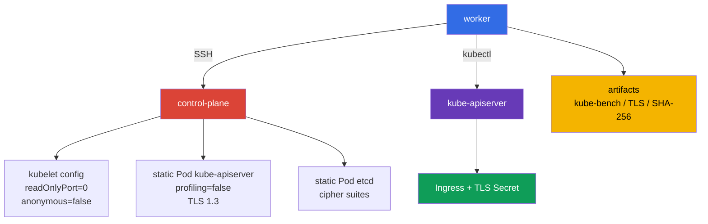

[Русская версия](README_RU.MD) · [Eng version](README.MD) · [Versión en español](README_ES.MD) · [Version française](README_FR.MD) · [ქართული ვერსია](README_GE.MD) · [繁體中文版](README_TW.MD) · [日本語版](README_JP.MD)

# Lab 103 - CIS/kube-bench, Secure Ingress TLS und Prüfung von Binärdateien

## Beschreibung

In dieser Übung konfigurierst du als Security Engineer einen Zwei-Node-Kubernetes-Cluster (control-plane +
worker): Du installierst `kube-bench` und behebst anhand seiner Findings
(nicht aus dem Gedächtnis) unsichere Parameter der control-plane-Komponenten und des kubelet
auf dem worker-Node, veröffentlichst einen Ingress nur über TLS, schränkst das TLS der control plane ein und
bestätigst die Integrität der installierten Kubernetes-Binärdateien.

Das ist keine Wiederholung der grundlegenden Kubernetes-Konfiguration aus CKA. Hier zählen die Stellen, an denen
Einstellungen angewendet werden: `KubeletConfiguration`, static Pod manifests der control plane, TLS-Parameter von etcd
und prüfbare Arbeitsergebnisse. Arbeite mit dem Node der control plane über den SSH-Namen
`control-plane`, der auf dem worker vorbereitet ist.

## Ziel

Den Stoff der Kurskapitel festigen:

- [Kapitel 07. CIS Benchmark und kube-bench](../../course/07/de.md)
- [Kapitel 08. Secure Ingress mit TLS](../../course/08/de.md)
- [Kapitel 09. Unsichere Argumente von Komponenten und Prüfung von Binärdateien](../../course/09/de.md)

## Prüfe dich vor dem Start

<details>
<summary>1. Warum kann ein Lauf von kube-bench mit dem Profil `cis-1.12` auf Kubernetes 1.36 nicht als authoritative CIS compliance bezeichnet werden?</summary>

Die in dieser Lab festgelegte Version `kube-bench 0.16.0` enthält überhaupt kein Profil für 1.36 - ihr eingebautes version mapping reicht nur bis `"1.34": "cis-1.12"` (das neueste verfügbare Profil). Indem wir `--benchmark cis-1.12` auf einem 1.36-Cluster explizit angeben, verwenden wir erzwungen das nächstliegende vorhandene Profil als Approximation: Ein Teil der Prüfungen kann für die neuere Version nicht mehr aktuell sein, und neue security-relevante Parameter speziell für 1.36 deckt dieses Profil noch nicht ab. Das ist ein wertvolles praktisches Signal, aber keine formal compliance statement für Version 1.36.
</details>

<details>
<summary>2. Warum konfiguriert `--tls-cipher-suites` am kube-apiserver nicht die Chiffren speziell für TLS 1.3?</summary>

In Go (in dem kube-apiserver geschrieben ist) steuert das Flag `--tls-cipher-suites` nur die cipher suites für TLS-Versionen ≤ 1.2. Für TLS 1.3 wählt Go den Chiffrensatz selbst aus einer fixed, hardcoded Liste - sie lassen sich über dieses Flag nicht konfigurieren. Deshalb bietet hier `--tls-min-version=VersionTLS13` den tatsächlichen Schutz (verbietet ältere Protokolle vollständig), und `--tls-cipher-suites` ist dort relevant, wo TLS 1.2 weiterhin zulässig ist (zum Beispiel etcd in dieser Lab).
</details>

<details>
<summary>3. Warum darf man einen aus der zu prüfenden Datei selbst berechneten Hash nicht als Referenz für die SHA-256 verification verwenden?</summary>

Wenn du den SHA-256 einer Datei berechnest und mit sich selbst vergleichst, besteht die Prüfung immer - auch wenn die Datei durch etwas Schädliches ersetzt wurde. Die Referenz-checksum muss aus einer unabhängigen, vertrauenswürdigen Quelle stammen - der offiziellen Release-Seite von Kubernetes - und nicht aus der lokalen Datei, die du prüfst.
</details>

## Was wir erstellen und warum

| Objekt oder Artefakt | Was das ist | Warum in dieser Lab |
|---|---|---|
| Bericht `kube-bench` | Snapshot der CIS-Prüfungen der control-plane | hält die ursprünglichen Empfehlungen fest und dient als Grundlage für das hardening |
| Kubelet configuration | Einstellungen des kubelet auf dem Node | deaktiviert den read-only endpoint und anonymous access |
| Static Pod manifest apiserver | Deklaration des kube-apiserver | deaktiviert profiling und setzt striktes TLS |
| TLS Secret und Ingress | TLS termination für die Anwendung | Der Ingress terminiert TLS für HTTPS auf `secure.cks.local`, und ingress-nginx leitet normale HTTP-Anfragen über `ssl-redirect` auf HTTPS um |
| Static Pod manifest etcd | Deklaration des lokalen etcd | begrenzt die zulässigen TLS cipher suites |
| SHA-256 artifact | Ergebnis des Abgleichs von `kubelet` und `kubectl` | bestätigt die Integrität der Binärdateien gegenüber den Release-Hashes |



## Infrastruktur

Die Umgebung wird in AWS (`eu-central-1`) über Terragrunt ausgerollt.

| Komponente | Beschreibung |
|---|---|
| `vpc` | VPC `10.103.0.0/16` mit öffentlichen Subnetzen |
| `ssh-keys` | SSH-Schlüssel für den Zugriff auf die Nodes |
| `k8s-1` | Kubernetes `1.36.0` (kubeadm), containerd und Calico: control-plane + ein worker-Node |
| `worker` | Arbeitsmaschine (bastion) mit `kubectl`, SSH-Zugriff und `check_result` (`kube-bench` selbst wird hier nicht benötigt - er ist bereits auf der `control-plane` und wird im Verlauf der Lab auf dem worker-Node installiert) |

> **Version und Prüfung.** Stand 2026-09-06 geht das offizielle CKS exam von Kubernetes `v1.35` aus. Diese Lab verwendet `1.36.0`, daher ist alles, was sich auf diese Version bezieht, ein forward-looking Lernszenario und keine Aussage über die aktuelle Prüfungsversion.

Von der control-plane wurde der taint entfernt, daher kann bei Bedarf ein Lern-Pod darauf gestartet werden.
Für die Aufgaben 2, 3 und 5 werden static Pods nach dem Speichern des
geänderten Manifests oder der Konfiguration automatisch vom kubelet neu erstellt. Lösche die Pods der control-plane nicht manuell.

## Bereitstellung

```bash
TASK=103 make run_cks_task
```

Verbinde dich per SSH mit dem worker. Der Kontext ist bereits eingerichtet:

```bash
kubectl config use-context cluster1-admin@cluster1
time_left      # wie viel Zeit für die Lab noch bleibt
check_result   # startet die automatischen Tests und zeigt das Ergebnis
```

Die Adresse der control-plane kannst du so ermitteln und prüfen:

```bash
kubectl get nodes -o wide
ssh control-plane hostname
```

## Aufgaben

---

| **1** | **CIS Benchmark Bericht** |
| :---: | :--- |
| Was wir tun | Führe auf dem Node `control-plane` `kube-bench` für Kubernetes `1.36.0` aus. Speichere die vollständige evidence in `/var/work/tests/artifacts/1/kube-bench.txt`: `kubernetes_version`, `kube_bench_version`, den gewählten `benchmark`, `mapping_status`, danach den Bericht selbst. `kube-bench` ist auf der `control-plane` bereits installiert (wie in der echten Prüfung, wo das CIS-Benchmark-Tooling auf den Nodes schon vorhanden ist) - du musst ihn weder installieren noch kopieren, geprüft werden soll gerade der Node. Das in der festgelegten Version `kube-bench 0.16.0` eingebaute version mapping endet mit dem Eintrag `"1.34": "cis-1.12"` - neuere Profile (einschließlich irgendeines Profils für 1.35/1.36) gibt es in dieser Version gar nicht. Starte daher `--benchmark cis-1.12` explizit und markiere das Ergebnis auf `1.36` als `forced-approximate`, nicht als authoritative compliance. **Starte das vollständige Set an targets für `cis-1.12`:** `--targets master,node,controlplane,etcd,policies` - das ist die Karte der targets, die kube-bench dem Profil `cis-1.12` zuordnet; das Auslassen eines davon ergibt einen unvollständigen Bericht. Ohne explizites `--targets` bestimmt kube-bench den Typ des aktuellen Nodes selbst und nimmt dafür nicht diese ganze Liste, sondern ein engeres Set - `etcd` und `policies` gelangen in einen solchen auto-detected Lauf nicht, daher wird ein Bericht ohne explizites `--targets` unvollständig sein. |
| Abnahmekriterien | - die evidence enthält alle vier version/mapping-Felder;<br/>- `mapping_status=forced-approximate` erklärt die fehlende offizielle Abdeckung von `1.36` explizit;<br/>- im Bericht gibt es Ergebnisse aller Abschnitte `master`, `node`, `controlplane`, `etcd`, `policies` (nicht nur eine beliebige Zeile `[PASS]`/`[WARN]`/`[FAIL]`);<br/>- der Text gibt das Ergebnis nicht als authoritative CIS compliance für Kubernetes `1.36` aus. |

<details>
<summary>💡 Hinweis zu Aufgabe 1</summary>

Die Prüfung erwartet am Anfang der Datei vier konkrete Marker-Zeilen: `kubernetes_version=v1.36.x`, `kube_bench_version=v0.16.0`, `benchmark=cis-1.12`, `mapping_status=forced-approximate` - das ist kein dekorativer Text, sondern ein Format, das der Test buchstäblich sucht. Starte `kube-bench` auf dem control-plane node selbst und nicht remote vom worker - kube-bench hat keinen Modus "fremden Node über SSH prüfen". Vergiss nicht `--targets master,node,controlplane,etcd,policies` - ohne explizite Angabe der targets können die Abschnitte `etcd` und `policies` übersprungen werden. `kube-bench` ist bereits zusammen mit der Konfiguration in seinem Standardverzeichnis `/etc/kube-bench/cfg` installiert, daher muss `--config-dir` in dieser Lab nicht angegeben werden - verwende dieses Flag nur, wenn du `cfg` selbst in einem anderen Verzeichnis abgelegt hast und den tatsächlichen Pfad zu dieser Kopie übergibst.
</details>

---

| **2** | **Hardening kubelet: read-only port und anonymous auth** |
| :---: | :--- |
| Was wir tun | Finde und behebe auf der control-plane zwei unsichere kubelet-Einstellungen: Er bedient noch den read-only Port ohne Authentifizierung und akzeptiert anonyme Anfragen (siehe das Kapitel über kubelet hardening). Verwende den `kube-bench`-Bericht aus Aufgabe 1 als Quelle der Wahrheit: Er hat beide Probleme im Abschnitt `node` für denselben Node bereits markiert - finde dort das `[FAIL]` neben diesen beiden Themen und orientiere dich daran. Korrigiere die `kubelet configuration`, starte kubelet neu und warte auf die Bereitschaft des Nodes. Ersetze die Prüfung nicht durch ein Text-artifact: Die Einstellungen müssen auf dem Node angewendet sein. |
| Abnahmekriterien | - in der geltenden kubelet configuration ist der read-only Port deaktiviert;<br/>- anonymous authentication des kubelet ist deaktiviert;<br/>- der Node ist nach dem Neustart `Ready`. |

<details>
<summary>💡 Hinweis zu Aufgabe 2</summary>

Suche im Bericht aus Aufgabe 1 die checks `4.2.1` (`--anonymous-auth`) und `4.2.4` (`--read-only-port`) im Abschnitt `node`. In der `KubeletConfiguration` (`/var/lib/kubelet/config.yaml`) entsprechen ihnen `authentication.anonymous.enabled` und `readOnlyPort` - CIS verlangt `authentication.anonymous.enabled: false` und `readOnlyPort: 0`. `authentication.anonymous.enabled` steht VERSCHACHTELT unter dem Schlüssel `authentication.anonymous` und nicht als separates top-level Feld `anonymous: false` - prüfe die YAML-Einrückung sorgfältig. Nach dem Ändern von config.yaml muss der kubelet-Dienst selbst neu gestartet werden (`systemctl restart kubelet`); das Bearbeiten der Datei allein wendet die Änderungen nicht auf den laufenden Prozess an.
</details>

---

| **3** | **Hardening kube-apiserver: profiling deaktivieren** |
| :---: | :--- |
| Was wir tun | Der kube-apiserver bedient bis jetzt den pprof-HTTP-Endpoint zur Prozess-Profilierung. Verwende den `kube-bench`-Bericht aus Aufgabe 1 als Quelle der Wahrheit: Er hat dieses Problem im Abschnitt `master` für denselben Node bereits markiert - finde dort das `[FAIL]` neben diesem Thema und orientiere dich daran. Korrigiere das static Pod manifest des kube-apiserver, warte auf die Neuerstellung und stelle sicher, dass die API bereit ist. |
| Abnahmekriterien | - der tatsächlich laufende Pod des kube-apiserver enthält `--profiling=false` in seinem `command` (geprüft über die API, nicht am Text der Datei auf der Platte);<br/>- `kubectl get --raw='/readyz'` liefert ein erfolgreiches Ergebnis;<br/>- der static Pod kube-apiserver läuft. |

<details>
<summary>💡 Hinweis zu Aufgabe 3</summary>

Suche im Bericht aus Aufgabe 1 den check `1.2.15` (`--profiling`) im Abschnitt `master`. Ihm entspricht das Flag `--profiling=false` im `command` des static Pod manifest `/etc/kubernetes/manifests/kube-apiserver.yaml`. Bearbeite den Pod nicht per `kubectl edit` - das ist ein static Pod, das kubelet verwaltet ihn direkt aus der Manifest-Datei auf der Platte und überschreibt jede Änderung über die API wieder. Füge das Flag direkt in die YAML-Datei auf dem Node ein und warte: Das kubelet bemerkt die Änderung der Datei nicht sofort.
</details>

---

| **4** | **Secure Ingress mit TLS** |
| :---: | :--- |
| Was wir tun | • Erzeuge ein selbstsigniertes Zertifikat für `secure.cks.local`, mit diesem Namen gerade im Subject Alternative Name, nicht nur im CN (der Befehl steht im Hinweis).<br/>• Erstelle den Namespace `cks-103` und aus diesem Zertifikat das TLS-Secret `secure-ingress-tls` vom Typ `kubernetes.io/tls`.<br/>• Rolle das Deployment `secure-app` aus (`viktoruj/ping_pong:alpine`, `SERVER_NAME=secure-app` und `SRV_PORT=80` über `kubectl set env`) und den Service `secure-app`.<br/>• Erstelle den Ingress `secure-ingress` mit `ingressClassName: nginx`, einer TLS-Sektion für diesen Host mit Verweis auf `secure-ingress-tls` und der Annotation `nginx.ingress.kubernetes.io/ssl-redirect: "true"`.<br/>• Der Controller `ingress-nginx` ist in dieser Lab bereits installiert und Ready als lab-owned fixture (siehe [Kapitel 08](../../course/08/de.md) zu seinem retirement) - stelle sicher, dass er deinen Ingress tatsächlich verarbeitet (siehe Abnahmekriterien). |
| Abnahmekriterien | - das Secret `secure-ingress-tls` in `cks-103` hat den Typ `kubernetes.io/tls` und die Felder `tls.crt`, `tls.key`; die Zugehörigkeit des Paares wird anhand des public key geprüft (algorithmenunabhängig, ohne Bindung an RSA/modulus);<br/>- das Zertifikat enthält `secure.cks.local` im SAN;<br/>- der Ingress `secure-ingress` enthält `ingressClassName: nginx`, die Annotation `ssl-redirect: "true"`, `spec.tls` mit dem Host `secure.cks.local` und Verweis auf `secure-ingress-tls`, backend `secure-app:80`;<br/>- der Service `secure-app` hat einen echten Endpoint;<br/>- der Controller `ingress-nginx` ist Ready;<br/>- eine HTTPS-Anfrage über den Controller liefert tatsächlich `200` mit einem Body, der `Server Name: secure-app` enthält (nicht irgendein `2xx`/`3xx`, das der Controller selbst ohne Zugriff auf das backend zurückgeben kann);<br/>- eine HTTP-Anfrage über den Controller erhält einen redirect mit dem Header `Location`, der auf den HTTPS-Host `https://secure.cks.local` zeigt (nicht irgendein `3xx`; der Pfad nach dem Host ist optional). |

<details>
<summary>💡 Hinweis zu Aufgabe 4</summary>

In der echten Prüfung ist das Zertifikat meist schon vorab ausgestellt - hier musst du es selbst erzeugen:

```bash
openssl req -x509 -nodes -newkey ec -pkeyopt ec_paramgen_curve:P-256 \
  -keyout tls.key -out tls.crt -days 30 \
  -subj "/CN=secure.cks.local" -addext "subjectAltName=DNS:secure.cks.local"
```

`-addext 'subjectAltName=DNS:secure.cks.local'` ist Pflicht - moderne Clients und Ingress controller prüfen gerade das SAN und nicht nur den CN. Erstelle das TLS Secret über `kubectl create secret tls secure-ingress-tls --cert=tls.crt --key=tls.key` - das setzt automatisch den korrekten `type: kubernetes.io/tls` und kodiert die Daten korrekt in base64. Wenn du das Secret manuell mit dem Typ `Opaque` und den Schlüsseln `tls.crt`/`tls.key` erstellst, besteht der Test auf `type` nicht, selbst wenn die Daten technisch gültig sind.

Die Prüfung des Paares certificate/private key erfolgt anhand des public key und nicht über den RSA-spezifischen modulus - das funktioniert gleich für RSA- und EC/ECDSA-Schlüssel:

```bash
cert_pub=$(kubectl -n cks-103 get secret secure-ingress-tls -o jsonpath='{.data.tls\.crt}' \
  | base64 -d | openssl x509 -pubkey -noout | openssl pkey -pubin -outform DER | sha256sum | awk '{print $1}')
key_pub=$(kubectl -n cks-103 get secret secure-ingress-tls -o jsonpath='{.data.tls\.key}' \
  | base64 -d | openssl pkey -pubout -outform DER | sha256sum | awk '{print $1}')
[[ -n "$cert_pub" && "$cert_pub" == "$key_pub" ]]
```

Verwende für die end-to-end-Prüfung nicht die Pod-IP aus den `Endpoints` des Controllers - sie ist von einer separaten worker-VM aus nicht garantiert routbar. `secure.cks.local` wird bereits zu einer echten Node-IP aufgelöst (der Eintrag wurde beim bootstrap in die `/etc/hosts` dieser Maschine eingetragen), und `ingress-nginx-controller` ist ein Service vom Typ `NodePort`, der auf jedem Node offen ist; daher kann die Anfrage direkt vom worker ausgeführt werden, ohne SSH zum Cluster:

```bash
HTTPS_NODEPORT=$(kubectl -n ingress-nginx get svc ingress-nginx-controller -o jsonpath='{.spec.ports[?(@.port==443)].nodePort}')
curl -sS -k --max-time 5 "https://secure.cks.local:${HTTPS_NODEPORT}/"
```

Die Prüfung des HTTP→HTTPS redirect ist keine künstliche Anforderung dieser Lab, sondern eine echte Prüfungsfrage (siehe mock-Prüfung `tasks/cks/mock/04`, Aufgabe 4: `Create an Ingress with a redirect from HTTP to HTTPS`).
</details>

---

| **5** | **TLS hardening der control plane** |
| :---: | :--- |
| Was wir tun | Setze in `/etc/kubernetes/manifests/kube-apiserver.yaml` `--tls-min-version=VersionTLS13` und `--tls-cipher-suites=TLS_ECDHE_RSA_WITH_AES_128_GCM_SHA256,TLS_ECDHE_RSA_WITH_AES_256_GCM_SHA384`. Setze in `/etc/kubernetes/manifests/etcd.yaml` `--cipher-suites` mit demselben Set. Bestätige nach der Neuerstellung der Komponenten, dass `TLSv1.3` ausgehandelt wird (`openssl s_client -tls1_3`) und dass `TLSv1.2` abgelehnt wird (`openssl s_client -tls1_2` endet mit einem handshake-Fehler), und speichere die Ausgabe in `/var/work/tests/artifacts/5/tls13.txt`. Wichtig ist, die Semantik zu verstehen: In Go gilt das Flag `--tls-cipher-suites` nur für TLS ≤ 1.2, und bei `--tls-min-version=VersionTLS13` werden die konkreten TLS 1.3 cipher suites über dieses Flag nicht konfiguriert (Go wählt sie selbst). Daher bietet beim kube-apiserver hier gerade min-version 1.3 den tatsächlichen Schutz; cipher-suites sind dort relevant, wo TLS 1.2 zulässig ist (z. B. bei etcd). |
| Abnahmekriterien | - beide erforderlichen TLS-Flags stehen im Manifest des kube-apiserver;<br/>- die cipher suites stehen im Manifest von etcd;<br/>- kube-apiserver und etcd sind gesund;<br/>- das TLS-artifact enthält die Bestätigung von `TLSv1.3` und die festgehaltene Ablehnung von TLS 1.2 (non-zero exit/handshake failure). |

<details>
<summary>💡 Hinweis zu Aufgabe 5</summary>

Das Flag bei etcd heißt `--cipher-suites` (ohne `tls-` am Anfang) - das ist ein ANDERER Flag-Name als `--tls-cipher-suites` am kube-apiserver. Die Verwechslung der Flag-Namen ist ein häufiger Fehler. Prüfe dich mit zwei separaten Befehlen: `openssl s_client -connect <host>:6443 -tls1_3` (muss erfolgreich verbinden) und `-tls1_2` (muss mit einem handshake-Fehler enden) - beide auf den Port des kube-apiserver, nicht von etcd.
</details>

---

| **6** | **Integritätsprüfung von kubelet und kubectl** |
| :---: | :--- |
| Was wir tun | Gleiche das SHA-256 der installierten `kubelet` auf der control-plane und `kubectl` auf dem worker mit den veröffentlichten checksums von Kubernetes `v1.36.0` ab. Speichere die Befehle und das Ergebnis von `sha256sum -c` in `/var/work/tests/artifacts/6/binaries.sha256.txt`. Verwende keine aus der zu prüfenden Datei berechneten Hashes als Referenz. |
| Abnahmekriterien | - das artifact existiert;<br/>- darin gibt es getrennte erfolgreiche Ergebnisse für `kubelet` und `kubectl` (`OK`);<br/>- die Referenzsummen stammen aus dem offiziellen Release `v1.36.0`. |

<details>
<summary>💡 Hinweis zu Aufgabe 6</summary>

Lade die offizielle Datei `kubelet.sha256`/`kubectl.sha256` von `https://dl.k8s.io/release/v1.36.0/bin/linux/amd64/` (oder der entsprechenden Plattform) herunter und verwende `sha256sum -c` mit dieser Datei gegen die tatsächlich installierte Binärdatei - gerade die Ausgabe dieses Befehls (`kubelet: OK`, `kubectl: OK`) wird im artifact benötigt und nicht nur der Hash selbst.
</details>

---

| **7** | **Remediation cycle: von einem konkreten kube-bench FAIL zu PASS** |
| :---: | :--- |
| Was wir tun | Der Bericht aus Aufgabe 1 ist ein Snapshot des aktuellen Zustands; hier musst du einen konkreten fehlgeschlagenen Test mit seiner Behebung verbinden. Starte auf der control-plane `kube-bench` gerade mit `--check 1.1.1` (Rechte des static Pod manifest des kube-apiserver; die Lab-Infrastruktur setzt absichtlich mode `0644`, `cis-1.12` verlangt `600` oder strenger) und speichere die Ausgabe **vor** der Korrektur in `/var/work/tests/artifacts/7/before.txt` - sie muss `[FAIL]` für diesen Test enthalten. Korrigiere das Zugriffsrecht der Datei `/etc/kubernetes/manifests/kube-apiserver.yaml` (`chmod 600`), starte dann denselben `--check 1.1.1` erneut und speichere die Ausgabe in `/var/work/tests/artifacts/7/after.txt` - sie muss `[PASS]` ohne ein einziges `[FAIL]` für diesen check enthalten. |
| Abnahmekriterien | `before.txt` enthält die Zeile `[FAIL]` für den check `1.1.1`; die tatsächlichen Rechte der Datei auf dem Node sind nach der Korrektur genau `600`; `after.txt` enthält `[PASS]` für den check `1.1.1` und kein `[FAIL]` dafür; der kube-apiserver bleibt nach der Änderung gesund (fs-only-Änderung, die Komponente wird nicht neu erstellt). |

<details>
<summary>💡 Hinweis zu Aufgabe 7</summary>

Bei dieser Aufgabe geht es um die Reihenfolge der Aktionen und nicht nur um den Endzustand: Halte zuerst `[FAIL]` fest (before.txt), führe erst danach `chmod 600` aus, dann lasse die Prüfung erneut laufen (after.txt). Wenn du `chmod` vor dem Speichern von before.txt ausführst, erhältst du das benötigte `[FAIL]` im ersten artifact nicht. Die Änderung der Dateirechte ist eine fs-only-Operation, das kubelet erstellt den static Pod wegen einer Änderung der Rechte der Manifest-Datei selbst nicht neu (anders als bei einer Änderung ihres Inhalts).
</details>

---

| **8** | **Remediation cycle: kube-controller-manager, derselbe Ansatz für eine andere Komponente** |
| :---: | :--- |
| Was wir tun | Dasselbe wie in Aufgabe 7, aber für `kube-controller-manager` und eine andere check ID: `--check 1.1.3` (Rechte des static Pod manifest des kube-controller-manager; die Lab-Infrastruktur setzt absichtlich mode `0644`). Speichere die Ausgabe **vor** der Korrektur in `/var/work/tests/artifacts/8/before.txt` (muss `[FAIL]` für `1.1.3` enthalten), korrigiere `chmod 600 /etc/kubernetes/manifests/kube-controller-manager.yaml`, speichere dann den erneuten Lauf in `/var/work/tests/artifacts/8/after.txt` (muss `[PASS]` ohne `[FAIL]` für `1.1.3` enthalten). |
| Abnahmekriterien | `before.txt` enthält die Zeile `[FAIL]` für den check `1.1.3`; die Rechte der Datei nach der Korrektur sind genau `600`; `after.txt` enthält `[PASS]` für `1.1.3` und kein `[FAIL]` dafür; `kube-controller-manager` bleibt `Running` (fs-only-Änderung, die Komponente wird nicht neu erstellt). |

<details>
<summary>💡 Hinweis zu Aufgabe 8</summary>

Dieselbe Reihenfolge der Aktionen wie in Aufgabe 7: zuerst `before.txt` mit `[FAIL]`, dann `chmod`, dann `after.txt` mit `[PASS]`. Übernimm alte CIS check IDs nicht "aus dem Gedächtnis" - `1.1.3` in der festgelegten Version `kube-bench 0.16.0`/dem Profil `cis-1.12` sind gerade die kube-controller-manager pod specification file permissions; prüfe das über `--check 1.1.3`, bevor du korrigierst.
</details>

---

| **9** | **Remediation cycle: profiling bei kube-controller-manager und kube-scheduler** |
| :---: | :--- |
| Was wir tun | Derselbe Ansatz wie in den Aufgaben 7-8, für die checks `1.3.2` (kube-controller-manager profiling) und `1.4.1` (kube-scheduler profiling) - beide unter demselben Profil `cis-1.12`, ein explizites `--targets` ist nicht nötig. Starte `kube-bench --check 1.3.2` und `--check 1.4.1` auf der `control-plane` und speichere die Ausgabe **vor** der Korrektur in `/var/work/tests/artifacts/9/controller-manager-before.txt` und `.../scheduler-before.txt` - beide müssen `[FAIL]` enthalten. Aufgabe 3 hat profiling beim kube-apiserver bereits deaktiviert; kubeadm fügt `--profiling=false` standardmäßig überhaupt nicht in die Manifeste von `kube-controller-manager`/`kube-scheduler` ein. Füge `--profiling=false` in den `command` beider static Pod manifests ein, warte auf die Neuerstellung und starte dieselben checks erneut, wobei du die Ausgabe in `.../controller-manager-after.txt` und `.../scheduler-after.txt` speicherst - beide müssen `[PASS]` ohne ein einziges `[FAIL]` enthalten. |
| Abnahmekriterien | Die `before`-Dateien enthalten `[FAIL]` für `1.3.2`/`1.4.1` entsprechend; die tatsächlich laufenden Pods `kube-controller-manager`/`kube-scheduler` enthalten `--profiling=false` in ihrem `command` (geprüft über die API); die `after`-Dateien enthalten `[PASS]` ohne `[FAIL]` für dieselben checks; beide Pods sind in der Phase `Running`. |

<details>
<summary>💡 Hinweis zu Aufgabe 9</summary>

Dieselbe Reihenfolge der Aktionen wie in den Aufgaben 7-8: zuerst `before.txt` mit `[FAIL]`, dann die Korrektur des Manifests, dann `after.txt` mit `[PASS]`. Bearbeite den Pod nicht per `kubectl edit` - das kubelet überschreibt jede solche Änderung aus der Datei auf der Platte. Füge das Flag direkt in das YAML auf dem Node ein und warte auf die Neuerstellung - sie erfolgt nicht augenblicklich. Verwechsle diese Aufgabe nicht mit `protectKernelDefaults` (Aufgabe 10, ein separater kubelet-Parameter des worker-Nodes) - hier geht es gerade um den HTTP profiling endpoint der control-plane-Komponenten.
</details>

---

| **10** | **Remediation cycle: protect-kernel-defaults auf dem worker-Node** |
| :---: | :--- |
| Was wir tun | Derselbe Ansatz wie in den Aufgaben 7-9, jetzt auf dem ECHTEN worker-Node des Clusters (nicht der control-plane), aber für ein ANDERES Profil: Das festgelegte `cis-1.12` (überall in dieser Lab verwendet) enthält den check protect-kernel-defaults überhaupt nicht - CIS hat ihn in dieser Version des Profils entfernt/umnummeriert, und das eigene `4.2.6` in `cis-1.12` ist ein anderer check (`--make-iptables-util-chains`, standardmäßig PASS). Der benötigte check mit derselben ID existiert im älteren Profil `cis-1.24` derselben Binärdatei - verwende explizit `--benchmark cis-1.24 --check 4.2.6` nur für diese Aufgabe. Anders als auf der `control-plane` ist `kube-bench` auf dem worker-Node NICHT vorinstalliert - installiere ihn hier selbst (echte Installation: dasselbe festgelegte Release herunterladen, `binary` und `cfg` entpacken) und kopiere ihn nicht von irgendwoher. Speichere die Ausgabe **vor** der Korrektur in `/var/work/tests/artifacts/10/before.txt` (muss `[FAIL]` mit Text zu protect-kernel-defaults enthalten). Die von kubeadm erzeugte `KubeletConfiguration` auf dem worker-Node enthält das Feld `protectKernelDefaults` überhaupt nicht (gleichbedeutend mit dem unsicheren Default `false`) - füge `protectKernelDefaults: true` in `/var/lib/kubelet/config.yaml` dieses Nodes ein, starte kubelet neu, warte auf `Ready`, starte dann denselben check erneut (mit demselben `cis-1.24`) und speichere `/var/work/tests/artifacts/10/after.txt` (muss `[PASS]` enthalten). |
| Abnahmekriterien | `before.txt` enthält `[FAIL] 4.2.6` mit Text zu protect-kernel-defaults (nicht irgendein `4.2.6`); in der geltenden kubelet configuration des worker-Nodes (`/configz`) steht `protectKernelDefaults: true`; `after.txt` enthält `[PASS] 4.2.6` mit demselben Text, ohne `[FAIL]`; der worker-Node ist nach dem Neustart `Ready`. |

<details>
<summary>💡 Hinweis zu Aufgabe 10</summary>

Finde den Namen des worker-Nodes über `kubectl get nodes -l '!node-role.kubernetes.io/control-plane'` - das ist NICHT die control-plane und NICHT die Arbeitsmaschine (bastion), von der aus du die Befehle ausführst. Installiere `kube-bench` darauf mit einem echten Befehl (`curl` + `tar` + `install`), nicht durch Kopieren von der control-plane oder dem worker PC - anders als auf der control-plane fehlt er hier absichtlich, damit du den Installationsprozess selbst einmal durchläufst. Vergiss nicht `--benchmark cis-1.24` (nicht `cis-1.12`, das in den übrigen Aufgaben überall verwendet wird) - sonst findet `--check 4.2.6` einen anderen, bereits bestehenden check und die Aufgabe beweist nichts. Das Feld `protectKernelDefaults` fehlt in der von kubeadm erzeugten `config.yaml` physisch, daher hänge es einfach an und suche keine vorhandene Zeile zum Ersetzen (anders als bei `readOnlyPort` in Aufgabe 2). Warte nach `systemctl restart kubelet` auf dem worker-Node, bis er zu `Ready` zurückkehrt, bevor du den check erneut startest.
</details>

---

## Ergebnisprüfung

Starte auf dem worker:

```bash
check_result
```

Die Prüfung enthält Init und zehn unabhängige Aufgaben. Die Systemaufgaben werden anhand des
Zustands der Nodes von control plane/worker über SSH und anhand von artifacts geprüft, nicht nur anhand von API-Objekten.

## Lösung

Referenzlösung: [worker/files/solutions/1_DE.MD](worker/files/solutions/1_DE.MD).

## Löschen von Cluster und Ressourcen

```bash
TASK=103 make delete_cks_task
```
