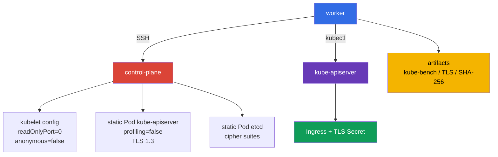

[Русская версия](README_RU.MD) · [Eng version](README.MD) · [Version française](README_FR.MD) · [Deutsche Version](README_DE.MD) · [ქართული ვერსია](README_GE.MD) · [繁體中文版](README_TW.MD) · [日本語版](README_JP.MD)

# Lab 103 - CIS/kube-bench, Secure Ingress TLS y verificación de binarios

## Descripción

En este laboratorio configuras un clúster de Kubernetes de dos nodos (control-plane +
worker) como ingeniero de seguridad: instalas `kube-bench` y, según sus hallazgos
(no de memoria), corriges los parámetros inseguros de los componentes del control-plane y del kubelet
del nodo worker, publicas un Ingress solo por TLS, restringes el TLS del control plane y
confirmas la integridad de los binarios de Kubernetes instalados.

Esto no es una repetición de la configuración básica de Kubernetes de CKA. Aquí importan los lugares
donde se aplican los ajustes: `KubeletConfiguration`, los static Pod manifests del control plane, los parámetros TLS de etcd
y los artefactos verificables del trabajo. Trabaja con el nodo control plane mediante el nombre SSH
`control-plane`, preparado en el worker.

## Objetivo

Consolidar el contenido de los capítulos del curso:

- [Capítulo 07. CIS Benchmark y kube-bench](../../course/07/es.md)
- [Capítulo 08. Secure Ingress con TLS](../../course/08/es.md)
- [Capítulo 09. Argumentos inseguros de los componentes y verificación de binarios](../../course/09/es.md)

## Compruébate antes de empezar

<details>
<summary>1. ¿Por qué no se puede llamar authoritative CIS compliance a ejecutar kube-bench con el perfil `cis-1.12` en Kubernetes 1.36?</summary>

La versión `kube-bench 0.16.0`, fijada en este laboratorio, no contiene ningún perfil para 1.36: su version mapping integrado llega solo hasta `"1.34": "cis-1.12"` (el perfil más reciente disponible). Al indicar explícitamente `--benchmark cis-1.12` en un clúster 1.36, usamos por la fuerza el perfil existente más cercano como approximation: parte de las comprobaciones puede no ser aplicable a una versión más nueva, y los nuevos parámetros relevantes para la seguridad específicos de 1.36 este perfil aún no los cubre. Es una señal práctica valiosa, pero no un formal compliance statement para la versión 1.36.
</details>

<details>
<summary>2. ¿Por qué `--tls-cipher-suites` en kube-apiserver no configura los cifrados precisamente para TLS 1.3?</summary>

En Go (en el que está escrito kube-apiserver) el flag `--tls-cipher-suites` controla solo las cipher suites de las versiones TLS ≤ 1.2. Para TLS 1.3, Go elige por sí mismo el conjunto de cifrados de una lista fixed, hardcoded: no se pueden configurar con este flag. Por eso la protección real aquí la da `--tls-min-version=VersionTLS13` (prohíbe por completo los protocolos más antiguos), mientras que `--tls-cipher-suites` es relevante donde TLS 1.2 todavía se admite (por ejemplo, etcd en este laboratorio).
</details>

<details>
<summary>3. ¿Por qué no se puede usar como referencia para la SHA-256 verification un hash calculado a partir del propio archivo que se comprueba?</summary>

Si calculas el SHA-256 de un archivo y lo comparas consigo mismo, la comprobación siempre pasará, incluso si el archivo ha sido sustituido por algo malicioso. La checksum de referencia debe obtenerse de una fuente independiente y de confianza: la página oficial de la release de Kubernetes, y no del archivo local que estás comprobando.
</details>

## Qué creamos y para qué

| Objeto o artefacto | Qué es | Para qué sirve en este laboratorio |
|---|---|---|
| Informe de `kube-bench` | instantánea de las comprobaciones CIS del control-plane | registra las recomendaciones iniciales y sirve de base para el hardening |
| Kubelet configuration | ajustes del kubelet en el nodo | desactiva el read-only endpoint y el anonymous access |
| Static Pod manifest de apiserver | declaración de kube-apiserver | desactiva profiling y establece un TLS estricto |
| TLS Secret e Ingress | TLS termination para la aplicación | el Ingress termina TLS para HTTPS en `secure.cks.local`, y ingress-nginx redirige las peticiones HTTP normales a HTTPS mediante `ssl-redirect` |
| Static Pod manifest de etcd | declaración del etcd local | limita las TLS cipher suites permitidas |
| Artefacto SHA-256 | resultado de la verificación de `kubelet` y `kubectl` | confirma la integridad de los binarios respecto a los hashes de la release |



## Infraestructura

El entorno se despliega en AWS (`eu-central-1`) mediante Terragrunt.

| Componente | Descripción |
|---|---|
| `vpc` | VPC `10.103.0.0/16` con subredes públicas |
| `ssh-keys` | claves SSH para acceder a los nodos |
| `k8s-1` | Kubernetes `1.36.0` (kubeadm), containerd y Calico: control-plane + un nodo worker |
| `worker` | Máquina de trabajo (bastion) con `kubectl`, acceso SSH y `check_result` (el propio `kube-bench` aquí no hace falta: ya está en `control-plane` y se instala en el nodo worker durante el laboratorio) |

> **Versión y examen.** A fecha de 2026-09-06, el CKS exam oficial parte de Kubernetes `v1.35`. Este laboratorio usa `1.36.0`, por lo que todo lo relativo a esta versión es un escenario didáctico forward-looking, y no una afirmación sobre la versión actual del examen.

Al control-plane se le ha quitado el taint, por lo que, si hace falta, se puede lanzar en él un Pod de laboratorio.
Para las tareas 2, 3 y 5, los static Pods son recreados automáticamente por el kubelet tras guardar
el manifest o la configuración modificados. No elimines manualmente los Pods del control-plane.

## Despliegue

```bash
TASK=103 make run_cks_task
```

Conéctate al worker por SSH. El contexto ya está configurado:

```bash
kubectl config use-context cluster1-admin@cluster1
time_left      # cuánto tiempo queda en el laboratorio
check_result   # lanza los tests automáticos y muestra el resultado
```

La dirección del control-plane se puede obtener y comprobar así:

```bash
kubectl get nodes -o wide
ssh control-plane hostname
```

## Tareas

---

| **1** | **Informe CIS Benchmark** |
| :---: | :--- |
| Qué hacemos | En el nodo `control-plane` ejecuta `kube-bench` para Kubernetes `1.36.0`. Guarda la evidence completa en `/var/work/tests/artifacts/1/kube-bench.txt`: `kubernetes_version`, `kube_bench_version`, el `benchmark` elegido, `mapping_status` y, a continuación, el propio informe. `kube-bench` ya está instalado en `control-plane` (igual que en el examen real, donde las herramientas de CIS Benchmark ya están en los nodos): no hace falta instalarlo ni copiarlo, lo que debe comprobarse es precisamente el nodo. El version mapping integrado en la versión fijada `kube-bench 0.16.0` termina con la entrada `"1.34": "cis-1.12"`: no hay perfiles más nuevos (incluido cualquier perfil para 1.35/1.36) en esta versión. Por eso lanza `--benchmark cis-1.12` explícitamente y marca el resultado en `1.36` como `forced-approximate`, y no como authoritative compliance. **Ejecuta el conjunto completo de targets para `cis-1.12`:** `--targets master,node,controlplane,etcd,policies`: es el mapa de targets que kube-bench asocia al perfil `cis-1.12`; omitir cualquiera de ellos da un informe incompleto. Sin un `--targets` explícito, kube-bench determina por sí mismo el tipo del nodo actual y toma para él no toda esa lista, sino un conjunto más estrecho: `etcd` y `policies` no entran en una ejecución auto-detected así, por lo que un informe sin `--targets` explícito resultará incompleto. |
| Criterios de aceptación | - la evidence contiene los cuatro campos de version/mapping;<br/>- `mapping_status=forced-approximate` explica explícitamente la ausencia de cobertura oficial de `1.36`;<br/>- en el informe hay resultados de todas las secciones `master`, `node`, `controlplane`, `etcd`, `policies` (no solo una línea arbitraria `[PASS]`/`[WARN]`/`[FAIL]`);<br/>- el texto no presenta el resultado como authoritative CIS compliance para Kubernetes `1.36`. |

<details>
<summary>💡 Pista para la tarea 1</summary>

La comprobación espera cuatro líneas-marcador concretas al principio del archivo: `kubernetes_version=v1.36.x`, `kube_bench_version=v0.16.0`, `benchmark=cis-1.12`, `mapping_status=forced-approximate`: no es texto decorativo, sino un formato que el test busca literalmente. Ejecuta `kube-bench` en el propio control-plane node, y no de forma remota desde el worker: kube-bench no tiene un modo "comprobar un nodo ajeno por SSH". No olvides `--targets master,node,controlplane,etcd,policies`: sin indicar explícitamente los targets, las secciones `etcd` y `policies` pueden omitirse. `kube-bench` ya está instalado junto con la configuración en su directorio estándar `/etc/kube-bench/cfg`, por lo que en este laboratorio no hace falta indicar `--config-dir`: usa ese flag solo si has colocado `cfg` tú mismo en otro directorio y pasas la ruta real a esa copia.
</details>

---

| **2** | **Hardening del kubelet: read-only port y anonymous auth** |
| :---: | :--- |
| Qué hacemos | En el control-plane encuentra y corrige dos ajustes inseguros del kubelet: todavía sirve el read-only port sin autenticación y acepta peticiones anónimas (consulta el capítulo sobre hardening del kubelet). Usa el informe de `kube-bench` de la tarea 1 como fuente de verdad: ya marcó ambos problemas en la sección `node` para este mismo nodo; encuentra ahí los `[FAIL]` junto a estos dos temas y guíate por ellos. Corrige la `kubelet configuration`, reinicia el kubelet y espera a que el nodo esté listo. No sustituyas la comprobación por un artefacto de texto: los ajustes deben estar aplicados en el nodo. |
| Criterios de aceptación | - en la kubelet configuration en vigor el read-only port está desactivado;<br/>- la anonymous authentication del kubelet está desactivada;<br/>- el nodo `Ready` tras el reinicio. |

<details>
<summary>💡 Pista para la tarea 2</summary>

Busca en el informe de la tarea 1 los checks `4.2.1` (`--anonymous-auth`) y `4.2.4` (`--read-only-port`) en la sección `node`. En `KubeletConfiguration` (`/var/lib/kubelet/config.yaml`) les corresponden `authentication.anonymous.enabled` y `readOnlyPort`: CIS exige `authentication.anonymous.enabled: false` y `readOnlyPort: 0`. `authentication.anonymous.enabled` está ANIDADO, bajo la clave `authentication.anonymous`, y no como un campo top-level independiente `anonymous: false`: comprueba con atención la indentación del YAML. Tras editar config.yaml hay que reiniciar el propio servicio kubelet (`systemctl restart kubelet`); editar el archivo por sí solo no aplica los cambios al proceso en ejecución.
</details>

---

| **3** | **Hardening de kube-apiserver: desactivar profiling** |
| :---: | :--- |
| Qué hacemos | kube-apiserver sigue sirviendo el pprof HTTP endpoint de profiling del proceso. Usa el informe de `kube-bench` de la tarea 1 como fuente de verdad: ya marcó este problema en la sección `master` para el mismo nodo; encuentra ahí el `[FAIL]` junto a este tema y guíate por él. Corrige el static Pod manifest de kube-apiserver, espera a que se recree y asegúrate de que la API está lista. |
| Criterios de aceptación | - el Pod kube-apiserver realmente en ejecución contiene `--profiling=false` en su `command` (se comprueba a través de la API, y no por el texto del archivo en disco);<br/>- `kubectl get --raw='/readyz'` devuelve un resultado correcto;<br/>- el static Pod kube-apiserver está en ejecución. |

<details>
<summary>💡 Pista para la tarea 3</summary>

Busca en el informe de la tarea 1 el check `1.2.15` (`--profiling`) en la sección `master`. Le corresponde el flag `--profiling=false` en el `command` del static Pod manifest `/etc/kubernetes/manifests/kube-apiserver.yaml`. No edites el Pod con `kubectl edit`: es un static Pod, el kubelet lo gestiona directamente desde el archivo de manifest en disco y sobrescribirá de vuelta cualquier cambio hecho a través de la API. Añade el flag directamente en el archivo YAML del nodo y espera: el kubelet no detecta el cambio del archivo al instante.
</details>

---

| **4** | **Secure Ingress con TLS** |
| :---: | :--- |
| Qué hacemos | • Genera un certificado autofirmado para `secure.cks.local` con ese nombre precisamente en el Subject Alternative Name, no solo en el CN (el comando está en la pista).<br/>• Crea el namespace `cks-103` y, a partir de ese certificado, el TLS-Secret `secure-ingress-tls` de tipo `kubernetes.io/tls`.<br/>• Despliega el Deployment `secure-app` (`viktoruj/ping_pong:alpine`, `SERVER_NAME=secure-app` y `SRV_PORT=80` mediante `kubectl set env`) y el Service `secure-app`.<br/>• Crea el Ingress `secure-ingress` con `ingressClassName: nginx`, una sección TLS para ese host con referencia a `secure-ingress-tls` y la anotación `nginx.ingress.kubernetes.io/ssl-redirect: "true"`.<br/>• El controller `ingress-nginx` en este laboratorio ya está instalado y Ready como lab-owned fixture (consulta el [capítulo 08](../../course/08/es.md) sobre su retirement): asegúrate de que realmente procesa tu Ingress (consulta los criterios de aceptación). |
| Criterios de aceptación | - el Secret `secure-ingress-tls` en `cks-103` tiene el tipo `kubernetes.io/tls` y los campos `tls.crt`, `tls.key`; la correspondencia del par se comprueba por la public key (independiente del algoritmo, sin atarse a RSA/modulus);<br/>- el certificado contiene `secure.cks.local` en el SAN;<br/>- el Ingress `secure-ingress` contiene `ingressClassName: nginx`, la anotación `ssl-redirect: "true"`, `spec.tls` con el host `secure.cks.local` y la referencia a `secure-ingress-tls`, backend `secure-app:80`;<br/>- el Service `secure-app` tiene un endpoint real;<br/>- el controller `ingress-nginx` está Ready;<br/>- una petición HTTPS a través del controller realmente devuelve `200` con un cuerpo que contiene `Server Name: secure-app` (no cualquier `2xx`/`3xx` que el propio controller puede devolver sin acceso al backend);<br/>- una petición HTTP a través del controller recibe un redirect con la cabecera `Location` que apunta al HTTPS-host `https://secure.cks.local` (no cualquier `3xx`; la ruta tras el host es opcional). |

<details>
<summary>💡 Pista para la tarea 4</summary>

En el examen real el certificado suele estar ya emitido de antemano; aquí hay que generarlo por tu cuenta:

```bash
openssl req -x509 -nodes -newkey ec -pkeyopt ec_paramgen_curve:P-256 \
  -keyout tls.key -out tls.crt -days 30 \
  -subj "/CN=secure.cks.local" -addext "subjectAltName=DNS:secure.cks.local"
```

`-addext 'subjectAltName=DNS:secure.cks.local'` es obligatorio: los clientes modernos y el Ingress controller comprueban precisamente el SAN, y no solo el CN. Crea el TLS Secret mediante `kubectl create secret tls secure-ingress-tls --cert=tls.crt --key=tls.key`: esto establece automáticamente el `type: kubernetes.io/tls` correcto y codifica correctamente los datos en base64. Si creas el Secret a mano con el tipo `Opaque` y las claves `tls.crt`/`tls.key`, el test del `type` no pasará, aunque los datos sean técnicamente válidos.

La comprobación del par certificate/private key se hace por la public key, y no por el modulus específico de RSA: funciona igual para claves RSA y EC/ECDSA:

```bash
cert_pub=$(kubectl -n cks-103 get secret secure-ingress-tls -o jsonpath='{.data.tls\.crt}' \
  | base64 -d | openssl x509 -pubkey -noout | openssl pkey -pubin -outform DER | sha256sum | awk '{print $1}')
key_pub=$(kubectl -n cks-103 get secret secure-ingress-tls -o jsonpath='{.data.tls\.key}' \
  | base64 -d | openssl pkey -pubout -outform DER | sha256sum | awk '{print $1}')
[[ -n "$cert_pub" && "$cert_pub" == "$key_pub" ]]
```

Para una comprobación end-to-end no uses el Pod IP de los `Endpoints` del controller: no está garantizado que sea enrutable desde una VM worker independiente. `secure.cks.local` ya se resuelve a una node IP real (la entrada se añadió en `/etc/hosts` de esta máquina durante el bootstrap), y `ingress-nginx-controller` es un Service de tipo `NodePort`, abierto en cada nodo, por lo que la petición se puede hacer directamente desde el worker, sin SSH al clúster:

```bash
HTTPS_NODEPORT=$(kubectl -n ingress-nginx get svc ingress-nginx-controller -o jsonpath='{.spec.ports[?(@.port==443)].nodePort}')
curl -sS -k --max-time 5 "https://secure.cks.local:${HTTPS_NODEPORT}/"
```

La comprobación del redirect HTTP→HTTPS no es un requisito artificial de este laboratorio, sino una pregunta real del examen (consulta el mock-examen `tasks/cks/mock/04`, tarea 4: `Create an Ingress with a redirect from HTTP to HTTPS`).
</details>

---

| **5** | **TLS hardening del control plane** |
| :---: | :--- |
| Qué hacemos | En `/etc/kubernetes/manifests/kube-apiserver.yaml` establece `--tls-min-version=VersionTLS13` y `--tls-cipher-suites=TLS_ECDHE_RSA_WITH_AES_128_GCM_SHA256,TLS_ECDHE_RSA_WITH_AES_256_GCM_SHA384`. En `/etc/kubernetes/manifests/etcd.yaml` establece `--cipher-suites` con el mismo conjunto. Tras la recreación de los componentes, confirma que se negocia `TLSv1.3` (`openssl s_client -tls1_3`) y que `TLSv1.2` es rechazado (`openssl s_client -tls1_2` termina con un error de handshake), y guarda la salida en `/var/work/tests/artifacts/5/tls13.txt`. Es importante entender la semántica: en Go el flag `--tls-cipher-suites` actúa solo para TLS ≤ 1.2, y con `--tls-min-version=VersionTLS13` las TLS 1.3 cipher suites concretas no se configuran con este flag (Go las elige por sí mismo). Por eso, para kube-apiserver la protección real aquí la da precisamente la min-version 1.3; las cipher-suites son significativas donde se admite TLS 1.2 (por ejemplo, para etcd). |
| Criterios de aceptación | - ambos flags TLS requeridos están en el manifest de kube-apiserver;<br/>- las cipher suites están en el manifest de etcd;<br/>- kube-apiserver y etcd están sanos;<br/>- el artefacto TLS contiene la confirmación de `TLSv1.3` y un rechazo registrado de TLS 1.2 (non-zero exit/handshake failure). |

<details>
<summary>💡 Pista para la tarea 5</summary>

El flag en etcd se llama `--cipher-suites` (sin `tls-` al principio): es OTRO nombre de flag en comparación con `--tls-cipher-suites` de kube-apiserver. Confundir los nombres de los flags es un error frecuente. Compruébalo con dos comandos separados `openssl s_client -connect <host>:6443 -tls1_3` (debe conectarse con éxito) y `-tls1_2` (debe terminar con un error de handshake), ambos contra el puerto de kube-apiserver, y no de etcd.
</details>

---

| **6** | **Verificación de la integridad de kubelet y kubectl** |
| :---: | :--- |
| Qué hacemos | Contrasta el SHA-256 de los `kubelet` instalados en el control-plane y de `kubectl` en el worker con las checksum publicadas de Kubernetes `v1.36.0`. Guarda los comandos y el resultado de `sha256sum -c` en `/var/work/tests/artifacts/6/binaries.sha256.txt`. No uses como referencia hashes calculados a partir del propio archivo que se comprueba. |
| Criterios de aceptación | - el artefacto existe;<br/>- contiene resultados correctos independientes para `kubelet` y `kubectl` (`OK`);<br/>- las sumas de referencia se obtuvieron de la release oficial `v1.36.0`. |

<details>
<summary>💡 Pista para la tarea 6</summary>

Descarga el archivo oficial `kubelet.sha256`/`kubectl.sha256` desde `https://dl.k8s.io/release/v1.36.0/bin/linux/amd64/` (o de la plataforma correspondiente) y usa `sha256sum -c` con ese archivo contra el binario realmente instalado: lo que hace falta en el artefacto es precisamente la salida de ese comando (`kubelet: OK`, `kubectl: OK`), y no simplemente el hash en sí.
</details>

---

| **7** | **Remediation cycle: de un kube-bench FAIL concreto a PASS** |
| :---: | :--- |
| Qué hacemos | El informe de la tarea 1 es una instantánea del estado actual; aquí hay que vincular un test concreto fallido con su corrección. En el control-plane ejecuta `kube-bench` precisamente con `--check 1.1.1` (permisos del static Pod manifest de kube-apiserver; la infraestructura del laboratorio establece a propósito el mode `0644`, `cis-1.12` exige `600` o más estricto) y guarda la salida **antes** de la corrección en `/var/work/tests/artifacts/7/before.txt`: debe contener `[FAIL]` para este test. Corrige el permiso de acceso del archivo `/etc/kubernetes/manifests/kube-apiserver.yaml` (`chmod 600`), luego vuelve a ejecutar el mismo `--check 1.1.1` y guarda la salida en `/var/work/tests/artifacts/7/after.txt`: debe contener `[PASS]` sin un solo `[FAIL]` para ese check. |
| Criterios de aceptación | `before.txt` contiene la línea `[FAIL]` para el check `1.1.1`; los permisos reales del archivo en el nodo tras la corrección son exactamente `600`; `after.txt` contiene `[PASS]` para el check `1.1.1` y no contiene `[FAIL]` para él; kube-apiserver sigue sano tras el cambio (corrección fs-only, el componente no se recrea). |

<details>
<summary>💡 Pista para la tarea 7</summary>

Esta tarea trata del orden de las acciones, y no solo del estado final: primero registra el `[FAIL]` (before.txt), solo después haz `chmod 600`, luego vuelve a ejecutar la comprobación (after.txt). Si haces `chmod` antes de guardar before.txt, no obtendrás el `[FAIL]` necesario en el primer artefacto. Cambiar los permisos del archivo es una operación fs-only: el kubelet no recrea el static Pod por el cambio de permisos del propio archivo de manifest (a diferencia del cambio de su contenido).
</details>

---

| **8** | **Remediation cycle: kube-controller-manager, la misma técnica para otro componente** |
| :---: | :--- |
| Qué hacemos | Lo mismo que en la tarea 7, pero para `kube-controller-manager` y otro check ID: `--check 1.1.3` (permisos del static Pod manifest de kube-controller-manager; la infraestructura del laboratorio establece a propósito el mode `0644`). Guarda la salida **antes** de la corrección en `/var/work/tests/artifacts/8/before.txt` (debe contener `[FAIL]` para `1.1.3`), corrige con `chmod 600 /etc/kubernetes/manifests/kube-controller-manager.yaml`, luego guarda la nueva ejecución en `/var/work/tests/artifacts/8/after.txt` (debe contener `[PASS]` sin `[FAIL]` para `1.1.3`). |
| Criterios de aceptación | `before.txt` contiene la línea `[FAIL]` para el check `1.1.3`; los permisos del archivo tras la corrección son exactamente `600`; `after.txt` contiene `[PASS]` para `1.1.3` y no contiene `[FAIL]` para él; `kube-controller-manager` sigue `Running` (corrección fs-only, el componente no se recrea). |

<details>
<summary>💡 Pista para la tarea 8</summary>

El mismo orden de acciones que en la tarea 7: primero `before.txt` con `[FAIL]`, luego `chmod`, luego `after.txt` con `[PASS]`. No traslades los antiguos CIS check ID "de memoria": `1.1.3` en la versión fijada `kube-bench 0.16.0`/perfil `cis-1.12` es precisamente kube-controller-manager pod specification file permissions; compruébalo con `--check 1.1.3` antes de corregir.
</details>

---

| **9** | **Remediation cycle: profiling en kube-controller-manager y kube-scheduler** |
| :---: | :--- |
| Qué hacemos | La misma técnica que en las tareas 7-8, para los checks `1.3.2` (kube-controller-manager profiling) y `1.4.1` (kube-scheduler profiling): ambos bajo el mismo perfil `cis-1.12`, no hace falta un `--targets` explícito. Ejecuta `kube-bench --check 1.3.2` y `--check 1.4.1` en `control-plane` y guarda la salida **antes** de la corrección en `/var/work/tests/artifacts/9/controller-manager-before.txt` y `.../scheduler-before.txt`: ambos deben contener `[FAIL]`. La tarea 3 ya desactivó profiling en kube-apiserver; por defecto, kubeadm no añade `--profiling=false` a los manifests de `kube-controller-manager`/`kube-scheduler` en absoluto. Añade `--profiling=false` al `command` de ambos static Pod manifests, espera a la recreación y vuelve a ejecutar los mismos check, guardando la salida en `.../controller-manager-after.txt` y `.../scheduler-after.txt`: ambos deben contener `[PASS]` sin un solo `[FAIL]`. |
| Criterios de aceptación | los archivos `before` contienen `[FAIL]` para `1.3.2`/`1.4.1` respectivamente; los Pods realmente en ejecución `kube-controller-manager`/`kube-scheduler` contienen `--profiling=false` en su `command` (se comprueba a través de la API); los archivos `after` contienen `[PASS]` sin `[FAIL]` para los mismos check; ambos Pod en la fase `Running`. |

<details>
<summary>💡 Pista para la tarea 9</summary>

El mismo orden de acciones que en las tareas 7-8: primero `before.txt` con `[FAIL]`, luego la edición del manifest, luego `after.txt` con `[PASS]`. No edites el Pod con `kubectl edit`: el kubelet sobrescribirá cualquier cambio así desde el archivo en disco. Añade el flag directamente en el YAML del nodo y espera a la recreación: no ocurre al instante. No confundas esta tarea con `protectKernelDefaults` (tarea 10, un parámetro de kubelet aparte del nodo worker): aquí se trata precisamente del HTTP profiling endpoint de los componentes del control-plane.
</details>

---

| **10** | **Remediation cycle: protect-kernel-defaults en el nodo worker** |
| :---: | :--- |
| Qué hacemos | La misma técnica que en las tareas 7-9, ahora en el nodo worker REAL del clúster (no en el control-plane), pero para OTRO perfil: el `cis-1.12` fijado (usado en todo este laboratorio) no contiene en absoluto el check protect-kernel-defaults: CIS lo eliminó/renumeró en esta versión del perfil, y el propio `4.2.6` en `cis-1.12` es otro check (`--make-iptables-util-chains`, PASS por defecto). El check necesario con el mismo ID existe en el perfil más antiguo `cis-1.24` del mismo binario: usa explícitamente `--benchmark cis-1.24 --check 4.2.6` solo para esta tarea. A diferencia de `control-plane`, `kube-bench` en el nodo worker NO está preinstalado: instálalo aquí por ti mismo (una instalación real: descargar la misma release fijada, desempaquetar `binary` y `cfg`), y no lo copies de ningún sitio. Guarda la salida **antes** de la corrección en `/var/work/tests/artifacts/10/before.txt` (debe contener `[FAIL]` con el texto sobre protect-kernel-defaults). El `KubeletConfiguration` generado por kubeadm en el nodo worker no contiene en absoluto el campo `protectKernelDefaults` (equivalente al default inseguro `false`): añade `protectKernelDefaults: true` a `/var/lib/kubelet/config.yaml` de este nodo, reinicia el kubelet, espera a `Ready`, luego vuelve a ejecutar el mismo check (con el mismo `cis-1.24`) y guarda `/var/work/tests/artifacts/10/after.txt` (debe contener `[PASS]`). |
| Criterios de aceptación | `before.txt` contiene `[FAIL] 4.2.6` con el texto sobre protect-kernel-defaults (no cualquier `4.2.6`); en la kubelet configuration en vigor del nodo worker (`/configz`) hay `protectKernelDefaults: true`; `after.txt` contiene `[PASS] 4.2.6` con el mismo texto, sin `[FAIL]`; el nodo worker `Ready` tras el reinicio. |

<details>
<summary>💡 Pista para la tarea 10</summary>

Encuentra el nombre del nodo worker mediante `kubectl get nodes -l '!node-role.kubernetes.io/control-plane'`: NO es el control-plane y NO es la máquina de trabajo (bastion) desde la que ejecutas los comandos. Instala `kube-bench` en él con un comando real (`curl` + `tar` + `install`), sin copiarlo desde el control-plane ni desde el worker PC: a diferencia del control-plane, aquí no está a propósito, para que pases una vez por el propio proceso de instalación. No olvides `--benchmark cis-1.24` (no `cis-1.12`, que se usa en el resto de las tareas): de lo contrario, `--check 4.2.6` encontrará otro check distinto, que ya pasa, y la tarea no demostrará nada. El campo `protectKernelDefaults` no existe físicamente en el `config.yaml` generado por kubeadm, por lo que simplemente añádelo al final, no busques una línea existente que reemplazar (a diferencia de `readOnlyPort` en la tarea 2). Tras `systemctl restart kubelet` en el nodo worker, espera a que vuelva a `Ready` antes de volver a ejecutar el check.
</details>

---

## Comprobación del resultado

En el worker lanza:

```bash
check_result
```

La comprobación contiene Init y diez tareas independientes. Las tareas del sistema se comprueban por
el estado de los nodos control plane/worker mediante SSH y por los artefactos, y no solo por los objetos de la API.

## Solución

Solución de referencia: [worker/files/solutions/1_ES.MD](worker/files/solutions/1_ES.MD).

## Eliminación del clúster y los recursos

```bash
TASK=103 make delete_cks_task
```
