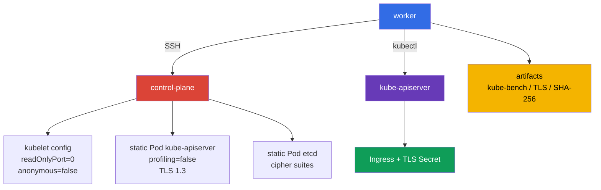

[Русская версия](README_RU.MD) · [Eng version](README.MD) · [Versión en español](README_ES.MD) · [Deutsche Version](README_DE.MD) · [ქართული ვერსია](README_GE.MD) · [繁體中文版](README_TW.MD) · [日本語版](README_JP.MD)

# Lab 103 - CIS/kube-bench, Secure Ingress TLS et vérification des binaires

## Description

Dans ce lab, vous configurez un cluster Kubernetes à deux nœuds (control-plane +
worker) en tant qu'ingénieur sécurité : vous installez `kube-bench` et, d'après ses constats
(et non de mémoire), vous corrigez les paramètres non sûrs des composants du control-plane et du kubelet
du nœud worker, vous publiez un Ingress uniquement en TLS, vous restreignez le TLS du control plane et
vous confirmez l'intégrité des binaires Kubernetes installés.

Ce n'est pas une répétition de la configuration de base de Kubernetes vue dans CKA. Ce qui compte ici, ce sont les endroits
où les réglages s'appliquent : `KubeletConfiguration`, les static Pod manifests du control plane, les paramètres TLS d'etcd
et les artefacts vérifiables du travail. Travaillez avec le nœud control plane via le nom SSH
`control-plane`, préparé sur le worker.

## Objectif

Consolider le contenu des chapitres du cours :

- [Chapitre 07. CIS Benchmark et kube-bench](../../course/07/fr.md)
- [Chapitre 08. Secure Ingress avec TLS](../../course/08/fr.md)
- [Chapitre 09. Arguments non sûrs des composants et vérification des binaires](../../course/09/fr.md)

## Vérifiez-vous avant de commencer

<details>
<summary>1. Pourquoi l'exécution de kube-bench avec le profil `cis-1.12` sur Kubernetes 1.36 ne peut-elle pas être qualifiée d'authoritative CIS compliance ?</summary>

La version `kube-bench 0.16.0`, figée dans ce lab, ne contient aucun profil pour 1.36 : son version mapping intégré ne va que jusqu'à `"1.34": "cis-1.12"` (le profil le plus récent disponible). En indiquant explicitement `--benchmark cis-1.12` sur un cluster 1.36, nous utilisons de force le profil existant le plus proche comme approximation : une partie des vérifications peut être sans objet pour une version plus récente, et les nouveaux paramètres relevant de la sécurité propres à 1.36, ce profil ne les couvre pas encore. C'est un signal pratique précieux, mais pas un formal compliance statement pour la version 1.36.
</details>

<details>
<summary>2. Pourquoi `--tls-cipher-suites` sur kube-apiserver ne configure-t-il pas les chiffrements précisément pour TLS 1.3 ?</summary>

En Go (dans lequel est écrit kube-apiserver), le flag `--tls-cipher-suites` ne contrôle que les cipher suites des versions TLS ≤ 1.2. Pour TLS 1.3, Go choisit lui-même l'ensemble des chiffrements dans une liste fixed, hardcoded - on ne peut pas les configurer par ce flag. C'est pourquoi la protection réelle est ici assurée par `--tls-min-version=VersionTLS13` (qui interdit entièrement les protocoles plus anciens), tandis que `--tls-cipher-suites` est pertinent là où TLS 1.2 est encore admis (par exemple, etcd dans ce lab).
</details>

<details>
<summary>3. Pourquoi ne peut-on pas utiliser comme référence pour la SHA-256 verification un hash calculé à partir du fichier vérifié lui-même ?</summary>

Si vous calculez le SHA-256 d'un fichier et le comparez à lui-même, la vérification passera toujours - même si le fichier a été remplacé par quelque chose de malveillant. La checksum de référence doit être obtenue d'une source indépendante et de confiance - la page officielle de la release Kubernetes, et non le fichier local que vous vérifiez.
</details>

## Ce que nous créons et pourquoi

| Objet ou artefact | Ce que c'est | Pourquoi dans ce lab |
|---|---|---|
| Rapport `kube-bench` | instantané des vérifications CIS du control-plane | consigne les recommandations initiales et sert de base au hardening |
| Kubelet configuration | paramètres du kubelet sur le nœud | désactive le read-only endpoint et l'anonymous access |
| Static Pod manifest d'apiserver | déclaration de kube-apiserver | désactive profiling et impose un TLS strict |
| TLS Secret et Ingress | TLS termination pour l'application | l'Ingress termine le TLS pour HTTPS sur `secure.cks.local`, et ingress-nginx redirige les requêtes HTTP ordinaires vers HTTPS via `ssl-redirect` |
| Static Pod manifest d'etcd | déclaration de l'etcd local | limite les TLS cipher suites autorisées |
| Artefact SHA-256 | résultat de la comparaison de `kubelet` et `kubectl` | confirme l'intégrité des binaires par rapport aux hashes de la release |



## Infrastructure

L'environnement est déployé dans AWS (`eu-central-1`) via Terragrunt.

| Composant | Description |
|---|---|
| `vpc` | VPC `10.103.0.0/16` avec des sous-réseaux publics |
| `ssh-keys` | clés SSH pour l'accès aux nœuds |
| `k8s-1` | Kubernetes `1.36.0` (kubeadm), containerd et Calico : control-plane + un nœud worker |
| `worker` | Machine de travail (bastion) avec `kubectl`, accès SSH et `check_result` (`kube-bench` lui-même n'est pas nécessaire ici - il est déjà sur `control-plane` et s'installe sur le nœud worker au cours du lab) |

> **Version et examen.** Au 2026-09-06, le CKS exam officiel part de Kubernetes `v1.35`. Ce lab utilise `1.36.0`, donc tout ce qui concerne cette version est un scénario pédagogique forward-looking, et non une affirmation sur la version actuelle de l'examen.

Le taint a été retiré du control-plane, on peut donc y lancer un Pod de lab si nécessaire.
Pour les tâches 2, 3 et 5, les static Pods sont recréés automatiquement par le kubelet après l'enregistrement
du manifest ou de la configuration modifiés. Ne supprimez pas manuellement les Pods du control-plane.

## Déploiement

```bash
TASK=103 make run_cks_task
```

Connectez-vous au worker en SSH. Le contexte est déjà configuré :

```bash
kubectl config use-context cluster1-admin@cluster1
time_left      # combien de temps il reste sur le lab
check_result   # lance les tests automatiques et affiche le résultat
```

L'adresse du control-plane peut être obtenue et vérifiée ainsi :

```bash
kubectl get nodes -o wide
ssh control-plane hostname
```

## Tâches

---

| **1** | **Rapport CIS Benchmark** |
| :---: | :--- |
| Ce qu'on fait | Sur le nœud `control-plane`, exécutez `kube-bench` pour Kubernetes `1.36.0`. Enregistrez l'evidence complète dans `/var/work/tests/artifacts/1/kube-bench.txt` : `kubernetes_version`, `kube_bench_version`, le `benchmark` choisi, `mapping_status`, puis le rapport lui-même. `kube-bench` est déjà installé sur `control-plane` (comme à l'examen réel, où les outils CIS Benchmark sont déjà présents sur les nœuds) - il n'est pas nécessaire de l'installer ni de le copier, c'est bien le nœud qui doit être vérifié. Le version mapping intégré à la version figée `kube-bench 0.16.0` se termine par l'entrée `"1.34": "cis-1.12"` - il n'y a pas de profils plus récents (y compris un quelconque profil pour 1.35/1.36) dans cette version. Lancez donc explicitement `--benchmark cis-1.12` et marquez le résultat sur `1.36` comme `forced-approximate`, et non comme authoritative compliance. **Exécutez l'ensemble complet des targets pour `cis-1.12` :** `--targets master,node,controlplane,etcd,policies` - c'est la carte des targets que kube-bench associe au profil `cis-1.12` ; omettre l'un d'eux donne un rapport incomplet. Sans `--targets` explicite, kube-bench détermine lui-même le type du nœud courant et prend pour lui non pas toute cette liste, mais un ensemble plus étroit - `etcd` et `policies` n'entrent pas dans une telle exécution auto-detected, le rapport sans `--targets` explicite sera donc incomplet. |
| Critères d'acceptation | - l'evidence contient les quatre champs version/mapping ;<br/>- `mapping_status=forced-approximate` explique explicitement l'absence de couverture officielle de `1.36` ;<br/>- le rapport contient les résultats de toutes les sections `master`, `node`, `controlplane`, `etcd`, `policies` (et pas seulement une ligne arbitraire `[PASS]`/`[WARN]`/`[FAIL]`) ;<br/>- le texte ne présente pas le résultat comme une authoritative CIS compliance pour Kubernetes `1.36`. |

<details>
<summary>💡 Indice pour la tâche 1</summary>

La vérification attend quatre lignes-marqueurs précises au début du fichier : `kubernetes_version=v1.36.x`, `kube_bench_version=v0.16.0`, `benchmark=cis-1.12`, `mapping_status=forced-approximate` - ce n'est pas du texte décoratif, mais un format que le test cherche littéralement. Lancez `kube-bench` sur le control-plane node lui-même, et non à distance depuis le worker - kube-bench n'a pas de mode « vérifier un nœud distant par SSH ». N'oubliez pas `--targets master,node,controlplane,etcd,policies` - sans indication explicite des targets, les sections `etcd` et `policies` peuvent être omises. `kube-bench` est déjà installé avec la configuration dans son répertoire standard `/etc/kube-bench/cfg`, il n'est donc pas nécessaire d'indiquer `--config-dir` dans ce lab - n'utilisez ce flag que si vous avez vous-même placé `cfg` dans un autre répertoire et que vous passez le chemin réel de cette copie.
</details>

---

| **2** | **Hardening du kubelet : read-only port et anonymous auth** |
| :---: | :--- |
| Ce qu'on fait | Sur le control-plane, trouvez et corrigez deux réglages non sûrs du kubelet : il sert encore le read-only port sans authentification et accepte les requêtes anonymes (voir le chapitre sur le hardening du kubelet). Utilisez le rapport `kube-bench` de la tâche 1 comme source de vérité : il a déjà signalé les deux problèmes dans la section `node` pour ce même nœud - trouvez-y les `[FAIL]` à côté de ces deux sujets et guidez-vous d'après eux. Corrigez la `kubelet configuration`, redémarrez le kubelet et attendez que le nœud soit prêt. Ne remplacez pas la vérification par un artefact texte : les réglages doivent être appliqués sur le nœud. |
| Critères d'acceptation | - dans la kubelet configuration en vigueur, le read-only port est désactivé ;<br/>- l'anonymous authentication du kubelet est désactivée ;<br/>- le nœud est `Ready` après le redémarrage. |

<details>
<summary>💡 Indice pour la tâche 2</summary>

Cherchez dans le rapport de la tâche 1 les checks `4.2.1` (`--anonymous-auth`) et `4.2.4` (`--read-only-port`) dans la section `node`. Dans `KubeletConfiguration` (`/var/lib/kubelet/config.yaml`), ils correspondent à `authentication.anonymous.enabled` et `readOnlyPort` - CIS exige `authentication.anonymous.enabled: false` et `readOnlyPort: 0`. `authentication.anonymous.enabled` se trouve IMBRIQUÉ, sous la clé `authentication.anonymous`, et non comme un champ top-level distinct `anonymous: false` - vérifiez attentivement l'indentation du YAML. Après avoir modifié config.yaml, il faut redémarrer le service kubelet lui-même (`systemctl restart kubelet`) ; modifier le fichier ne suffit pas à appliquer les changements au processus en cours.
</details>

---

| **3** | **Hardening de kube-apiserver : désactiver profiling** |
| :---: | :--- |
| Ce qu'on fait | kube-apiserver sert encore le pprof HTTP endpoint de profiling du processus. Utilisez le rapport `kube-bench` de la tâche 1 comme source de vérité : il a déjà signalé ce problème dans la section `master` pour le même nœud - trouvez-y le `[FAIL]` à côté de ce sujet et guidez-vous d'après lui. Corrigez le static Pod manifest de kube-apiserver, attendez la recréation et assurez-vous que l'API est prête. |
| Critères d'acceptation | - le Pod kube-apiserver réellement en cours d'exécution contient `--profiling=false` dans son `command` (vérifié via l'API, et non par le texte du fichier sur disque) ;<br/>- `kubectl get --raw='/readyz'` renvoie un résultat réussi ;<br/>- le static Pod kube-apiserver est en cours d'exécution. |

<details>
<summary>💡 Indice pour la tâche 3</summary>

Cherchez dans le rapport de la tâche 1 le check `1.2.15` (`--profiling`) dans la section `master`. Il correspond au flag `--profiling=false` dans le `command` du static Pod manifest `/etc/kubernetes/manifests/kube-apiserver.yaml`. Ne modifiez pas le Pod via `kubectl edit` - c'est un static Pod, le kubelet le gère directement à partir du fichier de manifest sur disque et réécrira en retour toute modification faite via l'API. Ajoutez le flag directement dans le fichier YAML sur le nœud et patientez : le kubelet ne remarque pas instantanément la modification du fichier.
</details>

---

| **4** | **Secure Ingress avec TLS** |
| :---: | :--- |
| Ce qu'on fait | • Générez un certificat auto-signé pour `secure.cks.local` avec ce nom précisément dans le Subject Alternative Name, et pas seulement dans le CN (la commande est dans l'indice).<br/>• Créez le namespace `cks-103` et, à partir de ce certificat, le TLS-Secret `secure-ingress-tls` de type `kubernetes.io/tls`.<br/>• Déployez le Deployment `secure-app` (`viktoruj/ping_pong:alpine`, `SERVER_NAME=secure-app` et `SRV_PORT=80` via `kubectl set env`) et le Service `secure-app`.<br/>• Créez l'Ingress `secure-ingress` avec `ingressClassName: nginx`, une section TLS pour cet hôte avec une référence à `secure-ingress-tls` et l'annotation `nginx.ingress.kubernetes.io/ssl-redirect: "true"`.<br/>• Le controller `ingress-nginx` est déjà installé et Ready dans ce lab en tant que lab-owned fixture (voir le [chapitre 08](../../course/08/fr.md) sur son retirement) - assurez-vous qu'il traite réellement votre Ingress (voir les critères d'acceptation). |
| Critères d'acceptation | - le Secret `secure-ingress-tls` dans `cks-103` est de type `kubernetes.io/tls` et a les champs `tls.crt`, `tls.key` ; la correspondance de la paire est vérifiée par la public key (indépendamment de l'algorithme, sans dépendre de RSA/modulus) ;<br/>- le certificat contient `secure.cks.local` dans le SAN ;<br/>- l'Ingress `secure-ingress` contient `ingressClassName: nginx`, l'annotation `ssl-redirect: "true"`, `spec.tls` avec l'hôte `secure.cks.local` et la référence à `secure-ingress-tls`, backend `secure-app:80` ;<br/>- le Service `secure-app` a un vrai endpoint ;<br/>- le controller `ingress-nginx` est Ready ;<br/>- une requête HTTPS via le controller renvoie réellement `200` avec un corps contenant `Server Name: secure-app` (et pas n'importe quel `2xx`/`3xx` que le controller peut renvoyer lui-même sans accès au backend) ;<br/>- une requête HTTP via le controller reçoit un redirect avec l'en-tête `Location` pointant vers le HTTPS-host `https://secure.cks.local` (pas n'importe quel `3xx` ; le chemin après l'hôte est facultatif). |

<details>
<summary>💡 Indice pour la tâche 4</summary>

À l'examen réel, le certificat est généralement déjà fourni à l'avance - ici, il faut le générer vous-même :

```bash
openssl req -x509 -nodes -newkey ec -pkeyopt ec_paramgen_curve:P-256 \
  -keyout tls.key -out tls.crt -days 30 \
  -subj "/CN=secure.cks.local" -addext "subjectAltName=DNS:secure.cks.local"
```

`-addext 'subjectAltName=DNS:secure.cks.local'` est obligatoire - les clients modernes et l'Ingress controller vérifient précisément le SAN, et pas seulement le CN. Créez le TLS Secret via `kubectl create secret tls secure-ingress-tls --cert=tls.crt --key=tls.key` - cela définit automatiquement le bon `type: kubernetes.io/tls` et encode correctement les données en base64. Si vous créez le Secret à la main avec le type `Opaque` et les clés `tls.crt`/`tls.key`, le test sur le `type` échouera, même si les données sont techniquement valides.

La vérification de la paire certificate/private key se fait par la public key, et non par le modulus spécifique à RSA - cela fonctionne de la même façon pour les clés RSA et EC/ECDSA :

```bash
cert_pub=$(kubectl -n cks-103 get secret secure-ingress-tls -o jsonpath='{.data.tls\.crt}' \
  | base64 -d | openssl x509 -pubkey -noout | openssl pkey -pubin -outform DER | sha256sum | awk '{print $1}')
key_pub=$(kubectl -n cks-103 get secret secure-ingress-tls -o jsonpath='{.data.tls\.key}' \
  | base64 -d | openssl pkey -pubout -outform DER | sha256sum | awk '{print $1}')
[[ -n "$cert_pub" && "$cert_pub" == "$key_pub" ]]
```

Pour une vérification end-to-end, n'utilisez pas le Pod IP des `Endpoints` du controller - il n'est pas garanti qu'il soit routable depuis une VM worker distincte. `secure.cks.local` se résout déjà en une vraie node IP (l'entrée a été ajoutée dans `/etc/hosts` de cette machine lors du bootstrap), et `ingress-nginx-controller` est un Service de type `NodePort`, ouvert sur chaque nœud, la requête peut donc être faite directement depuis le worker, sans SSH vers le cluster :

```bash
HTTPS_NODEPORT=$(kubectl -n ingress-nginx get svc ingress-nginx-controller -o jsonpath='{.spec.ports[?(@.port==443)].nodePort}')
curl -sS -k --max-time 5 "https://secure.cks.local:${HTTPS_NODEPORT}/"
```

La vérification du redirect HTTP→HTTPS n'est pas une exigence artificielle de ce lab, mais une vraie question d'examen (voir le mock-examen `tasks/cks/mock/04`, tâche 4 : `Create an Ingress with a redirect from HTTP to HTTPS`).
</details>

---

| **5** | **TLS hardening du control plane** |
| :---: | :--- |
| Ce qu'on fait | Dans `/etc/kubernetes/manifests/kube-apiserver.yaml`, définissez `--tls-min-version=VersionTLS13` et `--tls-cipher-suites=TLS_ECDHE_RSA_WITH_AES_128_GCM_SHA256,TLS_ECDHE_RSA_WITH_AES_256_GCM_SHA384`. Dans `/etc/kubernetes/manifests/etcd.yaml`, définissez `--cipher-suites` avec le même ensemble. Après la recréation des composants, confirmez que `TLSv1.3` est négocié (`openssl s_client -tls1_3`) et que `TLSv1.2` est rejeté (`openssl s_client -tls1_2` se termine par une erreur de handshake), et enregistrez la sortie dans `/var/work/tests/artifacts/5/tls13.txt`. Il est important de comprendre la sémantique : en Go, le flag `--tls-cipher-suites` n'agit que pour TLS ≤ 1.2, et avec `--tls-min-version=VersionTLS13` les TLS 1.3 cipher suites concrètes ne sont pas configurées par ce flag (Go les choisit lui-même). C'est pourquoi, pour kube-apiserver, la protection réelle est ici assurée précisément par la min-version 1.3 ; les cipher-suites sont significatives là où TLS 1.2 est admis (par exemple, pour etcd). |
| Critères d'acceptation | - les deux flags TLS requis sont dans le manifest de kube-apiserver ;<br/>- les cipher suites sont dans le manifest d'etcd ;<br/>- kube-apiserver et etcd sont sains ;<br/>- l'artefact TLS contient la confirmation de `TLSv1.3` et un refus enregistré de TLS 1.2 (non-zero exit/handshake failure). |

<details>
<summary>💡 Indice pour la tâche 5</summary>

Le flag sur etcd s'appelle `--cipher-suites` (sans `tls-` au début) - c'est un AUTRE nom de flag par rapport à `--tls-cipher-suites` sur kube-apiserver. Confondre les noms des flags est une erreur fréquente. Vérifiez avec deux commandes distinctes `openssl s_client -connect <host>:6443 -tls1_3` (doit se connecter avec succès) et `-tls1_2` (doit se terminer par une erreur de handshake) - toutes deux sur le port de kube-apiserver, et non d'etcd.
</details>

---

| **6** | **Vérification de l'intégrité de kubelet et kubectl** |
| :---: | :--- |
| Ce qu'on fait | Comparez le SHA-256 des `kubelet` installés sur le control-plane et de `kubectl` sur le worker avec les checksum publiées de Kubernetes `v1.36.0`. Enregistrez les commandes et le résultat de `sha256sum -c` dans `/var/work/tests/artifacts/6/binaries.sha256.txt`. N'utilisez pas comme référence des hashes calculés à partir du fichier vérifié lui-même. |
| Critères d'acceptation | - l'artefact existe ;<br/>- il contient des résultats réussis distincts pour `kubelet` et `kubectl` (`OK`) ;<br/>- les sommes de référence ont été obtenues de la release officielle `v1.36.0`. |

<details>
<summary>💡 Indice pour la tâche 6</summary>

Téléchargez le fichier officiel `kubelet.sha256`/`kubectl.sha256` depuis `https://dl.k8s.io/release/v1.36.0/bin/linux/amd64/` (ou de la plateforme correspondante) et utilisez `sha256sum -c` avec ce fichier contre le binaire réellement installé - c'est précisément la sortie de cette commande (`kubelet: OK`, `kubectl: OK`) qu'il faut dans l'artefact, et pas simplement le hash lui-même.
</details>

---

| **7** | **Remediation cycle : d'un kube-bench FAIL concret à PASS** |
| :---: | :--- |
| Ce qu'on fait | Le rapport de la tâche 1 est un instantané de l'état actuel ; ici, il faut relier un test échoué concret à sa correction. Sur le control-plane, exécutez `kube-bench` précisément avec `--check 1.1.1` (droits du static Pod manifest de kube-apiserver ; l'infrastructure du lab positionne volontairement le mode `0644`, `cis-1.12` exige `600` ou plus strict) et enregistrez la sortie **avant** la correction dans `/var/work/tests/artifacts/7/before.txt` - elle doit contenir `[FAIL]` pour ce test. Corrigez le droit d'accès du fichier `/etc/kubernetes/manifests/kube-apiserver.yaml` (`chmod 600`), puis relancez le même `--check 1.1.1` et enregistrez la sortie dans `/var/work/tests/artifacts/7/after.txt` - elle doit contenir `[PASS]` sans un seul `[FAIL]` pour ce check. |
| Critères d'acceptation | `before.txt` contient la ligne `[FAIL]` pour le check `1.1.1` ; les droits réels du fichier sur le nœud après la correction sont exactement `600` ; `after.txt` contient `[PASS]` pour le check `1.1.1` et ne contient pas `[FAIL]` pour lui ; kube-apiserver reste sain après la modification (correction fs-only, le composant n'est pas recréé). |

<details>
<summary>💡 Indice pour la tâche 7</summary>

Cette tâche porte sur l'ordre des actions, et pas seulement sur l'état final : enregistrez d'abord le `[FAIL]` (before.txt), ce n'est qu'ensuite que vous faites `chmod 600`, puis vous relancez la vérification (after.txt). Si vous faites `chmod` avant d'enregistrer before.txt, vous n'obtiendrez pas le `[FAIL]` nécessaire dans le premier artefact. Changer les droits du fichier est une opération fs-only, le kubelet ne recrée pas le static Pod à cause du changement de droits du fichier de manifest lui-même (contrairement à la modification de son contenu).
</details>

---

| **8** | **Remediation cycle : kube-controller-manager, la même technique pour un autre composant** |
| :---: | :--- |
| Ce qu'on fait | La même chose que dans la tâche 7, mais pour `kube-controller-manager` et un autre check ID : `--check 1.1.3` (droits du static Pod manifest de kube-controller-manager ; l'infrastructure du lab positionne volontairement le mode `0644`). Enregistrez la sortie **avant** la correction dans `/var/work/tests/artifacts/8/before.txt` (doit contenir `[FAIL]` pour `1.1.3`), corrigez par `chmod 600 /etc/kubernetes/manifests/kube-controller-manager.yaml`, puis enregistrez la nouvelle exécution dans `/var/work/tests/artifacts/8/after.txt` (doit contenir `[PASS]` sans `[FAIL]` pour `1.1.3`). |
| Critères d'acceptation | `before.txt` contient la ligne `[FAIL]` pour le check `1.1.3` ; les droits du fichier après la correction sont exactement `600` ; `after.txt` contient `[PASS]` pour `1.1.3` et ne contient pas `[FAIL]` pour lui ; `kube-controller-manager` reste `Running` (correction fs-only, le composant n'est pas recréé). |

<details>
<summary>💡 Indice pour la tâche 8</summary>

Le même ordre d'actions que dans la tâche 7 : d'abord `before.txt` avec `[FAIL]`, puis `chmod`, puis `after.txt` avec `[PASS]`. Ne reportez pas les anciens CIS check ID « de mémoire » - `1.1.3` dans la version figée `kube-bench 0.16.0`/profil `cis-1.12` est précisément kube-controller-manager pod specification file permissions, vérifiez-le via `--check 1.1.3` avant de corriger.
</details>

---

| **9** | **Remediation cycle : profiling sur kube-controller-manager et kube-scheduler** |
| :---: | :--- |
| Ce qu'on fait | La même technique que dans les tâches 7-8, pour les checks `1.3.2` (kube-controller-manager profiling) et `1.4.1` (kube-scheduler profiling) - tous deux sous le même profil `cis-1.12`, un `--targets` explicite n'est pas nécessaire. Exécutez `kube-bench --check 1.3.2` et `--check 1.4.1` sur `control-plane` et enregistrez la sortie **avant** la correction dans `/var/work/tests/artifacts/9/controller-manager-before.txt` et `.../scheduler-before.txt` - les deux doivent contenir `[FAIL]`. La tâche 3 a déjà désactivé profiling sur kube-apiserver ; par défaut, kubeadm n'ajoute pas du tout `--profiling=false` aux manifests de `kube-controller-manager`/`kube-scheduler`. Ajoutez `--profiling=false` au `command` des deux static Pod manifests, attendez la recréation et relancez les mêmes check, en enregistrant la sortie dans `.../controller-manager-after.txt` et `.../scheduler-after.txt` - les deux doivent contenir `[PASS]` sans un seul `[FAIL]`. |
| Critères d'acceptation | les fichiers `before` contiennent `[FAIL]` pour `1.3.2`/`1.4.1` respectivement ; les Pods réellement en cours d'exécution `kube-controller-manager`/`kube-scheduler` contiennent `--profiling=false` dans leur `command` (vérifié via l'API) ; les fichiers `after` contiennent `[PASS]` sans `[FAIL]` pour les mêmes check ; les deux Pod en phase `Running`. |

<details>
<summary>💡 Indice pour la tâche 9</summary>

Le même ordre d'actions que dans les tâches 7-8 : d'abord `before.txt` avec `[FAIL]`, puis la modification du manifest, puis `after.txt` avec `[PASS]`. Ne modifiez pas le Pod via `kubectl edit` - le kubelet écrasera toute modification de ce genre à partir du fichier sur disque. Ajoutez le flag directement dans le YAML sur le nœud et attendez la recréation - elle n'est pas instantanée. Ne confondez pas cette tâche avec `protectKernelDefaults` (tâche 10, un paramètre kubelet distinct du nœud worker) - il s'agit ici précisément du HTTP profiling endpoint des composants du control-plane.
</details>

---

| **10** | **Remediation cycle : protect-kernel-defaults sur le nœud worker** |
| :---: | :--- |
| Ce qu'on fait | La même technique que dans les tâches 7-9, maintenant sur le nœud worker RÉEL du cluster (et non sur le control-plane), mais pour un AUTRE profil : le `cis-1.12` figé (utilisé partout dans ce lab) ne contient pas du tout le check protect-kernel-defaults - CIS l'a supprimé/renuméroté dans cette version du profil, et le `4.2.6` propre de `cis-1.12` est un autre check (`--make-iptables-util-chains`, PASS par défaut). Le check nécessaire avec le même ID existe dans le profil plus ancien `cis-1.24` du même binaire - utilisez explicitement `--benchmark cis-1.24 --check 4.2.6` uniquement pour cette tâche. Contrairement à `control-plane`, `kube-bench` sur le nœud worker N'est PAS préinstallé - installez-le ici vous-même (une vraie installation : télécharger la même release figée, décompresser `binary` et `cfg`), et ne le copiez pas de quelque part. Enregistrez la sortie **avant** la correction dans `/var/work/tests/artifacts/10/before.txt` (doit contenir `[FAIL]` avec le texte sur protect-kernel-defaults). Le `KubeletConfiguration` généré par kubeadm sur le nœud worker ne contient pas du tout le champ `protectKernelDefaults` (équivalent au default non sûr `false`) - ajoutez `protectKernelDefaults: true` à `/var/lib/kubelet/config.yaml` de ce nœud, redémarrez le kubelet, attendez `Ready`, puis relancez le même check (avec le même `cis-1.24`) et enregistrez `/var/work/tests/artifacts/10/after.txt` (doit contenir `[PASS]`). |
| Critères d'acceptation | `before.txt` contient `[FAIL] 4.2.6` avec le texte sur protect-kernel-defaults (pas n'importe quel `4.2.6`) ; dans la kubelet configuration en vigueur du nœud worker (`/configz`) il y a `protectKernelDefaults: true` ; `after.txt` contient `[PASS] 4.2.6` avec le même texte, sans `[FAIL]` ; le nœud worker est `Ready` après le redémarrage. |

<details>
<summary>💡 Indice pour la tâche 10</summary>

Trouvez le nom du nœud worker via `kubectl get nodes -l '!node-role.kubernetes.io/control-plane'` - ce n'est PAS le control-plane et PAS la machine de travail (bastion) depuis laquelle vous exécutez les commandes. Installez `kube-bench` dessus avec une vraie commande (`curl` + `tar` + `install`), sans copier depuis le control-plane ni le worker PC - contrairement au control-plane, il y est absent exprès, pour que vous passiez une fois par le processus d'installation lui-même. N'oubliez pas `--benchmark cis-1.24` (et non `cis-1.12`, utilisé partout dans les autres tâches) - sinon `--check 4.2.6` trouvera un autre check, qui passe déjà, et la tâche ne démontrera rien. Le champ `protectKernelDefaults` est physiquement absent du `config.yaml` généré par kubeadm, ajoutez-le donc simplement à la fin, ne cherchez pas de ligne existante à remplacer (contrairement à `readOnlyPort` dans la tâche 2). Après `systemctl restart kubelet` sur le nœud worker, attendez son retour à `Ready` avant de relancer le check.
</details>

---

## Vérification du résultat

Sur le worker, lancez :

```bash
check_result
```

La vérification contient Init et dix tâches indépendantes. Les tâches système sont vérifiées par
l'état des nœuds control plane/worker via SSH et par les artefacts, et pas seulement par les objets de l'API.

## Solution

Solution de référence : [worker/files/solutions/1_FR.MD](worker/files/solutions/1_FR.MD).

## Suppression du cluster et des ressources

```bash
TASK=103 make delete_cks_task
```
