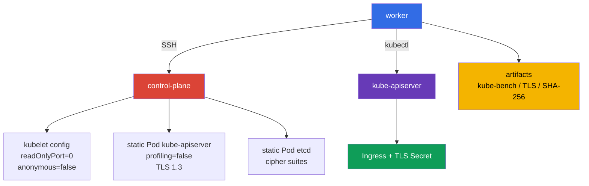

[Русская версия](README_RU.MD) · [Eng version](README.MD) · [Versión en español](README_ES.MD) · [Version française](README_FR.MD) · [Deutsche Version](README_DE.MD) · [繁體中文版](README_TW.MD) · [日本語版](README_JP.MD)

# Lab 103 - CIS/kube-bench, Secure Ingress TLS და binary-ების შემოწმება

## აღწერა

ამ ლაბორატორიულ სამუშაოში თქვენ აგებთ ორკვანძიან Kubernetes-კლასტერს (control-plane +
worker) როგორც უსაფრთხოების ინჟინერი: აყენებთ `kube-bench`-ს და მისი აღმოჩენების მიხედვით
(და არა მეხსიერებით) ასწორებთ control-plane კომპონენტებისა და worker-node-ის kubelet-ის
სახიფათო პარამეტრებს, აქვეყნებთ Ingress-ს მხოლოდ TLS-ით, ზღუდავთ control plane-ის TLS-ს და
ადასტურებთ დაყენებული Kubernetes-binary-ების მთლიანობას.

ეს არ არის CKA-დან Kubernetes-ის ბაზისური გამართვის გამეორება. აქ მნიშვნელოვანია პარამეტრების
გამოყენების ადგილები: `KubeletConfiguration`, control plane-ის static Pod manifests, etcd-ის TLS-პარამეტრები
და სამუშაოს შემოწმებადი artifacts. control plane node-თან იმუშავეთ SSH-სახელით
`control-plane`, რომელიც worker-ზეა მომზადებული.

## მიზანი

განამტკიცეთ კურსის თავების მასალა:

- [თავი 07. CIS Benchmark და kube-bench](../../course/07/ge.md)
- [თავი 08. Secure Ingress TLS-ით](../../course/08/ge.md)
- [თავი 09. კომპონენტების არასაიმედო არგუმენტები და binary-ების შემოწმება](../../course/09/ge.md)

## შეამოწმეთ თავი სტარტამდე

<details>
<summary>1. რატომ არ შეიძლება kube-bench-ის გაშვებას პროფილით `cis-1.12` Kubernetes 1.36-ზე ვუწოდოთ authoritative CIS compliance?</summary>

ამ ლაბში დაფიქსირებული ვერსია `kube-bench 0.16.0` 1.36-ის პროფილს საერთოდ არ შეიცავს - მისი ჩაშენებული version mapping მხოლოდ `"1.34": "cis-1.12"`-მდე აღწევს (ყველაზე ახალი ხელმისაწვდომი პროფილი). 1.36-იან კლასტერზე `--benchmark cis-1.12`-ის აშკარა მითითებით ჩვენ იძულებით ვიყენებთ უახლოეს არსებულ პროფილს როგორც approximation-ს: ზოგი შემოწმება შეიძლება უფრო ახალი ვერსიისთვის აქტუალური არ იყოს, ხოლო სწორედ 1.36-ის ახალ security-relevant პარამეტრებს ეს პროფილი ჯერ არ ფარავს. ეს ღირებული პრაქტიკული სიგნალია, მაგრამ არა formal compliance statement ვერსია 1.36-ისთვის.
</details>

<details>
<summary>2. რატომ არ აკონფიგურირებს `--tls-cipher-suites` kube-apiserver-ზე შიფრებს სწორედ TLS 1.3-ისთვის?</summary>

Go-ში (რომელზეც kube-apiserver არის დაწერილი) ფლაგი `--tls-cipher-suites` მართავს მხოლოდ cipher suites-ს TLS ვერსიებისთვის ≤ 1.2. TLS 1.3-ისთვის Go თავად ირჩევს შიფრების ნაკრებს fixed, hardcoded სიიდან - მათი კონფიგურაცია ამ ფლაგით შეუძლებელია. ამიტომ რეალურ დაცვას აქ იძლევა `--tls-min-version=VersionTLS13` (კრძალავს უფრო ძველ პროტოკოლებს მთლიანად), ხოლო `--tls-cipher-suites` აქტუალურია იქ, სადაც TLS 1.2 კვლავ დაშვებულია (მაგალითად, etcd ამ ლაბში).
</details>

<details>
<summary>3. რატომ არ შეიძლება შემოწმებადი ფაილიდან თავად გამოთვლილი hash-ის გამოყენება SHA-256 verification-ის ეტალონად?</summary>

თუ ფაილის SHA-256 გამოვთვალეთ და თავად მასთან შევადარეთ, შემოწმება ყოველთვის გაივლის - მაშინაც კი, თუ ფაილი რაიმე მავნეთი ჩანაცვლდა. ეტალონური checksum უნდა იყოს მიღებული დამოუკიდებელი, სანდო წყაროდან - Kubernetes-ის რელიზის ოფიციალური გვერდიდან, და არა ლოკალური ფაილიდან, რომელსაც ამოწმებთ.
</details>

## რას ვქმნით და რისთვის

| ობიექტი ან artifact | რა არის ეს | რისთვის არის ამ ლაბში |
|---|---|---|
| `kube-bench` ანგარიში | control-plane-ის CIS-შემოწმებების snapshot | აფიქსირებს საწყის რეკომენდაციებს და hardening-ის საფუძველია |
| Kubelet configuration | kubelet-ის პარამეტრები node-ზე | თიშავს read-only endpoint-სა და anonymous access-ს |
| Static Pod manifest apiserver | kube-apiserver-ის დეკლარაცია | თიშავს profiling-ს და აწესებს მკაცრ TLS-ს |
| TLS Secret და Ingress | TLS termination აპლიკაციისთვის | Ingress ასრულებს TLS-ს HTTPS-ისთვის `secure.cks.local`-ზე, ხოლო ingress-nginx ჩვეულებრივ HTTP-მოთხოვნებს HTTPS-ზე გადაამისამართებს `ssl-redirect`-ით |
| Static Pod manifest etcd | ლოკალური etcd-ის დეკლარაცია | ზღუდავს დასაშვებ TLS cipher suites-ს |
| SHA-256 artifact | `kubelet`-ისა და `kubectl`-ის შეჯერების შედეგი | ადასტურებს binary-ების მთლიანობას რელიზის hash-ებთან მიმართებით |



## ინფრასტრუქტურა

გარემო იშლება AWS-ში (`eu-central-1`) Terragrunt-ის მეშვეობით.

| კომპონენტი | აღწერა |
|---|---|
| `vpc` | VPC `10.103.0.0/16` საჯარო ქვექსელებით |
| `ssh-keys` | SSH-გასაღებები node-ებზე წვდომისთვის |
| `k8s-1` | Kubernetes `1.36.0` (kubeadm), containerd და Calico: control-plane + ერთი worker-node |
| `worker` | სამუშაო მანქანა (bastion) `kubectl`-ით, SSH-წვდომით და `check_result`-ით (თავად `kube-bench` აქ არ არის საჭირო - ის უკვე არის `control-plane`-ზე და worker-node-ზე ლაბის მსვლელობისას დაყენდება) |

> **ვერსია და გამოცდა.** 2026-09-06-ის მდგომარეობით ოფიციალური CKS exam ეყრდნობა Kubernetes `v1.35`-ს. ეს ლაბი იყენებს `1.36.0`-ს, ამიტომ ყველაფერი, რაც ამ ვერსიას ეხება, არის forward-looking სასწავლო სცენარი და არა განცხადება გამოცდის მიმდინარე ვერსიის შესახებ.

control-plane-დან მოხსნილია taint, ამიტომ საჭიროების შემთხვევაში მასზე სასწავლო Pod-ის გაშვება შეიძლება.
დავალებებისთვის 2, 3 და 5 static Pods ავტომატურად თავიდან იქმნება kubelet-ის მიერ შეცვლილი
manifest-ის ან კონფიგურაციის შენახვის შემდეგ. control-plane Pods ხელით ნუ წაშლით.

## განთავსება

```bash
TASK=103 make run_cks_task
```

დაუკავშირდით worker-ს SSH-ით. კონტექსტი უკვე გამართულია:

```bash
kubectl config use-context cluster1-admin@cluster1
time_left      # რამდენი დრო დარჩა ლაბზე
check_result   # უშვებს ავტომატურ ტესტებს და აჩვენებს შედეგს
```

control-plane-ის მისამართის მიღება და შემოწმება ასე შეიძლება:

```bash
kubectl get nodes -o wide
ssh control-plane hostname
```

## დავალებები

---

| **1** | **CIS Benchmark-ის ანგარიში** |
| :---: | :--- |
| რას ვაკეთებთ | `control-plane` node-ზე გაუშვით `kube-bench` Kubernetes `1.36.0`-ისთვის. შეინახეთ სრული evidence `/var/work/tests/artifacts/1/kube-bench.txt`-ში: `kubernetes_version`, `kube_bench_version`, არჩეული `benchmark`, `mapping_status`, შემდეგ თავად ანგარიში. `kube-bench` `control-plane`-ზე უკვე დაყენებულია (როგორც რეალურ გამოცდაზე, სადაც CIS Benchmark tooling node-ებზე უკვე არის) - მისი დაყენება ან კოპირება არ არის საჭირო, უნდა შემოწმდეს სწორედ node. დაფიქსირებულ ვერსიაში `kube-bench 0.16.0` ჩაშენებული version mapping მთავრდება ჩანაწერით `"1.34": "cis-1.12"` - უფრო ახალი პროფილები (1.35/1.36-ის რომელიმე პროფილის ჩათვლით) ამ ვერსიაში საერთოდ არ არის. ამიტომ გაუშვით `--benchmark cis-1.12` აშკარად და `1.36`-ზე შედეგი მონიშნეთ როგორც `forced-approximate`, და არა authoritative compliance. **გაუშვით targets-ის სრული ნაკრები `cis-1.12`-ისთვის:** `--targets master,node,controlplane,etcd,policies` - ეს არის targets-ის რუკა, რომელსაც kube-bench `cis-1.12` პროფილს უკავშირებს; რომელიმეს გამოტოვება არასრულ ანგარიშს იძლევა. აშკარა `--targets`-ის გარეშე kube-bench თავად ადგენს მიმდინარე node-ის ტიპს და მისთვის იღებს არა ამ მთელ სიას, არამედ უფრო ვიწრო ნაკრებს - `etcd` და `policies` ასეთ auto-detected გაშვებაში არ ხვდება, ამიტომ ანგარიში აშკარა `--targets`-ის გარეშე არასრული იქნება. |
| მიღების კრიტერიუმები | - evidence შეიცავს ოთხივე version/mapping ველს;<br/>- `mapping_status=forced-approximate` აშკარად განმარტავს `1.36`-ის ოფიციალური დაფარვის არარსებობას;<br/>- ანგარიშში არის ყველა `master`, `node`, `controlplane`, `etcd`, `policies` სექციის შედეგები (და არა მხოლოდ თვითნებური სტრიქონი `[PASS]`/`[WARN]`/`[FAIL]`);<br/>- ტექსტი შედეგს არ გასცემს Kubernetes `1.36`-ის authoritative CIS compliance-ად. |

<details>
<summary>💡 მინიშნება დავალება 1-ისთვის</summary>

შემოწმება ელის ოთხ კონკრეტულ სტრიქონს-მარკერს ფაილის დასაწყისში: `kubernetes_version=v1.36.x`, `kube_bench_version=v0.16.0`, `benchmark=cis-1.12`, `mapping_status=forced-approximate` - ეს არ არის დეკორატიული ტექსტი, არამედ ფორმატი, რომელსაც ტესტი სიტყვასიტყვით ეძებს. გაუშვით `kube-bench` თავად control-plane node-ზე, და არა worker-იდან დისტანციურად - kube-bench-ს არ აქვს რეჟიმი "სხვის node-ს SSH-ით შემოწმება". არ დაგავიწყდეთ `--targets master,node,controlplane,etcd,policies` - targets-ის აშკარა მითითების გარეშე `etcd` და `policies` სექციები შეიძლება გამოტოვებული იყოს. `kube-bench` უკვე დაყენებულია კონფიგურაციასთან ერთად თავის სტანდარტულ დირექტორიაში `/etc/kube-bench/cfg`, ამიტომ `--config-dir`-ის მითითება ამ ლაბში საჭირო არ არის - გამოიყენეთ ეს ფლაგი მხოლოდ თუ `cfg` თავად სხვა დირექტორიაში განათავსეთ და გადასცემთ ამ ასლის ფაქტობრივ გზას.
</details>

---

| **2** | **kubelet-ის hardening: read-only port და anonymous auth** |
| :---: | :--- |
| რას ვაკეთებთ | control-plane-ზე იპოვეთ და აღმოფხვრეთ kubelet-ის ორი სახიფათო პარამეტრი: ის კვლავ ემსახურება read-only პორტს ავტენტიფიკაციის გარეშე და იღებს ანონიმურ მოთხოვნებს (იხ. თავი kubelet-ის hardening-ის შესახებ). გამოიყენეთ `kube-bench`-ის ანგარიში დავალება 1-დან როგორც ჭეშმარიტების წყარო: ის უკვე აღნიშნავს ორივე პრობლემას სექციაში `node` ამავე node-ისთვის - იპოვეთ იქ `[FAIL]` ამ ორი თემის გვერდით და მათზე ორიენტირდით. გაასწორეთ `kubelet configuration`, გადატვირთეთ kubelet და დაელოდეთ node-ის მზადყოფნას. შემოწმებას ტექსტური artifact-ით ნუ ჩაანაცვლებთ: პარამეტრები node-ზე უნდა იყოს გამოყენებული. |
| მიღების კრიტერიუმები | - მოქმედ kubelet configuration-ში read-only პორტი გამორთულია;<br/>- kubelet-ის anonymous authentication გამორთულია;<br/>- node `Ready`-ა გადატვირთვის შემდეგ. |

<details>
<summary>💡 მინიშნება დავალება 2-ისთვის</summary>

ეძებეთ დავალება 1-ის ანგარიშში checks `4.2.1` (`--anonymous-auth`) და `4.2.4` (`--read-only-port`) სექციაში `node`. `KubeletConfiguration`-ში (`/var/lib/kubelet/config.yaml`) მათ შეესაბამება `authentication.anonymous.enabled` და `readOnlyPort` - CIS მოითხოვს `authentication.anonymous.enabled: false` და `readOnlyPort: 0`. `authentication.anonymous.enabled` მდებარეობს ჩადგმულად, key-ის `authentication.anonymous` ქვეშ, და არა როგორც ცალკე top-level ველი `anonymous: false` - YAML-ის ჩაღრმავებები ყურადღებით შეამოწმეთ. config.yaml-ის შესწორების შემდეგ საჭიროა თავად kubelet-სერვისის გადატვირთვა (`systemctl restart kubelet`), ფაილის რედაქტირება თავისთავად არ ამოქმედებს ცვლილებებს მუშა პროცესზე.
</details>

---

| **3** | **kube-apiserver-ის hardening: profiling-ის გამორთვა** |
| :---: | :--- |
| რას ვაკეთებთ | kube-apiserver დღემდე ემსახურება pprof HTTP endpoint-ს პროცესის პროფილირებისთვის. გამოიყენეთ `kube-bench`-ის ანგარიში დავალება 1-დან როგორც ჭეშმარიტების წყარო: ის უკვე აღნიშნავს ამ პრობლემას სექციაში `master` იმავე node-ისთვის - იპოვეთ იქ `[FAIL]` ამ თემის გვერდით და მასზე ორიენტირდით. გაასწორეთ kube-apiserver-ის static Pod manifest, დაელოდეთ თავიდან შექმნას და დარწმუნდით, რომ API მზადაა. |
| მიღების კრიტერიუმები | - რეალურად გაშვებული kube-apiserver Pod თავის `command`-ში შეიცავს `--profiling=false`-ს (მოწმდება API-ს გავლით, და არა დისკზე ფაილის ტექსტით);<br/>- `kubectl get --raw='/readyz'` აბრუნებს წარმატებულ შედეგს;<br/>- static Pod kube-apiserver გაშვებულია. |

<details>
<summary>💡 მინიშნება დავალება 3-ისთვის</summary>

ეძებეთ დავალება 1-ის ანგარიშში check `1.2.15` (`--profiling`) სექციაში `master`. მას შეესაბამება ფლაგი `--profiling=false` static Pod manifest-ის `/etc/kubernetes/manifests/kube-apiserver.yaml` `command`-ში. Pod-ს ნუ დაარედაქტირებთ `kubectl edit`-ით - ეს static Pod-ია, kubelet მას პირდაპირ მართავს დისკზე არსებული manifest-ფაილიდან და API-ს გავლით ნებისმიერ ცვლილებას უკან გადაწერს. დაამატეთ ფლაგი პირდაპირ node-ზე YAML-ფაილში და დაელოდეთ: kubelet ფაილის ცვლილებას მყისიერად არ შეამჩნევს.
</details>

---

| **4** | **Secure Ingress TLS-ით** |
| :---: | :--- |
| რას ვაკეთებთ | • დააგენერირეთ თვითხელმოწერილი სერტიფიკატი `secure.cks.local`-ისთვის ამ სახელით სწორედ Subject Alternative Name-ში, და არა მხოლოდ CN-ში (ბრძანება - მინიშნებაში).<br/>• შექმენით namespace `cks-103` და ამ სერტიფიკატიდან - TLS-Secret `secure-ingress-tls` ტიპით `kubernetes.io/tls`.<br/>• განათავსეთ Deployment `secure-app` (`viktoruj/ping_pong:alpine`, `SERVER_NAME=secure-app` და `SRV_PORT=80` `kubectl set env`-ით) და Service `secure-app`.<br/>• შექმენით Ingress `secure-ingress` `ingressClassName: nginx`-ით, ამ ჰოსტზე TLS-სექციით `secure-ingress-tls`-ზე მითითებით და ანოტაციით `nginx.ingress.kubernetes.io/ssl-redirect: "true"`.<br/>• Controller `ingress-nginx` ამ ლაბში უკვე დაყენებულია და Ready-ა როგორც lab-owned fixture (იხ. [თავი 08](../../course/08/ge.md) მისი retirement-ის შესახებ) - დარწმუნდით, რომ ის რეალურად ამუშავებს თქვენს Ingress-ს (იხ. მიღების კრიტერიუმები). |
| მიღების კრიტერიუმები | - Secret `secure-ingress-tls` `cks-103`-ში აქვს ტიპი `kubernetes.io/tls` და ველები `tls.crt`, `tls.key`; წყვილის შესაბამისობა მოწმდება public key-ით (ალგორითმისგან დამოუკიდებლად, RSA/modulus-ზე მიბმის გარეშე);<br/>- სერტიფიკატი შეიცავს `secure.cks.local`-ს SAN-ში;<br/>- Ingress `secure-ingress` შეიცავს `ingressClassName: nginx`-ს, ანოტაციას `ssl-redirect: "true"`, `spec.tls`-ს ჰოსტით `secure.cks.local` და მითითებით `secure-ingress-tls`-ზე, backend `secure-app:80`;<br/>- Service `secure-app`-ს აქვს რეალური endpoint;<br/>- controller `ingress-nginx` Ready-ა;<br/>- HTTPS-მოთხოვნა controller-ის გავლით მართლაც აბრუნებს `200`-ს სხეულით, რომელიც შეიცავს `Server Name: secure-app`-ს (და არა უბრალოდ ნებისმიერ `2xx`/`3xx`-ს, რომელიც თავად controller-მა backend-ზე წვდომის გარეშე შეიძლება დააბრუნოს);<br/>- HTTP-მოთხოვნა controller-ის გავლით იღებს redirect-ს ჰედერით `Location`, რომელიც მიუთითებს HTTPS-ჰოსტზე `https://secure.cks.local` (არა ნებისმიერი `3xx`; path ჰოსტის შემდეგ სავალდებულო არ არის). |

<details>
<summary>💡 მინიშნება დავალება 4-ისთვის</summary>

რეალურ გამოცდაზე სერტიფიკატი ჩვეულებრივ წინასწარ არის გაცემული - აქ მისი დაგენერირება თავად გჭირდებათ:

```bash
openssl req -x509 -nodes -newkey ec -pkeyopt ec_paramgen_curve:P-256 \
  -keyout tls.key -out tls.crt -days 30 \
  -subj "/CN=secure.cks.local" -addext "subjectAltName=DNS:secure.cks.local"
```

`-addext 'subjectAltName=DNS:secure.cks.local'` სავალდებულოა - თანამედროვე კლიენტები და Ingress controller ამოწმებენ სწორედ SAN-ს, და არა მხოლოდ CN-ს. TLS Secret-ი შექმენით `kubectl create secret tls secure-ingress-tls --cert=tls.crt --key=tls.key`-ით - ეს ავტომატურად ადგენს სწორ `type: kubernetes.io/tls`-ს და მონაცემებს სწორად აკოდირებს base64-ში. თუ Secret-ს ხელით შექმნით ტიპით `Opaque` და გასაღებებით `tls.crt`/`tls.key`, `type`-ის ტესტი ვერ გაივლის, თუნდაც მონაცემები ტექნიკურად ვალიდური იყოს.

certificate/private key წყვილის შემოწმება კეთდება public key-ით, და არა RSA-specific modulus-ით - ეს ერთნაირად მუშაობს RSA და EC/ECDSA გასაღებებისთვის:

```bash
cert_pub=$(kubectl -n cks-103 get secret secure-ingress-tls -o jsonpath='{.data.tls\.crt}' \
  | base64 -d | openssl x509 -pubkey -noout | openssl pkey -pubin -outform DER | sha256sum | awk '{print $1}')
key_pub=$(kubectl -n cks-103 get secret secure-ingress-tls -o jsonpath='{.data.tls\.key}' \
  | base64 -d | openssl pkey -pubout -outform DER | sha256sum | awk '{print $1}')
[[ -n "$cert_pub" && "$cert_pub" == "$key_pub" ]]
```

end-to-end შემოწმებისთვის ნუ გამოიყენებთ Pod IP-ს controller-ის `Endpoints`-იდან - ის გარანტირებულად არ მარშრუტიზდება ცალკე worker VM-იდან. `secure.cks.local` უკვე resolve-დება რეალურ node IP-ზე (ჩანაწერი ამ მანქანის `/etc/hosts`-ში bootstrap-ის დროს დაემატა), ხოლო `ingress-nginx-controller` - Service ტიპით `NodePort`-ია, გახსნილი ყველა node-ზე, ამიტომ მოთხოვნა შეიძლება პირდაპირ worker-იდან შესრულდეს, კლასტერზე SSH-ის გარეშე:

```bash
HTTPS_NODEPORT=$(kubectl -n ingress-nginx get svc ingress-nginx-controller -o jsonpath='{.spec.ports[?(@.port==443)].nodePort}')
curl -sS -k --max-time 5 "https://secure.cks.local:${HTTPS_NODEPORT}/"
```

HTTP→HTTPS redirect-ის შემოწმება - არ არის ამ ლაბის ხელოვნური მოთხოვნა, არამედ გამოცდის რეალური კითხვა (იხ. mock-გამოცდა `tasks/cks/mock/04`, დავალება 4: `Create an Ingress with a redirect from HTTP to HTTPS`).
</details>

---

| **5** | **control plane-ის TLS hardening** |
| :---: | :--- |
| რას ვაკეთებთ | `/etc/kubernetes/manifests/kube-apiserver.yaml`-ში მიუთითეთ `--tls-min-version=VersionTLS13` და `--tls-cipher-suites=TLS_ECDHE_RSA_WITH_AES_128_GCM_SHA256,TLS_ECDHE_RSA_WITH_AES_256_GCM_SHA384`. `/etc/kubernetes/manifests/etcd.yaml`-ში მიუთითეთ `--cipher-suites` იმავე ნაკრებით. კომპონენტების თავიდან შექმნის შემდეგ დაადასტურეთ, რომ შეთანხმდება `TLSv1.3` (`openssl s_client -tls1_3`) და რომ `TLSv1.2` უარყოფილია (`openssl s_client -tls1_2` სრულდება handshake-ის შეცდომით), და შეინახეთ გამოტანა `/var/work/tests/artifacts/5/tls13.txt`-ში. მნიშვნელოვანია სემანტიკის გააზრება: Go-ში ფლაგი `--tls-cipher-suites` მოქმედებს მხოლოდ TLS ≤ 1.2-ისთვის, ხოლო `--tls-min-version=VersionTLS13`-ის დროს კონკრეტული TLS 1.3 cipher suites ამ ფლაგით არ კონფიგურირდება (Go მათ თავად ირჩევს). ამიტომ kube-apiserver-ისთვის ფაქტობრივ დაცვას აქ სწორედ min-version 1.3 იძლევა; cipher-suites მნიშვნელოვანია იქ, სადაც TLS 1.2 დაშვებულია (მაგალითად, etcd-ისთვის). |
| მიღების კრიტერიუმები | - ორივე მოთხოვნილი TLS-ფლაგი არის kube-apiserver-ის manifest-ში;<br/>- cipher suites არის etcd-ის manifest-ში;<br/>- kube-apiserver და etcd ჯანსაღია;<br/>- TLS artifact შეიცავს `TLSv1.3`-ის დადასტურებას და TLS 1.2-ის დაფიქსირებულ უარყოფას (non-zero exit/handshake failure). |

<details>
<summary>💡 მინიშნება დავალება 5-ისთვის</summary>

ფლაგი etcd-ზე იწოდება `--cipher-suites` (დასაწყისში `tls-`-ის გარეშე) - ეს **განსხვავებული** სახელია `--tls-cipher-suites`-თან შედარებით kube-apiserver-ზე. ფლაგების სახელების არევა - ხშირი შეცდომაა. შეამოწმეთ თავი ორი ცალკე ბრძანებით `openssl s_client -connect <host>:6443 -tls1_3` (უნდა წარმატებით დაუკავშირდეს) და `-tls1_2` (უნდა დასრულდეს handshake-ის შეცდომით) - ორივე kube-apiserver-ის პორტზე, და არა etcd-ის.
</details>

---

| **6** | **kubelet-ისა და kubectl-ის მთლიანობის შემოწმება** |
| :---: | :--- |
| რას ვაკეთებთ | შეადარეთ control-plane-ზე დაყენებული `kubelet`-ისა და worker-ზე დაყენებული `kubectl`-ის SHA-256 Kubernetes `v1.36.0`-ის გამოქვეყნებულ checksum-ებს. შეინახეთ ბრძანებები და `sha256sum -c`-ის შედეგი `/var/work/tests/artifacts/6/binaries.sha256.txt`-ში. ეტალონად ნუ გამოიყენებთ hash-ებს, რომლებიც შემოწმებადი ფაილიდან არის გამოთვლილი. |
| მიღების კრიტერიუმები | - artifact არსებობს;<br/>- მასში არის ცალკე წარმატებული შედეგები `kubelet`-ისა და `kubectl`-ისთვის (`OK`);<br/>- ეტალონური ჯამები მიღებულია ოფიციალური release `v1.36.0`-იდან. |

<details>
<summary>💡 მინიშნება დავალება 6-ისთვის</summary>

ჩამოტვირთეთ ოფიციალური ფაილი `kubelet.sha256`/`kubectl.sha256` მისამართიდან `https://dl.k8s.io/release/v1.36.0/bin/linux/amd64/` (ან შესაბამისი პლატფორმის) და გამოიყენეთ `sha256sum -c` ამ ფაილით რეალურად დაყენებული binary-ის წინააღმდეგ - artifact-ში საჭიროა სწორედ ამ ბრძანების გამოტანა (`kubelet: OK`, `kubectl: OK`), და არა უბრალოდ თავად hash.
</details>

---

| **7** | **Remediation cycle: კონკრეტული kube-bench FAIL-იდან PASS-მდე** |
| :---: | :--- |
| რას ვაკეთებთ | დავალება 1-ის ანგარიში - მიმდინარე მდგომარეობის snapshot-ია; აქ საჭიროა ერთი კონკრეტული ჩავარდნილი ტესტის დაკავშირება მის გასწორებასთან. control-plane-ზე გაუშვით `kube-bench` სწორედ `--check 1.1.1`-ით (kube-apiserver-ის static Pod manifest-ის უფლებები; სალაბორატორიო ინფრასტრუქტურა განზრახ ადგენს mode `0644`-ს, `cis-1.12` მოითხოვს `600`-ს ან უფრო მკაცრს) და შეინახეთ გამოტანა **გასწორებამდე** `/var/work/tests/artifacts/7/before.txt`-ში - ის უნდა შეიცავდეს `[FAIL]`-ს ამ ტესტისთვის. გაასწორეთ ფაილის `/etc/kubernetes/manifests/kube-apiserver.yaml` წვდომის უფლება (`chmod 600`), შემდეგ ხელახლა გაუშვით იგივე `--check 1.1.1` და შეინახეთ გამოტანა `/var/work/tests/artifacts/7/after.txt`-ში - ის უნდა შეიცავდეს `[PASS]`-ს ამ check-ისთვის ერთი `[FAIL]`-ის გარეშე. |
| მიღების კრიტერიუმები | `before.txt` შეიცავს სტრიქონს `[FAIL]` check `1.1.1`-ისთვის; ფაილის ფაქტობრივი უფლებები node-ზე გასწორების შემდეგ - ზუსტად `600`; `after.txt` შეიცავს `[PASS]`-ს check `1.1.1`-ისთვის და მისთვის არ შეიცავს `[FAIL]`-ს; kube-apiserver ჯანსაღი რჩება ცვლილების შემდეგ (fs-only შესწორება, კომპონენტი თავიდან არ იქმნება). |

<details>
<summary>💡 მინიშნება დავალება 7-ისთვის</summary>

ეს დავალება ეხება მოქმედებების თანმიმდევრობას, და არა მხოლოდ საბოლოო მდგომარეობას: ჯერ დააფიქსირეთ `[FAIL]` (before.txt), მხოლოდ შემდეგ გააკეთეთ `chmod 600`, შემდეგ ისევ გაუშვით შემოწმება (after.txt). თუ `chmod`-ს before.txt-ის შენახვამდე გააკეთებთ, პირველ artifact-ში საჭირო `[FAIL]`-ს ვერ მიიღებთ. ფაილის უფლებების შეცვლა - fs-only ოპერაციაა, kubelet static Pod-ს თავად manifest-ფაილის უფლებების შეცვლის გამო თავიდან არ ქმნის (მისი შიგთავსის შეცვლისგან განსხვავებით).
</details>

---

| **8** | **Remediation cycle: kube-controller-manager, იგივე ხერხი სხვა კომპონენტისთვის** |
| :---: | :--- |
| რას ვაკეთებთ | იგივე, რაც დავალება 7-ში, მაგრამ `kube-controller-manager`-ისთვის და სხვა check ID-ისთვის: `--check 1.1.3` (kube-controller-manager-ის static Pod manifest-ის უფლებები; სალაბორატორიო ინფრასტრუქტურა განზრახ ადგენს mode `0644`-ს). შეინახეთ გამოტანა **გასწორებამდე** `/var/work/tests/artifacts/8/before.txt`-ში (უნდა შეიცავდეს `[FAIL]`-ს `1.1.3`-ისთვის), გაასწორეთ `chmod 600 /etc/kubernetes/manifests/kube-controller-manager.yaml`, შემდეგ შეინახეთ განმეორებითი გაშვება `/var/work/tests/artifacts/8/after.txt`-ში (უნდა შეიცავდეს `[PASS]`-ს `[FAIL]`-ის გარეშე `1.1.3`-ისთვის). |
| მიღების კრიტერიუმები | `before.txt` შეიცავს სტრიქონს `[FAIL]` check `1.1.3`-ისთვის; ფაილის უფლებები გასწორების შემდეგ - ზუსტად `600`; `after.txt` შეიცავს `[PASS]`-ს `1.1.3`-ისთვის და მისთვის არ შეიცავს `[FAIL]`-ს; `kube-controller-manager` რჩება `Running` (fs-only შესწორება, კომპონენტი თავიდან არ იქმნება). |

<details>
<summary>💡 მინიშნება დავალება 8-ისთვის</summary>

იგივე თანმიმდევრობა, რაც დავალება 7-ში: ჯერ `before.txt` `[FAIL]`-ით, შემდეგ `chmod`, შემდეგ `after.txt` `[PASS]`-ით. ძველ CIS check ID-ებს "მეხსიერებით" ნუ გადმოიტანთ - `1.1.3` დაფიქსირებულ ვერსიაში `kube-bench 0.16.0`/პროფილში `cis-1.12` - ეს არის სწორედ kube-controller-manager pod specification file permissions, შეამოწმეთ ეს `--check 1.1.3`-ით გასწორებამდე.
</details>

---

| **9** | **Remediation cycle: profiling kube-controller-manager-სა და kube-scheduler-ზე** |
| :---: | :--- |
| რას ვაკეთებთ | იგივე ხერხი, რაც დავალებებში 7-8, checks `1.3.2` (kube-controller-manager profiling) და `1.4.1` (kube-scheduler profiling) - ორივე იმავე პროფილით `cis-1.12`, აშკარა `--targets` საჭირო არ არის. გაუშვით `kube-bench --check 1.3.2` და `--check 1.4.1` `control-plane`-ზე და შეინახეთ გამოტანა **გასწორებამდე** `/var/work/tests/artifacts/9/controller-manager-before.txt`-სა და `.../scheduler-before.txt`-ში - ორივე უნდა შეიცავდეს `[FAIL]`-ს. დავალება 3-მა უკვე გამორთო profiling kube-apiserver-ზე; ნაგულისხმევად kubeadm `--profiling=false`-ს `kube-controller-manager`/`kube-scheduler`-ის manifest-ებში საერთოდ არ ამატებს. დაამატეთ `--profiling=false` ორივე static Pod manifest-ის `command`-ში, დაელოდეთ თავიდან შექმნას და ხელახლა გაუშვით იგივე check-ები, გამოტანის შენახვით `.../controller-manager-after.txt`-სა და `.../scheduler-after.txt`-ში - ორივე უნდა შეიცავდეს `[PASS]`-ს ერთი `[FAIL]`-ის გარეშე. |
| მიღების კრიტერიუმები | `before`-ფაილები შეიცავს `[FAIL]`-ს `1.3.2`/`1.4.1`-ისთვის შესაბამისად; რეალურად გაშვებული Pod-ები `kube-controller-manager`/`kube-scheduler` თავიანთ `command`-ში შეიცავს `--profiling=false`-ს (მოწმდება API-ს გავლით); `after`-ფაილები შეიცავს `[PASS]`-ს `[FAIL]`-ის გარეშე იმავე check-ებისთვის; ორივე Pod ფაზაში `Running`. |

<details>
<summary>💡 მინიშნება დავალება 9-ისთვის</summary>

იგივე თანმიმდევრობა, რაც დავალებებში 7-8: ჯერ `before.txt` `[FAIL]`-ით, შემდეგ manifest-ის შესწორება, შემდეგ `after.txt` `[PASS]`-ით. Pod-ს ნუ დაარედაქტირებთ `kubectl edit`-ით - kubelet ნებისმიერ ასეთ ცვლილებას დისკზე არსებული ფაილიდან გადაწერს. დაამატეთ ფლაგი პირდაპირ node-ზე YAML-ში და დაელოდეთ თავიდან შექმნას - ის მყისიერად არ ხდება. ამ დავალებას ნუ აგრევთ `protectKernelDefaults`-თან (დავალება 10, worker-node-ის ცალკე kubelet-პარამეტრი) - აქ საუბარია სწორედ control-plane კომპონენტების HTTP profiling endpoint-ზე.
</details>

---

| **10** | **Remediation cycle: protect-kernel-defaults worker-node-ზე** |
| :---: | :--- |
| რას ვაკეთებთ | იგივე ხერხი, რაც დავალებებში 7-9, ახლა კლასტერის რეალურ worker-node-ზე (და არა control-plane-ზე), მაგრამ სხვა პროფილისთვის: დაფიქსირებული `cis-1.12` (გამოყენებული ამ ლაბში ყველგან) check protect-kernel-defaults-ს საერთოდ არ შეიცავს - CIS-მა ის ამ პროფილის ვერსიაში ამოიღო/გადანომრა, ხოლო `cis-1.12`-ში საკუთარი `4.2.6` სხვა check-ია (`--make-iptables-util-chains`, ნაგულისხმევად PASS). საჭირო check იმავე ID-ით არსებობს იმავე binary-ის უფრო ძველ პროფილში `cis-1.24` - გამოიყენეთ აშკარად `--benchmark cis-1.24 --check 4.2.6` მხოლოდ ამ დავალებისთვის. `control-plane`-ისგან განსხვავებით, `kube-bench` worker-node-ზე წინასწარ დაყენებული **არ არის** - დააყენეთ ის აქ თავად (რეალური install: ჩამოტვირთეთ იგივე დაფიქსირებული release, ამოაარქივეთ `binary` და `cfg`), და არა სადმე სხვაგანიდან გადაიტანოთ. შეინახეთ გამოტანა **გასწორებამდე** `/var/work/tests/artifacts/10/before.txt`-ში (უნდა შეიცავდეს `[FAIL]`-ს ტექსტით protect-kernel-defaults-ის შესახებ). kubeadm-ის მიერ დაგენერირებული `KubeletConfiguration` worker-node-ზე ველს `protectKernelDefaults` საერთოდ არ შეიცავს (უსაფრთხოებისთვის სახიფათო default `false`-ის ექვივალენტია) - დაამატეთ `protectKernelDefaults: true` ამ node-ის `/var/lib/kubelet/config.yaml`-ში, გადატვირთეთ kubelet, დაელოდეთ `Ready`-ს, შემდეგ ხელახლა გაუშვით იგივე check (იგივე `cis-1.24`-ით) და შეინახეთ `/var/work/tests/artifacts/10/after.txt` (უნდა შეიცავდეს `[PASS]`-ს). |
| მიღების კრიტერიუმები | `before.txt` შეიცავს `[FAIL] 4.2.6`-ს ტექსტით protect-kernel-defaults-ის შესახებ (და არა ნებისმიერ `4.2.6`-ს); worker-node-ის მოქმედ kubelet configuration-ში (`/configz`) არის `protectKernelDefaults: true`; `after.txt` შეიცავს `[PASS] 4.2.6`-ს იმავე ტექსტით, `[FAIL]`-ის გარეშე; worker-node `Ready`-ა გადატვირთვის შემდეგ. |

<details>
<summary>💡 მინიშნება დავალება 10-ისთვის</summary>

იპოვეთ worker-node-ის სახელი `kubectl get nodes -l '!node-role.kubernetes.io/control-plane'`-ით - ეს არ არის control-plane და არც სამუშაო მანქანა (bastion), საიდანაც ბრძანებებს ასრულებთ. დააყენეთ `kube-bench` მასზე რეალური ბრძანებით (`curl` + `tar` + `install`), და არა control-plane-იდან ან worker PC-დან კოპირებით - control-plane-ისგან განსხვავებით, აქ ის განზრახ არ არის, რათა თავად დაყენების პროცესი ერთხელ გაიაროთ. არ დაგავიწყდეთ `--benchmark cis-1.24` (და არა `cis-1.12`, რომელიც დანარჩენ დავალებებში ყველგან გამოიყენება) - წინააღმდეგ შემთხვევაში `--check 4.2.6` იპოვის სხვა, უკვე გამავალ check-ს და დავალება არაფერს დაამტკიცებს. ველი `protectKernelDefaults` kubeadm-ის მიერ დაგენერირებულ `config.yaml`-ში ფიზიკურად არ არის, ამიტომ უბრალოდ ბოლოში მიუწერეთ, ჩასანაცვლებელი არსებული სტრიქონი ნუ გეძებთ (დავალება 2-ში `readOnlyPort`-ისგან განსხვავებით). worker-node-ზე `systemctl restart kubelet`-ის შემდეგ დაელოდეთ მის `Ready`-ზე დაბრუნებას, სანამ check-ს ხელახლა გაუშვებთ.
</details>

---

## შედეგის შემოწმება

worker-ზე გაუშვით:

```bash
check_result
```

შემოწმება შეიცავს Init-ს და ათ დამოუკიდებელ დავალებას. სისტემური დავალებები მოწმდება
control plane/worker node-ების მდგომარეობით SSH-ის გავლით და artifacts-ით, და არა მხოლოდ API-ს ობიექტებით.

## ამოხსნა

ეტალონური ამოხსნა: [worker/files/solutions/1_GE.MD](worker/files/solutions/1_GE.MD).

## კლასტერისა და რესურსების წაშლა

```bash
TASK=103 make delete_cks_task
```
