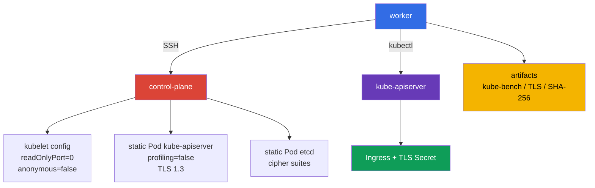

[Русская версия](README_RU.MD) · [Eng version](README.MD) · [Versión en español](README_ES.MD) · [Version française](README_FR.MD) · [Deutsche Version](README_DE.MD) · [ქართული ვერსია](README_GE.MD) · [繁體中文版](README_TW.MD)

# Lab 103 - CIS/kube-bench、Secure Ingress TLS、バイナリの検証

## 概要

この実習では、2 ノードの Kubernetes クラスター (control-plane + worker) を、セキュリティエンジニアとして設定します。`kube-bench` を実行し (worker ノードにはご自身でインストールします)、その検出結果に基づいて (記憶に頼らずに) control-plane コンポーネントと両ノードの kubelet の安全でないパラメータを修正し、Ingress を TLS のみで公開し、control plane の TLS を制限し、インストールされた Kubernetes バイナリの完全性を確認します。

これは CKA で扱う Kubernetes の基本設定の繰り返しではありません。ここで重要なのは、設定を適用する場所です：`KubeletConfiguration`、control plane の static Pod manifests、etcd の TLS パラメータ、そして検証可能な作業成果物。control plane ノードでの作業は、worker 上に用意された SSH 名 `control-plane` を使って行います。

## 目的

次のコース章の内容を定着させます：

- [第 07 章 CIS Benchmark と kube-bench](../../course/07/jp.md)
- [第 08 章 TLS を使った Secure Ingress](../../course/08/jp.md)
- [第 09 章 コンポーネントの安全でない引数とバイナリの検証](../../course/09/jp.md)

## 開始前のセルフチェック

<details>
<summary>1. Kubernetes 1.36 で kube-bench をプロファイル `cis-1.12` で実行しても、authoritative な CIS compliance とは呼べないのはなぜか？</summary>

この実習で固定されている `kube-bench 0.16.0` には、1.36 用のプロファイルがそもそも含まれていません - 組み込みの version mapping は `"1.34": "cis-1.12"` (利用可能な最新のプロファイル) までしかありません。クラスター 1.36 で明示的に `--benchmark cis-1.12` を指定することで、最も近い既存のプロファイルを approximation として強制的に使用することになります。一部のチェックは新しいバージョンには関係がない可能性があり、1.36 固有の新しい security-relevant なパラメータは、このプロファイルではまだカバーされていません。これは実用上価値のあるシグナルですが、バージョン 1.36 に対する formal compliance statement ではありません。
</details>

<details>
<summary>2. kube-apiserver の `--tls-cipher-suites` が、TLS 1.3 の暗号を設定しないのはなぜか？</summary>

Go (kube-apiserver が書かれている言語) では、フラグ `--tls-cipher-suites` が制御するのは TLS バージョン ≤ 1.2 の cipher suites だけです。TLS 1.3 では Go 自身が、fixed でハードコードされたリストから暗号の組を選択します - このフラグでそれらを設定することはできません。そのため、ここで実質的な保護を与えるのは `--tls-min-version=VersionTLS13` (古いプロトコルをすべて禁止する) であり、`--tls-cipher-suites` は TLS 1.2 がまだ許可される場所 (たとえばこの実習の etcd) で意味を持ちます。
</details>

<details>
<summary>3. 検証対象のファイル自体から計算したハッシュを、SHA-256 verification の基準として使ってはいけないのはなぜか？</summary>

ファイルの SHA-256 を計算して自分自身と比較すれば、検証は常に成功します - ファイルが悪意のあるものにすり替えられていたとしてもです。基準となる checksum は、独立した信頼できるソース - Kubernetes の公式リリースページ - から取得する必要があり、検証対象のローカルファイルから取得してはいけません。
</details>

## 何を作り、なぜ作るのか

| オブジェクトまたは成果物 | これは何か | この実習での役割 |
|---|---|---|
| `kube-bench` のレポート | control-plane の CIS チェックのスナップショット | 初期の推奨事項を記録し、hardening の根拠となる |
| Kubelet configuration | ノード上の kubelet の設定 | read-only endpoint と anonymous access を無効にする |
| Static Pod manifest apiserver | kube-apiserver の宣言 | profiling を無効にし、厳格な TLS を設定する |
| TLS Secret と Ingress | アプリケーションの TLS termination | Ingress は `secure.cks.local` の HTTPS のために TLS を終端し、ingress-nginx は通常の HTTP リクエストを `ssl-redirect` で HTTPS にリダイレクトする |
| Static Pod manifest etcd | ローカル etcd の宣言 | 許可される TLS cipher suites を制限する |
| SHA-256 成果物 | `kubelet` と `kubectl` の照合結果 | リリースのハッシュに対するバイナリの完全性を確認する |



## インフラ

環境は Terragrunt により AWS (`eu-central-1`) に展開されます。

| コンポーネント | 説明 |
|---|---|
| `vpc` | パブリックサブネットを持つ VPC `10.103.0.0/16` |
| `ssh-keys` | ノードへアクセスするための SSH キー |
| `k8s-1` | Kubernetes `1.36.0` (kubeadm)、containerd と Calico：control-plane + worker ノード 1 台 |
| `worker` | `kubectl`、SSH アクセス、`check_result` を備えた作業マシン (bastion) (`kube-bench` 自体はここでは不要です - すでに `control-plane` 上にあり、worker ノードには実習の途中でインストールします) |

> **バージョンと試験。** 2026-09-06 時点で、公式の CKS exam は Kubernetes `v1.35` を前提としています。この実習は `1.36.0` を使用するため、このバージョンに関することはすべて forward-looking な学習シナリオであり、現在の試験バージョンについての主張ではありません。

control-plane は taint が解除されているため、必要に応じて学習用の Pod を実行できます。
課題 3、5、9 では、static Pods は、変更された manifest を保存した後に kubelet によって自動的に再作成されます。課題 2 と 10 では、`KubeletConfiguration` を編集した後に kubelet を手動で再起動する必要があります (`systemctl restart kubelet`)。
control-plane の Pods を手動で削除しないでください。

## デプロイ

```bash
TASK=103 make run_cks_task
```

worker に SSH で接続します。コンテキストはすでに設定されています：

```bash
kubectl config use-context cluster1-admin@cluster1
time_left      # 実習の残り時間
check_result   # 自動テストを実行して結果を表示する
```

control-plane のアドレスは、次のように取得して確認できます：

```bash
kubectl get nodes -o wide
ssh control-plane hostname
```

## 課題

---

| **1** | **CIS Benchmark レポート** |
| :---: | :--- |
| やること | `control-plane` ノード上で、Kubernetes `1.36.0` に対して `kube-bench` を実行します。完全な evidence を `/var/work/tests/artifacts/1/kube-bench.txt` に保存します：`kubernetes_version`、`kube_bench_version`、選択した `benchmark`、`mapping_status`、続いてレポート本体。`kube-bench` は `control-plane` にすでにインストールされています (CIS Benchmark のツールがノード上にすでにある実際の試験と同様に) - インストールやコピーは不要で、チェックされるべきなのはまさにそのノードです。固定された `kube-bench 0.16.0` に組み込まれた version mapping は、エントリ `"1.34": "cis-1.12"` で終わっています - このバージョンには、それより新しいプロファイル (1.35/1.36 向けのプロファイルも含めて) はまったくありません。そのため、`--benchmark cis-1.12` を明示的に指定して実行し、`1.36` での結果を、authoritative compliance ではなく `forced-approximate` と明記してください。**`cis-1.12` の targets を完全なセットで実行してください：** `--targets master,node,controlplane,etcd,policies` - これは kube-bench がプロファイル `cis-1.12` に対応付ける targets のマップです；いずれかを省略すると不完全なレポートになります。`--targets` を明示しない場合、kube-bench は現在のノードの種類を自分で判定し、そのリスト全体ではなくより狭いセットを使います - `etcd` と `policies` はそのような auto-detected な実行には含まれないため、`--targets` を明示しないレポートは不完全になります。 |
| 受け入れ基準 | - evidence に 4 つの version/mapping フィールドがすべて含まれている；<br/>- `mapping_status=forced-approximate` が、`1.36` の公式カバレッジがないことを明示的に説明している；<br/>- レポートに、セクション `master`、`node`、`controlplane`、`etcd`、`policies` すべての結果がある (任意の `[PASS]`/`[WARN]`/`[FAIL]` の行だけではない)；<br/>- テキストが、その結果を Kubernetes `1.36` の authoritative CIS compliance として示していない。 |

<details>
<summary>💡 課題 1 のヒント</summary>

チェックは、ファイルの先頭に 4 つの具体的なマーカー行を期待します：`kubernetes_version=v1.36.x`、`kube_bench_version=v0.16.0`、`benchmark=cis-1.12`、`mapping_status=forced-approximate` - これは飾りのテキストではなく、テストがそのまま探す形式です。`kube-bench` は worker からリモートでではなく、control-plane node 自体で実行してください - kube-bench には「SSH 経由で他のノードをチェックする」モードはありません。`--targets master,node,controlplane,etcd,policies` を忘れないでください - targets を明示しないと、セクション `etcd` と `policies` がスキップされることがあります。`kube-bench` は標準のディレクトリ `/etc/kube-bench/cfg` に設定とともにすでにインストールされているため、この実習では `--config-dir` を指定する必要はありません - このフラグは、自分で `cfg` を別のディレクトリに置き、そのコピーへの実際のパスを渡す場合にのみ使用してください。
</details>

---

| **2** | **kubelet の hardening: read-only port と anonymous auth** |
| :---: | :--- |
| やること | control-plane 上で、kubelet の 2 つの安全でない設定を見つけて修正します：kubelet は認証なしの read-only ポートをまだ提供しており、匿名リクエストを受け付けています (kubelet の hardening の章を参照)。課題 1 の `kube-bench` のレポートを信頼できる情報源として使用します：同じノードの `node` セクションで、すでに両方の問題が指摘されています - そこでこれら 2 つのトピックの隣にある `[FAIL]` を見つけ、それを指針にしてください。`kubelet configuration` を修正し、kubelet を再起動して、ノードの準備ができるまで待ちます。チェックをテキストの成果物で代用しないでください：設定はノード上で適用されている必要があります。 |
| 受け入れ基準 | - 有効な kubelet configuration で read-only ポートが無効になっている；<br/>- kubelet の anonymous authentication が無効になっている；<br/>- 再起動後にノードが `Ready` である。 |

<details>
<summary>💡 課題 2 のヒント</summary>

課題 1 のレポートの `node` セクションで、checks `4.2.1` (`--anonymous-auth`) と `4.2.4` (`--read-only-port`) を探してください。`KubeletConfiguration` (`/var/lib/kubelet/config.yaml`) では、それぞれ `authentication.anonymous.enabled` と `readOnlyPort` に対応します - CIS は `authentication.anonymous.enabled: false` と `readOnlyPort: 0` を要求します。`authentication.anonymous.enabled` は、`authentication.anonymous` キーの下に入れ子で存在し、`anonymous: false` という独立した top-level フィールドではありません - YAML のインデントに十分注意してください。config.yaml を修正した後は kubelet サービス自体を再起動する必要があります (`systemctl restart kubelet`)。ファイルを編集しただけでは、動作中のプロセスには変更が適用されません。
</details>

---

| **3** | **kube-apiserver の hardening: profiling を無効にする** |
| :---: | :--- |
| やること | kube-apiserver は、プロセスのプロファイリング用の pprof HTTP endpoint を現在も提供しています。課題 1 の `kube-bench` のレポートを信頼できる情報源として使用します：同じノードの `master` セクションで、すでにこの問題が指摘されています - そこでこのトピックの隣にある `[FAIL]` を見つけ、それを指針にしてください。kube-apiserver の static Pod manifest を修正し、再作成を待って、API の準備ができていることを確認します。 |
| 受け入れ基準 | - 実際に実行されている kube-apiserver Pod の `command` に `--profiling=false` が含まれている (ディスク上のファイルのテキストではなく、API 経由で確認される)；<br/>- `kubectl get --raw='/readyz'` が成功した結果を返す；<br/>- static Pod kube-apiserver が実行中である。 |

<details>
<summary>💡 課題 3 のヒント</summary>

課題 1 のレポートの `master` セクションで、check `1.2.15` (`--profiling`) を探してください。これには、static Pod manifest `/etc/kubernetes/manifests/kube-apiserver.yaml` の `command` にあるフラグ `--profiling=false` が対応します。Pod を `kubectl edit` で編集しないでください - これは static Pod であり、kubelet はディスク上の manifest ファイルから直接管理しており、API 経由の変更はすべてファイルの内容で上書きされ、元に戻されます。フラグをノード上の YAML ファイルに直接追加し、待ってください：kubelet がファイルの変更に気づくのは瞬時ではありません。
</details>

---

| **4** | **TLS を使った Secure Ingress** |
| :---: | :--- |
| やること | • `secure.cks.local` の自己署名証明書を、この名前を CN だけでなく Subject Alternative Name に含めて生成します (コマンドはヒントにあります)。<br/>• namespace `cks-103` を作成し、この証明書から `kubernetes.io/tls` タイプの TLS-Secret `secure-ingress-tls` を作成します。<br/>• Deployment `secure-app` (`viktoruj/ping_pong:alpine`、`kubectl set env` による `SERVER_NAME=secure-app` と `SRV_PORT=80`) と Service `secure-app` をデプロイします。<br/>• `ingressClassName: nginx`、このホスト向けで `secure-ingress-tls` を参照する TLS セクション、アノテーション `nginx.ingress.kubernetes.io/ssl-redirect: "true"` を持つ Ingress `secure-ingress` を作成します。<br/>• `ingress-nginx` controller は、この実習では lab-owned fixture としてすでにインストールされ Ready になっています (その retirement については [第 08 章](../../course/08/jp.md) を参照) - それが実際にあなたの Ingress を処理していることを確認してください (受け入れ基準を参照)。 |
| 受け入れ基準 | - `cks-103` の Secret `secure-ingress-tls` のタイプが `kubernetes.io/tls` で、フィールド `tls.crt`、`tls.key` を持つ；ペアの対応は public key で確認される (アルゴリズムに依存せず、RSA/modulus には結びつかない)；<br/>- 証明書の SAN に `secure.cks.local` が含まれている；<br/>- Ingress `secure-ingress` に `ingressClassName: nginx`、アノテーション `ssl-redirect: "true"`、ホスト `secure.cks.local` と `secure-ingress-tls` への参照を持つ `spec.tls`、backend `secure-app:80` が含まれている；<br/>- Service `secure-app` に実際の endpoint がある；<br/>- `ingress-nginx` controller が Ready である；<br/>- controller 経由の HTTPS リクエストが、本文に `Server Name: secure-app` を含む `200` を実際に返す (backend にアクセスしなくても controller 自身が返しうる単なる任意の `2xx`/`3xx` ではない)；<br/>- controller 経由の HTTP リクエストが、HTTPS ホスト `https://secure.cks.local` を指す `Location` ヘッダー付きの redirect を受け取る (任意の `3xx` ではない；ホストの後の path は必須ではない)。 |

<details>
<summary>💡 課題 4 のヒント</summary>

実際の試験では、通常は証明書があらかじめ発行されています - ここでは自分で生成する必要があります：

```bash
openssl req -x509 -nodes -newkey ec -pkeyopt ec_paramgen_curve:P-256 \
  -keyout tls.key -out tls.crt -days 30 \
  -subj "/CN=secure.cks.local" -addext "subjectAltName=DNS:secure.cks.local"
```

`-addext 'subjectAltName=DNS:secure.cks.local'` は必須です - 現代のクライアントと Ingress controller は、CN だけでなく SAN を確認します。TLS Secret は `kubectl create secret tls secure-ingress-tls --cert=tls.crt --key=tls.key` で作成してください - これにより正しい `type: kubernetes.io/tls` が自動的に設定され、データが base64 で正しくエンコードされます。Secret を手動でタイプ `Opaque` とキー `tls.crt`/`tls.key` で作成すると、データが技術的には有効であっても、`type` のテストは通りません。

certificate/private key のペアの確認は、RSA 固有の modulus ではなく public key で行います - これは RSA と EC/ECDSA のキーで同じように動作します：

```bash
cert_pub=$(kubectl -n cks-103 get secret secure-ingress-tls -o jsonpath='{.data.tls\.crt}' \
  | base64 -d | openssl x509 -pubkey -noout | openssl pkey -pubin -outform DER | sha256sum | awk '{print $1}')
key_pub=$(kubectl -n cks-103 get secret secure-ingress-tls -o jsonpath='{.data.tls\.key}' \
  | base64 -d | openssl pkey -pubout -outform DER | sha256sum | awk '{print $1}')
[[ -n "$cert_pub" && "$cert_pub" == "$key_pub" ]]
```

end-to-end の確認には、controller の `Endpoints` の Pod IP を使わないでください - 別の worker VM から確実にルーティングされるとは限りません。`secure.cks.local` はすでに実際の node IP に解決され (このマシンの `/etc/hosts` に bootstrap 時にエントリが追加されています)、`ingress-nginx-controller` はすべてのノードで公開されている `NodePort` タイプの Service なので、クラスターへ SSH することなく、worker から直接リクエストを実行できます：

```bash
HTTPS_NODEPORT=$(kubectl -n ingress-nginx get svc ingress-nginx-controller -o jsonpath='{.spec.ports[?(@.port==443)].nodePort}')
curl -sS -k --max-time 5 "https://secure.cks.local:${HTTPS_NODEPORT}/"
```

HTTP→HTTPS redirect の確認は、この実習が作り出した人為的な要件ではなく、実際の試験の問題です (mock-exam `tasks/cks/mock/04`、課題 4 を参照：`Create an Ingress with a redirect from HTTP to HTTPS`)。
</details>

---

| **5** | **control plane の TLS hardening** |
| :---: | :--- |
| やること | `/etc/kubernetes/manifests/kube-apiserver.yaml` で `--tls-min-version=VersionTLS13` と `--tls-cipher-suites=TLS_ECDHE_RSA_WITH_AES_128_GCM_SHA256,TLS_ECDHE_RSA_WITH_AES_256_GCM_SHA384` を設定します。`/etc/kubernetes/manifests/etcd.yaml` で、同じセットの `--cipher-suites` を設定します。コンポーネントの再作成後、`TLSv1.3` がネゴシエートされること (`openssl s_client -tls1_3`)、および `TLSv1.2` が拒否されること (`openssl s_client -tls1_2` が handshake エラーで終了する) を確認し、出力を `/var/work/tests/artifacts/5/tls13.txt` に保存します。セマンティクスを理解することが重要です：Go では、フラグ `--tls-cipher-suites` は TLS ≤ 1.2 にのみ作用し、`--tls-min-version=VersionTLS13` の場合、具体的な TLS 1.3 の cipher suites はこのフラグでは設定されません (Go が自分で選択します)。そのため、kube-apiserver で実質的な保護を与えるのは、まさに min-version 1.3 です；cipher-suites は、TLS 1.2 が許可される場所 (たとえば etcd) で意味を持ちます。 |
| 受け入れ基準 | - 必要な両方の TLS フラグが kube-apiserver の manifest にある；<br/>- cipher suites が etcd の manifest にある；<br/>- kube-apiserver と etcd が正常である；<br/>- TLS 成果物に `TLSv1.3` の確認と、TLS 1.2 の拒否の記録 (non-zero exit/handshake failure) が含まれている。 |

<details>
<summary>💡 課題 5 のヒント</summary>

etcd のフラグは `--cipher-suites` という名前です (先頭に `tls-` が付きません) - これは kube-apiserver の `--tls-cipher-suites` とは異なる名前のフラグです。フラグ名の取り違えはよくある間違いです。2 つの別々のコマンド `openssl s_client -connect <host>:6443 -tls1_3` (正常に接続できる必要があります) と `-tls1_2` (handshake エラーで終了する必要があります) で確認してください - どちらも etcd ではなく kube-apiserver のポートに対して実行します。
</details>

---

| **6** | **kubelet と kubectl の完全性の確認** |
| :---: | :--- |
| やること | control-plane にインストールされている `kubelet` と、worker にインストールされている `kubectl` の SHA-256 を、公開されている Kubernetes `v1.36.0` の checksum と照合します。コマンドと `sha256sum -c` の結果を `/var/work/tests/artifacts/6/binaries.sha256.txt` に保存します。検証対象のファイルから計算したハッシュを基準として使用しないでください。 |
| 受け入れ基準 | - 成果物が存在する；<br/>- `kubelet` と `kubectl` それぞれの成功した結果 (`OK`) が個別に含まれている；<br/>- 基準となるチェックサムが公式の release `v1.36.0` から取得されている。 |

<details>
<summary>💡 課題 6 のヒント</summary>

`https://dl.k8s.io/release/v1.36.0/bin/linux/amd64/` (または対応するプラットフォーム) から公式ファイル `kubelet.sha256`/`kubectl.sha256` をダウンロードし、そのファイルを使って、実際にインストールされているバイナリに対して `sha256sum -c` を実行してください - 成果物に必要なのは、ハッシュそのものではなく、このコマンドの出力 (`kubelet: OK`、`kubectl: OK`) です。
</details>

---

| **7** | **Remediation cycle: 具体的な kube-bench の FAIL から PASS へ** |
| :---: | :--- |
| やること | 課題 1 のレポートは現在の状態のスナップショットです；ここでは、失敗した 1 つの具体的なテストと、その修正を結びつける必要があります。control-plane で `kube-bench` をまさに `--check 1.1.1` (static Pod manifest kube-apiserver のパーミッション；ラボのインフラは意図的に mode `0644` を設定しており、`cis-1.12` は `600` かそれより厳しい設定を要求します) で実行し、修正**前**の出力を `/var/work/tests/artifacts/7/before.txt` に保存します - このテストに対する `[FAIL]` が含まれている必要があります。ファイル `/etc/kubernetes/manifests/kube-apiserver.yaml` のアクセス権を修正し (`chmod 600`)、同じ `--check 1.1.1` を再度実行して、出力を `/var/work/tests/artifacts/7/after.txt` に保存します - この check に対する `[FAIL]` が 1 つもなく、`[PASS]` が含まれている必要があります。 |
| 受け入れ基準 | `before.txt` に check `1.1.1` の `[FAIL]` 行が含まれている；修正後のノード上のファイルの実際のパーミッションがちょうど `600` である；`after.txt` に check `1.1.1` の `[PASS]` が含まれ、それに対する `[FAIL]` が含まれていない；変更後も kube-apiserver が正常なままである (fs-only の修正で、コンポーネントは再作成されない)。 |

<details>
<summary>💡 課題 7 のヒント</summary>

この課題は、最終的な状態だけでなく、操作の順序についてのものです：まず `[FAIL]` を記録し (before.txt)、その後で初めて `chmod 600` を行い、再度チェックを実行します (after.txt)。before.txt を保存する前に `chmod` を行うと、最初の成果物に必要な `[FAIL]` が得られません。ファイルのパーミッションの変更は fs-only の操作であり、manifest ファイル自体のパーミッションの変更では (内容の変更とは異なり) kubelet は static Pod を再作成しません。
</details>

---

| **8** | **Remediation cycle: kube-controller-manager、別のコンポーネントでの同じ手法** |
| :---: | :--- |
| やること | 課題 7 と同じことを、`kube-controller-manager` と別の check ID で行います：`--check 1.1.3` (static Pod manifest kube-controller-manager のパーミッション；ラボのインフラは意図的に mode `0644` を設定しています)。修正**前**の出力を `/var/work/tests/artifacts/8/before.txt` に保存し (`1.1.3` に対する `[FAIL]` が含まれている必要があります)、`chmod 600 /etc/kubernetes/manifests/kube-controller-manager.yaml` で修正し、その後、再実行の結果を `/var/work/tests/artifacts/8/after.txt` に保存します (`1.1.3` に対する `[FAIL]` がなく `[PASS]` が含まれている必要があります)。 |
| 受け入れ基準 | `before.txt` に check `1.1.3` の `[FAIL]` 行が含まれている；修正後のファイルのパーミッションがちょうど `600` である；`after.txt` に `1.1.3` の `[PASS]` が含まれ、それに対する `[FAIL]` が含まれていない；`kube-controller-manager` が `Running` のままである (fs-only の修正で、コンポーネントは再作成されない)。 |

<details>
<summary>💡 課題 8 のヒント</summary>

課題 7 と同じ操作の順序です：まず `[FAIL]` を持つ `before.txt`、次に `chmod`、そして `[PASS]` を持つ `after.txt`。古い CIS check ID を「記憶で」持ち越さないでください - 固定された `kube-bench 0.16.0`/プロファイル `cis-1.12` における `1.1.3` は、まさに kube-controller-manager の pod specification file のパーミッションです。修正する前に `--check 1.1.3` で確認してください。
</details>

---

| **9** | **Remediation cycle: kube-controller-manager と kube-scheduler の profiling** |
| :---: | :--- |
| やること | 課題 7-8 と同じ手法を、checks `1.3.2` (kube-controller-manager の profiling) と `1.4.1` (kube-scheduler の profiling) に対して行います - どちらも同じプロファイル `cis-1.12` の下にあり、明示的な `--targets` は不要です。`control-plane` で `kube-bench --check 1.3.2` と `--check 1.4.1` を実行し、修正**前**の出力を `/var/work/tests/artifacts/9/controller-manager-before.txt` と `.../scheduler-before.txt` に保存します - どちらにも `[FAIL]` が含まれている必要があります。課題 3 ですでに kube-apiserver の profiling は無効にされています；デフォルトでは kubeadm は `kube-controller-manager`/`kube-scheduler` の manifest に `--profiling=false` をそもそも追加しません。両方の static Pod manifests の `command` に `--profiling=false` を追加し、再作成を待って、同じ check を再度実行し、出力を `.../controller-manager-after.txt` と `.../scheduler-after.txt` に保存します - どちらにも `[FAIL]` が 1 つもなく、`[PASS]` が含まれている必要があります。 |
| 受け入れ基準 | `before` ファイルにはそれぞれ `1.3.2`/`1.4.1` の `[FAIL]` が含まれている；実際に実行されている `kube-controller-manager`/`kube-scheduler` の Pod の `command` に `--profiling=false` が含まれている (API 経由で確認される)；`after` ファイルには同じ check の `[PASS]` が含まれ、`[FAIL]` は含まれていない；両方の Pod が `Running` フェーズである。 |

<details>
<summary>💡 課題 9 のヒント</summary>

課題 7-8 と同じ操作の順序です：まず `[FAIL]` を持つ `before.txt`、次に manifest の修正、そして `[PASS]` を持つ `after.txt`。Pod を `kubectl edit` で編集しないでください - kubelet はそのような変更をすべて、ディスク上のファイルから上書きします。フラグをノード上の YAML に直接追加し、再作成を待ってください - それは瞬時には行われません。この課題を `protectKernelDefaults` (課題 10、worker ノードの別の kubelet パラメータ) と混同しないでください - ここで扱うのは、control-plane コンポーネントの HTTP profiling endpoint です。
</details>

---

| **10** | **Remediation cycle: worker ノードでの protect-kernel-defaults** |
| :---: | :--- |
| やること | 課題 7-9 と同じ手法を、今度はクラスターの実際の worker ノード (control-plane ではない) で、ただし別のプロファイルに対して行います：固定された `cis-1.12` (この実習のあらゆる場所で使用) には、check protect-kernel-defaults はそもそも含まれていません - CIS はこのバージョンのプロファイルでそれを削除/番号変更しており、`cis-1.12` の `4.2.6` 自体は別の check です (`--make-iptables-util-chains`、デフォルトで PASS)。必要な同じ ID の check は、同じバイナリのより古いプロファイル `cis-1.24` に存在します - この課題に限り、`--benchmark cis-1.24 --check 4.2.6` を明示的に使用してください。`control-plane` とは異なり、worker ノードには `kube-bench` は事前にインストールされていません - ここで自分でインストールしてください (実際のインストール：同じ固定リリースをダウンロードし、`binary` と `cfg` を展開する)。どこかからコピーしないでください。修正**前**の出力を `/var/work/tests/artifacts/10/before.txt` に保存します (protect-kernel-defaults についてのテキストを持つ `[FAIL]` が含まれている必要があります)。worker ノードの kubeadm が生成した `KubeletConfiguration` には、フィールド `protectKernelDefaults` がそもそも含まれていません (安全でないデフォルトの `false` と同等) - このノードの `/var/lib/kubelet/config.yaml` に `protectKernelDefaults: true` を追加し、kubelet を再起動し、`Ready` を待って、同じ check (同じ `cis-1.24`) を再度実行し、`/var/work/tests/artifacts/10/after.txt` を保存します (`[PASS]` が含まれている必要があります)。 |
| 受け入れ基準 | `before.txt` に、protect-kernel-defaults についてのテキストを持つ `[FAIL] 4.2.6` が含まれている (任意の `4.2.6` ではない)；worker ノードの有効な kubelet configuration (`/configz`) に `protectKernelDefaults: true` がある；`after.txt` に、同じテキストを持つ `[PASS] 4.2.6` が含まれ、`[FAIL]` は含まれていない；再起動後に worker ノードが `Ready` である。 |

<details>
<summary>💡 課題 10 のヒント</summary>

worker ノードの名前は `kubectl get nodes -l '!node-role.kubernetes.io/control-plane'` で見つけてください - これは control-plane ではなく、コマンドを実行している作業マシン (bastion) でもありません。そのノードに `kube-bench` を、実際のコマンド (`curl` + `tar` + `install`) でインストールしてください。control-plane や worker PC からのコピーではいけません - control-plane とは異なり、ここにはインストールのプロセス自体を一度体験してもらうために、あえて入っていません。`--benchmark cis-1.24` を忘れないでください (他のすべての課題で使われている `cis-1.12` ではありません) - そうしないと `--check 4.2.6` は別の、すでに通過している check を見つけてしまい、この課題は何も実証しません。kubeadm が生成した `config.yaml` にはフィールド `protectKernelDefaults` が物理的に存在しないため、単に追記してください。置換する既存の行を探さないでください (課題 2 の `readOnlyPort` とは異なります)。worker ノードで `systemctl restart kubelet` した後は、check を再実行する前に `Ready` に戻るのを待ってください。
</details>

---

## 結果のチェック

worker で次を実行します：

```bash
check_result
```

チェックには Init と 10 個の独立した課題が含まれます。システム課題は、API オブジェクトだけでなく、
SSH 経由での control plane/worker ノードの状態と成果物によっても確認されます。

## 解答

参考解答：[worker/files/solutions/1_JP.MD](worker/files/solutions/1_JP.MD)。

## クラスターとリソースの削除

```bash
TASK=103 make delete_cks_task
```
