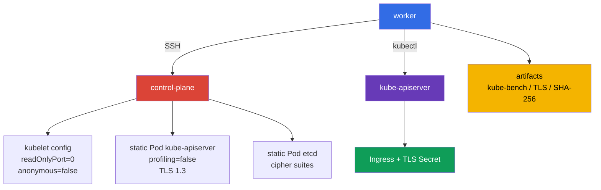

[Русская версия](README_RU.MD) · [Eng version](README.MD) · [Versión en español](README_ES.MD) · [Version française](README_FR.MD) · [Deutsche Version](README_DE.MD) · [ქართული ვერსია](README_GE.MD) · [日本語版](README_JP.MD)

# Lab 103 - CIS/kube-bench、Secure Ingress TLS 與二進位檔驗證

## 說明

在這個實驗中,你要以資安工程師的身分設定一個雙節點的 Kubernetes 叢集(control-plane +
worker):安裝 `kube-bench`,並依據它的發現(而不是憑記憶)修正 control-plane 元件與 worker 節點上 kubelet 的不安全參數,
只透過 TLS 發布 Ingress,限制 control plane 的 TLS,
並確認已安裝的 Kubernetes 二進位檔的完整性。

這不是對 CKA 中 Kubernetes 基本設定的重複。這裡重要的是設定被套用的位置:
`KubeletConfiguration`、control plane 的 static Pod manifests、etcd 的 TLS 參數,
以及可驗證的工作成果。請透過在 worker 上準備好的 SSH 名稱
`control-plane` 來操作 control plane 節點。

## 目標

鞏固以下課程章節的內容:

- [第 07 章。CIS Benchmark 與 kube-bench](../../course/07/tw.md)
- [第 08 章。帶有 TLS 的 Secure Ingress](../../course/08/tw.md)
- [第 09 章。元件的不安全參數與二進位檔驗證](../../course/09/tw.md)

## 開始前先自我檢查

<details>
<summary>1. 為什麼在 Kubernetes 1.36 上用 `cis-1.12` profile 執行 kube-bench,不能稱為 authoritative CIS compliance?</summary>

本實驗固定使用的 `kube-bench 0.16.0` 版本完全沒有 1.36 的 profile - 它內建的 version mapping 只到 `"1.34": "cis-1.12"`(目前可用的最新 profile)。在 1.36 的叢集上明確指定 `--benchmark cis-1.12`,是強制使用最接近的現有 profile 作為 approximation:部分檢查對較新的版本可能已不適用,而針對 1.36 才有的新 security-relevant 參數,這個 profile 還沒有涵蓋。這是有價值的實務訊號,但不是針對 1.36 版本的 formal compliance statement。
</details>

<details>
<summary>2. 為什麼 kube-apiserver 上的 `--tls-cipher-suites` 無法設定 TLS 1.3 的加密套件?</summary>

在 Go(kube-apiserver 就是用它寫的)中,`--tls-cipher-suites` 旗標只管理 TLS ≤ 1.2 版本的 cipher suites。對於 TLS 1.3,Go 會自己從固定、寫死的清單中選擇加密套件 - 無法透過這個旗標設定。因此這裡真正提供防護的是 `--tls-min-version=VersionTLS13`(整體禁止較舊的協定),而 `--tls-cipher-suites` 則在仍允許 TLS 1.2 的地方才有意義(例如本實驗中的 etcd)。
</details>

<details>
<summary>3. 為什麼不能使用從被檢查的檔案本身計算出的雜湊值,作為 SHA-256 verification 的基準?</summary>

如果計算檔案的 SHA-256 再與它自己比較,檢查永遠會通過 - 即使檔案已被替換成惡意內容。基準 checksum 必須取自獨立、可信的來源 - Kubernetes 的官方 release 頁面,而不是你正在檢查的本機檔案。
</details>

## 我們要建立什麼,以及為什麼

| 物件或 artifact | 這是什麼 | 為什麼出現在這個實驗中 |
|---|---|---|
| `kube-bench` 報告 | control-plane 的 CIS 檢查快照 | 記錄最初的建議,並作為 hardening 的依據 |
| Kubelet configuration | 節點上 kubelet 的設定 | 停用 read-only endpoint 與 anonymous access |
| Static Pod manifest apiserver | kube-apiserver 的宣告 | 停用 profiling 並設定嚴格的 TLS |
| TLS Secret 與 Ingress | 應用程式的 TLS termination | Ingress 在 `secure.cks.local` 上為 HTTPS 終結 TLS,而 ingress-nginx 透過 `ssl-redirect` 把一般 HTTP 請求重新導向到 HTTPS |
| Static Pod manifest etcd | 本機 etcd 的宣告 | 限制允許的 TLS cipher suites |
| SHA-256 artifact | `kubelet` 與 `kubectl` 的比對結果 | 對照 release 的雜湊值,確認二進位檔的完整性 |



## 基礎架構

環境透過 Terragrunt 部署在 AWS(`eu-central-1`)。

| 元件 | 說明 |
|---|---|
| `vpc` | VPC `10.103.0.0/16`,含公有子網路 |
| `ssh-keys` | 用於存取節點的 SSH 金鑰 |
| `k8s-1` | Kubernetes `1.36.0`(kubeadm)、containerd 與 Calico:control-plane + 一個 worker 節點 |
| `worker` | 工作機(bastion),具備 `kubectl`、SSH 存取與 `check_result`(這裡不需要 `kube-bench` 本身 - 它已經在 `control-plane` 上,並會在實驗過程中安裝到 worker 節點上) |

> **版本與考試。** 截至 2026-09-06,官方 CKS exam 以 Kubernetes `v1.35` 為準。本實驗使用 `1.36.0`,因此所有與該版本相關的內容,都是 forward-looking 的學習情境,而不是對目前考試版本的聲明。

control-plane 上的 taint 已移除,因此必要時可以在上面執行學習用的 Pod。
對於任務 2、3 與 5,在儲存修改後的 manifest 或設定之後,static Pods 會由 kubelet 自動重新建立。
請不要手動刪除 control-plane 的 Pods。

## 部署

```bash
TASK=103 make run_cks_task
```

透過 SSH 連線到 worker。context 已經設定好:

```bash
kubectl config use-context cluster1-admin@cluster1
time_left      # 實驗還剩多少時間
check_result   # 執行自動測試並顯示結果
```

control-plane 的位址可以這樣取得並檢查:

```bash
kubectl get nodes -o wide
ssh control-plane hostname
```

## 任務

---

| **1** | **CIS Benchmark 報告** |
| :---: | :--- |
| 要做什麼 | 在 `control-plane` 節點上對 Kubernetes `1.36.0` 執行 `kube-bench`。將完整的 evidence 儲存到 `/var/work/tests/artifacts/1/kube-bench.txt`:`kubernetes_version`、`kube_bench_version`、選用的 `benchmark`、`mapping_status`,然後是報告本身。`kube-bench` 已經安裝在 `control-plane` 上(就像真正的考試中,節點上已經有 CIS Benchmark 工具一樣)- 不需要安裝或複製它,要檢查的正是這個節點。固定版本 `kube-bench 0.16.0` 內建的 version mapping 以 `"1.34": "cis-1.12"` 這筆記錄結束 - 這個版本中完全沒有更新的 profile(包括任何 1.35/1.36 的 profile)。因此請明確執行 `--benchmark cis-1.12`,並把 `1.36` 上的結果標記為 `forced-approximate`,而不是 authoritative compliance。**請執行 `cis-1.12` 的完整 targets 集合:** `--targets master,node,controlplane,etcd,policies` - 這是 kube-bench 對應到 `cis-1.12` profile 的 targets 對照表;漏掉其中任何一個都會得到不完整的報告。沒有明確的 `--targets` 時,kube-bench 會自己判斷目前節點的類型,並為它選取的不是整份清單,而是範圍更窄的一組 - `etcd` 與 `policies` 不會出現在這種自動偵測的執行中,因此沒有明確 `--targets` 的報告會是不完整的。 |
| 驗收標準 | - evidence 包含全部四個 version/mapping 欄位;<br/>- `mapping_status=forced-approximate` 明確說明了為什麼沒有 `1.36` 的官方涵蓋;<br/>- 報告中有 `master`、`node`、`controlplane`、`etcd`、`policies` 所有區段的結果(而不只是任意一行 `[PASS]`/`[WARN]`/`[FAIL]`);<br/>- 文字沒有把結果說成是 Kubernetes `1.36` 的 authoritative CIS compliance。 |

<details>
<summary>💡 任務 1 的提示</summary>

檢查預期檔案開頭有四行具體的標記字串:`kubernetes_version=v1.36.x`、`kube_bench_version=v0.16.0`、`benchmark=cis-1.12`、`mapping_status=forced-approximate` - 這不是裝飾性的文字,而是測試逐字尋找的格式。請在 control-plane node 本身上執行 `kube-bench`,而不是從 worker 遠端執行 - kube-bench 沒有「透過 SSH 檢查別的節點」的模式。別忘了 `--targets master,node,controlplane,etcd,policies` - 沒有明確指定 targets,`etcd` 與 `policies` 區段可能會被跳過。`kube-bench` 已經連同設定一起安裝在它的標準目錄 `/etc/kube-bench/cfg`,因此在本實驗中不需要指定 `--config-dir` - 只有在你自己把 `cfg` 放在其他目錄,並傳入該副本的實際路徑時,才使用這個旗標。
</details>

---

| **2** | **Hardening kubelet:read-only port 與 anonymous auth** |
| :---: | :--- |
| 要做什麼 | 在 control-plane 上找出並修正 kubelet 的兩個不安全設定:它仍然提供沒有驗證的 read-only 埠,並接受匿名請求(參見關於 kubelet hardening 的章節)。請以任務 1 的 `kube-bench` 報告作為真相來源:它已經在同一個節點的 `node` 區段中標記了這兩個問題 - 請在那裡找到這兩個主題旁邊的 `[FAIL]`,並以它們為準。修正 `kubelet configuration`,重新啟動 kubelet,並等待節點就緒。不要用文字 artifact 取代檢查:設定必須實際套用在節點上。 |
| 驗收標準 | - 在生效的 kubelet configuration 中,read-only 埠已停用;<br/>- kubelet 的 anonymous authentication 已停用;<br/>- 重新啟動後節點為 `Ready`。 |

<details>
<summary>💡 任務 2 的提示</summary>

請在任務 1 的報告中,於 `node` 區段尋找 checks `4.2.1`(`--anonymous-auth`)與 `4.2.4`(`--read-only-port`)。在 `KubeletConfiguration`(`/var/lib/kubelet/config.yaml`)中,它們對應 `authentication.anonymous.enabled` 與 `readOnlyPort` - CIS 要求 `authentication.anonymous.enabled: false` 與 `readOnlyPort: 0`。`authentication.anonymous.enabled` 是「巢狀」位於 `authentication.anonymous` 鍵之下,而不是獨立的 top-level 欄位 `anonymous: false` - 請仔細檢查 YAML 的縮排。修改 config.yaml 之後,必須重新啟動 kubelet 服務本身(`systemctl restart kubelet`),只編輯檔案並不會把變更套用到正在執行的行程。
</details>

---

| **3** | **Hardening kube-apiserver:停用 profiling** |
| :---: | :--- |
| 要做什麼 | kube-apiserver 到現在仍然提供 pprof HTTP 行程分析 endpoint。請以任務 1 的 `kube-bench` 報告作為真相來源:它已經在同一個節點的 `master` 區段中標記了這個問題 - 請在那裡找到這個主題旁邊的 `[FAIL]`,並以它為準。修正 kube-apiserver 的 static Pod manifest,等待重新建立,並確認 API 已就緒。 |
| 驗收標準 | - 實際執行中的 kube-apiserver Pod 在它的 `command` 中包含 `--profiling=false`(透過 API 檢查,而不是檢查磁碟上檔案的文字);<br/>- `kubectl get --raw='/readyz'` 回傳成功的結果;<br/>- static Pod kube-apiserver 正在執行。 |

<details>
<summary>💡 任務 3 的提示</summary>

請在任務 1 的報告中,於 `master` 區段尋找 check `1.2.15`(`--profiling`)。它對應 static Pod manifest `/etc/kubernetes/manifests/kube-apiserver.yaml` 的 `command` 中的旗標 `--profiling=false`。不要透過 `kubectl edit` 編輯這個 Pod - 它是 static Pod,kubelet 直接從磁碟上的 manifest 檔案管理它,並會把任何透過 API 做的變更覆寫回去。請直接在節點上的 YAML 檔案中加入旗標並等待:kubelet 不會立刻注意到檔案的變更。
</details>

---

| **4** | **帶有 TLS 的 Secure Ingress** |
| :---: | :--- |
| 要做什麼 | • 為 `secure.cks.local` 產生自簽憑證,並且這個名稱必須放在 Subject Alternative Name 中,而不只是 CN(指令在提示中)。<br/>• 建立 namespace `cks-103`,並用這個憑證建立 `kubernetes.io/tls` 類型的 TLS-Secret `secure-ingress-tls`。<br/>• 部署 Deployment `secure-app`(`viktoruj/ping_pong:alpine`,透過 `kubectl set env` 設定 `SERVER_NAME=secure-app` 與 `SRV_PORT=80`)以及 Service `secure-app`。<br/>• 建立 Ingress `secure-ingress`,帶有 `ingressClassName: nginx`、針對這個 host 並引用 `secure-ingress-tls` 的 TLS 區段,以及 annotation `nginx.ingress.kubernetes.io/ssl-redirect: "true"`。<br/>• `ingress-nginx` controller 在本實驗中已作為 lab-owned fixture 安裝並處於 Ready(關於它的 retirement,參見 [第 08 章](../../course/08/tw.md))- 請確認它確實處理了你的 Ingress(參見驗收標準)。 |
| 驗收標準 | - `cks-103` 中的 Secret `secure-ingress-tls` 類型為 `kubernetes.io/tls`,並具有 `tls.crt`、`tls.key` 欄位;憑證與金鑰是否成對,是依據 public key 檢查的(與演算法無關,不綁定 RSA/modulus);<br/>- 憑證的 SAN 中包含 `secure.cks.local`;<br/>- Ingress `secure-ingress` 包含 `ingressClassName: nginx`、annotation `ssl-redirect: "true"`、帶有 host `secure.cks.local` 並引用 `secure-ingress-tls` 的 `spec.tls`、backend `secure-app:80`;<br/>- Service `secure-app` 有真實的 endpoint;<br/>- `ingress-nginx` controller 為 Ready;<br/>- 透過 controller 的 HTTPS 請求確實回傳 `200`,且內容包含 `Server Name: secure-app`(而不是任何 `2xx`/`3xx`,因為 controller 在連不到 backend 的情況下也可能自己回傳這些);<br/>- 透過 controller 的 HTTP 請求會收到帶有 `Location` 標頭的 redirect,指向 HTTPS-host `https://secure.cks.local`(不是任意的 `3xx`;host 之後的路徑可有可無)。 |

<details>
<summary>💡 任務 4 的提示</summary>

在真正的考試中,憑證通常已經事先發好 - 這裡需要你自己產生:

```bash
openssl req -x509 -nodes -newkey ec -pkeyopt ec_paramgen_curve:P-256 \
  -keyout tls.key -out tls.crt -days 30 \
  -subj "/CN=secure.cks.local" -addext "subjectAltName=DNS:secure.cks.local"
```

`-addext 'subjectAltName=DNS:secure.cks.local'` 是必須的 - 現代的用戶端與 Ingress controller 檢查的是 SAN,而不只是 CN。請透過 `kubectl create secret tls secure-ingress-tls --cert=tls.crt --key=tls.key` 建立 TLS Secret - 這會自動設定正確的 `type: kubernetes.io/tls`,並正確地以 base64 編碼資料。如果手動建立類型為 `Opaque`、鍵為 `tls.crt`/`tls.key` 的 Secret,即使資料在技術上有效,針對 `type` 的測試也不會通過。

憑證/私鑰是否成對,是依據 public key 檢查的,而不是 RSA 專屬的 modulus - 這對 RSA 與 EC/ECDSA 金鑰的作用相同:

```bash
cert_pub=$(kubectl -n cks-103 get secret secure-ingress-tls -o jsonpath='{.data.tls\.crt}' \
  | base64 -d | openssl x509 -pubkey -noout | openssl pkey -pubin -outform DER | sha256sum | awk '{print $1}')
key_pub=$(kubectl -n cks-103 get secret secure-ingress-tls -o jsonpath='{.data.tls\.key}' \
  | base64 -d | openssl pkey -pubout -outform DER | sha256sum | awk '{print $1}')
[[ -n "$cert_pub" && "$cert_pub" == "$key_pub" ]]
```

進行 end-to-end 檢查時,請不要使用 controller 的 `Endpoints` 中的 Pod IP - 它不保證能從獨立的 worker VM 路由到。`secure.cks.local` 已經解析為真實的節點 IP(該記錄在 bootstrap 時被加入這台機器的 `/etc/hosts`),而 `ingress-nginx-controller` 是類型為 `NodePort` 的 Service,在每個節點上都開放,因此可以直接在 worker 上發出請求,不需要 SSH 到叢集:

```bash
HTTPS_NODEPORT=$(kubectl -n ingress-nginx get svc ingress-nginx-controller -o jsonpath='{.spec.ports[?(@.port==443)].nodePort}')
curl -sS -k --max-time 5 "https://secure.cks.local:${HTTPS_NODEPORT}/"
```

檢查 HTTP→HTTPS redirect 並不是本實驗人為設置的要求,而是考試中的真實題目(參見 mock 考試 `tasks/cks/mock/04`,任務 4:`Create an Ingress with a redirect from HTTP to HTTPS`)。
</details>

---

| **5** | **TLS hardening control plane** |
| :---: | :--- |
| 要做什麼 | 在 `/etc/kubernetes/manifests/kube-apiserver.yaml` 中設定 `--tls-min-version=VersionTLS13` 與 `--tls-cipher-suites=TLS_ECDHE_RSA_WITH_AES_128_GCM_SHA256,TLS_ECDHE_RSA_WITH_AES_256_GCM_SHA384`。在 `/etc/kubernetes/manifests/etcd.yaml` 中以相同的集合設定 `--cipher-suites`。元件重新建立之後,確認協商出的是 `TLSv1.3`(`openssl s_client -tls1_3`),並且 `TLSv1.2` 被拒絕(`openssl s_client -tls1_2` 以 handshake 錯誤結束),並把輸出儲存到 `/var/work/tests/artifacts/5/tls13.txt`。重要的是要理解其語意:在 Go 中,旗標 `--tls-cipher-suites` 只對 TLS ≤ 1.2 有效,而在 `--tls-min-version=VersionTLS13` 時,具體的 TLS 1.3 cipher suites 不能透過這個旗標設定(Go 會自己選擇)。因此對 kube-apiserver 來說,這裡實際提供防護的正是 min-version 1.3;cipher-suites 則在允許 TLS 1.2 的地方才有意義(例如 etcd)。 |
| 驗收標準 | - 兩個必要的 TLS 旗標都在 kube-apiserver 的 manifest 中;<br/>- cipher suites 在 etcd 的 manifest 中;<br/>- kube-apiserver 與 etcd 都健康;<br/>- TLS artifact 包含 `TLSv1.3` 的確認,以及記錄下來的 TLS 1.2 被拒絕(non-zero exit/handshake failure)。 |

<details>
<summary>💡 任務 5 的提示</summary>

etcd 上的旗標叫 `--cipher-suites`(開頭沒有 `tls-`)- 它與 kube-apiserver 上的 `--tls-cipher-suites` 是「不同」的旗標名稱。把旗標名稱搞混是常見的錯誤。請用兩個獨立的指令自行檢查:`openssl s_client -connect <host>:6443 -tls1_3`(必須成功連線)與 `-tls1_2`(必須以 handshake 錯誤結束)- 兩者都是連到 kube-apiserver 的埠,而不是 etcd。
</details>

---

| **6** | **kubelet 與 kubectl 的完整性驗證** |
| :---: | :--- |
| 要做什麼 | 將 control-plane 上已安裝的 `kubelet` 與 worker 上已安裝的 `kubectl` 的 SHA-256,與 Kubernetes `v1.36.0` 公布的 checksum 比對。把指令與 `sha256sum -c` 的結果儲存到 `/var/work/tests/artifacts/6/binaries.sha256.txt`。不要把從被檢查的檔案計算出的雜湊值當作基準。 |
| 驗收標準 | - artifact 存在;<br/>- 其中有 `kubelet` 與 `kubectl` 各自獨立的成功結果(`OK`);<br/>- 基準總和取自官方 release `v1.36.0`。 |

<details>
<summary>💡 任務 6 的提示</summary>

從 `https://dl.k8s.io/release/v1.36.0/bin/linux/amd64/`(或對應的平台)下載官方檔案 `kubelet.sha256`/`kubectl.sha256`,並用 `sha256sum -c` 以這個檔案對照實際安裝的二進位檔 - artifact 中需要的正是這個指令的輸出(`kubelet: OK`、`kubectl: OK`),而不只是雜湊值本身。
</details>

---

| **7** | **Remediation cycle:從具體的 kube-bench FAIL 到 PASS** |
| :---: | :--- |
| 要做什麼 | 任務 1 的報告是目前狀態的快照;這裡需要把一個具體失敗的測試與它的修正連結起來。在 control-plane 上以 `--check 1.1.1` 執行 `kube-bench`(kube-apiserver 的 static Pod manifest 的權限;實驗基礎架構刻意設定了 mode `0644`,`cis-1.12` 要求 `600` 或更嚴格),並把修正**之前**的輸出儲存到 `/var/work/tests/artifacts/7/before.txt` - 其中必須包含這個測試的 `[FAIL]`。修正檔案 `/etc/kubernetes/manifests/kube-apiserver.yaml` 的存取權限(`chmod 600`),然後重新執行同一個 `--check 1.1.1`,並把輸出儲存到 `/var/work/tests/artifacts/7/after.txt` - 其中必須包含 `[PASS]`,且這個 check 沒有任何一個 `[FAIL]`。 |
| 驗收標準 | `before.txt` 包含 check `1.1.1` 的 `[FAIL]` 行;修正後節點上檔案的實際權限恰好是 `600`;`after.txt` 包含 check `1.1.1` 的 `[PASS]`,且不含它的 `[FAIL]`;修改之後 kube-apiserver 仍然健康(fs-only 的修改,元件不會被重新建立)。 |

<details>
<summary>💡 任務 7 的提示</summary>

這個任務重點在於操作順序,而不只是最終狀態:先記錄 `[FAIL]`(before.txt),之後才做 `chmod 600`,然後再次執行檢查(after.txt)。如果在儲存 before.txt 之前就做了 `chmod`,你在第一個 artifact 中就得不到需要的 `[FAIL]`。修改檔案權限是 fs-only 的操作,kubelet 不會因為 manifest 檔案本身的權限變更而重新建立 static Pod(與修改它的內容不同)。
</details>

---

| **8** | **Remediation cycle:kube-controller-manager,對另一個元件使用同樣的做法** |
| :---: | :--- |
| 要做什麼 | 與任務 7 相同,但對象是 `kube-controller-manager` 與另一個 check ID:`--check 1.1.3`(kube-controller-manager 的 static Pod manifest 的權限;實驗基礎架構刻意設定了 mode `0644`)。把修正**之前**的輸出儲存到 `/var/work/tests/artifacts/8/before.txt`(必須包含 `1.1.3` 的 `[FAIL]`),修正 `chmod 600 /etc/kubernetes/manifests/kube-controller-manager.yaml`,然後把重新執行的結果儲存到 `/var/work/tests/artifacts/8/after.txt`(必須包含 `1.1.3` 的 `[PASS]`,且沒有 `[FAIL]`)。 |
| 驗收標準 | `before.txt` 包含 check `1.1.3` 的 `[FAIL]` 行;修正後檔案權限恰好是 `600`;`after.txt` 包含 `1.1.3` 的 `[PASS]`,且不含它的 `[FAIL]`;`kube-controller-manager` 仍然是 `Running`(fs-only 的修改,元件不會被重新建立)。 |

<details>
<summary>💡 任務 8 的提示</summary>

與任務 7 相同的操作順序:先有帶 `[FAIL]` 的 `before.txt`,然後 `chmod`,然後是帶 `[PASS]` 的 `after.txt`。不要「憑記憶」搬用舊的 CIS check ID - 在固定版本 `kube-bench 0.16.0`/profile `cis-1.12` 中,`1.1.3` 正是 kube-controller-manager pod specification file 的權限,請在修正之前先透過 `--check 1.1.3` 確認這一點。
</details>

---

| **9** | **Remediation cycle:kube-controller-manager 與 kube-scheduler 上的 profiling** |
| :---: | :--- |
| 要做什麼 | 與任務 7-8 相同的做法,針對 checks `1.3.2`(kube-controller-manager profiling)與 `1.4.1`(kube-scheduler profiling)- 兩者都在同一個 `cis-1.12` profile 之下,不需要明確的 `--targets`。在 `control-plane` 上執行 `kube-bench --check 1.3.2` 與 `--check 1.4.1`,並把修正**之前**的輸出分別儲存到 `/var/work/tests/artifacts/9/controller-manager-before.txt` 與 `.../scheduler-before.txt` - 兩者都必須包含 `[FAIL]`。任務 3 已經停用了 kube-apiserver 上的 profiling;kubeadm 預設根本不會在 `kube-controller-manager`/`kube-scheduler` 的 manifests 中加入 `--profiling=false`。請在兩個 static Pod manifests 的 `command` 中加入 `--profiling=false`,等待重新建立,並重新執行相同的 checks,把輸出儲存到 `.../controller-manager-after.txt` 與 `.../scheduler-after.txt` - 兩者都必須包含 `[PASS]`,且沒有任何一個 `[FAIL]`。 |
| 驗收標準 | `before` 檔案分別包含 `1.3.2`/`1.4.1` 的 `[FAIL]`;實際執行中的 Pod `kube-controller-manager`/`kube-scheduler` 在它們的 `command` 中包含 `--profiling=false`(透過 API 檢查);`after` 檔案包含相同 checks 的 `[PASS]`,且沒有 `[FAIL]`;兩個 Pod 都處於 `Running` 階段。 |

<details>
<summary>💡 任務 9 的提示</summary>

與任務 7-8 相同的操作順序:先有帶 `[FAIL]` 的 `before.txt`,然後修改 manifest,然後是帶 `[PASS]` 的 `after.txt`。不要透過 `kubectl edit` 編輯 Pod - kubelet 會根據磁碟上的檔案覆寫任何這類變更。請直接在節點上的 YAML 中加入旗標並等待重新建立 - 這不會立刻發生。不要把這個任務與 `protectKernelDefaults`(任務 10,worker 節點上單獨的 kubelet 參數)搞混 - 這裡說的正是 control-plane 元件的 HTTP profiling endpoint。
</details>

---

| **10** | **Remediation cycle:worker 節點上的 protect-kernel-defaults** |
| :---: | :--- |
| 要做什麼 | 與任務 7-9 相同的做法,這次是在叢集「真正的」worker 節點上(不是 control-plane),但針對「另一個」profile:固定的 `cis-1.12`(本實驗到處使用)完全不包含 protect-kernel-defaults 的 check - CIS 在這個版本的 profile 中把它移除/重新編號了,而 `cis-1.12` 中自己的 `4.2.6` 是另一個 check(`--make-iptables-util-chains`,預設為 PASS)。具有相同 ID 的所需 check 存在於同一個二進位檔較舊的 profile `cis-1.24` 中 - 只在這個任務中明確使用 `--benchmark cis-1.24 --check 4.2.6`。與 `control-plane` 不同,worker 節點上「沒有」預先安裝 `kube-bench` - 請在這裡自己安裝(真正的安裝:下載同一個固定的 release,解壓縮 `binary` 與 `cfg`),而不是從別處複製。把修正**之前**的輸出儲存到 `/var/work/tests/artifacts/10/before.txt`(必須包含帶有 protect-kernel-defaults 文字的 `[FAIL]`)。kubeadm 產生的 worker 節點上的 `KubeletConfiguration` 完全不包含 `protectKernelDefaults` 欄位(等同於不安全的預設值 `false`)- 請在這個節點的 `/var/lib/kubelet/config.yaml` 中加入 `protectKernelDefaults: true`,重新啟動 kubelet,等待 `Ready`,然後重新執行同一個 check(同樣使用 `cis-1.24`),並儲存 `/var/work/tests/artifacts/10/after.txt`(必須包含 `[PASS]`)。 |
| 驗收標準 | `before.txt` 包含帶有 protect-kernel-defaults 文字的 `[FAIL] 4.2.6`(不是任意的 `4.2.6`);在 worker 節點生效的 kubelet configuration(`/configz`)中有 `protectKernelDefaults: true`;`after.txt` 包含具有相同文字的 `[PASS] 4.2.6`,沒有 `[FAIL]`;重新啟動後 worker 節點為 `Ready`。 |

<details>
<summary>💡 任務 10 的提示</summary>

請透過 `kubectl get nodes -l '!node-role.kubernetes.io/control-plane'` 找出 worker 節點的名稱 - 它「不是」control-plane,也「不是」你用來執行指令的工作機(bastion)。請用真正的指令(`curl` + `tar` + `install`)在它上面安裝 `kube-bench`,而不是從 control-plane 或 worker PC 複製 - 與 control-plane 不同,這裡刻意沒有安裝它,讓你親自走過一次安裝流程。別忘了 `--benchmark cis-1.24`(不是其他任務中到處使用的 `cis-1.12`)- 否則 `--check 4.2.6` 會找到另一個已經通過的 check,而這個任務什麼也證明不了。kubeadm 產生的 `config.yaml` 中實際上沒有 `protectKernelDefaults` 欄位,因此直接把它補在後面,不要去找現有的行來取代(與任務 2 中的 `readOnlyPort` 不同)。在 worker 節點上執行 `systemctl restart kubelet` 之後,請等它回到 `Ready`,再重新執行 check。
</details>

---

## 檢查結果

在 worker 上執行:

```bash
check_result
```

檢查包含 Init 與十個獨立的任務。系統層級的任務是透過 SSH 依據 control plane/worker 節點的
狀態以及 artifacts 來檢查,而不只是檢查 API 物件。

## 解答

參考解答:[worker/files/solutions/1_TW.MD](worker/files/solutions/1_TW.MD)。

## 刪除叢集與資源

```bash
TASK=103 make delete_cks_task
```
