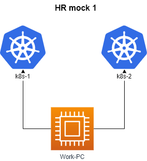

# HR Practice Scenario 01

## Deployment

Prepare AWS access, Terraform state storage, and the required tools using the [Docker quick start](../../../../docs/run_from_docker.MD). Run all `make` commands below from the **repository root on the controlling machine**. Check this mock's [env.hcl](env.hcl), including its region and instance settings, before deployment.

```bash
TASK=01 make run_hr_mock
```

To display the Terraform connection details again:

```bash
TASK=01 make output_hr_mock
```

## Connect and start working

Use the `worker_pc_ssh` value from the **worker** module, the workstation prepared for this mock exam. A password-enabled environment prints a value in this form:

```text
worker_pc_ssh = "ssh ubuntu@<IP> password=<PASSWORD>"
```

Use only the address in the SSH command:

```bash
ssh ubuntu@<IP>
```

Enter the printed password when prompted; `password=...` is output metadata, not part of the SSH command. If password authentication is disabled, use the SSH key configured for the environment, for example `ssh ubuntu@<IP> -i <key_path>`.

After connecting, wait for initialization to finish and reload the shell settings:

```bash
sudo cloud-init status --wait
source ~/.bashrc
```

Work from the workstation. Select the Kubernetes context named in each task; use `ssh <node_name>` from the workstation when a task requires access to a cluster node. Check the remaining time with:

```bash
time_left
```

Follow the questions below. If initialization reports an error, inspect `/var/log/cloud-init-output.log` before starting the tasks.

## Check the result

Run on the workstation:

```bash
check_result
```

After your attempt, review the [reference solutions](worker/files/solutions) and [automated checks](worker/files/tests.bats).

## Delete the environment

AWS resources are billed to your account. After practice, return to the **controlling machine and repository root**, then run:

```bash
TASK=01 make delete_hr_mock
```

<details>
<summary>Independent environments for multiple users or attempts</summary>

Use the same identifiers for launch, output, and deletion:

```bash
USER_ID='user1' ENV_ID='01' TASK=01 make run_hr_mock
USER_ID='user1' ENV_ID='01' TASK=01 make output_hr_mock
USER_ID='user1' ENV_ID='01' TASK=01 make delete_hr_mock
```

[More about independent environments and CMDB](../../../../docs/environments.md).

</details>

---

**This script is an example of a scenario that can be used as part of the interview screening process to hire employees for SRE (Site Reliability Engineer) and DevOps positions. The expected execution time should not exceed 25 minutes. The technology stack includes AWS, Kubernetes, Helm, and Prometheus.**

## Allowed resources

## **Kubernetes Documentation:**

<https://kubernetes.io/docs/> and their subdomains

<https://kubernetes.io/blog/> and their subdomains

<https://docs.aws.amazon.com/> and their subdomains

<https://prometheus.io/>  and their subdomains

<https://github.com/prometheus-community/helm-charts/>  and their subdomains

<https://github.com/prometheus-operator/prometheus-operator/tree/main/Documentation/user-guides/> and their subdomains



- run ``time_left`` on work pc to **check time**
- run ``check_result`` on work pc to **check result**
- time = **20 minutes**

## Questions

|        **1**        | **Using AWS CLI, get all ec2 instances with the tag `env_name=hr-mock`.**                                    |
| :-----------------: |:-------------------------------------------------------------------------------------------------------------|
|     Task weight     | 1%                                                                                                           |
|       Cluster       | -                                                                                                            |
| Acceptance criteria | - region: `eu-north-1` <br/>- output: `json`<br/>- save output to : `/var/work/tests/artifacts/1/ec2_1.json` |


|        **2**        | **Update deployment named `test-app` in ns = `dev-team`.**                    |
|:-------------------:|:--------------------------------------------------------------------------|
|     Task weight     | 1%                                                                        |
|       Cluster       | cluster2                                                                  |
| Acceptance criteria | - ns: `dev-team` <br/>- deployment name: `test-app`<br/>-  replicas: `4` <br/>-  image: `nginx:stable` |


|        **3**        | **Install helm  release  kube-prometheus-stack**                                                                                                                                                                                               |
|:-------------------:|:-----------------------------------------------------------------------------------------------------------------------------------------------------------------------------------------------------------------------------------------------|
|     Task weight     | 1%                                                                                                                                                                                                                                             |
|       Cluster       | cluster1                                                                                                                                                                                                                                       |
| Acceptance criteria | - ns: `monitoring` <br/>- release name : `kube-prometheus-stack`<br/>-  repository: `https://prometheus-community.github.io/helm-charts` <br/>-  version: `45.4.0` <br/>-  values file: `/var/work/tests/artifacts/kube-prometheus-stack.yaml` |


|        **4**        | **Create prometheus operator crd serviceMonitor**                                                                                                                                                                                             |
|:-------------------:|:----------------------------------------------------------------------------------------------------------------------------------------------------------------------------------------------------------------------------------------------|
|     Task weight     | 1%                                                                                                                                                                                                                                            |
|       Cluster       | cluster1                                                                                                                                                                                                                                      |
| Acceptance criteria | - ns: `prod` <br/>- service: `app`<br/>-  service.port: `metrics` <br/>-  for checking  result you can make  http request to   : `kube-prometheus-stack-prometheus.monitoring.svc.cluster.local:9090/api/v1/query?query=requests_per_second ` |


|        **5**        | **Get  nodes with the label `work_type=infra`**                                                                 |
|:-------------------:|:----------------------------------------------------------------------------------------------------------------|
|     Task weight     | 1%                                                                                                              |
|       Cluster       | cluster1                                                                                                        |
| Acceptance criteria | - node label: `work_type=infra` <br/>- format type: `json` <br/>-  save path : `/var/work/tests/artifacts/5/nodes.json` |
